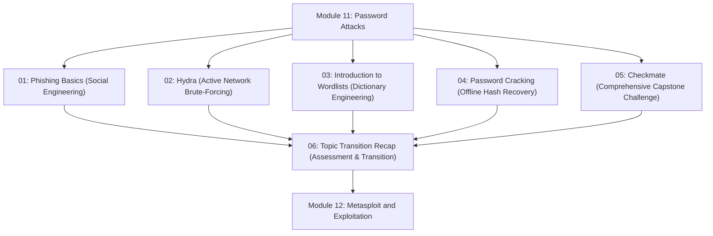

# Module 11: Password Attacks & Credential Compromise

---

## 1. Module Header & Metadata

- **English Title:** Module 11: Password Attacks
- **Learning Path:** Junior Penetration Tester (PT1 Aligned Curriculum)
- **Filesystem Identifier:** `11-PASSWORD-ATTACKS`
- **Total Rooms & Challenges:** 6 units (5 core rooms & hands-on challenge labs + 1 topic transition recap)
- **Prerequisites:** Module 03 (Network Reconnaissance), Module 09 (Vulnerability Knowledge), Module 10 (OWASP Top 10 - 2025).

---

## 2. Comprehensive Module Overview

Credentials and authentication tokens represent both the primary defensive perimeter and the most heavily targeted assets in modern penetration testing. This module provides complete theoretical and operational coverage of the entire credential-attack lifecycle:

1. **Social Engineering & Phishing Analysis (Phishing Basics):**
   Dissecting deceptive communication tradecraft, email header analysis (`Received`, `Authentication-Results`, `DKIM`, `SPF`, `DMARC`), payload identification, and credential-harvesting indicators.
2. **Active Online Network Brute-Forcing (Hydra):**
   Mastering the high-speed network authentication attack tool **Hydra** across remote administrative protocols (SSH, FTP, RDP, SMB) and web authentication endpoints (HTTP-GET, HTTP-POST-FORM).
3. **Targeted Wordlist Engineering (Wordlists):**
   Moving beyond generic static dictionaries (`rockyou.txt`) by weaponizing target-specific reconnaissance, utilizing web-scraping dictionary generators (CeWL), and programmatic pattern builders (Crunch, Hashcat rules).
4. **Offline Hash Cracking Tradecraft (Password Cracking):**
   Understanding cryptographic hash structures (MD5, SHA-256, NTLM, NetNTLMv2, bcrypt, Argon2) and leveraging accelerated parallel cracking engines: **John the Ripper** and **Hashcat** using dictionary, mask, and rule-based modes.
5. **Applied Capstone Challenge (Checkmate):**
   A multi-stage capture-the-flag simulation integrating network reconnaissance, credential discovery, brute-forcing, service exploitation, and privilege escalation.

---

## 3. Structural Roadmap & Room Interconnection

