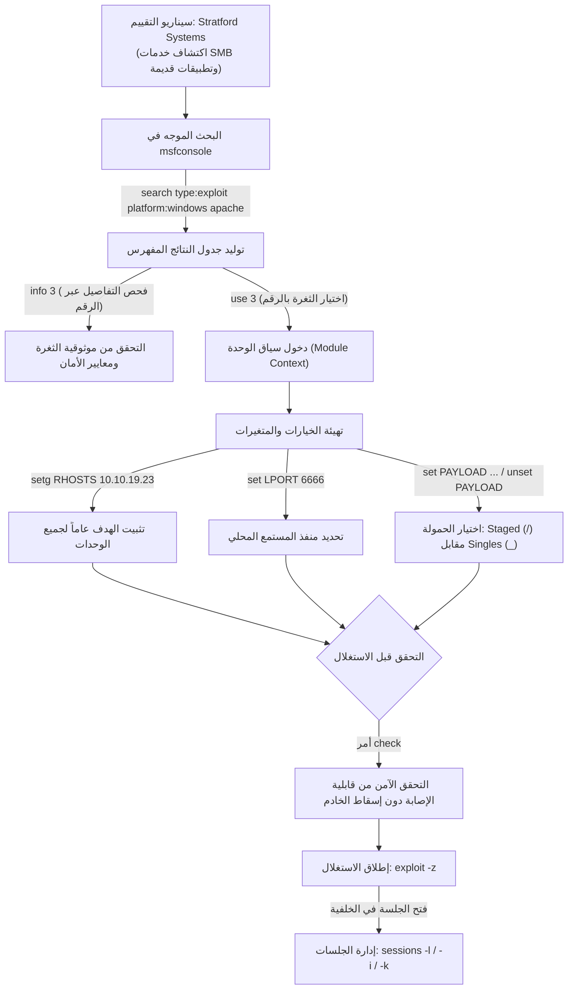

# توثيق غرفة ميتاسبلويت: الأساسيات (Metasploit: The Basics)

---

## 1. بيانات المديول والروم (Metadata & Overview)

* **المسار التعليمي:** مسار مبتدئ اختبار الاختراق (Jr Penetration Tester)
* **المديول:** المديول الثاني عشر — ميتاسبلويت والاستغلال (12-METASPLOIT-AND-EXPLOITATION)
* **اسم الغرفة:** ميتاسبلويت: الأساسيات (Metasploit: The Basics)
* **المعرف البرمجي (Slug):** `metasploitthebasics`
* **الرابط المباشر:** [TryHackMe Metasploit: The Basics](https://tryhackme.com/room/metasploitthebasics)
* **مستوى الصعوبة:** متوسط (Medium)
* **النوع:** غرفة إرشادية وتطبيق عملي (Walkthrough & Guided Practice)
* **سيناريو التقييم:** تقييم اختبار اختراق لمؤسسة **Stratford Systems** للخدمات المالية
* **عدد المهام:** 6 مهام
* **عدد الأسئلة:** 17 سؤالاً تم حلها والتحقق منها بنسبة 100%

---

## 2. الملخص التنفيذي (Executive Summary)

تُمثل غرفة **Metasploit: The Basics** الانطلاقة التأسيسية المنهجية للمديول الثاني عشر في مسار Jr Penetration Tester؛ حيث تضع المختبر في سيناريو واقعي لتقييم البنية التحتية لمؤسسة **Stratford Systems** بعد اكتشاف خدمات قديمة وعرضة للاختراق (مثل بروتوكول SMB غير المرقع). بدلاً من كتابة شفرات استغلال عشوائية تهدد استقرار أنظمة العميل الحساسة، يتم تسخير **إطار عمل ميتاسبلويت (MSF)** لتنظيم وتأكيد وتوثيق الثغرات بأعلى درجات الموثوقية.

تغطي الغرفة سلسلة الاستغلال (Exploit Chain)، والتصنيفات المعيارية السبعة للوحدات في ميتاسبلويت (Exploits, Payloads, Auxiliary, Post, Encoders, NOPs, Evasion)، والفارق الجوهري في التسمية والتنفيذ بين الحمولات المرحلية (Staged المعرفة برمز `/`) وغير المرحلية (Singles المعرفة برمز `_`)، وتقنيات التصفية والبحث السريع، والتعامل بالأرقام المفهرسة، وضبط المتغيرات المحلية والعامة (`set` و `setg`)، وخيارات التنفيذ في الخلفية (`exploit -z`)، وإدارة دورة حياة الجلسات التفاعلية وعزلها (`sessions`).

---

## 3. مخطط سير العمل وسلسلة الاستغلال (Architectural & Exploit Chain Flow)

يوضح المخطط التالي دورة حياة الاستغلال عبر `msfconsole`:



---

## 4. المتطلبات وإعداد البيئة (Prerequisites & Environment Setup)

للعمل العملي داخل بيئة Metasploit، تتطلب بيئة العمل التحقق من جاهزية قاعدة البيانات وتشغيل الطرفية:

```bash
# 1. تشغيل خدمة قاعدة البيانات PostgreSQL
sudo systemctl start postgresql

# 2. تهيئة وتأكيد حالة قاعدة بيانات ميتاسبلويت
msfdb init
msfdb status

# 3. تشغيل msfconsole في الوضع الهادئ (Quiet Mode)
msfconsole -q
```

---

## 5. توصيف مكونات وأقسام ميتاسبلويت (Framework Components & Taxonomy)

تنقسم وحدات ميتاسبلويت البرمجية في المسار `/opt/metasploit-framework/embedded/framework/modules/` إلى سبعة أقسام رئيسية:

| القسم البرمجي | المسار | الوظيفة التقنية | مثال نموذجي |
| :--- | :--- | :--- | :--- |
| **Exploits** | `exploits/` | شفرات برمجية تستغل ثغرات برمجية للسيطرة على النظام | `exploit/windows/smb/ms17_010_eternalblue` |
| **Payloads** | `payloads/` | الشفرة البرمجية المنفذة على الهدف بعد نجاح الثغرة | `windows/x64/meterpreter/reverse_tcp` |
| **Auxiliary** | `auxiliary/` | أدوات مساعدة للمسح، التخمين، الفحص، والتحقق | `auxiliary/scanner/smb/smb_version` |
| **Post** | `post/` | وحدات ما بعد الاستغلال لسحب الهاشات والقفز الشبكي | `post/windows/gather/smart_hashdump` |
| **Encoders** | `encoders/` | مشفرات لإزالة الأحرف السيئة والتمويه ضد برامج الحماية | `x86/shikata_ga_nai` |
| **NOPs** | `nops/` | مولدات تعليمات "عدم التنفيذ" لموازنة الذاكرة (NOP Sleds) | `x86/opty2` |
| **Evasion** | `evasion/` | شفرات مخصصة لتوليد ملفات تتجاوز برامج مكافحة الفيروسات | `windows/windows_defender_exe` |

---

## 6. دليل الحل التفصيلي والمراحل المنهجية (Complete Walkthrough)

### المهمة 1: مقدمة إلى إطار عمل ميتاسبلويت (Introduction)
- استعراض سيناريو شركة Stratford Systems وأهمية استخدام أطر العمل المنظمة لتفادي حوادث إسقاط الخدمات (Denial of Service).
- **الإجابة:** `No answer needed`.

### المهمة 2: المفاهيم الأساسية وأنواع الوحدات (Core Concepts and Module Types)
1. الشفرة التي تستغل خطأ أو عيباً في النظام تُسمى: **`Exploit`**.
2. الشفرة التي تعمل على النظام المستهدف بعد نجاح الثغرة تُسمى: **`Payload`**.
3. الحمولات المستقلة ذاتياً بالكامل والتي لا تتطلب تنزيل مرحلة ثانوية تُسمى: **`Singles`**.
4. الرمز المستخدم في مسار الحمولة للدلالة على أنها حمولة مرحلية (Staged) هو الشرطة المائلة: **`/`**.

### المهمة 3: التعامل مع الطرفية التفاعلية (Navigating Msfconsole)
1. للبحث عن كافة وحدات الاستغلال الخاصة بخادم Apache: **`search type:exploit apache`**.
2. لعرض معلومات وتفاصيل الوحدة رقم 3 من نتائج البحث السابقة: **`info 3`**.
3. للرجوع من سياق الوحدة الحالية إلى سياق المحث الرئيسي `msf6 >`: **`back`**.

### المهمة 4: إعداد وتشغيل الوحدات (Configuring and Running Modules)
1. لضبط قيمة منفذ الاستماع المحلي `LPORT` إلى المنفذ 6666: **`set LPORT 6666`**.
2. لضبط قيمة الهدف `RHOSTS` بشكل عام وشامل للجلسة بأكملها: **`setg RHOSTS 10.10.19.23`**.
3. لتفريغ أو إلغاء حمولة محددة مسبقاً: **`unset PAYLOAD`**.
4. لإطلاق وحدة الاستغلال وبدء الهجوم: **`exploit`**.
5. لإطلاق الاستغلال مع وضع الجلسة الناتجة في الخلفية لمواصلة العمل في الكونسول: **`-z`**.

### المهمة 5: إدارة الجلسات (Managing Sessions)
1. الأمر المستخدم لوضع جلسة Meterpreter في الخلفية والعودة للكونسول: **`background`**.
2. الخيار المستخدم مع أمر `sessions` للتفاعل مع جلسة محددة برقمها: **`-i`**.
3. لإنهاء الجلسة رقم 2 فقط دون التأثير على الجلسات الأخرى: **`sessions -k 2`**.

### المهمة 6: الخاتمة (Conclusion)
- استعراض الخطوات الأربع لإدارة الاستغلال: الفهم $\to$ البحث والتحقق $\to$ التهيئة والإطلاق $\to$ إدارة الجلسات.
- **الإجابة:** `No answer needed`.

---

## 7. المصفوفة التقنية لأوامر msfconsole (Tools Syntax Matrix)

| الأمر | الغرض العملياتي | مثال تطبيقي |
| :--- | :--- | :--- |
| `use` | اختيار وحدة ودخول سياقها بالمسار أو الرقم | `use exploit/windows/smb/ms17_010_eternalblue` أو `use 3` |
| `back` | مغادرة سياق الوحدة للرئيسية | `back` |
| `info` | عرض توثيق ومؤلفي ومعايير الوحدة بالمسار أو الرقم | `info 3` |
| `search` | البحث عن وحدات بفلاتر محددة | `search type:exploit platform:windows cve:2017 smb` |
| `show options` | عرض الخيارات المطلوبة والحالية | `show options` |
| `show payloads` | عرض الحمولات المتوافقة مع الثغرة | `show payloads` |
| `set` | تعيين متغير محلي للوحدة الحالية | `set LPORT 6666` |
| `setg` | تعيين متغير عام مستمر في الجلسة | `setg RHOSTS 10.10.19.23` |
| `unset` | إلغاء تعيين متغير محلي | `unset PAYLOAD` |
| `check` | فحص قابلية الهدف للإصابة بأمان | `check` |
| `exploit` | إطلاق الاستغلال المباشر | `exploit` |
| `exploit -z` | إطلاق الاستغلال ووضع الجلسة بالخلفية فوراً | `exploit -z` |
| `sessions -l` | عرض جدول الجلسات المفتوحة بالتفصيل | `sessions -l` |
| `sessions -i` | التفاعل مع جلسة تحكم محددة | `sessions -i 1` |
| `sessions -k` | إنهاء جلسة محددة برقمها | `sessions -k 2` |
| `sessions -K` | إنهاء كافة الجلسات النشطة دفعة واحدة | `sessions -K` |

---

## 8. الأعماق التشفيرية وتنفيذ الذاكرة (Memory Execution Internals)

### الفارق المعماري بين الحمولات المرحلية وغير المرحلية:
1. **الحمولات المرحلية (Staged Payloads - `/`):**
   - تُقسّم إلى مرحلتين: المرحلة الأولى هي **Stager** بحجم صغير جداً ($\sim 300$ بايت) يتم حقنه في ثغرة طفحان الذاكرة المقيدة الحجم، ليقوم بالاتصال بالمستمع واستقبال المرحلة الثانية.
   - المرحلة الثانية هي **Stage** (بحجم يتجاوز 1 ميجابايت) وتتضمن مكتبات Meterpreter بالكامل، وتُحقن في الذاكرة دون كتابة أي ملف على القرص عبر تقنية **Reflective DLL Injection**.
2. **الحمولات الفردية (Singles / Inline - `_`):**
   - شفرة برمجية مستقلة بالكامل تتضمن منطق التنفيذ دفعة واحدة (كإنشاء حساب أو قذيفة أوامر بسيطة). ميزتها أنها لا تحتاج لمرحلة اتصال ثانوية؛ مما يقلل من بصمتها الشبكية ويمنع اعتراض المرحلة الثانية.

---

## 9. الأمن العملياتي وبصمة الاكتشاف (OpSec & Detection Footprint)

* **خطر انهيار الخدمات في المؤسسات المالية (Stratford Systems):** وحدات الاستغلال التي تتعامل مع الذاكرة الخام لبروتوكول SMB قد تؤدي لشاشة زرقاء (BSOD) إذا لم تتطابق إزاحة الذاكرة مع إصدار النظام. استخدام أمر `check` إلزامي للتحقق قبل الإطلاق.
* **البصمة الشبكية للمراحل الثانية:** ترصد جدران الحماية المتقدمة (NGFW) وأنظمة NIDS نقل ملفات الـ DLL الخاصة بـ Meterpreter عبر الشبكة كحركة مرور غير مشفرة. يُنصح بتفعيل تشفير المراحل: `set EnableStageEncoding true`.
* **تنظيف الجلسات (Session Hygiene):** إبقاء جلسات قديمة معلقة على أنظمة العملاء يترك منافذ اتصال نشطة ترصدها أنظمة EDR وتفضح نشاط الفريق الأحمر. إنهاء الجلسات فور انتهاء العمل عبر `sessions -k <ID>`.

---

## 10. التحصين الدفاعي والمعالجة (Defensive Hardening)

1. **إدارة التحديثات والترقيع الفوري (Patch Management):** ترقيع بروتوكولات المشاركة القديمة (SMBv1) وتعطيلها بالكامل عبر بيئة الدومين لمنع ثغرات مثل MS17-010.
2. **تطبيق عزل الذاكرة (DEP & ASLR):** تفعيل حماية منع تنفيذ البيانات (DEP) وتوزيع مساحة العنوان العشوائي (ASLR) لإحباط شفرات استغلال الذاكرة التي تعتمد على عناوين ثابتة.
3. **مراقبة حقن العمليات (Process Injection Auditing):** رصد استدعاءات الـ API المشبوهة المرتبطة بالحقن الانعكاسي (Reflective DLL Injection) مثل `VirtualAllocEx` و `CreateRemoteThread`.

---

## 11. الأخطاء الشائعة وحلولها (Common Pitfalls)

* **الخطأ في عنوان LHOST:** ترك قيمة LHOST على العنوان الافتراضي أو عنوان الشبكة المحلية بدلاً من عنوان واجهة الـ VPN (`tun0`)؛ مما يجعل الحمولة تتصل بعنوان غير صحيح ويفشل الاتصال العكسي.
* **الخلط بين set و setg:** استخدام `set` وتوقع استمرار القيمة عند الانتقال لوحدة أخرى، مما يتطلب إعادة كتابة الهدف مراراً. استخدم `setg` للمتغيرات الثابتة كـ `RHOSTS` و `LHOST`.
* **تعارض المنافذ:** محاولة تشغيل مستمع جديد على نفس المنفذ (مثل 4444) بينما توجد جلسة نشطة سابقة لم يتم إنهاؤها بـ `sessions -k`.

---

## 12. فهرس المهام والحلول الكامل (Comprehensive Tasks Index)

| المهمة | عنوان المهمة | السؤال | الإجابة المحققة |
| :---: | :--- | :--- | :--- |
| **01** | Introduction to the Framework | Ready to start! | `No answer needed` |
| **02** | Core Concepts and Module Types | What code takes advantage of a flaw? | `Exploit` |
| **02** | Core Concepts and Module Types | What code runs after a successful exploit? | `Payload` |
| **02** | Core Concepts and Module Types | What type of payload is self-contained? | `Singles` |
| **02** | Core Concepts and Module Types | What symbol indicates a staged payload? | `/` |
| **03** | Navigating Msfconsole | How to search for all exploit modules for Apache? | `search type:exploit apache` |
| **03** | Navigating Msfconsole | Command to view detailed info on index 3? | `info 3` |
| **03** | Navigating Msfconsole | Command to go back to main msf6 prompt? | `back` |
| **04** | Configuring and Running Modules | How would you set the LPORT value to 6666? | `set LPORT 6666` |
| **04** | Configuring and Running Modules | How to set global value for RHOSTS to 10.10.19.23? | `setg RHOSTS 10.10.19.23` |
| **04** | Configuring and Running Modules | Command to clear a set payload? | `unset PAYLOAD` |
| **04** | Configuring and Running Modules | Command to launch an exploit module? | `exploit` |
| **04** | Configuring and Running Modules | Flag to background session immediately upon opening? | `-z` |
| **05** | Managing Sessions | Command to background a Meterpreter session? | `background` |
| **05** | Managing Sessions | Flag with sessions command to interact by ID? | `-i` |
| **05** | Managing Sessions | Full command to terminate session 2 only? | `sessions -k 2` |
| **06** | Conclusion | Done! | `No answer needed` |

---

## 13. مراجعة المفاهيم والأسئلة الامتحانية (Knowledge Check)

1. **س: كيف تميز بين الحمولة المرحلية والحمولة الفردية من خلال الاسم في ميتاسبلويت؟**  
   *ج:* الحمولات المرحلية تستخدم الشرطة المائلة للفصل بين المكونات (مثل `meterpreter/reverse_tcp`)، بينما الحمولات الفردية المدمجة تستخدم الشرطة السفلية (مثل `meterpreter_reverse_tcp`).

2. **س: ما الفارق العملياتي بين تنفيذ `exploit` وتنفيذ `exploit -z`؟**  
   *ج:* أمر `exploit` العادي ينقل تحكم الطرفية مباشرة إلى جلسة الضحية بمجرد نجاح الهجوم؛ بينما `exploit -z` يفتح الجلسة في الخلفية فوراً ويبقي المختبر داخل كونسول ميتاسبلويت لمواصلة المهام.

3. **س: كيف يساهم استخدام الأرقام المفهرسة (`info 3` و `use 3`) في رفع كفاءة المختبر؟**  
   *ج:* يختصر الوقت والجهد الحركي المطلوب لنسخ المسارات الطويلة للوحدات، ويقلل احتمالية أخطاء الكتابة التي قد تتسبب في أخطاء تشغيل أثناء التقييمات الزمنية الحرجة.

---

## 14. المراجع والتوثيق الرسمي (References)

* [بوابة توثيق ميتاسبلويت الرسمية من Rapid7](https://docs.metasploit.com/)
* [دليل Metasploit Unleashed من Offensive Security](https://www.offsec.com/metasploit-unleashed/)
* [مستودع الشفرة المصدرية لإطار عمل Metasploit على GitHub](https://github.com/rapid7/metasploit-framework)
* [إرشادات NIST SP 800-115 لاختبارات الأمان الفنية](https://csrc.nist.gov/publications/detail/sp/800-115/final)
* [غرفة TryHackMe Metasploit: The Basics](https://tryhackme.com/room/metasploitthebasics)
