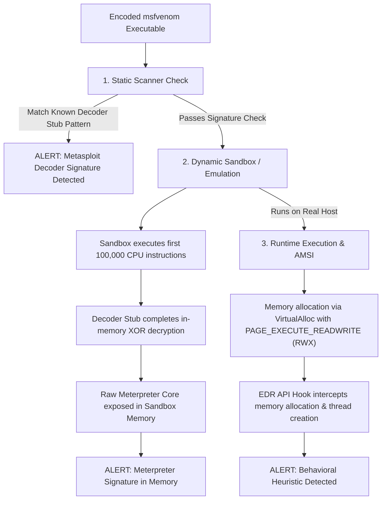

# Additional Technical Notes: Metasploit: Payload Generation

---

## 1. Portable Executable (PE) Internals & Template Injection

When `msfvenom` generates a Windows binary (`-f exe`) or uses an existing application as a template (`-x <template> -k`), it manipulates the Microsoft Windows **Portable Executable (PE32 / PE32+)** file structure.

```
+------------------------------------+
|            DOS Header              | -> "MZ" magic (0x5A4D), e_lfanew pointer
+------------------------------------+
|            DOS Stub                | -> "This program cannot be run in DOS mode"
+------------------------------------+
|            PE Header               | -> "PE\0\0" signature (0x00004550)
+------------------------------------+
|          Optional Header           | -> ImageBase, AddressOfEntryPoint, Subsystem
+------------------------------------+
|           Section Table            | -> .text, .data, .rdata, .rsrc, [.extra]
+------------------------------------+
|             Sections               |
|  .text   (Executable Code)         | -> Modified or new section added
|  .data   (Global Variables)        |
|  .rsrc   (Icons, Manifest, UI)     |
+------------------------------------+
```

### The Injected Thread Architecture (`-k` Flag)
Without the `-k` flag, `msfvenom` overwrites the `AddressOfEntryPoint` in the Optional Header to point directly to the shellcode stager. When the user executes the binary, the shellcode runs, but the original program logic is never reached, causing an immediate crash or unresponsive UI.

With `-k` enabled:
1. `msfvenom` preserves the original `AddressOfEntryPoint`.
2. A small loader hook executes `CreateThread` (or equivalent Windows API primitives), creating an independent, asynchronous thread dedicated to the Meterpreter payload.
3. The main thread then jumps to the original entry point, allowing the benign program (e.g., `putty.exe` or `calc.exe`) to initialize its normal GUI interface.
4. **EDR Static Detection:** Security tools detect template injection by examining section headers for:
   * Non-standard section names or suspicious section entropy (> 7.2 indicating compressed/encrypted code).
   * Sections marked with both `IMAGE_SCN_MEM_WRITE` and `IMAGE_SCN_MEM_EXECUTE` (RWX permissions).

---

## 2. Antivirus, EDR, and AMSI Detection Mechanics

### Why Encoders (`shikata_ga_nai`) Fail to Evade Modern Endpoints:



1. **Decoder Stub Footprint:** The `x86/shikata_ga_nai` engine relies on an `FPU` instruction (`fnstenv` / `fld`) to determine the current Instruction Pointer (`EIP`), followed by a loop that iterates through shellcode bytes using XOR with additive feedback. While the encrypted body changes polymorphically on each iteration, the structural mechanics of the decryption loop remain constant and are heavily signatured by antivirus engines.
2. **RWX Memory Flags:** Modern operating systems implement Data Execution Prevention (DEP). Shellcode decoders must allocate memory with execute permissions (`PAGE_EXECUTE_READWRITE`). Modern EDR hooks (via `ntdll.dll` user-mode hooking or kernel-mode callbacks like `PsSetCreateProcessNotifyRoutineEx`) actively monitor and flag processes that allocate RWX memory.
3. **AMSI (Antimalware Scan Interface):** On Windows 10/11 and Windows Server, AMSI integrates directly into script interpreters (PowerShell, VBScript, JScript) and common loaders. It intercepts code buffers *after* de-obfuscation and memory unpacking immediately prior to CPU execution.

---

## 3. Staged vs. Stageless Network Mechanics

### Staged Communication Flow (`windows/x64/meterpreter/reverse_tcp`):
```text
Target (Stager)                                    Attacker (multi/handler)
      |                                                        |
      |--------------- 1. TCP Handshake (SYN) ---------------->|
      |<-------------- 2. TCP Handshake (SYN/ACK) -------------|
      |--------------- 3. TCP Handshake (ACK) ---------------->|
      |                                                        |
      |<=== 4. Sends 4-byte Length Header (Stage Size) ========|
      |<=== 5. Transmits Stage 1 (~1 MB Meterpreter DLL) ======|
      |                                                        |
[Reflective DLL Loader executes DLL in memory]                 |
      |<========== 6. Encrypted TLV C2 Negotiation ===========>|
```

### Stageless Communication Flow (`windows/x64/meterpreter_reverse_tcp`):
```text
Target (Self-Contained Binary)                      Attacker (multi/handler)
      |                                                        |
      |--------------- 1. TCP Handshake (SYN) ---------------->|
      |<-------------- 2. TCP Handshake (SYN/ACK) -------------|
      |--------------- 3. TCP Handshake (ACK) ---------------->|
      |                                                        |
[Direct In-Memory Initialization without secondary download]  |
      |<========== 2. Encrypted TLV C2 Negotiation ===========>|
```

* **Failure Point of Staged Payloads:** If a network firewall performs deep packet inspection (DPI) or enforces application-layer proxies, transmission of the raw unencrypted Stage 1 DLL over port 4444 or 443 is immediately detected as anomalous binary stream data and RST packets are injected to kill the socket.

---

## 4. SMB Delivery Architecture via `auxiliary/admin/smb/upload_file`

The `upload_file` module connects to Microsoft SMB services over TCP port 445:
* **Protocol Negotiation:** Negotiates SMB dialect (SMBv1, SMBv2, SMBv3).
* **Session Setup:** Uses provided credentials (`SMBUser guest`, `SMBPass ""`). If anonymous or guest access is allowed, the Windows server grants a valid security token.
* **Tree Connect:** Connects to the target share (`\\<TARGET_IP>\public`).
* **Create & Write:** Issues standard SMB file creation and write commands (`SMB2_CREATE`, `SMB2_WRITE`), streaming the local binary directly to the target share.

---

## 5. Local SAM Password Storage & NTLM Hashes

Windows stores local user account hashes in the `SAM` registry hive (`HKEY_LOCAL_MACHINE\SAM`):
* The hash dumped by `hashdump` follows the format:
  `Username:RID:LM_Hash:NTLM_Hash:::`
* Example from Capstone:
  `jim:1001:aad3b435b51404eeaad3b435b51404ee:1e3fe826df1e5af582a98c034cafa9f4:::`
* `aad3b435b51404eeaad3b435b51404ee` is the blank/empty LM hash constant.
* `1e3fe826df1e5af582a98c034cafa9f4` is user `jim`'s actual NTLM hash:
  $$\text{NTLM} = \text{MD4}(\text{UTF-16LE}(\text{Password}))$$
