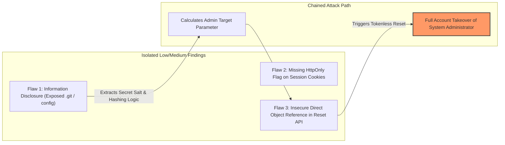
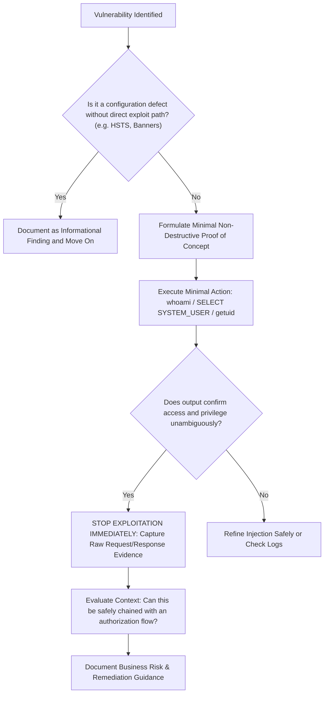

# Additional Technical Notes: Exploitation and Weaponisation

---

## 1. Defining Weaponisation: Consultant vs. Cyber Kill Chain

The term **Weaponisation** varies significantly depending on operational context:

```
[Lockheed Martin Cyber Kill Chain]:
Reconnaissance -> Weaponisation -> Delivery -> Exploitation -> Installation -> C2 -> Actions on Objectives
(Weaponisation = Creating an executable payload package, e.g. embedding stager in macro document)

[Professional Security Consulting Framework]:
Discovery -> Verification -> Controlled Exploitation -> Contextual Weaponisation -> Reporting
(Weaponisation = Demonstrating realistic business impact by chaining flaws and abusing business logic)
```

In consulting engagements, weaponisation does not mean causing damage. It means bridging the communication divide between raw technical findings and corporate executive risk management. Proving that an IDOR vulnerability allows an unauthenticated external user to view all employee payroll records conveys immediate executive urgency, whereas reporting an "Access Control Flaw on endpoint `/api/v1/users/{id}`" often gets lost in backlog prioritization.

---

## 2. Controlled Exploitation Matrix & Minimal Proof-of-Concept Patterns

A core discipline of professional offensive testing is **Minimal Necessary Proof**:

| Vulnerability Type | Safe / Controlled Proof Command | Risky / Over-Exploitative Action | Rationale for Stopping |
| :--- | :--- | :--- | :--- |
| **Command Injection (Linux)** | `whoami`, `id`, `hostname` | `rm -rf`, `curl http://... \| sh`, `cat /etc/shadow` | `whoami` proves arbitrary execution; reading `/etc/shadow` leaves unnecessary credential exposure. |
| **Command Injection (Windows)** | `whoami`, `hostname` | `net user /add`, editing registry, downloading tools | `whoami` proves token context; adding accounts modifies production security state. |
| **SQL Injection (MSSQL)** | `SELECT @@version`, `SELECT SYSTEM_USER` | `xp_cmdshell 'powershell...'`, `DROP TABLE`, `--dump-all` | `SYSTEM_USER` confirms `sa` access; OS command execution introduces severe host instability. |
| **SQL Injection (MySQL/PostgreSQL)**| `SELECT version()`, `SELECT current_user` | `INTO OUTFILE '/var/www/shell.php'` | Confirming database user and version proves full query control without writing web shells to disk. |
| **Stored XSS** | `alert(document.domain)` | Mass defacement, phishing redirects, crypto-mining | Proves execution context bounded to the domain without disrupting legitimate users. |
| **Insecure Direct Object Reference**| Accessing a single secondary testing account | Scripted mass scraping of all client customer IDs | Proves absence of authorization check without exfiltrating confidential PII. |

---

## 3. Vulnerability Chaining Taxonomy & Graph Modeling

An isolated vulnerability may possess a CVSS Base Score of 3.5 (Low), yet when chained with complementary flaws, the aggregate attack path achieves a CVSS Score of 9.8 (Critical).



### The Three Link Categories:
1. **The Intelligence Link:** Discloses architectural parameters, database structures, or internal algorithms (e.g. source code leaks, debug traces).
2. **The Vector Link:** Provides execution capability (e.g. XSS, file upload, injection).
3. **The Objective Link:** Manipulates core business entities (e.g. fund transfer, password reset, administrative role assignment).

---

## 4. Tool Calibration & Blast Radius Mitigation

Automated security tools are force multipliers, but without guardrails, they behave like blunt instruments:

### SQLMap Calibration Rules:
* **Never use `--dump-all`** on client infrastructure. It performs full database table enumeration, locks memory, and causes severe network latency.
* **Always use range controls:** `--start=1 --stop=1` guarantees that only the first record is queried, returning a single proof value.
* **Throttle requests:** Use `--delay=0.5` and `--threads=1` to avoid triggering production database deadlocks.

### Burp Suite Operational Discipline:
* **Burp Repeater:** The primary tool for precision. It operates synchronously, sending exactly one request per manual invocation, making it completely non-destructive and forensically clean.
* **Burp Intruder:** Dangerous when unthrottled. Misconfigured cluster-bomb or sniper attacks can trigger active directory account lockouts, exhaust email verification quotas, or crash fragile legacy web applications. Always set throttling and verify account lockout policies before fuzzing.

---

## 5. The Stopping Point Decision Framework


