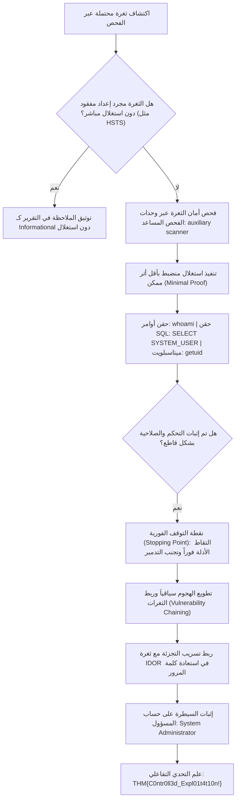

# توثيق غرفة الاستغلال وتطويع الهجمات (Exploitation and Weaponisation)

---

## 1. بيانات المديول والروم (Metadata & Overview)

* **المسار التعليمي:** مسار مبتدئ اختبار الاختراق (Jr Penetration Tester)
* **المديول:** المديول الثاني عشر — ميتاسبلويت والاستغلال (12-METASPLOIT-AND-EXPLOITATION)
* **اسم الغرفة:** الاستغلال وتطويع الهجمات (Exploitation and Weaponisation)
* **المعرف البرمجي (Slug):** `exploitationandweaponisation`
* **الرابط المباشر:** [TryHackMe Exploitation and Weaponisation](https://tryhackme.com/room/exploitationandweaponisation)
* **مستوى الصعوبة:** سهل (Easy)
* **النوع:** غرفة إرشادية ومحاكاة تفاعلية (Walkthrough & Interactive Decision Lab)
* **سيناريو التقييم:** فهم الفارق الجوهري بين الاستغلال المنضبط والتطويع السياقي للمخاطر، وتسلسل الثغرات وربطها ببعضها (Vulnerability Chaining)، والتحكم في أدوات الفحص، واستخراج علم المحاكاة التفاعلية.
* **عدد المهام:** 8 مهام
* **عدد الأسئلة:** 15 سؤالاً وتأكيداً تم حلها والتحقق منها بنسبة 100%

---

## 2. الملخص التنفيذي (Executive Summary)

تُمثل غرفة **Exploitation and Weaponisation** محطة منهجية حاسمة تنقل مختبر الاختراق من مرحلة "التشغيل الأعمى للحمولات البرمجية" إلى عقلية "المستشار الأمني المحترف". في سياق الاستشارات الأمنية واختبار الاختراق المؤسسي، لا يعني مصطلح **تطويع الهجوم (Weaponisation)** صناعة برمجيات خبيثة مدمرة أو تدمير قواعد بيانات العميل، بل يعني **ترجمة الثغرات التقنية المؤكدة إلى أثر عملي ملموس (Demonstrated Business Impact)** يمكن لصناع القرار وإدارة المخاطر فهمه واتخاذ إجراءات حاسمة لمعالجته.

تُغطي الغرفة المبادئ الاحترافية التالية:
1. **الاستغلال المنضبط (Controlled Exploitation):** إثبات وجود الثغرة بأقل قدر ممكن من التفاعل ودون التسبب في أي ضرر أو تعديل غير قابل للإلغاء على أنظمة الإنتاج (استخدام `whoami` في حقن الأوامر، و `SELECT SYSTEM_USER` في حقن SQL، و `getuid` في جلسات Meterpreter).
2. **التطويع السياقي (Context-Aware Weaponisation):** توجيه نقاط الضعف نحو الوظائف الحيوية للمؤسسة، مثل استغلال مسارات استعادة كلمات المرور (Password Reset) للسيطرة على الحسابات، واستهداف دور مسؤول النظام (System Administrator) في ثغرات الـ IDOR لإثبات أعلى درجات الخطورة.
3. **تسلسل الثغرات (Vulnerability Chaining):** دمج ثغرات منخفضة أو متوسطة الخطورة (مثل تسريب كود المصدر أو غياب علم `HttpOnly`) مع ثغرات الوصول لإنتاج سيناريو هجوم كامل وعالي الخطورة.
4. **الانضباط في استخدام الأدوات (Tools in Context):** معايرة أدوات الفحص وتحديد نطاقها؛ تفضيل أداة **Burp Repeater** لإثبات الأدلة بدقة، وتجنب استخدام **Burp Intruder** غير المقيد لمنع حجب الخدمة، وتقييد استخراج البيانات في **SQLMap** باستخدام علم `--start=1 --stop=1` لسحب صف واحد فقط كدليل قاطع دون سحب سجلات العملاء كاملة.
5. **المحاكاة التفاعلية لاتخاذ القرار (Interactive Decision Lab):** تصنيف الثغرات وتحديد نقطة التوقف المثلى عند الوصول لصلاحيات `sa` على خادم قاعدة البيانات دون تفعيل `xp_cmdshell` أو العبث بنظام التشغيل، واستخراج علم `THM{C0ntr0ll3d_Expl01t4t10n!}`.

---

## 3. مخطط سير العمل والتحكم في الاستغلال وسلسلة الهجمات (Architectural Flowchart)



---

## 4. المتطلبات وإعداد البيئة (Prerequisites & Environment Setup)

* **الأدوات:** ميتاسبلويت (Metasploit Framework v6+)، حزمة Burp Suite، أداة SQLMap.
* **البيئة التفاعلية:** مختبر القرارات التفاعلي عبر منصة TryHackMe السحابية.

---

## 5. الفروق الهندسية وميكانيكا العمل (Core Concepts & Technical Deep Dive)

### أ. مفهوم التطويع: المستشار الأمني مقابل سلسلة القتل السيبراني
* **سلسلة القتل السيبراني (Lockheed Martin Kill Chain):** تُعرّف مرحلة التطويع (Weaponisation) بأنها عملية دمج وتغليف الحمولة الخبيثة داخل ملف تسليم (مثل دمج قذيفة داخل ملف وورد أو PDF).
* **منظور الاستشارات واختبار الاختراق:** التطويع يعني "تجسيد الأثر المالي والتشغيلي للثغرة". إبلاغ العميل بوجود ثغرة "IDOR في مسار `/api/v1/user/10`" قد يُصنف كأمر منخفض الأولوية لدى الإدارة، بينما إثبات أن هذا المسار يتيح تنزيل كشوف رواتب الموظفين كاملة ينقل البلاغ فوراً إلى أعلى درجات الطوارئ لمعالجته.

### ب. مبادئ الاستغلال المنضبط الثلاثة (Minimal Necessary Proof)
1. **أدنى إثبات تحكم (Prove Control Minimally):** إثبات القدرة على التنفيذ بأمر يقرأ الهوية في الذاكرة دون كتابة ملفات (`whoami`).
2. **تحجيم دائرة الضرر (Scope Blast Radius):** تجنب تعديل أو حذف البيانات. يعلم العميل مسبقاً أن حذف قاعدة البيانات أمر مدمر؛ ومهمة المختبر هي فقط إثبات إمكانية الوصول لتلك النقطة.
3. **التوثيق الفوري أثناء التنفيذ (Document As You Go):** تسجيل لقطات الطلبات والاستجابات لحظة نجاح الهجوم لتجنب إعادة تكرار الهجمات الخطرة لاحقاً.

### ج. ميكانيكا تسلسل الثغرات (Vulnerability Chaining)
تعتمد قوة المهاجم المتقدم على ربط نقاط الضعف:
* **تسريب الكود المصدري (Source Disclosure):** يكشف أن الرمز المميز هو تجزئة `md5(email)`.
* **ثغرة التحكم بالوصول (IDOR):** في مسار إعادة تعيين كلمة المرور يستقبل الرمز المحسوب.
* **النتيجة المشتركة:** حساب تجزئة البريد الإلكتروني لمسؤول النظام وتمريره في المسار يمنح المهاجم استيلاءً كاملاً على حساب المدير العام دون الحاجة لأي ثغرة أخرى.

---

## 6. مرجع أوامر الاستغلال المنضبط والأدوات (Reference Guide)

| الأداة / السياق | الأمر أو التقنية | الغرض والأثر الآمن |
| :--- | :--- | :--- |
| **حقن الأوامر (Linux)** | `whoami` أو `id` أو `hostname` | إثبات تنفيذ الأوامر دون لمس القرص الصلب أو كتابة ملفات |
| **حقن أوامر (Windows)** | `whoami` | إثبات سياق الرمز الأمني وصلاحيات المستخدم الحالي |
| **حقن SQL (MSSQL)** | `SELECT @@version, SYSTEM_USER` | تأكيد إصدار المحرك وصلاحيات `sa` دون فتح `xp_cmdshell` |
| **حقن SQL (MySQL)** | `SELECT version(), current_user()` | تأكيد التحكم في الاستعلام وصلاحيات المستخدم |
| **ميتاسبلويت (Meterpreter)** | `getuid` | معرفة المستخدم الحالي والتأكد من الوصول لصلاحية `SYSTEM` |
| **ميتاسبلويت (MS17-010)** | `use auxiliary/scanner/smb/smb_ms17_010` | فحص الثغرة بأمان وتجنب إسقاط الخادم بالـ BSOD |
| **Burp Suite** | **Repeater** | اختبار المعاملات يدوياً وتوثيق أدلة الاستجابة الفردية بأمان |
| **Burp Suite** | **Intruder** | توليد هجمات فحص مكثفة (يجب خفض عدد الخيوط لتجنب DoS) |
| **SQLMap** | `--dump --start=1 --stop=1` | استخراج صف واحد فقط كدليل قاطع دون سحب قاعدة البيانات كاملة |

---

## 7. سيناريو التقييم العملي: محاكاة التقييم التفاعلي (Interactive Lab)

### المرحلة 1: فرز وتصنيف الثغرات (Triage Phase)
* فحص الثغرات الحرجة المؤكدة -> تصنيف: **Exploit** (لإثبات الأثر الحقيقي).
* فحص الملاحظات البسيطة وسجلات العرض -> تصنيف: **Validate Only**.
* غياب ترويسات الأمان (مثل HSTS) أو لافتات الإصدارات -> تصنيف: **Report As-Is** (توثيق الملاحظة في التقرير والانتقال للهدف التالي دون إضاعة الوقت في هجمات غير مجدية).

### المرحلة 2: بناء سلسلة الهجوم (Chaining Phase)
ترتيب خطوات الهجوم المترابطة:
1. استغلال تسريب كود المصدر لكشف خوارزمية التجزئة المستخدمة للبريد الإلكتروني (`md5(email)`).
2. استغلال ثغرة IDOR في نموذج استعادة كلمة المرور عبر تمرير التجزئة المحسوبة لبريد مسؤول النظام.
3. الاستيلاء على حساب مسؤول النظام بنجاح.

### المرحلة 3: تحديد نقطة التوقف الأخلاقية (Stopping Point Phase)
* عند اكتشاف ثغرة حقن SQL في بيئة MSSQL:
  * التحقق من الصلاحيات عبر استعلام `SELECT SYSTEM_USER` واكتشاف امتلاك حساب المدير `sa`.
  * **نقطة التوقف الصحيحة:** التوقف فوراً هنا؛ امتلاك حساب `sa` يثبت السيطرة الكاملة على خادم البيانات، وتفعيل `xp_cmdshell` أو كتابة ملفات لنظام التشغيل يعتبر استغلالاً مفرطاً وغير مبرر.

### النتيجة النهائية:
الحصول على علم التحدي التفاعلي:
```text
THM{C0ntr0ll3d_Expl01t4t10n!}
```

---

## 8. فهرس المهام والأسئلة (Tasks & Questions Index)

| رقم المهمة | عنوان المهمة | عدد الأسئلة | الإجابات والأعلام المعتمدة | ملف التوثيق المفصل |
| :---: | :--- | :---: | :--- | :---: |
| 01 | Introduction | 1 | الجاهزية للتطويع والاستغلال (`No answer needed`) | [TASK-01.md](file:///e:/THM-JR-PENETRATION-TESTER/12-METASPLOIT-AND-EXPLOITATION/05-EXPLOITATION-AND-WEAPONISATION/TASKS/TASK-01.md) |
| 02 | From Vulnerability Discovery to Exploitation | 2 | الفاحص الآمن (`auxiliary/scanner/smb/smb_ms17_010`)، الخيار (`b`) لتوثيق غياب HSTS | [TASK-02.md](file:///e:/THM-JR-PENETRATION-TESTER/12-METASPLOIT-AND-EXPLOITATION/05-EXPLOITATION-AND-WEAPONISATION/TASKS/TASK-02.md) |
| 03 | Controlled Exploitation Techniques | 3 | أوامر الفحص الأدنى: `whoami`، و `SELECT SYSTEM_USER`، و `getuid` | [TASK-03.md](file:///e:/THM-JR-PENETRATION-TESTER/12-METASPLOIT-AND-EXPLOITATION/05-EXPLOITATION-AND-WEAPONISATION/TASKS/TASK-03.md) |
| 04 | Context-Aware Weaponisation | 2 | الوظيفة الحيوية: `Password Reset`، والدور الأكثر تأثيراً: `b` (System Administrator) | [TASK-04.md](file:///e:/THM-JR-PENETRATION-TESTER/12-METASPLOIT-AND-EXPLOITATION/05-EXPLOITATION-AND-WEAPONISATION/TASKS/TASK-04.md) |
| 05 | Chaining Vulnerabilities | 2 | خاصية الكوكي: `HttpOnly`، والثغرات المتسلسلة: `b,c` | [TASK-05.md](file:///e:/THM-JR-PENETRATION-TESTER/12-METASPLOIT-AND-EXPLOITATION/05-EXPLOITATION-AND-WEAPONISATION/TASKS/TASK-05.md) |
| 06 | Tools in Context | 3 | أداة التوثيق الفردي: `Repeater`، وأعلام استخراج صف واحد: `--start=1 --stop=1`، وأداة الحجم العالي: `Intruder` | [TASK-06.md](file:///e:/THM-JR-PENETRATION-TESTER/12-METASPLOIT-AND-EXPLOITATION/05-EXPLOITATION-AND-WEAPONISATION/TASKS/TASK-06.md) |
| 07 | Test Your Knowledge | 1 | علم المحاكاة التفاعلية: `THM{C0ntr0ll3d_Expl01t4t10n!}` | [TASK-07.md](file:///e:/THM-JR-PENETRATION-TESTER/12-METASPLOIT-AND-EXPLOITATION/05-EXPLOITATION-AND-WEAPONISATION/TASKS/TASK-07.md) |
| 08 | Conclusion | 1 | إتقان تسلسل الثغرات والاستغلال المنضبط (`No answer needed`) | [TASK-08.md](file:///e:/THM-JR-PENETRATION-TESTER/12-METASPLOIT-AND-EXPLOITATION/05-EXPLOITATION-AND-WEAPONISATION/TASKS/TASK-08.md) |

---

## 9. تحليل أمني ومفاهيم الدفاع والرصد (Defense, Detection & Blue Team)

1. **الحد من مخاطر تسلسل الثغرات (Defense in Depth):**
   - حماية الكوكيز بتفعيل خاصيتي `HttpOnly` و `Secure` و `SameSite=Lax/Strict` لمنع سرقة الجلسات حتى في حال وجود ثغرات XSS.
   - تشديد ضوابط الوصول على واجهات برمجة التطبيقات (APIs) بالتحقق من هوية وصلاحية المستخدم في كل طلب وعدم الاعتماد على المعاملات الممررة من العميل.
2. **رصد محاولات الاستغلال الأدنى في السجلات:**
   - رصد استدعاءات عمليات `whoami.exe` أو `hostname.exe` الناتجة عن عمليات خوادم الويب (`w3wp.exe` أو `httpd` أو `nginx`) عبر قواعد كشف Sysmon (Event ID 1).
   - رصد استعلامات حقن SQL التي تحتوي على دالات النظام (`SYSTEM_USER`, `@@version`) عبر أنظمة كشف التسلل (WAF/NIDS).

---

## 10. مصفوفة MITRE ATT&CK للغرفة

| مرحلة الهجوم | المعرف التقني | اسم التقنية | التطبيق العملي في الغرفة |
| :--- | :--- | :--- | :--- |
| **Initial Access** | T1190 | Exploit Public-Facing Application | فحص واستغلال ثغرات الويب والشبكات |
| **Execution** | T1059 | Command and Scripting Interpreter | تنفيذ `whoami` لإثبات حقن الأوامر |
| **Discovery** | T1033 | System Owner/User Discovery | التحقق من المستخدم الحالي عبر `getuid` |
| **Credential Access** | T1539 | Steal Web Session Cookie | سرقة الكوكيز عبر XSS عند غياب `HttpOnly` |
| **Lateral Movement** | T1021.004 | SSH / Pivoting | استغلال بيانات الاعتماد المسربة للانتقال الداخلي |

---

## 11. الأخطاء الشائعة ومخاطر الإفراط في الاستغلال (Common Pitfalls)

* **الخطأ:** محاولة سحب قاعدة البيانات كاملة في تقييم حي باستخدام SQLMap (`--dump-all`).
  * *الخطر:* التسبب في بطء شديد أو حجب خدمة قاعدة البيانات، وتحمل مسؤولية قانونية جراء تخزين بيانات شخصية حساسة (PII) دون داعٍ.
  * *الحل:* استخدام علم `--start=1 --stop=1` لإثبات الوصول بسحب سجل واحد فقط.
* **الخطأ:** الاستغلال المباشر لثغرة EternalBlue على خادم إنتاج دون فحص مسبق.
  * *الخطر:* حدوث انهيار مفاجئ لنواة النظام وظهور شاشة الموت الزرقاء (BSOD).
  * *الحل:* تشغيل وحدة الفحص `auxiliary/scanner/smb/smb_ms17_010` أولاً.

---

## 12. المقارنات التقنية والتكتيكية (Technical Comparisons)

| وجه المقارنة | الاستغلال المنضبط (Controlled) | الاستغلال المفرط / المدمر (Over-Exploitation) |
| :--- | :--- | :--- |
| **الهدف** | إثبات وجود الخطر ومستوى الصلاحية | إحداث أقصى تغيير أو سحب كافة البيانات |
| **الأثر التشغيلي** | معدوم (لا يؤثر على أداء النظام) | خطر حجب الخدمة وفقدان سلامة البيانات |
| **المسؤولية القانونية** | متوافقة تماماً مع قواعد الاشتباك (ROE) | انتهاك صريح يعرض الشركة للمساءلة |
| **القيمة للعميل** | عالية جداً (أدلة واضحة وتوصيات محددة) | سلبية (تشتيت الانتباه في معالجة آثار التخريب) |

---

## 13. أفضل الممارسات وقواعد الاشتباك (Best Practices & ROE)

1. **الالتزام بنقطة التوقف (Stopping Point):** بمجرد إثبات الوصول وصلاحية الحساب، أوقف الهجوم فوراً والتقط الأدلة.
2. **استخدام حسابات اختبار مخصصة:** عند اختبار مسارات تسجيل الدخول واستعادة كلمات المرور، استخدم حسابات وهمية أنشأتها لأغراض الاختبار ولا تستهدف حسابات موظفي العميل الحقيقيين.
3. **التوثيق الدقيق للتوقيت:** وثق توقيت كل طلب استغلال بالثانية لتسهيل مراجعة فريق الدفاع (Blue Team) ومطابقتها مع سجلات الـ SIEM.

---

## 14. المراجع والمصادر الرسمية (References & Official Links)

* [TryHackMe Exploitation and Weaponisation Room](https://tryhackme.com/room/exploitationandweaponisation)
* [Penetration Testing Execution Standard (PTES) Exploitation Phase](http://www.pentest-standard.org/index.php/Exploitation)
* [NIST SP 800-115 Technical Guide to Information Security Testing](https://csrc.nist.gov/publications/detail/sp/800-115/final)
* [OWASP Top 10 Broken Access Control](https://owasp.org/Top10/A01_2021-Broken_Access_Control/)
* [فهرس المهام والحلول المعتمدة (TASKS.md)](file:///e:/THM-JR-PENETRATION-TESTER/12-METASPLOIT-AND-EXPLOITATION/05-EXPLOITATION-AND-WEAPONISATION/TASKS.md)
* [الملاحظات التقنية الإضافية (ADDITIONAL-NOTES.md)](file:///e:/THM-JR-PENETRATION-TESTER/12-METASPLOIT-AND-EXPLOITATION/05-EXPLOITATION-AND-WEAPONISATION/ADDITIONAL-NOTES.md)
* [قائمة المراجع والمعايير الرسمية (REFERENCES.md)](file:///e:/THM-JR-PENETRATION-TESTER/12-METASPLOIT-AND-EXPLOITATION/05-EXPLOITATION-AND-WEAPONISATION/REFERENCES.md)
