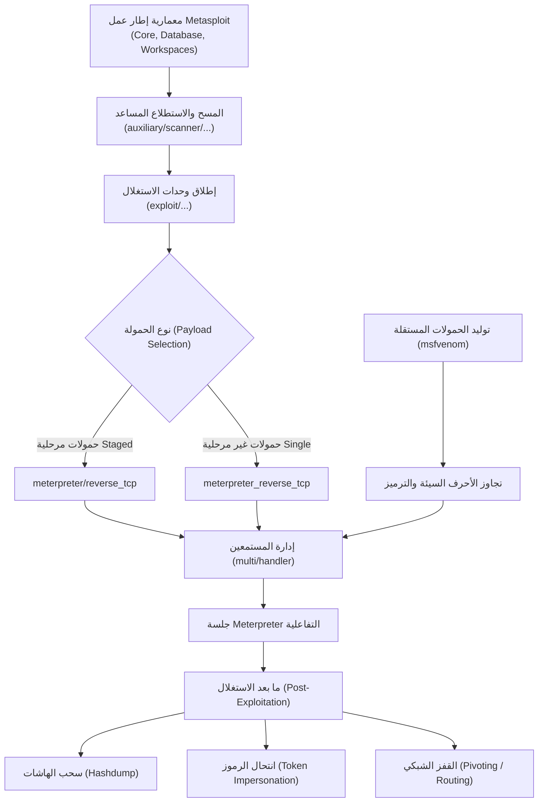

# المديول الثاني عشر: ميتاسبلويت والاستغلال (Metasploit and Exploitation)

---

## 1. نظرة عامة على المديول (Module Overview)

* **المسار التعليمي:** مسار مبتدئ اختبار الاختراق (Jr Penetration Tester)
* **رقم المديول:** المديول الثاني عشر (12 من أصل 18 مديولاً)
* **المجال العملياتي:** هندسة الاستغلال، أطر العمل الهجومية، توليد الحمولات، وإدارة الجلسات التفاعلية
* **حالة الإنجاز:** قيد التنفيذ المنهجي (In Progress)

---

## 2. الأهمية الاستراتيجية في اختبار الاختراق (Strategic Significance)

يُمثل هذا المديول نقطة التحول المركزية في اختبار الاختراق؛ حيث ينتقل المختبر من مرحلة جمع المعلومات واكتشاف الثغرات وتخمين بيانات الاعتماد (المديولات 01 إلى 11) إلى **مرحلة الاستغلال الفعلي (Exploitation Phase)** واختراق الهدف للوصول الأولي (Initial Access) وتثبيت التواجد.

يغطي المديول إطار عمل **Metasploit Framework (MSF)** الرائد عالمياً، والذي يوفر منظومة معيارية شاملة تضم آلاف وحدات الاستغلال (Exploits)، ووحدات المسح المساعدة (Auxiliary)، وحمولات التحكم (Payloads)، وأداة توليد الحمولات المستقلة **msfvenom**، إضافة إلى دراسة شاملة لمعمارية القذائف العكسية والمربوطة (Reverse & Bind Shells) واستقرار الطرفيات.

---

## 3. المعمارية المنهجية للمديول (Methodological Architecture)

---

## 4. قائمة غرف المديول ومحاورها التقنية (Room Inventory)

1. **Metasploit: The Basics (`metasploitintro`):** هيكلية MSF، بيئة `msfconsole`، تكامل قاعدة بيانات PostgreSQL، وإدارة مساحات العمل.
2. **Metasploit: Scanning and Exploitation:** استخدام الوحدات المساعدة لفحص الخدمات والمنافذ، والتحقق من الثغرات، وإطلاق الهجمات.
3. **Metasploit: Post-Exploitation:** أوامر Meterpreter الأساسية، التفاعل مع العمليات ونظام الملفات، وسحب بيانات الاعتماد.
4. **Metasploit: Payload Generation:** أداة `msfvenom`، تنسيقات الملفات التنفيذية (PE/ELF)، وتجاوز الأحرف المحظورة.
5. **Exploitation and Weaponization:** تجميع وتعديل شفرات الاستغلال العامة (PoCs)، ومفاهيم طفحان الذاكرة التخزينية (Buffer Overflow).
6. **Shells & Listeners Fundamentals:** الفارق المعماري بين Reverse Shell و Bind Shell، أدوات Netcat و Socat، وترقية الطرفيات.
7. **Shell Payload Generation & Delivery:** حمولات الويب (PHP/ASPX/WAR)، واستغلال أدوات النظام الموثوقة (LOLBins).
8. **Topic Transition Recap:** التقييم التركيبي الشامل لمهارات الاستغلال.
