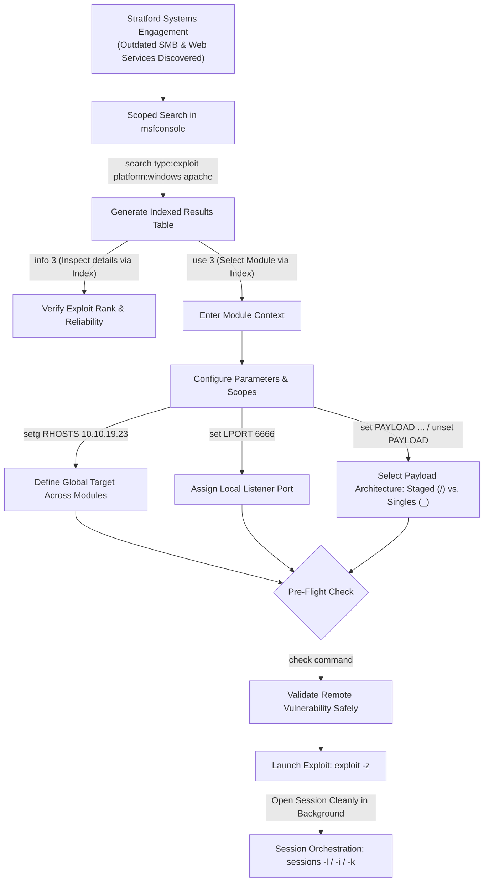

# Room Documentation: Metasploit: The Basics

---

## 1. Metadata & Overview

* **Learning Path:** Jr Penetration Tester
* **Module:** Module 12 — Metasploit and Exploitation (12-METASPLOIT-AND-EXPLOITATION)
* **Room Name:** Metasploit: The Basics
* **Room Slug:** `metasploitthebasics`
* **Room URL:** [TryHackMe Metasploit: The Basics](https://tryhackme.com/room/metasploitthebasics)
* **Difficulty:** Medium
* **Room Type:** Walkthrough & Guided Practice
* **Scenario Context:** Penetration Testing Engagement for **Stratford Systems** (Financial Services)
* **Total Tasks:** 6 Tasks
* **Total Questions:** 17 Questions (100% Solved & Verified)

---

## 2. Executive Summary

**Metasploit: The Basics** serves as the canonical opening room for Module 12 on the Jr Penetration Tester learning path. Framed around a realistic enterprise assessment for **Stratford Systems**, the room demonstrates how penetration testing frameworks replace chaotic, ad-hoc custom exploits with a standardized, reliable, and auditable methodology.

The room details the core Exploit Chain (Vulnerability $\to$ Exploit $\to$ Payload), the framework's seven functional module categories (Exploits, Payloads, Auxiliary, Post, Encoders, NOPs, Evasion), the structural distinction between staged payloads (denoted by `/`) and inline singles (denoted by `_`), advanced search filtering, index-based module selection (`info 3`, `use 3`), local versus global variable scoping (`set` vs. `setg`), non-intrusive pre-flight checks (`check`), background exploit launching (`exploit -z`), and full lifecycle session orchestration (`sessions`).

---

## 3. Architectural & Exploitation Flow Diagram

The following diagram maps the structured interaction model within `msfconsole`:



---

## 4. Prerequisites & Environment Setup

Verify local framework dependencies and PostgreSQL integration:

```bash
# 1. Start the PostgreSQL database daemon
sudo systemctl start postgresql

# 2. Initialize and verify database status
msfdb init
msfdb status

# 3. Launch msfconsole in quiet mode
msfconsole -q
```

---

## 5. Framework Components & Taxonomy Profiling

Metasploit organizes its extensive module library across seven functional categories in `/opt/metasploit-framework/embedded/framework/modules/`:

| Module Tree | Path | Operational Function | Representative Example |
| :--- | :--- | :--- | :--- |
| **Exploits** | `exploits/` | Delivery mechanism taking advantage of software flaws | `exploit/windows/smb/ms17_010_eternalblue` |
| **Payloads** | `payloads/` | Action code executed on target system post-exploitation | `windows/x64/meterpreter/reverse_tcp` |
| **Auxiliary** | `auxiliary/` | Scanning, fuzzing, fingerprinting, and non-exploit verification | `auxiliary/scanner/smb/smb_version` |
| **Post** | `post/` | Post-exploitation credential dumping, looting, and enumeration | `post/windows/gather/smart_hashdump` |
| **Encoders** | `encoders/` | Shellcode re-encoding to eliminate bad characters and evade legacy AV | `x86/shikata_ga_nai` |
| **NOPs** | `nops/` | Architecture-specific no-operation instructions for memory sleds | `x86/opty2` |
| **Evasion** | `evasion/` | Generating executables designed to evade host antivirus | `windows/windows_defender_exe` |

---

## 6. Complete Walkthrough & Methodological Stages

### Task 1: Introduction to the Metasploit Framework
- Overview of the Stratford Systems engagement and the architectural necessity of penetration testing frameworks to eliminate production outages.
- **Answer:** `No answer needed`.

### Task 2: Core Concepts and Module Types
1. Code taking advantage of a flaw: **`Exploit`**.
2. Code running post-compromise: **`Payload`**.
3. Self-contained payloads without secondary downloads: **`Singles`**.
4. Symbol indicating a staged payload path: **`/`**.

### Task 3: Navigating Msfconsole
1. Searching for Apache exploit modules: **`search type:exploit apache`**.
2. Viewing details for search result index #3: **`info 3`**.
3. Returning to the main `msf6 >` prompt: **`back`**.

### Task 4: Configuring and Running Modules
1. Setting local listening port to 6666: **`set LPORT 6666`**.
2. Setting global target IP: **`setg RHOSTS 10.10.19.23`**.
3. Clearing an assigned payload parameter: **`unset PAYLOAD`**.
4. Launching the exploit module: **`exploit`**.
5. Backgrounding the session immediately upon opening: **`-z`**.

### Task 5: Managing Sessions
1. Backgrounding an active Meterpreter session: **`background`**.
2. Flag used to interact with a session by ID: **`-i`**.
3. Terminating session 2 selectively without affecting others: **`sessions -k 2`**.

### Task 6: Conclusion
- Review of the 4-phase methodology: Understand building blocks $\to$ Find module $\to$ Configure & launch $\to$ Manage sessions.
- **Answer:** `No answer needed`.

---

## 7. Tools Deep Dive & Syntax Matrix

| Command | Operational Purpose | Example Syntax |
| :--- | :--- | :--- |
| `use` | Select module context by path or index | `use exploit/windows/smb/ms17_010_eternalblue` or `use 3` |
| `back` | Exit active module context | `back` |
| `info` | View comprehensive module details by path or index | `info 3` |
| `search` | Filter modules using granular tags | `search type:exploit platform:windows cve:2017 smb` |
| `show options` | Display current and required variables | `show options` |
| `show payloads` | Display compatible payloads for active exploit | `show payloads` |
| `set` | Assign variable within local module | `set LPORT 6666` |
| `setg` | Assign persistent global variable | `setg RHOSTS 10.10.19.23` |
| `unset` | Clear local variable | `unset PAYLOAD` |
| `check` | Non-intrusive remote vulnerability test | `check` |
| `exploit` | Execute active exploit module | `exploit` |
| `exploit -z` | Exploit and immediately background session | `exploit -z` |
| `sessions -l` | List all active sessions | `sessions -l` |
| `sessions -i` | Interact with session by ID | `sessions -i 1` |
| `sessions -k` | Terminate specific session by ID | `sessions -k 2` |
| `sessions -K` | Terminate all active sessions simultaneously | `sessions -K` |

---

## 8. Cryptographic & Memory Execution Internals

### Staged vs. Inline Single Payload Mechanics:
- **Staged Payloads (`/` delimiter):**
  - Divided into an initial **Stager** ($\sim 250 - 400$ bytes) and a secondary **Stage** ($\sim 1 \text{ MB}$).
  - The stager injects into restricted buffer space, connects back to the multi-handler, and downloads the full Meterpreter DLL into memory. The stage executes purely in memory using **Reflective DLL Injection**, avoiding disk writes.
- **Single / Inline Payloads (`_` delimiter):**
  - Fully self-contained monolithic binaries containing the complete execution logic (e.g., executing a command or binding a shell). Useful when network egress filters block secondary stage downloads.

---

## 9. Operational Security & Detection Footprint

* **Preventing Production Outages:** Memory corruption exploits (such as SMB kernel flaws) risk causing system crashes or Windows Blue Screens (BSOD) when executed against mismatched operating system versions. In client environments like Stratford Systems, operators must run `check` before firing.
* **Network Sensor Inspection:** Unencrypted Meterpreter stage transmissions are easily detected by network intrusion detection systems (NIDS). Enable stage encoding via `set EnableStageEncoding true`.
* **Session Housekeeping:** Leaving abandoned sessions open on client systems leaves persistent network connections and memory hooks that can be detected by defensive monitoring. Terminate sessions promptly using `sessions -k <ID>`.

---

## 10. Defensive Hardening & Remediation

1. **Systematic Patch Management:** Metasploit modules target known, cataloged vulnerabilities with assigned CVEs; applying vendor security patches eliminates exploit viability.
2. **Memory Protection Controls:** Enforce Data Execution Prevention (DEP) and Address Space Layout Randomization (ASLR) at the operating system level to defeat memory corruption and buffer overflow exploits.
3. **Endpoint Behavioral Monitoring:** Configure EDR solutions to monitor suspicious API sequences (`VirtualAllocEx` with `PAGE_EXECUTE_READWRITE`, `WriteProcessMemory`, `CreateRemoteThread`) indicative of reflective DLL injection.

---

## 11. Common Pitfalls & Troubleshooting

* **Misconfigured LHOST:** Defaulting `LHOST` to `127.0.0.1` or the local Ethernet IP instead of the VPN interface (`tun0`) causes reverse payloads to call back to unreachable addresses.
* **Confusing `set` with `setg`:** Setting `RHOSTS` with `set` only applies to the current module; switching contexts clears it. Use `setg` for values that apply across multiple modules.
* **Port Conflicts:** Binding to an `LPORT` already in use by an active listener or local service causes socket bind errors (`Errno::EADDRINUSE`).

---

## 12. Comprehensive Tasks & Solutions Index

| Task # | Task Title | Question Text | Verified Answer |
| :---: | :--- | :--- | :--- |
| **01** | Introduction to the Framework | Ready to start! | `No answer needed` |
| **02** | Core Concepts and Module Types | What code takes advantage of a flaw? | `Exploit` |
| **02** | Core Concepts and Module Types | What code runs after a successful exploit? | `Payload` |
| **02** | Core Concepts and Module Types | What type of payload is self-contained? | `Singles` |
| **02** | Core Concepts and Module Types | What symbol indicates a staged payload? | `/` |
| **03** | Navigating Msfconsole | How to search for all exploit modules for Apache? | `search type:exploit apache` |
| **03** | Navigating Msfconsole | Command to view detailed info on index 3? | `info 3` |
| **03** | Navigating Msfconsole | Command to go back to main msf6 prompt? | `back` |
| **04** | Configuring and Running Modules | How would you set the LPORT value to 6666? | `set LPORT 6666` |
| **04** | Configuring and Running Modules | How to set global value for RHOSTS to 10.10.19.23? | `setg RHOSTS 10.10.19.23` |
| **04** | Configuring and Running Modules | Command to clear a set payload? | `unset PAYLOAD` |
| **04** | Configuring and Running Modules | Command to launch an exploit module? | `exploit` |
| **04** | Configuring and Running Modules | Flag to background session immediately upon opening? | `-z` |
| **05** | Managing Sessions | Command to background a Meterpreter session? | `background` |
| **05** | Managing Sessions | Flag with sessions command to interact by ID? | `-i` |
| **05** | Managing Sessions | Full command to terminate session 2 only? | `sessions -k 2` |
| **06** | Conclusion | Done! | `No answer needed` |

---

## 13. Knowledge Check & Exam Review

1. **How do you visually identify a staged payload versus an inline single payload in Metasploit?**  
   *Answer:* Staged payloads use a forward slash `/` to separate components (e.g., `meterpreter/reverse_tcp`), whereas inline single payloads use an underscore `_` (e.g., `meterpreter_reverse_tcp`).

2. **What is the operational purpose of the `check` command?**  
   *Answer:* It tests whether a remote service is vulnerable by sending benign diagnostic requests without injecting the exploit payload, preventing service disruption.

3. **What is the difference between `exploit` and `exploit -z`?**  
   *Answer:* A standard `exploit` transfers console control directly to the newly opened session, whereas `exploit -z` immediately backgrounds the established session, keeping the operator in `msfconsole`.

---

## 14. References & External Documentation

* [Rapid7 Metasploit Documentation Portal](https://docs.metasploit.com/)
* [Metasploit Unleashed Training Guide](https://www.offsec.com/metasploit-unleashed/)
* [Metasploit Framework Source Code (GitHub)](https://github.com/rapid7/metasploit-framework)
* [NIST SP 800-115 Security Testing Guidelines](https://csrc.nist.gov/publications/detail/sp/800-115/final)
* [TryHackMe Metasploit: The Basics](https://tryhackme.com/room/metasploitthebasics)
