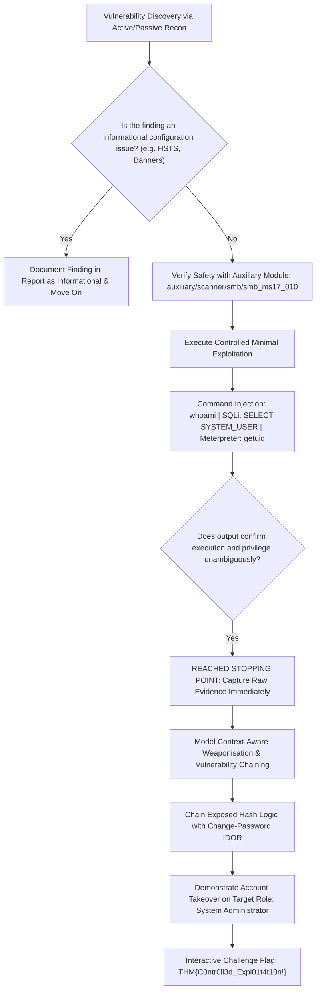

# Room Documentation: Exploitation and Weaponisation

---

## 1. Metadata & Overview

* **Learning Path:** Jr Penetration Tester
* **Module:** Module 12 — Metasploit and Exploitation (`12-METASPLOIT-AND-EXPLOITATION`)
* **Room Name:** Exploitation and Weaponisation
* **Slug:** `exploitationandweaponisation`
* **Direct URL:** [TryHackMe Exploitation and Weaponisation](https://tryhackme.com/room/exploitationandweaponisation)
* **Difficulty:** Easy
* **Category:** Walkthrough & Interactive Simulation Lab
* **Scenario:** Mastering controlled exploitation, vulnerability chaining, context-aware weaponisation, and tool safety on live environments.
* **Tasks Count:** 8 tasks
* **Questions Count:** 15 verified questions & confirmations (100% completion parity)

---

## 2. Executive Summary

The **Exploitation and Weaponisation** room marks a critical pedagogical transition within the Jr Penetration Tester curriculum, elevating practitioners from script-reliant operators into disciplined, impact-driven security consultants. In commercial penetration testing, **weaponisation** does not mean crafting destructive cyber weapons or crashing production assets; it means translating confirmed technical vulnerabilities into demonstrated, measurable business risk that executive decision-makers can understand, prioritize, and remediate.

Key proficiencies mastered in this room:
1. **From Discovery to Controlled Exploitation:** Establishing a methodical verification workflow: distinguishing theoretical scanner warnings from true positives, executing non-destructive pre-exploit checks (e.g. `auxiliary/scanner/smb/smb_ms17_010`), and knowing when an informational finding (e.g. missing HSTS headers) requires documentation rather than reckless exploitation.
2. **The Principle of Minimal Necessary Proof:** Confirming vulnerability reality with minimal footprint: using in-memory execution proofs (`whoami`, `id`, `hostname`) for command injection, querying database metadata (`SELECT SYSTEM_USER`, `@@version`) for SQL injection, and executing `getuid` to verify `SYSTEM` privilege in Meterpreter without altering target state.
3. **Context-Aware Weaponisation:** Mapping technical flaws to organizational risk: focusing on high-value business logic (such as `Password Reset` workflows) and targeting high-privilege organizational personas (`System Administrator`) in IDOR scenarios to prove maximum business impact.
4. **Vulnerability Chaining:** Connecting disparate low- and medium-severity weaknesses (source code leaks, cryptographic salt disclosure, missing `HttpOnly` flags) into an unbroken critical attack path.
5. **Tool Calibration & Blast Radius Mitigation:** Employing surgical tools (Burp Repeater) for evidence capture, enforcing strict extraction boundaries in automated tools (SQLMap's `--start=1 --stop=1`), and avoiding high-risk unthrottled fuzzing (Burp Intruder).
6. **Capstone Decision Simulation:** Triaging vulnerabilities, chaining complex attack steps, and identifying the exact stopping point where sufficient proof is gathered without over-exploiting, unlocking challenge flag `THM{C0ntr0ll3d_Expl01t4t10n!}`.

---

## 3. Architectural Flowchart: Controlled Exploitation Lifecycle



---

## 4. Prerequisites & Environment Setup

* **Frameworks & Tools:** Metasploit Framework v6+, Burp Suite Professional/Community, SQLMap.
* **Interactive Environment:** TryHackMe Cloud-hosted static interactive engagement simulator.

---

## 5. Core Concepts & Technical Deep Dive

### A. The Consultant's Definition of Weaponisation
* In the Lockheed Martin Cyber Kill Chain, weaponisation is the technical act of fusing an exploit with a malicious payload (such as generating an `.exe` with `msfvenom` or creating a poisoned PDF).
* In security consulting, weaponisation is an analytical and communicative discipline: it contextualizes technical findings within the client's business architecture. Proving that an IDOR allows exfiltrating payroll data or taking over administrator accounts demonstrates direct financial and regulatory risk.

### B. The Three Core Principles of Controlled Exploitation
1. **Prove Control Minimally:** Never execute commands that alter files or write to disk if reading memory identity suffices. `whoami` proves command injection; `SELECT SYSTEM_USER` proves database execution privileges.
2. **Scope Your Blast Radius:** Destructive actions (dropping database tables, rebooting servers) are strictly forbidden. Clients already understand that database loss is disastrous; the penetration tester's mandate is solely to prove that an attacker could achieve the capability to do so.
3. **Document As You Go:** Capture exact HTTP request/response transcripts, tool outputs, and timestamps immediately upon initial proof rather than attempting to recreate fragile exploit states later.

### C. Vulnerability Chaining Dynamics
Attack chains systematically compound lower-tier risks into severe business impact:
* *Information Disclosure:* Source code reveals that authentication tokens are formatted as `md5(email)`.
* *Broken Access Control:* Password reset endpoint accepts user identifier hash without verifying active session context.
* *Synthesis:* The tester hashes the administrator's known email, submits it to the password reset endpoint, and achieves total platform takeover.

---

## 6. Controlled Commands & Tooling Reference

| Tool / Vector | Controlled Command / Technique | Safety Profile & Technical Objective |
| :--- | :--- | :--- |
| **Linux Command Injection** | `whoami`, `id`, `hostname` | Proves command execution entirely in-memory without disk writes |
| **Windows Command Injection** | `whoami` | Identifies security token context without altering local accounts |
| **MSSQL Database Injection** | `SELECT @@version, SYSTEM_USER` | Proves database engine version and `sa` privilege without invoking `xp_cmdshell` |
| **MySQL Database Injection** | `SELECT version(), current_user()` | Verifies database user permissions safely |
| **Meterpreter Session** | `getuid` | Interrogates active session token to confirm `SYSTEM` access |
| **Metasploit SMB Check** | `use auxiliary/scanner/smb/smb_ms17_010` | Verifies EternalBlue vulnerability without risking kernel BSOD |
| **Burp Suite Repeater** | Single-request manual manipulation | Sends isolated HTTP payloads and captures clean evidence pairs |
| **Burp Suite Intruder** | Multi-threaded fuzzing engine | High-risk; must be throttled to prevent DoS or account lockouts |
| **SQLMap Extraction** | `--dump --start=1 --stop=1` | Limits data extraction to a single row, proving impact without mass exfiltration |

---

## 7. Interactive Lab Walkthrough (Test Your Knowledge)

### Phase 1: Vulnerability Triage
* High-impact exploitable findings (e.g. unauthenticated RCE candidates) -> Categorized as **Exploit**.
* Ambiguous findings or directory listings -> Categorized as **Validate Only**.
* Missing headers (such as `Strict-Transport-Security` / HSTS) -> Categorized as **Report As-Is** (documented directly in the final report without attempting dangerous network MITM attacks).

### Phase 2: Vulnerability Chaining
Constructing the logical exploitation sequence:
1. Locate source code disclosure revealing the application's email hashing function (`md5(email)`).
2. Calculate the target administrator's email hash.
3. Inject the calculated hash into the change-password IDOR flow.
4. Establish unauthorized session control over the platform administrator.

### Phase 3: The Stopping Point
* During MSSQL injection, testing confirms execution under the `sa` account via `SELECT SYSTEM_USER`.
* **The Stopping Point:** Cease exploitation immediately. Proving administrative control over the database engine fulfills the assessment objective; enabling `xp_cmdshell` or dumping OS memory introduces unacceptable availability risks.

### Final Challenge Flag:
```text
THM{C0ntr0ll3d_Expl01t4t10n!}
```

---

## 8. Tasks & Questions Index

| Task # | Task Title | Question Count | Verified Solutions & Flags | Dedicated Documentation |
| :---: | :--- | :---: | :--- | :---: |
| 01 | Introduction | 1 | Acknowledgment of exploitation and weaponisation concepts (`No answer needed`) | [TASK-01.md](file:///e:/THM-JR-PENETRATION-TESTER/12-METASPLOIT-AND-EXPLOITATION/05-EXPLOITATION-AND-WEAPONISATION/TASKS/TASK-01.md) |
| 02 | From Vulnerability Discovery to Exploitation | 2 | Pre-exploit scanner (`auxiliary/scanner/smb/smb_ms17_010`), HSTS action (`b`) | [TASK-02.md](file:///e:/THM-JR-PENETRATION-TESTER/12-METASPLOIT-AND-EXPLOITATION/05-EXPLOITATION-AND-WEAPONISATION/TASKS/TASK-02.md) |
| 03 | Controlled Exploitation Techniques | 3 | Minimal proof commands: `whoami`, `SELECT SYSTEM_USER`, `getuid` | [TASK-03.md](file:///e:/THM-JR-PENETRATION-TESTER/12-METASPLOIT-AND-EXPLOITATION/05-EXPLOITATION-AND-WEAPONISATION/TASKS/TASK-03.md) |
| 04 | Context-Aware Weaponisation | 2 | High-value vector (`Password Reset`), highest impact role (`b` - System Administrator) | [TASK-04.md](file:///e:/THM-JR-PENETRATION-TESTER/12-METASPLOIT-AND-EXPLOITATION/05-EXPLOITATION-AND-WEAPONISATION/TASKS/TASK-04.md) |
| 05 | Chaining Vulnerabilities | 2 | Cookie flag required to be False (`HttpOnly`), chainable options (`b,c`) | [TASK-05.md](file:///e:/THM-JR-PENETRATION-TESTER/12-METASPLOIT-AND-EXPLOITATION/05-EXPLOITATION-AND-WEAPONISATION/TASKS/TASK-05.md) |
| 06 | Tools in Context | 3 | Single evidence module (`Repeater`), single-row dump (`--start=1 --stop=1`), high-volume risk module (`Intruder`) | [TASK-06.md](file:///e:/THM-JR-PENETRATION-TESTER/12-METASPLOIT-AND-EXPLOITATION/05-EXPLOITATION-AND-WEAPONISATION/TASKS/TASK-06.md) |
| 07 | Test Your Knowledge | 1 | Interactive simulation completion flag: `THM{C0ntr0ll3d_Expl01t4t10n!}` | [TASK-07.md](file:///e:/THM-JR-PENETRATION-TESTER/12-METASPLOIT-AND-EXPLOITATION/05-EXPLOITATION-AND-WEAPONISATION/TASKS/TASK-07.md) |
| 08 | Conclusion | 1 | Final mastery acknowledgment (`No answer needed`) | [TASK-08.md](file:///e:/THM-JR-PENETRATION-TESTER/12-METASPLOIT-AND-EXPLOITATION/05-EXPLOITATION-AND-WEAPONISATION/TASKS/TASK-08.md) |

---

## 9. Defense, Detection & Blue Team Countermeasures

1. **Defending Against Vulnerability Chaining:**
   - Enforce defense-in-depth: set `HttpOnly`, `Secure`, and `SameSite` flags on all session cookies to neutralize token theft via XSS.
   - Enforce server-side authorization checks on every state-changing API request rather than trusting client-side parameters.
2. **Monitoring Minimal Exploitation Artifacts:**
   - Monitor process spawn trees: alert on web server processes (`w3wp.exe`, `nginx`, `httpd`) spawning reconnaissance utilities like `whoami.exe` or `hostname.exe` (Sysmon Event ID 1).
   - Configure WAF signatures to detect database introspection functions (`SYSTEM_USER`, `@@version`, `user()`).

---

## 10. MITRE ATT&CK Matrix Mapping

| Attack Phase | Technique ID | Technique Name | Implementation in Room |
| :--- | :--- | :--- | :--- |
| **Initial Access** | T1190 | Exploit Public-Facing Application | Evaluating web and service vulnerabilities |
| **Execution** | T1059 | Command and Scripting Interpreter | Executing `whoami` to verify command injection |
| **Discovery** | T1033 | System Owner/User Discovery | Querying `getuid` to verify Meterpreter context |
| **Credential Access** | T1539 | Steal Web Session Cookie | Exploiting XSS with missing `HttpOnly` flags |
| **Privilege Escalation** | T1068 | Exploitation for Privilege Escalation | Elevating to administrative application roles |

---

## 11. Common Pitfalls & Over-Exploitation Risks

* **Issue: Running `--dump-all` in live client databases.**
  * *Consequence:* Causes database worker thread starvation, network congestion, and unlawful storage of client PII.
  * *Remedy:* Always constrain extraction to one row using `--start=1 --stop=1`.
* **Issue: Firing kernel exploits without prior scanning.**
  * *Consequence:* High risk of host kernel crashes (BSOD).
  * *Remedy:* Verify vulnerability presence using auxiliary check modules (`auxiliary/scanner/smb/smb_ms17_010`).

---

## 12. Technical Comparisons

| Metric / Dimension | Controlled Exploitation | Over-Exploitation / Reckless Testing |
| :--- | :--- | :--- |
| **Primary Goal** | Prove technical reality and business risk | Cause maximum disruption or dump full databases |
| **System Impact** | Zero degradation, completely non-destructive | High risk of DoS, table corruption, or data leakage |
| **Compliance & ROE** | Fully aligned with client Rules of Engagement | Breaches professional ethics and legal authorization |
| **Deliverable Quality** | Clear evidence, exact reproduction, safe remediation | Unnecessary incident response distraction for client |

---

## 13. Best Practices & Rules of Engagement

1. **Adhere to the Stopping Point:** Cease active exploitation the instant administrative or database engine privilege is proved.
2. **Use Dedicated Test Principals:** When testing authentication and password reset flows, always demonstrate account takeover between test accounts created specifically for the engagement.
3. **Log Execution Timestamps:** Record exact timestamps for every probe request to assist client defensive teams in correlating SIEM telemetry.

---

## 14. References & Official Links

* [TryHackMe Exploitation and Weaponisation Room](https://tryhackme.com/room/exploitationandweaponisation)
* [Penetration Testing Execution Standard (PTES)](http://www.pentest-standard.org/index.php/Exploitation)
* [NIST SP 800-115 Technical Guide to Information Security Testing](https://csrc.nist.gov/publications/detail/sp/800-115/final)
* [OWASP Broken Access Control Overview](https://owasp.org/Top10/A01_2021-Broken_Access_Control/)
* [Task Guide (TASKS.md)](file:///e:/THM-JR-PENETRATION-TESTER/12-METASPLOIT-AND-EXPLOITATION/05-EXPLOITATION-AND-WEAPONISATION/TASKS.md)
* [Additional Technical Notes (ADDITIONAL-NOTES.md)](file:///e:/THM-JR-PENETRATION-TESTER/12-METASPLOIT-AND-EXPLOITATION/05-EXPLOITATION-AND-WEAPONISATION/ADDITIONAL-NOTES.md)
* [Official References (REFERENCES.md)](file:///e:/THM-JR-PENETRATION-TESTER/12-METASPLOIT-AND-EXPLOITATION/05-EXPLOITATION-AND-WEAPONISATION/REFERENCES.md)
