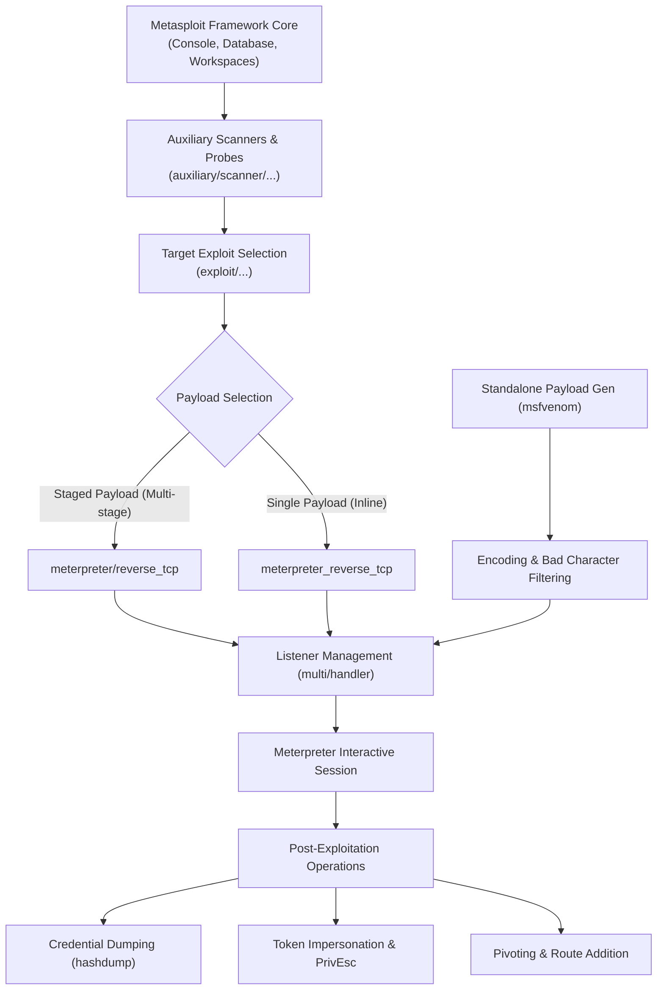

# Module 12: Metasploit and Exploitation

---

## 1. Metadata & Overview

* **Learning Path:** Jr Penetration Tester
* **Module:** Module 12 — Metasploit and Exploitation
* **Directory:** `12-METASPLOIT-AND-EXPLOITATION`
* **Operational Scope:** Weaponization, Exploitation Frameworks, Payload Architecture, Shell Listeners, and Interactive Sessions
* **Completion Status:** In Progress

---

## 2. Executive Summary

Module 12 represents the critical operational pivot within the penetration testing lifecycle, transitioning the tester from reconnaissance, vulnerability analysis, and credential access (Modules 01–11) into **active exploitation**.

This module establishes professional competency in the **Metasploit Framework (MSF)** ecosystem—the world's most widely utilized exploitation platform. Testers master `msfconsole` navigation, PostgreSQL database synchronization (`db_nmap`, workspaces, credential caching), modular exploit execution, staged versus non-staged payload mechanics, standalone artifact compilation using `msfvenom`, reverse versus bind shell architectures, listener stabilization, and advanced in-memory post-exploitation via **Meterpreter**.

---

## 3. Methodological Architecture

---

## 4. Module Curriculum Roster

1. **Metasploit: The Basics (`metasploitintro`):** Core framework architecture, `msfconsole` navigation, database integration, and workspace management.
2. **Metasploit: Scanning and Exploitation:** Leveraging auxiliary modules for port scanning, vulnerability validation, and exploit execution.
3. **Metasploit: Post-Exploitation:** Core Meterpreter commands, process migration, filesystem manipulation, and credential harvesting.
4. **Metasploit: Payload Generation:** `msfvenom` CLI syntax, executable output formats, encoding, and bad character avoidance.
5. **Exploitation and Weaponization:** Compiling public exploits, buffer overflow concepts, and payload delivery mechanics.
6. **Shells & Listeners Fundamentals:** Reverse vs. bind shells, Netcat, Socat, and terminal stabilization techniques.
7. **Shell Payload Generation & Delivery:** Web shells, Living-off-the-Land Binaries (LOLBins), and cross-platform payload delivery.
8. **Topic Transition Recap:** Comprehensive assessment synthesizing exploitation and payload disciplines.
