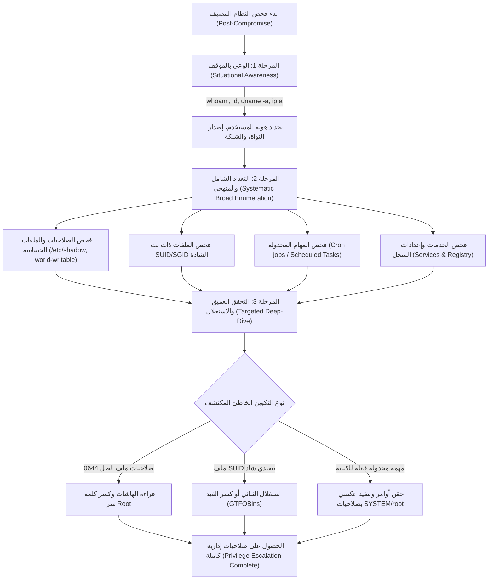

# توثيق مراجعة تكوينات الخوادم والأنظمة المضيفة (Host & Server Configuration Reviews)

---

## 1. بيانات المديول والغرفة (Metadata & Overview)

* **المسار التعليمي:** مسار مبتدئ اختبار الاختراق (Jr Penetration Tester)
* **المديول:** المديول الثالث عشر — تصعيد الصلاحيات (13-PRIVILEGE-ESCALATION)
* **اسم الغرفة:** مراجعة تكوينات الخوادم والأنظمة المضيفة (Host & Server Configuration Reviews)
* **المعرف البرمجي (Slug):** `hostserverconfigurationreviews`
* **الرابط المباشر:** [TryHackMe Host & Server Configuration Reviews](https://tryhackme.com/room/hostserverconfigurationreviews)
* **مستوى الصعوبة:** سهل / متوسط (Easy / Medium)
* **النوع:** غرفة إرشادية وتدقيق عملي (Walkthrough & Configuration Audit Practical)
* **سيناريو التقييم:** تدقيق أمني وتصعيد صلاحيات مبني على معايير CIS Benchmarks و DISA STIGs
* **عدد المهام:** 9 مهام
* **عدد الأسئلة:** 14 سؤالاً تم حلها وتوثيقها بنسبة 100%

---

## 2. الملخص التنفيذي (Executive Summary)

تُمثل غرفة **Host & Server Configuration Reviews** المدخل المنهجي للمديول الثالث عشر (تصعيد الصلاحيات - Privilege Escalation) ضمن مسار اختبار الاختراق. تُركز هذه الغرفة على الجانب الأكثر شيوعاً وموثوقية في اختراق وتصعيد الصلاحيات داخل بيئات المؤسسات: **الأخطاء الإدارية في التكوين (Configuration Misconfigurations)** بدلاً من الاعتماد الحصري على ثغرات البرمجيات وأنوية الأنظمة (Vulnerability-Based Escalation).

تستعرض الغرفة كيفية تقييم الأنظمة ضد المعايير الأمنية العالمية المعتمدة مثل **معايير CIS (Center for Internet Security)** و **أدلة DISA STIGs** التابعة لوزارة الدفاع الأمريكية، مع توضيح الفارق بين مستويات التدقيق (Level 1 و Level 2) وتصنيفات الخطورة الثلاثية (CAT I, CAT II, CAT III). كما تتناول الغرفة المقارنة بين أدوات الامتثال الدفاعية الآلية (Tenable Nessus, Lynis, OpenSCAP) وسكريبتات التعداد الهجومية (LinPEAS, WinPEAS)، وتختتم بتطبيق عملي تفاعلي لتدقيق خوادم إنتاجية (`linux-web-01`, `win-dc-01`, `linux-db-02`) واكتشاف ثغرات خطيرة مثل صلاحيات ملف الظل غير الآمنة (`/etc/shadow` بوضع `0644`)، والملفات العالمية القابلة للكتابة، وملفات SUID الشاذة، وسياسات كلمات المرور الضعيفة، وتعطيل تصفية رموز UAC الإدارية.

---

## 3. مخطط سير العمل والتدقيق الأمني (Audit & Escalation Workflow)

يوضح المخطط التالي منهجية التعداد المكونة من 3 مراحل وكيفية اكتشاف وتصعيد الصلاحيات عبر سوء التكوين:



---

## 4. المتطلبات والمفاهيم الأساسية (Prerequisites & Core Foundations)

### التمييز بين نمطي تصعيد الصلاحيات:
1. **تصعيد الصلاحيات المبني على الثغرات البرمجية (Vulnerability-Based Escalation):**
   * يعتمد على وجود أخطاء برمجية في الكود المصدري لنواة النظام (Kernel Exploits مثل Dirty COW, Dirty Pipe) أو في برامج تعمل بصلاحيات عالية.
   * **نقاط الضعف:** ترقيع النظام يغلق الثغرة تماماً، ومحاولة الاستغلال تحمل مخاطر انهيار النظام (Kernel Panic / Blue Screen of Death).
2. **تصعيد الصلاحيات المبني على سوء التكوين (Configuration-Based Escalation):**
   * يعتمد على أخطاء إدارية، مثل منح صلاحيات غير آمنة للملفات، أو مسارات خدمات غير مقتبسة، أو تخزين كلمات مرور بنصوص واضحة.
   * **نقاط القوة للمهاجم:** يعمل حتى على أحدث الأنظمة المرقعة بالكامل، وموثوق بنسبة 100% دون التسبب في سقوط النظام.

---

## 5. المعايير القياسية العالمية (Industry Standards)

### معايير CIS Benchmarks:
* تُنشر بواسطة **Center for Internet Security** بتوافق مجتمعي ودولي.
* **المستوى الأول (Level 1 Profile):** معايير أساسية لتقليل سطح الهجوم مع ضمان استمرارية الأعمال وعدم تعطيل البرمجيات.
* **المستوى الثاني (Level 2 Profile):** معايير الدفاع بالعمق (Defense-in-depth) للمؤسسات ذات الأهمية القصوى والأمان العالي (قد تتطلب تضحيات في التوافق أو سهولة الاستخدام).
* **قاعدة التحديثات:** تحديث النظام (OS Update) لن يُصلح بالضرورة التكوينات غير المتوافقة؛ بل يتطلب ذلك تدخلاً إدارياً وتطبيقاً لنصوص برمجية خاصة بالتهيئة.

### أدلة DISA STIGs:
* تُنشر بواسطة **Defense Information Systems Agency** التابعة لوزارة الدفاع الأمريكية.
* **الفئة الأولى (CAT I - High):** ثغرات ينتج عنها اختراق فوري وكامل للنظام (مثل حسابات بدون كلمة سر، أو ملفات كلمات سر قابلة للقراءة للجميع).
* **الفئة الثانية (CAT II - Medium):** ثغرات تُضعف الوضع الأمني وتُتيح للمهاجم توسيع نطاق الهجوم أو تسريب بيانات سرية.
* **الفئة الثالثة (CAT III - Low):** ثغرات تُقلل من فعالية إجراءات الدفاع بالعمق أو تُساعد في التجسس وجمع المعلومات.

---

## 6. الأدوات الآلية في مواجهة التعداد اليدوي (Tools vs. Manual Auditing)

| الأداة | الفئة | بيئة العمل | المتطلبات التشغيلية |
| :--- | :--- | :--- | :--- |
| **Tenable Nessus** | فاحص امتثال وثغرات مؤسسي | شبكي / عبر عميل | يتطلب صلاحيات إدارية كاملة (Root/Admin) لتشغيل تدقيق الامتثال |
| **Lynis** | أداة تدقيق لأنظمة Linux/Unix | محلي على السيرفر | يعمل بصلاحيات مستخدم عادي ويولد Hardening Index |
| **OpenSCAP** | إطار عمل SCAP القياسي | محلي عبر الطرفية | تدقيق سياسات XCCDF مقابل مواصفات OVAL |
| **LinPEAS / WinPEAS** | أدوات تعداد هجومية | محلي (ذاكرة مؤقتة) | مصممة للعمل بصلاحيات منخفضة جداً للبحث عن مسارات التصعيد |

---

## 7. منهجية التعداد الثلاثية (The 3-Phase Enumeration Methodology)

1. **المرحلة الأولى: الوعي بالموقف (Situational Awareness):**
   * فهم هوية المستخدم وسياقه (`whoami`, `id`, `groups`).
   * إصدار النظام ونواة التشغيل والتوزيعة (`uname -a`, `cat /etc/os-release`).
   * المنافذ المفتوحة داخلياً فقط ولا تُرى من الخارج (`netstat -tulnp`, `ss -tulnp`).
2. **المرحلة الثانية: التعداد الشامل والمنهجي (Systematic Broad Enumeration):**
   * البحث عن برامج SUID/SGID الشاذة.
   * رصد الملفات والمجلدات القابلة للكتابة لأي مستخدم (World-Writable).
   * استخراج المهام المجدولة (Cron jobs / Systemd timers / Scheduled Tasks).
   * فحص الخدمات وصلاحيات المسارات غير المقتبسة في ويندوز.
3. **المرحلة الثالثة: التحقق العميق والمستهدف (Targeted Deep-Dive Verification):**
   * تحليل نصوص السكريبتات التنفيذية التي تعمل بصلاحيات عالية.
   * مراجعة قواعد GTFOBins أو LOLBAS للثنائيات المكتشفة.
   * اختبار كتابة الأوامر والحصول على الصدفة العكسية الإدارية.

---

## 8. توثيق وحلول المهام تفصيلياً (Task-by-Task Solutions)

### المهمة 01: المقدمة (Introduction)
* استيعاب الفارق المعماري بين الثغرات البرمجية وأخطاء التكوين.
* **الإجابة:** `No answer needed`

### المهمة 02: ما هي مراجعات التكوين؟ (What are Configuration Reviews?)
* فحص ما إذا كانت التحديثات التلقائية للنظام كافية لتطبيق معايير CIS.
* **السؤال:** Will updating a Linux machine change its configuration to comply with the CIS benchmarks? (yea/nay)
* **الإجابة:** `nay`

### المهمة 03: المعايير القياسية: CIS و STIGs (Industry Standards: CIS and STIGs)
* تحديد فئة الخطورة في معايير DISA STIG التي تؤدي إلى اختراق كامل وفوري للنظام.
* **السؤال:** Which DISA STIG category will result in a complete compromise of the system?
* **الإجابة:** `CAT I`

### المهمة 04: الأدوات الآلية مقابل المراجعات اليدوية (Automated Tools vs. Manual Reviews)
* تحديد أداة فحص الثغرات القادرة على تنفيذ مراجعات الامتثال للسياسات عبر ملفات `.audit`.
* **السؤال:** Which vulnerability scanner mentioned above can perform compliance checks?
* **الإجابة:** `Nessus`

### المهمة 05: الأخطاء الشائعة في التكوين (Common Misconfigurations)
* تحديد نوع الصلاحية في أنظمة يونكس التي تسمح بتشغيل الملف بصلاحيات مالكه (مثل root).
* **السؤال:** What type of file permissions allow a user to execute a binary with the permissions of the file owner?
* **الإجابة:** `SUID`

### المهمة 06: منهجية التعداد (The Enumeration Methodology)
* تحديد المرحلة الأولى من عملية التعداد التي تُركز على فهم البيئة وسياق المستخدم.
* **السؤال:** What phase of the enumeration process focuses on understanding the system environment?
* **الإجابة:** `situational awareness`

### المهمة 07: تقييم النتائج (Evaluating Findings)
* استيعاب مصفوفة تقييم الخطورة وتأثير التكوين الخاطئ على سرية وسلامة وتوافر النظام.
* **الإجابة:** `No answer needed`

### المهمة 08: التطبيق العملي (Practical)
تدقيق ثلاثة خوادم ضمن شبكة تجريبية استناداً لتقارير CIS Benchmarks التفاعلية:
* **السؤال 1:** ما هي صلاحيات ملف `/etc/shadow` على الخادم `linux-web-01`؟
  * **الإجابة:** `0644` (قراءة للجميع، مما يتيح قراءة هاشات كلمات المرور لجميع المستخدمين).
* **السؤال 2:** كم عدد الملفات القابلة للكتابة للجميع (world-writable) التي تم العثور عليها على `linux-web-01`؟
  * **الإجابة:** `3`
* **السؤال 3:** ما هو اسم الملف التنفيذي الذي وُجد بصلاحيات SUID شاذة على `linux-web-01`؟
  * **الإجابة:** `/opt/admin-tools/logviewer`
* **السؤال 4:** ما هو الحد الأدنى لطول كلمة المرور المكوّن على خادم الدومين `win-dc-01`؟
  * **الإجابة:** `8` (المعيار يوصي بـ 14 حرفاً أو أكثر).
* **السؤال 5:** ما هي قيمة السجل لسياسة `FilterAdministratorToken` على `win-dc-01`؟
  * **الإجابة:** `0x0` (معطلة، مما يتيح تنفيذ العمليات الإدارية دون تصفية رمز UAC).
* **السؤال 6:** كم عدد الفحوصات التي نجحت بالكامل على خادم قاعدة البيانات `linux-db-02`؟
  * **الإجابة:** `8` (نظام محصن بالكامل خالي من الثغرات).

### المهمة 09: الخاتمة (Conclusion)
* تأكيد الجاهزية للانتقال للغرف العملية القادمة لتصعيد الصلاحيات على لينكس وويندوز.
* **الإجابة:** `No answer needed`

---

## 9. التحليل الأمني المتقدم للأخطاء المكتشفة (Security Deep Dive)

### 1. خطورة ملف الظل بوضع `0644`:
* في الوضع الافتراضي المشدد، يجب أن تكون صلاحيات `/etc/shadow` مضبوطة على `0640` مع امتلاك `root:shadow`، أو `0000` على أنظمة أخرى.
* ضبط الملف بوضع `0644` يعني أن خانة "Others" تمتلك إذن القراءة `r` (القيمة 4)، مما يمكن أي مستخدم محلي، أو حتى خدمة ويب مخترقة (`www-data`)، من قراءة محتوى الملف بالكامل واستخراج هاشات كلمات المرور لحسابات root والمستخدمين، ومن ثم كسرها ببرامج مثل Hashcat أو John the Ripper.

### 2. خطورة ثنائي SUID الشاذ `/opt/admin-tools/logviewer`:
* الثنائيات الافتراضية لـ SUID معروفة ومحدودة (`sudo`, `passwd`, `su`).
* وجود ثنائي مخصص داخل `/opt` مع تعيين بت SUID يشير إلى أداة داخلية كتبها مسؤول النظام لتسهيل مراجعة السجلات.
* إذا كانت هذه الأداة تستدعي برامج مثل `less` أو `tail` أو `cat` دون استخدام المسار المطلق (Relative Path)، يمكن للمهاجم التلاعب بمتغير البيئة `$PATH` لتنفيذ صدفة أوامر root كاملة.

### 3. خطورة قيمة `FilterAdministratorToken = 0x0` في ويندوز:
* في بيئات Active Directory، تضمن تصفية رمز المدير العام أن الحسابات الإدارية تعمل برموز صلاحيات منخفضة عند الاتصال بالشبكة حتى تطلب التصريح الصريح.
* ضبط القيمة على `0x0` يُعطل هذه الحماية ويجعل النظام عرضة لتمرير الهاش (Pass-the-Hash) والتحرك الجانبي السلس عبر تقنيات مثل WinRM و PsExec دون قيود UAC.

---

## 10. اعتبارات الأمن التشغيلي (OpSec Considerations)

* **تقليل البصمة:** تشغيل سكريبتات الفحص الشاملة مثل LinPEAS يُنشئ مئات العمليات الفرعية وقراءات القرص مما يُطلق إنذارات فورية لدى أنظمة EDR (مثل CrowdStrike أو Defender for Endpoint).
* **الأفضلية للتعداد اليدوي الهادئ:** ابدأ دائماً بأوامر النواة المدمجة المباشرة لتأكيد الموقف والبيئة قبل رفع أي أدوات إضافية.
* **حفظ التغييرات المؤقتة:** في حال اضطررت لإنشاء ملفات أثناء التعداد، أنشئها في مسارات الذاكرة المؤقتة في لينكس مثل `/dev/shm` لضمان عدم كتابتها على القرص الصلب وزوالها عند إعادة التشغيل.

---

## 11. الهندسة الدفاعية والمعالجة (Defensive Engineering & Hardening)

### معالجة ثغرات خادم Linux:
```bash
# 1. إصلاح صلاحيات ملف الظل فوراً
sudo chmod 0640 /etc/shadow
sudo chown root:shadow /etc/shadow

# 2. إزالة بت SUID من البرامج المخصصة غير الموثوقة
sudo chmod u-s /opt/admin-tools/logviewer

# 3. إزالة صلاحيات الكتابة العامة من الملفات الحساسة
sudo chmod o-w /path/to/world/writable/file
```

### معالجة ثغرات خادم Windows (عبر PowerShell الإداري):
```powershell
# 1. تفعيل تصفية رمز المدير لحماية UAC
Set-ItemProperty -Path "HKLM:\SOFTWARE\Microsoft\Windows\CurrentVersion\Policies\System" -Name "FilterAdministratorToken" -Value 1 -Type DWord

# 2. تطبيق سياسة طول كلمة المرور الإلزامية (14 حرفاً على الأقل) عبر Group Policy
# GPO -> Computer Configuration -> Windows Settings -> Security Settings -> Account Policies -> Password Policy -> Minimum password length: 14
```

---

## 12. الاستجابة للحوادث واصطياد التهديدات (Incident Response & Hunting)

* **اصطياد تغييرات الصلاحيات:** مراقبة نداءات النظام الخاصة بتغيير الصلاحيات عبر `auditd` في لينكس:
  ```bash
  # قاعدة تدقيق لمراقبة أوامر chmod / chown وبت SUID
  -a always,exit -F arch=b64 -S chmod -S fchmod -S fchmodat -F auid>=1000 -k perm_mod
  ```
* **مراقبة التعديل على ملفات المصادقة:** تفعيل تنبيهات SIEM الفورية عند فتح أو قراءة ملف `/etc/shadow` من قبل أي عملية غير تابعة لـ `passwd` أو `sshd`.
* **مراقبة مفاتيح السجل في ويندوز:** تدقيق الحدث رقم **4657** في سجلات أمان ويندوز لمراقبة تعديلات مفاتيح UAC وسياسات الأمان.

---

## 13. مرجع الأوامر والبطاقة السريعة (Cheatsheet)

| الإجراء | أمر Linux | أمر Windows |
| :--- | :--- | :--- |
| **هوية المستخدم والصلاحيات** | `whoami && id` | `whoami /all` |
| **معلومات النظام والنواة** | `uname -a; cat /etc/os-release` | `systeminfo` |
| **المنافذ والخدمات المتصلة** | `ss -tulnp` أو `netstat -tulnp` | `netstat -ano \| findstr LISTENING` |
| **البحث عن ملفات SUID** | `find / -perm -4000 -type f 2>/dev/null` | غير متاح (البحث عن خدمات ومسارات غير مقتبسة) |
| **البحث عن ملفات قابلة للكتابة** | `find / -writable -type f 2>/dev/null` | `accesschk.exe -uwdqs Users c:\` |
| **فحص المهام المجدولة** | `cat /etc/crontab /etc/cron.*/*` | `schtasks /query /fo LIST /v` |

---

## 14. المراجع والخطوات القادمة (References & Next Steps)

1. [CIS Benchmarks Official Guidelines](https://www.cisecurity.org/cis-benchmarks/)
2. [DISA STIGs DoD Security Requirements](https://public.cyber.mil/stigs/)
3. [NIST Special Publication 800-53](https://csrc.nist.gov/publications/detail/sp/800-53/rev-5/final)
4. [GTFOBins Unix SUID / Privilege Escalation Reference](https://gtfobins.github.io/)

### الخطوة التالية في المديول:
الانتقال إلى الغرفة الثانية في المديول الثالث عشر:
**`02-LINUX-PRIVILEGE-ESCALATION-ENUMERATION`** للبدء في التطبيق العملي المباشر للتعداد اليدوي على أنظمة لينكس واكتشاف مسارات التصعيد في البيئات الواقعية.
