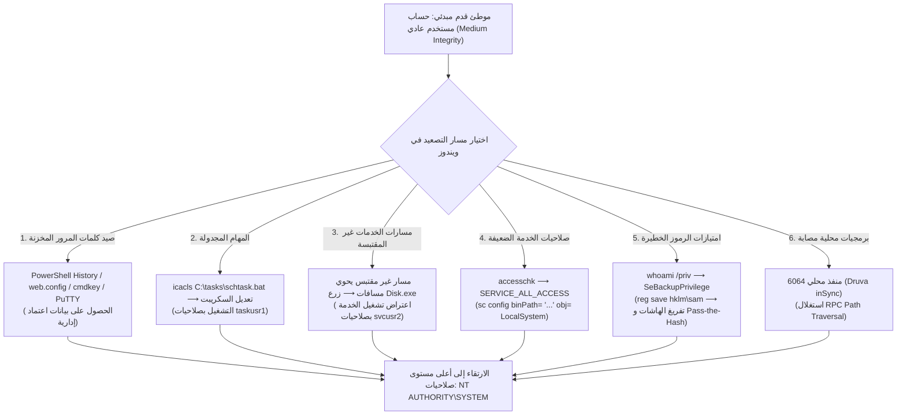

# توثيق غرفة تصعيد صلاحيات ويندوز (Windows Privilege Escalation)

---

## 1. بيانات المديول والغرفة (Metadata & Overview)

* **المسار التعليمي:** مسار مبتدئ اختبار الاختراق (Jr Penetration Tester)
* **المديول:** المديول الثالث عشر — تصعيد الصلاحيات (13-PRIVILEGE-ESCALATION)
* **اسم الغرفة:** تصعيد صلاحيات ويندوز (Windows Privilege Escalation)
* **المعرف البرمجي (Slug):** `windowsprivesc20`
* **الرابط المباشر:** [TryHackMe Windows Privilege Escalation](https://tryhackme.com/room/windowsprivesc20)
* **مستوى الصعوبة:** متوسط (Medium)
* **النوع:** غرفة عملية وتطبيق استغلال شامل (Walkthrough & Hands-on Lab)
* **سيناريو التقييم:** استغلال عملي لنواقل تصعيد الصلاحيات المتعددة في أنظمة ميكروسوفت ويندوز (استخراج كلمات السر، الخدمات، مسارات غير مقتبسة، صلاحيات الرموز، المهام المجدولة، والبرمجيات المصابة)
* **عدد المهام:** 9 مهام
* **عدد الأسئلة:** 15 سؤالاً تم حلها والتحقق منها بنسبة 100%

---

## 2. الملخص التنفيذي (Executive Summary)

تُمثل غرفة **Windows Privilege Escalation** الانتقال المعماري الرئيسي من بيئة لينكس إلى بيئة أنظمة تشغيل **Microsoft Windows** ضمن مسار Jr Penetration Tester. يختلف نموذج الأمان في ويندوز جذرياً عن لينكس، حيث يعتمد على **رموز الوصول (Access Tokens)**، ومعرفات الأمان (SIDs)، وقوائم التحكم في الوصول الاختيارية (DACLs)، ومستويات النزاهة الإلزامية (Integrity Levels).

تُغطي الغرفة ثمانية محاور رئيسية لاستغلال أخطاء التكوين والارتقاء من حساب مستخدم عادي محدود إلى السيطرة الكاملة بصلاحيات `NT AUTHORITY\SYSTEM` أو `Administrator`:
1. **تصنيف حسابات ويندوز:** فهم الفارق الجوهري بين مجموعة المديرين `Administrators` وحساب النظام الأعلى `SYSTEM` وحسابات الخدمات (`Local Service` و `Network Service`).
2. **صيد واستخراج كلمات المرور من المواقع الشائعة:** استخراج كلمات السر من سجل أوامر PowerShell التاريخي (`ZuperCkretPa5z`)، وملفات تكوين IIS web.config (`098n0x35skjD3`)، واستغلال بيانات الاعتماد المحفوظة عبر `cmdkey` وأمر `runas /savecred` (`THM{WHAT_IS_MY_PASSWORD}`)، وسجلات جلسات PuTTY في الريجستري (`CoolPass2021`).
3. **الانتصارات السريعة (Quick Wins):** استغلال المهام المجدولة ذات الصلاحيات المفتوحة على الملفات التنفيذية (`THM{TASK_COMPLETED}`)، ومفهوم سياسة `AlwaysInstallElevated`.
4. **استغلال أخطاء خدمات ويندوز (Services):**
   * استبدال ملف الخدمة التنفيذي ذو الصلاحيات الضعيفة (`THM{AT_YOUR_SERVICE}`).
   * اعتراض مسارات الخدمات غير المقتبسة الحاوية لمسافات (Unquoted Service Paths) عبر `Disk.exe` (`THM{QUOTES_EVERYWHERE}`).
   * إعادة تكوين مسار الخدمة عبر صلاحيات الخدمة الضعيفة بواسطة أمر `sc config` (`THM{INSECURE_SVC_CONFIG}`).
5. **استغلال امتيازات الرموز الخطيرة (Dangerous Privileges):** استغلال امتيازات `SeBackup` و `SeRestore` لسحب خلايا الريجستري الحساسة SAM/SYSTEM وتجاوز قيود الوصول (`THM{SEFLAGPRIVILEGE}`).
6. **استغلال البرمجيات المصابة:** استغلال واجهة RPC غير الموثقة في تطبيق النسخ الاحتياطي Druva inSync عبر ثغرة مسار نسبي (`THM{EZ_DLL_PROXY_4ME}`).
7. **أدوات التعداد الآلي المعتمدة:** مقارنة أداء وتخفي أدوات WinPEAS و PrivescCheck في الذاكرة وأداة WES-NG دون اتصال.

---

## 3. مخطط نواقل تصعيد صلاحيات ويندوز (Architecture & Vectors Flow)

يوضح المخطط التالي خريطة النواقل الهجومية في ويندوز والمسار المؤدي للسيطرة على النظام:



---

## 4. المتطلبات والمفاهيم الأساسية وهيكل حسابات ويندوز

### هرمية الحسابات في ويندوز:
1. **`NT AUTHORITY\SYSTEM` (LocalSystem):** أعلى حساب صلاحيات على الجهاز المحلي. يمتلك حق الوصول إلى كافة ملفات النظام ومساحات ذاكرة النواة ولا يخضع لرسائل UAC.
2. **`Administrators` Group:** الحسابات الإدارية التي تستطيع تثبيت البرمجيات وتعديل الخدمات وسياسات الجهاز.
3. **`Users` Group:** المستخدمون القياسيون؛ تقتصر صلاحياتهم على مجلدات ملفاتهم الشخصية (`C:\Users\<username>`).
4. **حسابات الخدمات:**
   * `LOCAL SERVICE`: حساب بخدمات محلية ضئيلة يتصل بالشبكة كحساب مجهول (Anonymous).
   * `NETWORK SERVICE`: حساب خدمات شبكية يستخدم هوية الجهاز في الدومين (`<COMPUTERNAME>$`).

---

## 5. صيد واستخراج كلمات المرور من المواقع الشائعة

1. **سجل أوامر PowerShell التاريخي:**
   ```powershell
   type %userprofile%\AppData\Roaming\Microsoft\Windows\PowerShell\PSReadline\ConsoleHost_history.txt
   ```
   * تم كشف أمر إنشاء مستخدم بكلمة السر: **`ZuperCkretPa5z`**.
2. **ملفات تكوين خادم الويب IIS:**
   ```cmd
   type C:\inetpub\wwwroot\web.config
   ```
   * تم كشف سلسلة الاتصال بقاعدة البيانات بكلمة السر: **`098n0x35skjD3`**.
3. **استغلال بيانات الاعتماد المحفوظة (`cmdkey`):**
   ```cmd
   cmdkey /list
   runas /savecred /user:MACHINE\mike.katz "cmd.exe /c copy C:\Users\mike.katz\Desktop\flag.txt C:\flag.txt"
   ```
   * الفلاج المكتشف: **`THM{WHAT_IS_MY_PASSWORD}`**.
4. **جلسات PuTTY المخزنة في الريجستري:**
   ```cmd
   reg query "HKCU\Software\SimonTatham\PuTTY\Sessions" /s
   ```
   * كلمة السر المستخرجة للمستخدم thom.smith: **`CoolPass2021`**.

---

## 6. الانتصارات السريعة (Quick Wins)

* **المهام المجدولة الضعيفة:**
  فحص المهمة `vulntask` عبر `schtasks /query /tn vulntask /fo list /v` وفحص أذونات ملفها `C:\tasks\schtask.bat` عبر `icacls`.
  أظهرت النتيجة `BUILTIN\Users:(F)`. تم تعديل الملف وتشغيله للحصول على فلاج: **`THM{TASK_COMPLETED}`**.
* **سياسة `AlwaysInstallElevated`:**
  عند تفعيل هذا الخيار في فرعي الريجستري HKLM و HKCU، يقوم محرك التثبيت `msiexec` بتشغيل حزم MSI بصلاحيات SYSTEM.

---

## 7. استغلال أخطاء تكوين خدمات ويندوز (Services)

1. **أذونات الملف التنفيذي للخدمة:**
   استبدال ملف `WService.exe` الخاص بخدمة `windowsscheduler` وإعادة تشغيل الخدمة لحصد فلاج المستخدم svcusr1:
   **`THM{AT_YOUR_SERVICE}`**.
2. **المسارات غير المقتبسة الحاوية لمسافات (Unquoted Paths):**
   مسار خدمة Disk Sorter غير مقتبس ويحتوي على مسافات. تم إسقاط ثنائي باسم `Disk.exe` في مجلد `C:\MyPrograms\` مما مكن من اعتراض تشغيل الخدمة كـ svcusr2:
   **`THM{QUOTES_EVERYWHERE}`**.
3. **صلاحيات الخدمة المفتوحة (Insecure Service DACL):**
   فحص الخدمة `THMService` عبر أداة `accesschk64.exe -qlc thmservice` أظهر صلاحية `SERVICE_ALL_ACCESS`. تم تغيير مسار الخدمة عبر `sc config` لتعمل كـ LocalSystem وتقرأ فلاج المدير العام:
   **`THM{INSECURE_SVC_CONFIG}`**.

---

## 8. إساءة استخدام امتيازات الرموز الخطيرة (Token Privileges)

* **امتياز `SeBackupPrivilege`:**
  يتيح قراءة أي ملف متجاوزاً قيود الحماية. تم تفريغ خلايا الريجستري:
  ```cmd
  reg save hklm\sam C:\temp\sam.hive
  reg save hklm\system C:\temp\system.hive
  ```
  واستخراج الهاشات واستخدام Pass-the-Hash عبر `psexec.py` للدخول كـ SYSTEM وقراءة الفلاج:
  **`THM{SEFLAGPRIVILEGE}`**.

---

## 9. استغلال ثغرات البرمجيات والخدمات المحلية

* **ثغرة Druva inSync 6.6.3:**
  خدمة محلية تستمع على المنفذ `6064` بصلاحيات SYSTEM. تم استخدام سكريبت بايثون/باورشيل للاتصال بواجهة RPC وتنفيذ أمر إداري عبر ثغرة مسار نسبي، واستخراج الفلاج:
  **`THM{EZ_DLL_PROXY_4ME}`**.

---

## 10. أدوات التعداد والمسح الآلي في ويندوز

| الأداة | لغة العمل | بيئة التشغيل والتخفي |
| :--- | :--- | :--- |
| **WinPEAS** | EXE / BAT | أداة مسح شاملة ولكن يسهل رصدها من برامج مكافحة الفيروسات (AV/EDR) |
| **PrivescCheck** | PowerShell | مسح فائق في الذاكرة دون كتابة ملفات تنفيذية على القرص |
| **WES-NG** | Python | أداة استعلام ثغرات تعمل على جهاز المهاجم دون اتصال مباشر بالهدف |

---

## 11. توثيق وحلول المهام تفصيلياً (Task-by-Task Solutions)

* **المهمة 01:** `No answer needed`
* **المهمة 02:**
  * السؤال 1: `Administrators`
  * السؤال 2: `aye`
* **المهمة 03:**
  * السؤال 1: `ZuperCkretPa5z`
  * السؤال 2: `098n0x35skjD3`
  * السؤال 3: `THM{WHAT_IS_MY_PASSWORD}`
  * السؤال 4: `CoolPass2021`
* **المهمة 04:** `THM{TASK_COMPLETED}`
* **المهمة 05:**
  * السؤال 1: `THM{AT_YOUR_SERVICE}`
  * السؤال 2: `THM{QUOTES_EVERYWHERE}`
  * السؤال 3: `THM{INSECURE_SVC_CONFIG}`
* **المهمة 06:** `THM{SEFLAGPRIVILEGE}`
* **المهمة 07:** `THM{EZ_DLL_PROXY_4ME}`
* **المهمة 08:** `No answer needed`
* **المهمة 09:** `No answer needed`

---

## 12. اعتبارات الأمن التشغيلي (OpSec Considerations)

* **تجنب إسقاط الملفات التنفيذية:** مكافح الفيروسات Windows Defender يتعرف على أدوات مثل `winpeas.exe` فور كتابتها على القرص. استخدم أوامر النظام الأصلية (LotL) أو سكريبتات باورشيل العاملة في الذاكرة.
* **حذف الملفات المؤقتة:** إزالة خلايا الريجستري المفرغة ومسارات الملفات المعدلة فور إتمام الاختبار لمنع تسريب بيانات العميل.

---

## 13. الهندسة الدفاعية والمعالجة (Defensive Hardening)

1. **اقتباس مسارات الخدمات:** التأكد من وضع مسارات كافة الخدمات في الريجستري بين علامتي تنصيص `""`.
2. **تشديد أذونات المجلدات والملفات التنفيذية:** التأكد من عدم منح `BUILTIN\Users` صلاحيات كتابة أو تعديل على مجلدات البرامج أو سكريبتات المهام المجدولة.
3. **تطبيق مبدأ الصلاحيات الأقل على الحسابات والخدمات:** تشغيل الخدمات بحسابات خدمة مدارة (gMSA) وتجريد الحسابات العادية من الامتيازات الخطيرة مثل `SeBackup` و `SeImpersonate`.

---

## 14. مرجع الأوامر والمراجع والخطوات القادمة (Cheatsheet & Next Steps)

| الإجراء | أمر ويندوز |
| :--- | :--- |
| **فحص الصلاحيات والامتيازات** | `whoami /priv` و `whoami /all` |
| **فحص أذونات ملف أو مجلد** | `icacls "C:\path\to\file"` |
| **استعلام تكوين خدمة** | `sc qc <service_name>` |
| **فحص أذونات خدمة عبر AccessChk** | `accesschk64.exe -qlc <service_name>` |
| **استعراض المهام المجدولة** | `schtasks /query /fo LIST /v` |
| **استعراض كلمات السر المخزنة** | `cmdkey /list` |

### الخطوة التالية في المديول:
الانتقال إلى الغرفة السادسة في المديول الثالث عشر:
**`06-JUMP-CHALLENGE`** لتطبيق كافة مهارات تصعيد الصلاحيات العملية في تحدي معملي واقعي.
