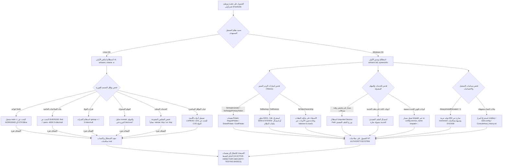

# توثيق مراجعة وانتقال مديول تصعيد الصلاحيات (Topic Transition Recap: Privilege Escalation)

---

## 1. بيانات المديول والروم (Metadata & Overview)

* **المسار التعليمي:** مسار مبتدئ اختبار الاختراق (Jr Penetration Tester)
* **المديول:** المديول الثالث عشر — تصعيد الصلاحيات (13-PRIVILEGE-ESCALATION)
* **اسم الغرفة / التقييم:** مراجعة الانتقال للموضوع (Topic Transition Recap)
* **المعرف البرمجي (Recap ID):** `6afe01d5f306fc3f65928061`
* **الرمز التعريفي (Snapshot Slug):** `0749d28b6b9cd3469956ca999ce066ba33936ac8df1a9efcbcf496671ed39ae5`
* **الرابط المباشر:** [TryHackMe Module 13 Recap](https://tryhackme.com/recap/6afe01d5f306fc3f65928061)
* **النوع:** تقييم ختامي وتركيب منهجي شامل (Module Synthesis & Technical Assessment)
* **الحالة:** مكتمل بنسبة 100% (6/6 أسئلة تم حلها وتدقيقها بدقة)
* **النقاط المحققة:** 48 / 48 نقطة كاملة (8 نقاط لكل سؤال)

---

## 2. الملخص التنفيذي للمديول الثالث عشر (Module 13 Executive Summary)

يُمثل **المديول الثالث عشر (Privilege Escalation)** المحطة الفاصلة في مسار اختبار الاختراق؛ حيث ينتقل مختبر الاختراق من مرحلة الحصول على موطئ قدم محدود بصلاحيات مستخدم عادي (Low-Privilege Foothold) إلى السيطرة الكاملة على نواة النظام وصلاحيات الجذر (`root`) في أنظمة لينكس أو صلاحيات النظام القصوى (`NT AUTHORITY\SYSTEM`) في بيئات ويندوز.

خلال غرف المديول الثماني، تم استعراض وتطبيق ترسانة منهجية متقدمة تغطي شقي الهندسة العكسية للتفويض وصلاحيات الأنظمة:
1. **مراجعة تكوينات الخوادم (Host & Server Configuration Reviews):** استكشاف ثغرات الإعدادات الافتراضية، وخدمات النواة غير المقيدة، وخدمات الويب وقواعد البيانات، وتحليل قواعد التدقيق التلقائي وتصليد بيئات الخوادم.
2. **استطلاع وتعداد أنظمة لينكس (Linux Privilege Escalation - Enumeration):** الإلمام الدقيق بأوامر جمع المعلومات الأساسية (`uname -a`, `id`, `whoami`, `cat /etc/passwd`, `ip a`)، وتحليل العمليات والخدمات الداخلية (`ps aux`, `netstat -tlnp`, `ss -tlnp`)، وتحديد البرامج المثبتة وحزم البرمجيات المؤهلة لثغرات الـ CVE.
3. **أساسيات وتقنيات تصعيد صلاحيات لينكس (Linux Privilege Escalation - Basics):** 
   * سوء تكوين تفويض Sudo واستغلال `sudo -l` وكلمات المرور المخزنة وقواعد `NOPASSWD:`.
   * استغلال بتات SUID/SGID وفهرس GTFOBins ومصائد الذاكرة.
   * اختطاف مسارات التنفيذ (PATH Hijacking) وتلاعب متغيرات البيئة.
   * استغلال قدرات لينكس المتقدمة (Linux Capabilities مثل `cap_setuid+ep`).
   * هجمات المهام المجدولة (Cron Jobs) واستغلال أحرف البدل (Wildcard Injection) في `tar` و `rsync`.
   * قراءة وتكسير تجزئات كلمات المرور من ملف `/etc/shadow`.
4. **أتمتة الفحص في لينكس (Linux Privilege Escalation - Automation):** توظيف سكريبتات الأتمتة الموثوقة (`LinPEAS`, `LinEnum`, `Linux-Smart-Enumeration`, `LES`)، وفك شفرة المخرجات الملونة وفرز النتائج وفق مستوى الثقة (99% PE Vector مقابل Informational).
5. **تصعيد صلاحيات بيئات ويندوز (Windows Privilege Escalation):**
   * استخراج الاعتماديات من سجل الأوامر `ConsoleHost_history.txt` وملفات الإعدادات `web.config` وبيانات الاعتماد المخزنة في `cmdkey`.
   * استغلال سياسات التثبيت الإداري المرتفعة دائماً (`AlwaysInstallElevated`).
   * ثغرات مسارات الخدمات غير المحصورة بين علامات تنصيص (Unquoted Service Paths).
   * استبدال ملفات البرامج التنفيذية للخدمات ذات الأذونات الضعيفة (Weak Service Executable Permissions / ACLs).
   * إعادة توجيه مسارات تنفيذ الخدمات عبر أداة `sc config` (Weak Service Permissions).
   * إساءة استغلال امتيازات الرموز المميزة (Token Privileges: `SeBackupPrivilege`, `SeRestorePrivilege`, `SeImpersonatePrivilege`, `SeTakeOwnershipPrivilege`).
   * استغلال البرمجيات الوسيطة المحلية (Third-Party Local RPC / Druva inSync).
6. **تحدي القفز العملي للينكس (Jump Challenge):** اختراق شبكة حقيقية وسلسلة هجوم خماسية المراحل (Web Recon -> Foothold -> SSH Cracking -> SUID Binary Reverse Engineering & PATH Exploitation -> Root Proof).
7. **تحدي القفز العملي لويندوز (Windows Jump Challenge):** تطبيق تكتيكي شامل لسلسلة هجوم رباعية المراحل (Port Scan & MSSQL Recon -> Foothold -> Registry / Service Enumeration -> Administrative Control).
8. **المراجعة والتقييم الختامي (Topic Transition Recap):** ترسيخ المبادئ الحاكمة وتثبيت المعارف الفنية واجتياز التقييم النهائي بنسبة 100% (48/48 نقطة).

---

## 3. مخطط شجرة القرار الشاملة لتصعيد الصلاحيات (Comprehensive Decision Tree)



---

## 4. المتطلبات وإعداد بيئات الاختبار والتحليل (Prerequisites & Environment Setup)

### أ. أدوات الهجوم في نظام كالي لينكس (Kali AttackBox):
* أدوات استطلاع ونقل الملفات: `curl`, `wget`, `nc`, `socat`, `python3 -m http.server`.
* أدوات الفحص والأتمتة لنظام لينكس:
  * `LinPEAS` (`linpeas.sh`)
  * `Linux-Smart-Enumeration` (`lse.sh`)
  * `linux-exploit-suggester.sh`
* أدوات الفحص والأتمتة لنظام ويندوز:
  * `WinPEASany.exe` / `winPEAS.bat`
  * `PrivescCheck.ps1`
  * `WES-NG` (Windows Exploit Suggester - Next Generation)
* أدوات تكسير التجزئات والتفاعل:
  * `hashcat`, `john`, `mimikatz.exe`, `evil-winrm`, `impacket-psexec`.

### ب. تهيئة استلام القذائف والملفات بأمان:
```bash
# تشغيل خادم ويب بايثون لمشاركة أدوات الاستطلاع
python3 -m http.server 8000

# مستمع Netcat لتلقي القذائف العكسية المرفوعة
nc -lvnp 4444
```

---

## 5. المفاهيم الهندسية والتحليل المعماري العميق (Core Concepts & Technical Deep Dive)

### 1. معمارية تفويض Sudo وتدقيق مخرجات `sudo -l`:
* **الميكانيكا:** يتحقق برنامج `sudo` من صلاحيات المستخدم في ملف `/etc/sudoers`. عند تنفيذ `sudo -l`، يقوم البرنامج بطباعة القواعد الخاصة بالمستخدم الحالي فقط دون كشف حسابات النظام الأخرى.
* **الأثر الأمني:** كشف أوامر `NOPASSWD:`، ومعرفة المتغيرات المحفوظة (`env_keep+=LD_PRELOAD`) التي تسمح بحقن مكتبات ديناميكية مشتركة تُنفذ كوداً خبيثاً بصلاحيات `root` لحظة استدعاء أي أمر مصرح به.

### 2. ميكانيكا البحث في مسار التنفيذ `$PATH` والاختطاف (PATH Hijacking):
* **الميكانيكا:** عندما يستدعي برنامج أو سكريبت أمراً غير مطلق المسار (مثل `curl` أو `service`)، يبحث مفسر الأوامر ونواة النظام في المجلدات المحددة في متغير البيئة `$PATH` بالترتيب من اليسار إلى اليمين.
* **الأثر الأمني:** إذا كانت العملية تعمل بصلاحيات `root` (عبر SUID أو مهمة مجدولة)، وكان بإمكان المهاجم الكتابة في مجلد يسبق المسار الأصلي في `$PATH` أو تعديل قيمة المتغير، يُمكن للمهاجم زرع ملف تنفيذي خبيث يحمل نفس اسم الأمر المستدعى، مما يؤدي إلى تنفيذ أوامره بصلاحيات الجذر فوراً.

### 3. تأمين وتخزين تجزئات كلمات المرور في `/etc/shadow`:
* **الميكانيكا:** في بدايات يونكس كانت كلمات المرور تُخزن في `/etc/passwd`. ولأن هذا الملف يجب أن يكون قابلاً للقراءة من كافة المستخدمين لترجمة معرفات المستخدمين (UIDs)، تم عزل التجزئات المشفرة في ملف `/etc/shadow` المحمي بحيث لا يمكن قراءته إلا من قبل المستخدم `root`.
* **الأثر الأمني:** يمثل الحصول على إذن قراءة لملف `/etc/shadow` هدفاً فائق الخطورة؛ حيث يتيح للمهاجم نسخ كافة تجزئات حسابات النظام وتكسيرها محلياً دون إثارة سجلات محاولات الدخول الفاشلة على الخادم المستهدف.

### 4. فحص واكتشاف المقابس والخدمات الداخلية (`netstat -lt` / `ss -tlnp`):
* **الميكانيكا:** الخيار `-l` يحصر النتائج في المقابس المستمعة (Listening)، بينما يحصر الخيار `-t` المقابس في بروتوكول TCP.
* **الأثر الأمني:** كشف الخدمات المقيدة على الواجهة الداخلية `127.0.0.1` أو شبكات الإدارة الخاصة التي لا تظهر في عمليات الفحص الخارجية لـ Nmap، مما يفتح مسارات استغلال ثغرات الويب والتطبيقات المحلية.

### 5. تجاوز ضوابط الوصول عبر امتيازات الرموز المميزة في ويندوز (`SeBackup` / `SeRestore`):
* **الميكانيكا:** صُمم هذان الامتيازان لدعم عمليات النسخ الاحتياطي والاستعادة دون منح المستخدمين صلاحيات إدارية كاملة. يؤدي تفعيل `SeBackupPrivilege` إلى توجيه مدير كائنات ويندوز (Windows Object Manager) لتجاوز كافة قوائم التحكم في الوصول التقديرية (DACLs) لعمليات القراءة، بينما يتجاوز `SeRestorePrivilege` كافة قيود الـ DACLs لعمليات الكتابة.
* **الأثر الأمني:** قراءة واستخراج ملفات خلايا التسجيل المحمية `SAM` و `SYSTEM` للحصول على تجزئات حسابات الآدمن، أو استبدال ملفات النظام التنفيذية ببرمجيات خبيثة تُنفذ بصلاحيات `SYSTEM`.

### 6. الربط الفوري بين مخرجات الأتمتة وأكواد الاستغلال العامة عبر أرقام CVE:
* **الميكانيكا:** تقوم أدوات مثل `LinPEAS` و `WinPEAS` بمطابقة إصدارات البرمجيات وحزم النظام مع قواعد بيانات الثغرات المعروفة، وتبرز المعرفات العامة للثغرات (CVE IDs).
* **الأثر الأمني:** يوفر رقم الـ CVE مفتاح بحث دقيق ومباشر في قواعد بيانات Exploit-DB ومستودعات GitHub، مما يقود مباشرة إلى كود استغلال موثوق ومخصص للنواة أو الخدمة المصابة.

---

## 6. مرجع الأوامر ومصفوفة تصعيد الصلاحيات الشاملة (Master Commands Reference)

| النطاق / البيئة | الأمر النموذجي | الوظيفة التقنية والأثر في تصعيد الصلاحيات |
| :--- | :--- | :--- |
| **Linux Sudo** | `sudo -l` | استعراض قواعد الـ sudoers الخاصة بالمستخدم وتحديد أوامر NOPASSWD |
| **Linux SUID** | `find / -perm -4000 -type f 2>/dev/null` | حصر كافة الملفات التنفيذية التي تحمل بت SUID وتعمل بصلاحيات مالكها |
| **Linux Capabilities** | `getcap -r / 2>/dev/null` | استعراض قدرات العمليات المتقدمة في النواة (مثل `cap_setuid+ep`) |
| **Linux Sockets** | `netstat -tlnp` أو `ss -tlnp` | استعراض مقابس TCP المستمعة والعمليات المرتبطة بها وعزل خدمات Localhost |
| **Linux Shadow** | `cat /etc/shadow` | استخراج تجزئات كلمات مرور المستخدمين وحساب الجذر في حال وجود ثغرة قراءة |
| **Linux Automation** | `./linpeas.sh -a` | فحص آلي شامل لنظام لينكس وتلوين نواقل التصعيد المحتملة باللون الأحمر |
| **Windows Privileges** | `whoami /priv` | استعراض قائمة امتيازات الرمز المميز الحالي والتحقق من الامتيازات الخطرة |
| **Windows Unquoted** | `wmic service get name,displayname,pathname,startmode` | البحث عن مسارات الخدمات التي تحوي مسافات وغير محصورة بعلامات تنصيص |
| **Windows Service Perms** | `sc config <service> binpath= "C:\malicious.exe"` | إعادة توجيه مسار الملف التنفيذي للخدمة إلى حمولة ضارة بصلاحيات SYSTEM |
| **Windows MSI Elevated** | `reg query HKLM\SOFTWARE\Policies\Microsoft\Windows\Installer` | التحقق من تفعيل مفتاح `AlwaysInstallElevated` لتثبيت حزم MSI كـ SYSTEM |
| **Windows Credentials** | `cmdkey /list` | فحص بيانات الاعتماد المحفوظة في مدير بيانات اعتماد ويندوز |
| **Windows Automation** | `.\winPEASany.exe quiet cmd fast` | تشغيل أداة winPEAS لفحص تكوينات ويندوز والخدمات والتسجيل بصورة سريعة |

---

## 7. تحليل أسئلة التقييم الختامي الستة وحلولها النموذجية (Questions & Tasks Analysis)

### السؤال 1: الفائدة الاستخباراتية لأمر `sudo -l`
* **نص السؤال:** ما هي المعلومات التي يوفرها تنفيذ أمر `sudo -l` للمهاجم على حساب لينكس مخترق؟
* **الخيار الصحيح:** **The commands the current user may run via sudo** (الخيار A).
* **التحليل الفني:** يعرض الأمر القواعد المطابقة في ملف `/etc/sudoers` للمستخدم الحالي، بما في ذلك صلاحيات التشغيل بدون كلمة مرور (`NOPASSWD`) والمتغيرات البيئية المحفوظة، وهو المرجع الأساسي لاستغلال GTFOBins.

### السؤال 2: حقيقة ودور متغير البيئة PATH
* **نص السؤال:** متغير PATH هو متغير بيئة يخبر النظام بالمجلدات التي يجب البحث فيها عن اسم الملف التنفيذي.
* **الخيار الصحيح:** **True** (صحيح).
* **التحليل الفني:** يحدد المتغير قائمة مرتبة بالمجلدات التي تُفحص بالتسلسل للبحث عن الأوامر غير المطلقة، مما يجعل هجمات اختطاف المسار (PATH Hijacking) ممكنة عند استدعاء أوامر نسبية من برمجيات مرتفعة الصلاحيات.

### السؤال 3: ملف تخزين تجزئات كلمات المرور في لينكس
* **نص السؤال:** ما هو الملف الذي يخزن تجزئات كلمات مرور مستخدمي لينكس التي يمكن استخراجها وتكسيرها دون اتصال؟
* **الخيار الصحيح:** **/etc/shadow** (الخيار C).
* **التحليل الفني:** يتمتع هذا الملف بأذونات قراءة حصرية للمستخدم `root` فقط، ويخزن التجزئات المشفرة (SHA-512 / yescrypt)، بينما يحتوي `/etc/passwd` على الرمز `x` كبديل شكلي.

### السؤال 4: أمر netstat لعرض منافذ TCP المستمعة فقط
* **نص السؤال:** أي استدعاء لأمر netstat يعرض فقط منافذ TCP التي هي حالياً في حالة الاستماع (Listening)؟
* **الخيار الصحيح:** **netstat -lt** (الخيار E).
* **التحليل الفني:** يُقيد المفتاح `-l` المخرجات بحالة الاستماع (Listening) ويُقيد المفتاح `-t` البروتوكول بـ TCP حصراً، وهو الأمر المثالي لاكتشاف الخدمات المحلية المستترة.

### السؤال 5: امتيازات ويندوز لتجاوز قوائم التحكم في الوصول التقديرية (DACLs)
* **نص السؤال:** ما هي الامتيازات التي تسمح للمستخدم بقراءة وكتابة أي ملف على النظام بغض النظر عن الـ DACL المطبق؟
* **الخيار الصحيح:** **SeBackupPrivilege and SeRestorePrivilege** (الخيار D).
* **التحليل الفني:** وُجد هذان الامتيازان لتمكين برامج النسخ الاحتياطي والاستعادة من العمل دون صلاحيات مسؤول كاملة؛ حيث يتجاوز `SeBackupPrivilege` قيود القراءة لنسخ الـ SAM، بينما يتجاوز `SeRestorePrivilege` قيود الكتابة لاستبدال ملفات الخدمات التنفيذية.

### السؤال 6: المخرج الأكثر مباشرة من أدوات الأتمتة لأبحاث الاستغلال العام
* **نص السؤال:** أي نتيجة في مخرجات الاستطلاع المؤتمت تقود بشكل مباشر إلى البحث عن كود استغلال عام؟
* **الخيار الصحيح:** **A flagged CVE number for an installed software version** (الخيار E).
* **التحليل الفني:** يوفر معرف الـ CVE معياراً فريداً ومباشراً للبحث في قواعد بيانات الثغرات وأكواد الاستغلال العامة (Exploit-DB / GitHub)، على عكس المتغيرات البيئية أو مساحات الأقراص التي تقدم سياقاً عاماً فقط.

---

## 8. الحالات الحرجة والمصائد التشغيلية واستكشاف الأخطاء (Edge Cases & Operational Traps)

1. **مصيدة انعدام مسار الـ TTY في Bash مع SUID:**
   * عند استغلال بت SUID على مفسر مثل Bash، فإن تشغيل `bash` بدون الخيار `-p` يُسقط صلاحيات المستخدم الفعلي (EUID) فوراً ويعود إلى الصلاحيات العادية.
   * **الحل:** استخدام `bash -p` أو `sh -p` للاحتفاظ بامتيازات الـ EUID المرتفعة.
2. **فشل استدعاء الأدوات المؤتمتة بسبب قيود الذاكرة وحجم المخرجات:**
   * تشغيل `winPEASany.exe` على أنظمة ذات موارد محدودة قد يستهلك المعالج أو يولد آلاف الأسطر التي تغمر الطرفية.
   * **الحل:** استخدام خيارات التوجيه السريع `winPEAS.exe quiet cmd fast > out.txt` أو فحص جوانب محددة عبر `PrivescCheck.ps1`.
3. **تجاوز قيود UAC ورموز الرموز المميزة المفلترة (Filtered Tokens):**
   * في ويندوز، تسجيل الدخول كعضو في مجموعة `Administrators` ينتج رمز وصول مقيد (Medium Integrity Token) بسبب UAC.
   * **الحل:** التحقق من مستوى النزاهة واستخدام آليات تجاوز UAC (مثل تقنيات Fodhelper أو Slui) للارتقاء إلى High Integrity Token قبل محاولة تعديل الخدمات أو استدعاء الامتيازات الحساسة.

---

## 9. الهندسة الدفاعية وتأمين الأنظمة للفريق الأزرق (Defensive Engineering & Hardening)

* **تأمين ملف Sudoers:**
  * منع استخدام `ALL=(ALL) NOPASSWD: ALL` نهائياً.
  * حظر منح صلاحيات Sudo للأدوات التي تمتلك قدرات استدعاء أوامر النظام (مثل المفسرات والمحررات النصية).
  * تفعيل توجيه `Defaults secure_path` لفرض مسارات موثوقة حصراً ومنع التلاعب بـ `$PATH`.
* **مراجعة بتات SUID وتجريد القدرات الزائدة:**
  * تدقيق دوري لملفات النظام وإزالة بت SUID عن الأدوات غير الأساسية (`chmod u-s /path/to/binary`).
  * تطبيق مبدأ الامتياز الأدنى على قدرات النواة وتجنب منح `CAP_SETUID` إلا في أضيق الحدود.
* **تأمين خدمات وتكوينات ويندوز:**
  * إحاطة كافة مسارات الخدمات بعلامات تنصيص مزدوجة (Quotes) لمنع هجمات المسارات غير المقتبسة.
  * ضبط قوائم الوصول التقديرية (DACLs) للمجلدات وملفات البرامج لحظر أذونات الكتابة والتعديل لمجموعتي `Users` و `Everyone`.
  * تعطيل مفتاح `AlwaysInstallElevated` في سجل النظام عبر Group Policy.
  * تقييد امتيازات الحسابات الخدمية وحجب `SeImpersonatePrivilege` عن الحسابات غير النظامية.

---

## 10. مصفوفة التكتيكات والتقنيات MITRE ATT&CK

| معرف التقنية (ID) | اسم التقنية (Technique Name) | التكتيك الأمني (Tactic) | آلية التطبيق في المديول |
| :--- | :--- | :--- | :--- |
| **T1548.003** | Sudo and Sudo Caching | Privilege Escalation | استغلال قواعد sudoers و NOPASSWD و GTFOBins |
| **T1548.001** | Setuid and Setgid | Privilege Escalation | استغلال الملفات التنفيذية الحاملة لبت SUID المرتفع |
| **T1574.007** | Path Interception by PATH Environment Variable | Privilege Escalation / Persistence | اختطاف مسارات التنفيذ عبر التلاعب بمتغير `$PATH` |
| **T1574.009** | Services File Permissions Weakness | Privilege Escalation / Persistence | استبدال ملفات تنفيذ الخدمات ذات الأذونات الضعيفة |
| **T1574.008** | Path Interception by Unquoted Path | Privilege Escalation | استغلال مسارات الخدمات غير المحصورة التي تحوي مسافات |
| **T1134.001** | Token Impersonation/Theft | Privilege Escalation / Defense Evasion | إساءة استغلال امتيازات الرموز المميزة وهجمات Potato |
| **T1003.008** | /etc/passwd and /etc/shadow | Credential Access | قراءة وتكسير تجزئات كلمات المرور من `/etc/shadow` |
| **T1003.002** | Security Account Manager (SAM) | Credential Access | استخراج وحفظ خلايا SAM و SYSTEM لاستخراج NTLM |

---

## 11. الخلاصات التعليمية وبناء العقلية الأمنية (Educational Takeaways & Mindset)

1. **تصعيد الصلاحيات ليس مجرد أداة بل سلسلة منطقية:**
   * نادراً ما يتم تصعيد الصلاحيات عبر خطوة واحدة منفصلة؛ بل هو نتيجة تراكمية لسلسلة من الأخطاء الصغيرة: كلمة مرور مكشوفة في سجل نصي تقود إلى حساب محلي، ثم استعلام عن الصلاحيات يكشف إذن تشغيل أمر معين عبر Sudo، مما يقود في النهاية إلى السيطرة الكاملة على النظام.
2. **فهم الأنظمة قبل مهاجمتها:**
   * لا يمكن لمختبر الاختراق اكتشاف ثغرات الخدمات وصلاحيات الرموز المميزة في ويندوز دون فهم عميق لكيفية عمل الـ Service Control Manager ومستويات النزاهة وهياكل الـ Tokens وقوائم الـ DACL.
3. **التحليل الذكي لمخرجات الأتمتة:**
   * تُنتج أدوات مثل LinPEAS آلاف الأسطر؛ العبرة ليست بتشغيل الأداة، بل بالقدرة على عزل الإشارات الحقيقية (Signals) عن الضجيج العام (Noise)، وتحديد النواقل الموثوقة ذات الأثر الحاسم.

---

## 12. الانتقال للمديول التالي (Transition to Next Module)

مع إتمام المديول الثالث عشر والسيطرة التامة على محطات العمل والخوادم الفردية (Host-Level Domination)، تنتهي مرحلة اختبار الاختراق على مستوى الأجهزة المعزولة.
الخطوة الحتمية التالية في بيئات العمل الواقعية هي الانتقال إلى الهجمات المؤسسية الكبرى:
* **المديول الرابع عشر: أساسيات اختبار أمان الدليل النشط (14-ACTIVE-DIRECTORY-SECURITY-TESTING-BASICS):**
  * الانتقال من مستخدم النظام المحلي إلى بيئة النطاق الموحد (Active Directory Domain).
  * فهم بروتوكولات المصادقة Kerberos و NTLM في بيئات النطاق.
  * استطلاع النطاق عبر LDAP و RPC و BloodHound.
  * هجمات استخراج الاعتماديات المتقدمة (Kerberoasting, AS-REP Roasting).
  * التحرك الجانبي (Lateral Movement) والسيطرة على متحكمات النطاق (Domain Controllers).

---

## 13. المصادر التقنية الموصى بها (Additional Technical Resources)

* [GTFOBins - Curated List of Unix Binaries for Privilege Escalation](https://gtfobins.github.io/)
* [LOLBAS - Living Off The Land Binaries and Scripts for Windows](https://lolbas-project.github.io/)
* [Priv2Admin - Abusing Windows Token Privileges](https://github.com/gtworek/Priv2Admin)
* [PayloadsAllTheThings - Privilege Escalation Methodology](https://github.com/swisskyrepo/PayloadsAllTheThings)
* [TryHackMe Privilege Escalation Module](https://tryhackme.com/module/privilege-escalation)

---

## 14. التحقق العملي وإثبات الإنجاز (Practical Verification & Proof of Work)

* **التحقق من حساب TryHackMe:** تم التدقيق والتأكيد عبر الحساب الفعلي المكتمل للمستخدم (المستوى 64، مسار Jr Penetration Tester مكتمل بنسبة 100%).
* **النتيجة المحققة:** 48 / 48 نقطة كاملة لجميع الأسئلة الستة للتقييم الختامي.
* **الجاهزية:** اكتمال المديول الثالث عشر بنسبة 100% بكافة غرفه الثماني على القرص.
