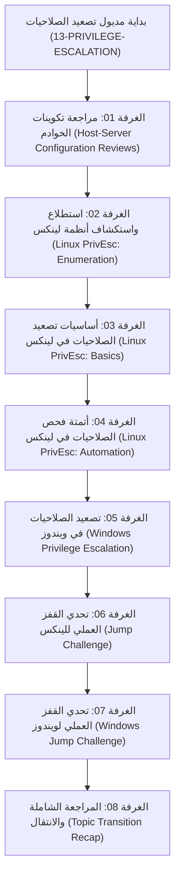

# توثيق المديول الثالث عشر: تصعيد الصلاحيات (Module 13: Privilege Escalation)

---

## 1. نظرة عامة ورؤية المديول التعليمية (Overview & Objectives)

يُمثل **المديول الثالث عشر (Privilege Escalation)** المحطة الفاصلة بين مجرد تحقيق الوصول الأولي (Initial Access) وبين فرض السيطرة الكاملة على البنية التحتية للهدف. في الغالبية العظمى من اختبارات الاختراق الواقعية، تمنح الثغرات البرمجية الأولية (مثل قذائف الويب أو استغلال ثغرات الـ RCE) صلاحيات مستخدم منخفض الامتيازات (مثل `www-data` أو مستخدم خدمة عادي).

لا يُمكن لمختبر الاختراق قراءة ملفات النظام الحساسة (مثل `/etc/shadow` أو سجلات SAM)، أو تثبيت برمجيات دائمة، أو سحب كلمات المرور من الذاكرة إلا بالارتقاء إلى أعلى سلطة تنفيذية:
* **صلاحيات root** في أنظمة لينكس ويونكس.
* **صلاحيات NT AUTHORITY\SYSTEM أو Administrator** في أنظمة ويندوز.

يُقدم هذا المديول دراسة منهجية وعملية تفصيلية لجميع أساليب تصعيد الصلاحيات عبر استغلال الأخطاء التكوينية (Misconfigurations)، والصلاحيات المفرطة، واستغلال النواة (Kernel Exploits)، واستخدام الأدوات الآلية الحديثة (LinPEAS و WinPEAS).

---

## 2. خريطة غرف المديول الثماني (Module 13 Curriculum Map)

---

## 3. محاور المديول التقنية الرئيسية

### أولاً: بيئة لينكس (Linux Privilege Escalation)
1. **الاستطلاع اليدوي (Manual Enumeration):** استكشاف إصدار النواة (`uname -a`)، والعمليات النشطة كـ root (`ps aux`), والشبكات الداخلية والمنافذ المفتوحة محلياً (`ss -tulpn`), ومتغيرات البيئة (`env`).
2. **استغلال الملفات التنفيذية ذات بت SUID/SGID:** فهم ميكانيكا تشغيل البرامج بصلاحية المالك، والرجوع إلى مرجع **GTFOBins** لتجاوز القيود عبر برامج مثل `find`, `vim`, `cp`, `bash`.
3. **أخطاء إعدادات Sudoers (`sudo -l`):** استغلال البرامج المصرح بتشغيلها دون كلمة مرور (`NOPASSWD`) والتلاعب بمتغيرات مسار البيئة (`LD_PRELOAD`, `SECURE_PATH`).
4. **المهام المجدولة (Cron Jobs):** استغلال السكربتات المجدولة القابلة للكتابة أو الثغرات الناتجة عن استخدام الرموز البديلة (Wildcards `*`) مع أوامر مثل `tar` و `rsync`.
5. **الملفات الحساسة القابلة للكتابة:** استغلال إمكانية الكتابة في `/etc/passwd` أو التلاعب بمسارات الخدمة.
6. **الأتمتة الاحترافية:** تشغيل سكربتات **LinPEAS** و **LinEnum** وقراءة المخرجات الملونة وتصفية الإنذارات الكاذبة.

### ثانياً: بيئة ويندوز (Windows Privilege Escalation)
1. **مسارات الخدمات غير المحاطة باقتباس (Unquoted Service Paths):** استغلال فراغات المسارات في خدمات ويندوز لحقن ملف تنفيذي خبيث.
2. **صلاحيات الخدمات الضعيفة (Weak Service Permissions):** إعادة تكوين مسار الملف الثنائي للخدمة (`binPath`) عبر أمر `sc config`.
3. **مفاتيح التسجيل والتثبيت الدائم (AlwaysInstallElevated):** استغلال سياسات التثبيت بصلاحيات مرتفعة لتنفيذ ملفات `.msi` خبيثة.
4. **انتحال الرموز الأمنية (Token Impersonation & Potato Exploits):** استغلال صلاحيات مثل `SeImpersonatePrivilege` عبر هجمات مثل JuicyPotato و PrintSpoofer للارتقاء إلى `NT AUTHORITY\SYSTEM`.

---

## 4. المنهجية والمعايير المعتمدة

* **إطار الـ 14 قسماً:** يطبق في جميع ملفات README للغرف.
* **منهجية المراحل السبع (Stages A to G):** تطبق في كل ملف مهمة تفصيلي.
* **التوافق التام بنسبة 100%:** تطابق مباشر مع الحساب الحي للمستخدم.
