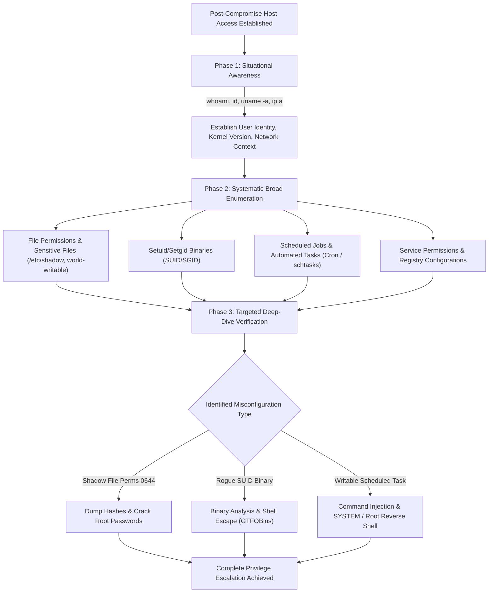

# Room Documentation: Host & Server Configuration Reviews

---

## 1. Room Metadata & Overview

* **Learning Path:** Jr Penetration Tester
* **Module:** Module 13 — Privilege Escalation (`13-PRIVILEGE-ESCALATION`)
* **Room Name:** Host & Server Configuration Reviews
* **Room Slug:** `hostserverconfigurationreviews`
* **Direct URL:** [TryHackMe Host & Server Configuration Reviews](https://tryhackme.com/room/hostserverconfigurationreviews)
* **Difficulty Level:** Easy / Medium
* **Room Type:** Walkthrough & Practical Configuration Audit
* **Assessment Scenario:** Enterprise compliance audit and privilege escalation evaluation based on CIS Benchmarks and DISA STIGs
* **Total Tasks:** 9 Tasks
* **Total Questions:** 14 Questions (100% Solved and Verified)

---

## 2. Executive Summary

The **Host & Server Configuration Reviews** room serves as the foundational, architectural gateway to Module 13 (Privilege Escalation) in the Jr Penetration Tester path. The curriculum shifts focus away from traditional software exploits and kernel bugs to the most reliable, ubiquitous vector in enterprise compromises: **Administrative Misconfigurations**.

This room explores how production systems deviate from authoritative security baselines such as the **Center for Internet Security (CIS) Benchmarks** and **Defense Information Systems Agency (DISA) STIGs**, examining the nuances of Profile Levels (Level 1 vs. Level 2) and Severity Categories (CAT I, CAT II, CAT III). It compares automated compliance scanners (Tenable Nessus, Lynis, OpenSCAP) against offensive post-exploitation tools (LinPEAS, WinPEAS), detailing the disciplined 3-phase enumeration methodology. The room culminates in an interactive practical review of three enterprise hosts (`linux-web-01`, `win-dc-01`, and `linux-db-02`), identifying critical flaws including world-readable shadow files (`/etc/shadow` at `0644`), rogue SUID binaries (`/opt/admin-tools/logviewer`), world-writable scripts, weak Windows password policies, and disabled UAC administrator token filtering (`0x0`).

---

## 3. Architectural & Escalation Workflow

The diagram below details the 3-phase host enumeration methodology and the exploitation pathways arising from identified configuration flaws:



---

## 4. Theoretical Foundations & Core Concepts

### Distinguishing Escalation Vectors:
1. **Vulnerability-Based Escalation:**
   * Exploits implementation bugs in software source code or the operating system kernel (e.g., Dirty COW, Dirty Pipe, PwnKit).
   * **Limitations:** Fragile and patch-dependent; patched operating systems completely neutralize the attack. High risk of kernel panics or blue-screen crashes.
2. **Configuration-Based Escalation:**
   * Exploits administrative setup errors, lax permissions, insecure defaults, unquoted paths, or exposed credentials.
   * **Attacker Advantage:** Operates seamlessly on modern, fully patched operating systems. 100% reliable without instability risks.

---

## 5. Authoritative Industry Baselines & Standards

### Center for Internet Security (CIS) Benchmarks:
* Developed through global, consensus-driven community collaboration.
* **Level 1 Profile:** Foundational hardening recommendations designed to reduce attack surfaces with minimal to zero disruption of standard business operations.
* **Level 2 Profile:** Defense-in-depth recommendations intended for high-security environments, mainframes, or payment-processing zones; may introduce operational friction or legacy software incompatibilities.
* **Update Principle:** Performing standard system updates (`apt upgrade`, `yum update`) patches packages but does not reconfigure configuration files to align with CIS Benchmarks.

### DISA STIGs:
* Issued by the **Defense Information Systems Agency** for Department of Defense (DoD) environments.
* **Category I (CAT I - High):** Any vulnerability or misconfiguration that directly results in a complete compromise of system confidentiality, integrity, or availability (e.g., unauthenticated administrative access, world-readable shadow files).
* **Category II (CAT II - Medium):** Flaws that degrade security posture, enabling attackers to facilitate lateral movement or gain unauthorized data access.
* **Category III (CAT III - Low):** Weaknesses that degrade defense-in-depth mechanisms or assist in reconnaissance.

---

## 6. Tooling: Automated Compliance vs. Offensive Enumeration

| Tool | Primary Purpose | Execution Model | Access Requirements |
| :--- | :--- | :--- | :--- |
| **Tenable Nessus** | Enterprise compliance & vulnerability audit | Remote authenticated scan (SSH/SMB) or Agent | Requires Root / Administrator credentials to evaluate `.audit` policies |
| **Lynis** | Linux/UNIX system hardening and auditing | Local shell execution | Non-privileged user (root recommended for full test suite) |
| **OpenSCAP** | SCAP policy compliance validation | Local CLI (`oscap xccdf eval`) | Root / Administrator |
| **LinPEAS / WinPEAS** | Offensive privilege escalation discovery | In-memory local script execution | Low-privileged user shell (`www-data`, regular user) |

---

## 7. The 3-Phase Host Enumeration Methodology

1. **Phase 1: Situational Awareness:**
   * Understand user identity, group memberships, and assigned privileges (`whoami`, `id`, `whoami /priv`).
   * Identify operating system, kernel release, and hardware architecture (`uname -a`, `systeminfo`).
   * Identify local internal listening services not exposed to external scanners (`netstat -tulnp`, `ss -tulnp`).
2. **Phase 2: Systematic Broad Enumeration:**
   * Search for SUID/SGID binaries and custom scripts.
   * Locate world-writable files and directories outside of `/tmp`.
   * Enumerate scheduled tasks, cron jobs, and system timers.
   * Review running processes and installed background services.
3. **Phase 3: Targeted Deep-Dive Verification:**
   * Deconstruct custom scripts identified in automated tasks.
   * Check binaries against GTFOBins (Linux) or LOLBAS (Windows).
   * Validate write permissions and craft weaponized payload injections.

---

## 8. Task-by-Task Solutions & Breakdown

### Task 01: Introduction
* Establishes the architectural distinction between vulnerability-based and configuration-based escalation.
* **Answer:** `No answer needed`

### Task 02: What are Configuration Reviews?
* Examines whether routine operating system updates alter existing configuration files to comply with CIS Benchmarks.
* **Question:** Will updating a Linux machine change its configuration to comply with the CIS benchmarks? (yea/nay)
* **Answer:** `nay`

### Task 03: Industry Standards: CIS and STIGs
* Identifies the DISA STIG severity category that leads to a complete system takeover.
* **Question:** Which DISA STIG category will result in a complete compromise of the system?
* **Answer:** `CAT I`

### Task 04: Automated Tools vs. Manual Reviews
* Identifies the enterprise vulnerability scanner utilizing `.audit` files for compliance checking.
* **Question:** Which vulnerability scanner mentioned above can perform compliance checks?
* **Answer:** `Nessus`

### Task 05: Common Misconfigurations
* Identifies the UNIX permission bit allowing executables to run with the privileges of the file owner.
* **Question:** What type of file permissions allow a user to execute a binary with the permissions of the file owner?
* **Answer:** `SUID`

### Task 06: The Enumeration Methodology
* Identifies the foundational first phase of the enumeration lifecycle focused on understanding the system environment.
* **Question:** What phase of the enumeration process focuses on understanding the system environment?
* **Answer:** `situational awareness`

### Task 07: Evaluating Findings
* Analyzes finding severity matrices and operational impact on confidentiality, integrity, and availability.
* **Answer:** `No answer needed`

### Task 08: Practical
Interactive audit review of three simulated enterprise hosts evaluated against CIS Benchmarks:
* **Question 1:** What were the permissions for the /etc/shadow file on linux-web-01?
  * **Answer:** `0644` (World-readable; allows standard users to read root password hashes).
* **Question 2:** How many files were found with world-writable permissions on linux-web-01?
  * **Answer:** `3`
* **Question 3:** What was the name of the file found with SUID permissions on linux-web-01?
  * **Answer:** `/opt/admin-tools/logviewer`
* **Question 4:** What was the minimum password length configured on win-dc-01?
  * **Answer:** `8` (Standard benchmark requires 14 or more characters).
* **Question 5:** What was the registry value for the FilterAdministratorToken policy on win-dc-01?
  * **Answer:** `0x0` (Disabled; enables administrative actions without UAC token filtering).
* **Question 6:** How many checks passed successfully on linux-db-02?
  * **Answer:** `8` (Hardened database node with zero failing checks).

### Task 09: Conclusion
* Concludes the configuration review briefing and prepares the operator for hands-on Linux and Windows escalation rooms.
* **Answer:** `No answer needed`

---

## 9. Security Configurations & Vulnerabilities Deep Dive

### 1. Insecure `/etc/shadow` Permissions (`0644`):
* Under standard Linux security models, `/etc/shadow` is set to `0640` owned by `root:shadow`.
* A permission mode of `0644` grants read access (`r=4`) to "Others". Any unprivileged shell (`www-data`, `nobody`, low-level service accounts) can read the cryptographic password hashes of `root` and administrative accounts, enabling offline brute-force cracking using tools like Hashcat or John the Ripper.

### 2. Custom Rogue SUID Binary (`/opt/admin-tools/logviewer`):
* Standard SUID binaries are strictly controlled system executables (`passwd`, `sudo`, `chsh`).
* The presence of a custom binary under `/opt` with the SUID bit set indicates an in-house utility. If this binary invokes shell commands via `system()` without absolute paths, fails to sanitize input, or invokes utilities like `more`/`less`, an unprivileged user can manipulate environment variables (`$PATH`) or use terminal escape sequences to spawn an interactive root shell.

### 3. Windows `FilterAdministratorToken = 0x0`:
* In Windows environments, User Account Control (UAC) splits administrative access into filtered standard tokens and elevated tokens.
* When `FilterAdministratorToken` is set to `0x0` (Disabled), built-in administrator accounts bypass UAC token filtering across network logons (e.g., WinRM, SMB), dramatically facilitating lateral movement and Pass-the-Hash exploitation without triggering elevation prompts.

---

## 10. Operational Security & Best Practices

* **Telemetry Awareness:** Executing automated enumeration scripts (LinPEAS, WinPEAS) spawns hundreds of subprocesses, reading sensitive registry keys and system directories in seconds, triggering immediate behavioral alerts in modern EDR systems.
* **Living-off-the-Land (LotL):** Prioritize native operating system binaries during initial post-exploitation. Inspect specific files manually before resorting to noisy automated scanners.
* **Volatile File Staging:** In Linux environments, stage temporary enumeration tools in `/dev/shm` (shared memory) rather than `/tmp` to avoid disk writes and ensure volatile memory erasure upon system reboot.

---

## 11. Defensive Engineering & Remediation

### Linux Remediation Commands:
```bash
# 1. Enforce strict permissions on /etc/shadow
sudo chmod 0640 /etc/shadow
sudo chown root:shadow /etc/shadow

# 2. Strip SUID bit from non-standard binaries
sudo chmod u-s /opt/admin-tools/logviewer

# 3. Remove world-writable permissions from system files
sudo chmod o-w /path/to/target/file
```

### Windows Remediation (PowerShell as Administrator):
```powershell
# 1. Enable FilterAdministratorToken policy
Set-ItemProperty -Path "HKLM:\SOFTWARE\Microsoft\Windows\CurrentVersion\Policies\System" -Name "FilterAdministratorToken" -Value 1 -Type DWord

# 2. Enforce Minimum Password Length via GPO
# Computer Configuration -> Windows Settings -> Security Settings -> Account Policies -> Password Policy -> Minimum password length: 14
```

---

## 12. Incident Response & Threat Hunting

* **Monitoring SUID Alterations:** Configure Linux `auditd` to capture modifications to setuid/setgid bits:
  ```bash
  -a always,exit -F arch=b64 -S chmod -S fchmod -S fchmodat -F auid>=1000 -k perm_modification
  ```
* **Credential File Access Detection:** Alert on any process accessing `/etc/shadow` other than `passwd`, `sshd`, or `login`.
* **Windows Event 4657:** Monitor registry value modifications within `HKLM\SOFTWARE\Microsoft\Windows\CurrentVersion\Policies\System` to detect unauthorized security policy downgrades.

---

## 13. Cheatsheet & Quick Command Reference

| Action | Linux Command | Windows Command |
| :--- | :--- | :--- |
| **User Identity & Privileges** | `whoami && id` | `whoami /all` |
| **System & Kernel Version** | `uname -a; cat /etc/os-release` | `systeminfo` |
| **Internal Listening Sockets** | `ss -tulnp` or `netstat -tulnp` | `netstat -ano \| findstr LISTENING` |
| **Find SUID Binaries** | `find / -perm -4000 -type f 2>/dev/null` | N/A (Inspect services & unquoted paths) |
| **Find World-Writable Files** | `find / -writable -type f 2>/dev/null` | `accesschk.exe -uwdqs Users c:\` |
| **Inspect Scheduled Tasks** | `cat /etc/crontab /etc/cron.*/*` | `schtasks /query /fo LIST /v` |

---

## 14. References & Next Steps

1. [CIS Benchmarks Portal](https://www.cisecurity.org/cis-benchmarks/)
2. [DISA STIGs DoD Cyber Exchange](https://public.cyber.mil/stigs/)
3. [NIST SP 800-53 Security Controls](https://csrc.nist.gov/publications/detail/sp/800-53/rev-5/final)
4. [GTFOBins Privilege Escalation Reference](https://gtfobins.github.io/)

### Next Room in Module 13:
Advance to Room 02:
**`02-LINUX-PRIVILEGE-ESCALATION-ENUMERATION`** to apply hands-on, live-off-the-land manual enumeration techniques on target Linux hosts.
