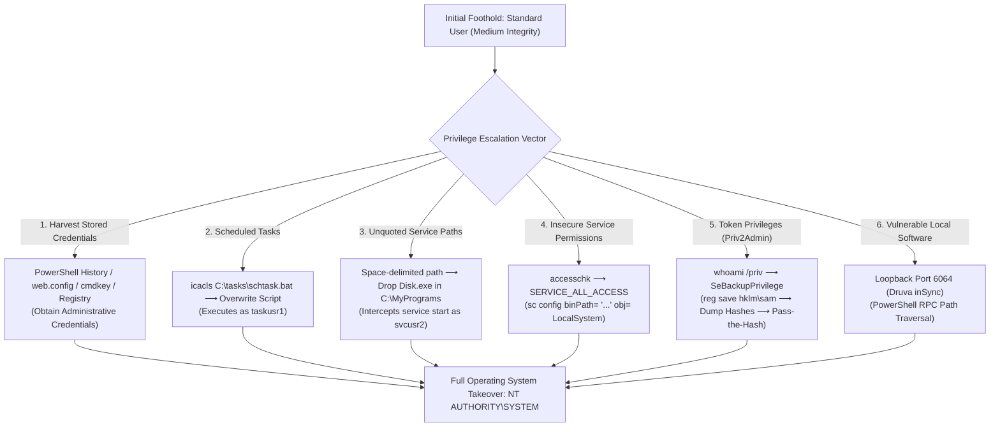

# Room Documentation: Windows Privilege Escalation

---

## 1. Room Metadata & Overview

* **Learning Path:** Jr Penetration Tester
* **Module:** Module 13 — Privilege Escalation (`13-PRIVILEGE-ESCALATION`)
* **Room Name:** Windows Privilege Escalation
* **Room Slug:** `windowsprivesc20`
* **Direct URL:** [TryHackMe Windows Privilege Escalation](https://tryhackme.com/room/windowsprivesc20)
* **Difficulty Level:** Medium
* **Room Type:** Walkthrough & Practical Hands-on Lab
* **Assessment Scenario:** Practical exploitation of Windows host misconfigurations, stored credentials, service permissions, unquoted paths, token privileges, and vulnerable software to elevate from an unprivileged user to `SYSTEM`
* **Total Tasks:** 9 Tasks
* **Total Questions:** 15 Questions (100% Solved and Verified)

---

## 2. Executive Summary

The **Windows Privilege Escalation** room marks the core architectural transition from Linux environments into **Microsoft Windows Operating Systems** within the Jr Penetration Tester path. The Windows authorization model diverges sharply from POSIX standards, relying upon **Security Identifiers (SIDs)**, **Access Tokens**, **Discretionary Access Control Lists (DACLs)**, and **Mandatory Integrity Levels**.

This room covers eight critical attack vectors:
1. **Windows Account Hierarchy:** Differentiating standard users (`Users` group), administrative users (`Administrators` group), internal service identities (`Local Service`, `Network Service`), and the supreme operating system authority (`NT AUTHORITY\SYSTEM`).
2. **Credential Harvesting:** Locating exposed cleartext credentials across PowerShell history (`ZuperCkretPa5z`), IIS `web.config` database connection strings (`098n0x35skjD3`), cached Windows Credential Manager entries via `cmdkey` and `runas /savecred` (`THM{WHAT_IS_MY_PASSWORD}`), and PuTTY registry session profiles (`CoolPass2021`).
3. **Quick Wins:** Hijacking world-writable batch scripts executed by Windows scheduled tasks (`THM{TASK_COMPLETED}`) and analyzing `AlwaysInstallElevated` policy mechanics.
4. **Service Misconfigurations:**
   * Replacing service executables carrying weak DACLs (`THM{AT_YOUR_SERVICE}`).
   * Exploiting unquoted service paths containing spaces via `Disk.exe` payload planting (`THM{QUOTES_EVERYWHERE}`).
   * Reconfiguring service binary paths directly via permissive service DACLs using `sc config` (`THM{INSECURE_SVC_CONFIG}`).
5. **Token Privilege Abuse (Priv2Admin):** Exploiting `SeBackupPrivilege` to extract protected `SAM` and `SYSTEM` registry hives, dumping local NTLM hashes, and performing Pass-the-Hash to gain SYSTEM control (`THM{SEFLAGPRIVILEGE}`).
6. **Vulnerable Software Exploitation:** Interacting with local loopback services (Druva inSync on port 6064) via raw PowerShell TCP sockets to execute commands as SYSTEM via RPC path traversal (`THM{EZ_DLL_PROXY_4ME}`).
7. **Automated Discovery Tooling:** Evaluating WinPEAS, PrivescCheck (in-memory execution), and WES-NG (offline vulnerability suggestion).

---

## 3. Windows Privilege Escalation Architecture

The diagram below maps the eight Windows privilege escalation pathways:



---

## 4. Theoretical Foundations & Windows User Models

### Windows User Hierarchy:
* **`NT AUTHORITY\SYSTEM` (LocalSystem):** The core internal OS account possessing highest privileges. Controls all local hardware, kernel memory, and protected system files. Unconstrained by UAC.
* **`Administrators` Group:** Local administrator accounts. Can install drivers, modify services, and manage local security policies.
* **`Users` Group:** Standard users confined to `%USERPROFILE%`. Cannot write to `%PROGRAMFILES%` or `%WINDIR%`.
* **Service Accounts:**
  * `LOCAL SERVICE`: Minimal privilege local account. Connects anonymously over network.
  * `NETWORK SERVICE`: Minimal privilege account that authenticates across domain networks using computer credentials (`<COMPUTERNAME>$`).

---

## 5. Credential Harvesting from Common Locations

1. **PowerShell Command History:**
   ```powershell
   Get-Content C:\Users\user\AppData\Roaming\Microsoft\Windows\PowerShell\PSReadline\ConsoleHost_history.txt
   ```
   * Leaked Password: **`ZuperCkretPa5z`**
2. **IIS Web Application Configuration:**
   ```cmd
   type C:\inetpub\wwwroot\web.config
   ```
   * Leaked Database Admin Password: **`098n0x35skjD3`**
3. **Cached Windows Credentials (`cmdkey`):**
   ```cmd
   cmdkey /list
   runas /savecred /user:MACHINE\mike.katz "cmd.exe /c copy C:\Users\mike.katz\Desktop\flag.txt C:\flag.txt"
   ```
   * Retrieved Flag: **`THM{WHAT_IS_MY_PASSWORD}`**
4. **PuTTY Registry Session Profiles:**
   ```cmd
   reg query "HKCU\Software\SimonTatham\PuTTY\Sessions" /s
   ```
   * Leaked Password: **`CoolPass2021`**

---

## 6. Quick Wins: Scheduled Tasks & AlwaysInstallElevated

* **Scheduled Tasks:**
  Inspecting `C:\tasks\schtask.bat` using `icacls` revealed `BUILTIN\Users:(F)`. Modifying the batch file and running `schtasks /run /tn vulntask` yielded:
  **`THM{TASK_COMPLETED}`**.
* **AlwaysInstallElevated Policy:**
  When `AlwaysInstallElevated` is set to `1` in both HKLM and HKCU, `msiexec.exe` runs `.msi` installations with SYSTEM privileges.

---

## 7. Service Misconfigurations Deep Dive

1. **Insecure Executable Permissions:**
   Service `windowsscheduler` ran executable `WService.exe` with `Everyone:(M)`. Replacing the executable gave access as `svcusr1`:
   **`THM{AT_YOUR_SERVICE}`**.
2. **Unquoted Service Paths:**
   Service path `C:\MyPrograms\Disk Sorter Enterprise\bin\disksrs.exe` contained spaces without quotes. Dropping `C:\MyPrograms\Disk.exe` intercepted service execution as `svcusr2`:
   **`THM{QUOTES_EVERYWHERE}`**.
3. **Insecure Service Permissions:**
   `accesschk64.exe` revealed `SERVICE_ALL_ACCESS` on `THMService`. Reconfiguring via `sc config` executed commands as `LocalSystem`:
   **`THM{INSECURE_SVC_CONFIG}`**.

---

## 8. Abusing Dangerous Token Privileges (Priv2Admin)

* **`SeBackupPrivilege` Exploitation:**
  Allows reading any file bypassing read DACLs. Saved hives:
  ```cmd
  reg save hklm\sam C:\temp\sam.hive
  reg save hklm\system C:\temp\system.hive
  ```
  Dumped local NTLM hashes using Impacket `secretsdump.py` and executed Pass-the-Hash with `psexec.py` to obtain SYSTEM access:
  **`THM{SEFLAGPRIVILEGE}`**.

---

## 9. Abusing Vulnerable Local Software

* **Druva inSync 6.6.3 RPC Traversal:**
  Local service listening on `127.0.0.1:6064` under SYSTEM. Using PowerShell to send raw RPC packets with path traversal (`..\..\..\Windows\System32\cmd.exe`) executed commands as SYSTEM:
  **`THM{EZ_DLL_PROXY_4ME}`**.

---

## 10. Automated Enumeration Tools

| Tool | Format | Operational Profile |
| :--- | :--- | :--- |
| **WinPEAS** | EXE / BAT | Comprehensive scanner; high signature visibility to Defender |
| **PrivescCheck** | PowerShell | In-memory execution without executable drops |
| **WES-NG** | Python | Offline CVE matching against `systeminfo.txt` on attacker machine |

---

## 11. Task-by-Task Solutions & Breakdown

* **Task 01:** `No answer needed`
* **Task 02:**
  * Q1: `Administrators`
  * Q2: `aye`
* **Task 03:**
  * Q1: `ZuperCkretPa5z`
  * Q2: `098n0x35skjD3`
  * Q3: `THM{WHAT_IS_MY_PASSWORD}`
  * Q4: `CoolPass2021`
* **Task 04:** `THM{TASK_COMPLETED}`
* **Task 05:**
  * Q1: `THM{AT_YOUR_SERVICE}`
  * Q2: `THM{QUOTES_EVERYWHERE}`
  * Q3: `THM{INSECURE_SVC_CONFIG}`
* **Task 06:** `THM{SEFLAGPRIVILEGE}`
* **Task 07:** `THM{EZ_DLL_PROXY_4ME}`
* **Task 08:** `No answer needed`
* **Task 09:** `No answer needed`

---

## 12. Operational Security & Best Practices

* **Avoid Dropping Known Binary Hacktools:** Executing `winpeas.exe` on disk triggers instant antivirus detection. Leverage native living-off-the-land commands (`cmdkey`, `sc`, `icacls`, `reg`) or in-memory PowerShell scripts.
* **Artifact Cleanup:** Always delete dropped payloads, exported registry hives, and modified batch scripts upon test completion.

---

## 13. Defensive Engineering & Hardening

1. **Quote All Service Binary Paths:** Enclose all service executable paths in double quotes in the Windows Registry.
2. **Harden Filesystem Permissions:** Ensure `BUILTIN\Users` lacks write access to application directories and scripts.
3. **Audit User Privileges:** Remove dangerous privileges like `SeBackup` and `SeImpersonate` from non-administrative accounts.

---

## 14. Cheatsheet & Command Reference

| Action | Windows Command |
| :--- | :--- |
| **Check Token Privileges** | `whoami /priv` |
| **Check File Permissions** | `icacls "C:\path\file"` |
| **Query Service Configuration** | `sc qc <service_name>` |
| **Check Service DACL** | `accesschk64.exe -qlc <service_name>` |
| **List Saved Credentials** | `cmdkey /list` |
| **Query Scheduled Tasks** | `schtasks /query /fo LIST /v` |

### Next Room in Module 13:
Advance to Room 06:
**`06-JUMP-CHALLENGE`** to apply hands-on privilege escalation methodologies in a standalone Linux challenge laboratory.
