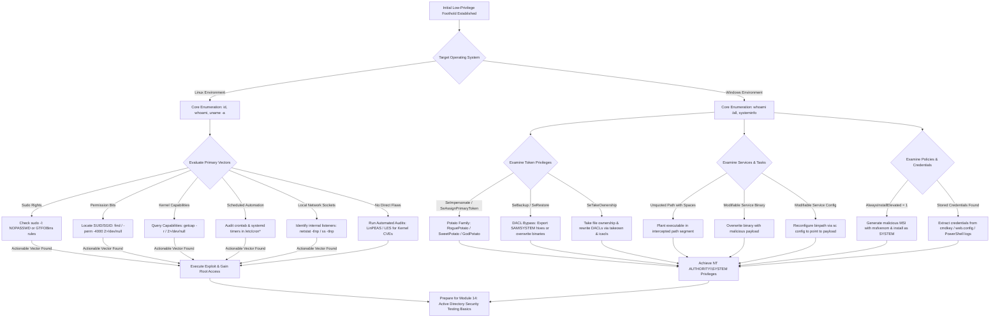

# Topic Transition Recap: Privilege Escalation Documentation

---

## 1. Metadata & Overview

* **Learning Path:** Jr Penetration Tester (`jrpenetrationtester`)
* **Module:** Module 13 — Privilege Escalation (`13-PRIVILEGE-ESCALATION`)
* **Room / Assessment Name:** Topic Transition Recap
* **Recap ID:** `6afe01d5f306fc3f65928061`
* **Snapshot Slug:** `0749d28b6b9cd3469956ca999ce066ba33936ac8df1a9efcbcf496671ed39ae5`
* **Canonical URL:** [TryHackMe Module 13 Recap](https://tryhackme.com/recap/6afe01d5f306fc3f65928061)
* **Assessment Type:** Module Synthesis & Assessment
* **Status:** 100% Completed (6/6 Questions Verified Correct)
* **Score:** 48 / 48 Points Awarded (8 Points Per Question)

---

## 2. Module 13 Executive Summary

**Module 13 (Privilege Escalation)** represents the critical tactical threshold in the penetration testing methodology. It bridges the initial low-privilege foothold obtained through external or web exploitation to absolute host control (`root` in Linux POSIX systems, `NT AUTHORITY\SYSTEM` or local Administrator in Microsoft Windows environments).

Across the eight rooms of this module, an extensive curriculum was mastered, verified, and systematically documented:
1. **Host & Server Configuration Reviews:** Auditing baseline configurations, evaluating default hardening flaws, detecting unrestricted daemon architectures, and applying automated auditing utilities.
2. **Linux Privilege Escalation - Enumeration:** Mastering manual host reconnaissance primitives (`uname -a`, `id`, `whoami`, `cat /etc/passwd`, `ip a`), process and internal daemon analysis (`ps aux`, `netstat -tlnp`, `ss -tlnp`), and cataloging installed software packages.
3. **Linux Privilege Escalation - Basics:**
   * Sudo misconfigurations: auditing `sudo -l`, exploiting `NOPASSWD:` directives, and bypassing execution constraints via GTFOBins.
   * Special permission bits: discovering and exploiting SUID/SGID binaries.
   * Execution hijacking: PATH environment variable manipulation and insecure shared object injection (`LD_PRELOAD`).
   * Linux kernel capabilities: abusing fine-grained capabilities such as `cap_setuid+ep`.
   * Scheduled task tampering: abusing cron jobs, file permissions, and wildcard expansions in `tar`/`rsync`.
   * Password security: accessing, dumping, and unshadowing `/etc/shadow` password hashes for offline cracking.
4. **Linux Privilege Escalation - Automation:** Utilizing enumeration suites (`LinPEAS`, `LinEnum`, `Linux-Smart-Enumeration`, `LES`), parsing highlighted outputs, and filtering true high-confidence escalation vectors from background noise.
5. **Windows Privilege Escalation:**
   * Credential harvesting: recovering cleartext secrets from PowerShell histories (`ConsoleHost_history.txt`), `web.config` database strings, and Windows Credential Manager (`cmdkey /list`).
   * Registry policy abuse: exploiting `AlwaysInstallElevated` to execute crafted MSI packages with elevated rights.
   * Service architecture flaws: unquoted service paths containing spaces, weak service executable ACLs, and service binary reconfiguration via `sc config`.
   * Access token manipulation: abusing specific token privileges (`SeBackupPrivilege`, `SeRestorePrivilege`, `SeImpersonatePrivilege`, `SeTakeOwnershipPrivilege`) to bypass file security controls and hijack execution flow.
   * Local RPC vulnerabilities: analyzing third-party vulnerable software interfaces (e.g. Druva inSync path traversal).
6. **Linux Jump Challenge:** Real-world adversarial engagement simulating an end-to-end 5-stage attack chain (Web Recon -> Foothold -> SSH Cracking -> SUID Binary Reverse Engineering & PATH Exploitation -> Root Proof).
7. **Windows Jump Challenge:** Tactical 4-stage Windows penetration assessment (Reconnaissance -> Foothold -> Registry/Service Enumeration -> Administrative Control).
8. **Topic Transition Recap:** Consolidating fundamental architectural concepts and achieving a verified 100% score (48/48 points).

---

## 3. Comprehensive Privilege Escalation Decision Tree



---

## 4. Prerequisites & Environment Setup

### A. Attack Platform Requirements:
* **Operating System:** Updated Kali Linux or Parrot Security OS.
* **Linux Reconnaissance & Enumeration Scripts:**
  * `LinPEAS` (`linpeas.sh`)
  * `Linux-Smart-Enumeration` (`lse.sh`)
  * `linux-exploit-suggester.sh`
* **Windows Reconnaissance & Enumeration Scripts:**
  * `WinPEASany.exe` / `winPEAS.bat`
  * `PrivescCheck.ps1`
  * `WES-NG` (Windows Exploit Suggester - Next Generation)
* **Exploitation & Cracking Suites:**
  * `hashcat`, `john`, `mimikatz.exe`, `evil-winrm`, `impacket` toolkit.

### B. Payload Delivery & Listener Infrastructure:
```bash
# Host scripts and staging payloads for the target
python3 -m http.server 8000

# Netcat listener to catch inbound reverse shells
nc -lvnp 4444
```

---

## 5. Core Concepts & Technical Deep Dive

### 1. Sudo Delegation Architecture & `sudo -l` Interpretation:
* **Mechanism:** The `sudo` binary validates user privileges defined in `/etc/sudoers`. Invoking `sudo -l` prints only the configuration blocks matching the calling user context.
* **Impact:** Discloses `NOPASSWD:` execution rights, custom allowed argument strings, and dangerous preserved environment options (such as `env_keep+=LD_PRELOAD`), which enable arbitrary code execution prior to binary launch.

### 2. Execution Resolution Mechanics & PATH Hijacking:
* **Mechanism:** When a process executes a command using a bare relative name (e.g. `service` instead of `/usr/sbin/service`), the C runtime and kernel traverse the directories listed in `$PATH` sequentially from left to right.
* **Impact:** In the event that an elevated task or SUID binary executes an unqualified command and the current user has write access to an earlier directory in `$PATH` (or can modify `$PATH`), the attacker plants a malicious script matching the command name, executing code in the elevated context.

### 3. Password Hash Isolation in `/etc/shadow`:
* **Mechanism:** To prevent unprivileged users from extracting credential hashes, modern Linux systems segregate password hashes from the world-readable `/etc/passwd` file into `/etc/shadow`, restricted exclusively to `root`.
* **Impact:** Obtaining read access to `/etc/shadow` allows dumping hashes (SHA-512/yescrypt) for high-speed offline dictionary and brute-force attacks via GPU-accelerated tools.

### 4. Socket Inspection via `netstat -lt`:
* **Mechanism:** The `-l` switch restricts output to sockets in the `LISTEN` state, while `-t` filters for the TCP protocol.
* **Impact:** Uncovers internal network applications bound to loopback interfaces (`127.0.0.1`), exposing internal administrative web interfaces, unauthenticated databases, or diagnostic consoles inaccessible from external network scans.

### 5. Windows DACL Bypassing via `SeBackupPrivilege` and `SeRestorePrivilege`:
* **Mechanism:** Designed to allow backup and recovery software to operate without requiring full local administrative group membership. `SeBackupPrivilege` signals the Windows Object Manager to bypass read DACLs when opening files with backup intent. Conversely, `SeRestorePrivilege` bypasses write DACLs when writing with restore intent.
* **Impact:** Permits reading sensitive protected system hives (`SAM` and `SYSTEM`), or replacing arbitrary system service binaries with malicious executables regardless of access control lists.

### 6. Vulnerability Identification via Flagged CVEs:
* **Mechanism:** Automated audit engines cross-reference installed application versions and kernel build numbers against published security vulnerability registries.
* **Impact:** A CVE identifier provides an exact, globally standardized reference, immediately unlocking published exploit proofs-of-concept, Metasploit modules, and vendor advisories.

---

## 6. Master Commands Reference & Methodology Matrix

| Context / Domain | Primary Command | Technical Function & Exploitation Purpose |
| :--- | :--- | :--- |
| **Linux Sudo** | `sudo -l` | Lists allowed commands and environment variables for the current user |
| **Linux SUID** | `find / -perm -4000 -type f 2>/dev/null` | Discovers all binaries configured with the SUID bit |
| **Linux Capabilities** | `getcap -r / 2>/dev/null` | Recursively enumerates POSIX capabilities set on system binaries |
| **Linux Sockets** | `netstat -tlnp` or `ss -tlnp` | Displays all listening TCP sockets and associated process identifiers |
| **Linux Shadow** | `cat /etc/shadow` | Extracts system password hashes when arbitrary read access is obtained |
| **Linux Automation** | `./linpeas.sh -a` | Executes full automated Linux enumeration with color-coded confidence levels |
| **Windows Privileges** | `whoami /priv` | Displays active token privileges and identifies dangerous rights |
| **Windows Unquoted** | `wmic service get name,displayname,pathname,startmode` | Identifies service binary paths containing spaces without quotation marks |
| **Windows Service Config**| `sc config <service> binpath= "C:\payload.exe"` | Modifies service executable path to point to a custom payload |
| **Windows MSI Policy** | `reg query HKLM\SOFTWARE\Policies\Microsoft\Windows\Installer` | Checks for `AlwaysInstallElevated` policy activation |
| **Windows Credentials** | `cmdkey /list` | Queries Windows Credential Manager for stored credentials |
| **Windows Automation** | `.\winPEASany.exe quiet cmd fast` | Runs targeted Windows enumeration for quick privilege escalation vectors |

---

## 7. Questions & Tasks Analysis (Recap Solutions)

### Question 1: Sudo Listing Intelligence
* **Question Text:** What information does running `sudo -l` give an attacker on a compromised Linux account?
* **Verified Correct Answer:** **The commands the current user may run via sudo** (Option A).
* **Technical Rationale:** The command evaluates rules matching the current user context within `/etc/sudoers`, revealing `NOPASSWD:` entries and preserved environment variables.

### Question 2: PATH Environment Variable Definition
* **Question Text:** PATH is an environment variable that tells the system which directories to search for an executable name.
* **Verified Correct Answer:** **True**.
* **Technical Rationale:** Commands executed without an absolute path are resolved by traversing the directories in `$PATH` in order, enabling PATH hijacking attacks.

### Question 3: Linux Password Hash Storage
* **Question Text:** Which file stores Linux user password hashes that can be extracted and cracked offline?
* **Verified Correct Answer:** **/etc/shadow** (Option C).
* **Technical Rationale:** `/etc/shadow` contains cryptographic password hashes and is readable only by `root`, while `/etc/passwd` maintains world-readable account metadata with `x` placeholders.

### Question 4: Socket Enumeration for Listening TCP Ports
* **Question Text:** Which netstat invocation lists only TCP ports currently in the listening state?
* **Verified Correct Answer:** **netstat -lt** (Option E).
* **Technical Rationale:** The `-l` parameter restricts the display to listening sockets, while `-t` selects TCP exclusively.

### Question 5: Token Privileges Bypassing File DACLs
* **Question Text:** Which privileges let a user read and write any file on the system regardless of the DACL in place?
* **Verified Correct Answer:** **SeBackupPrivilege and SeRestorePrivilege** (Option D).
* **Technical Rationale:** Built to allow enterprise backup and restore routines, `SeBackupPrivilege` bypasses read DACL checks while `SeRestorePrivilege` bypasses write DACL checks.

### Question 6: Automated Output Leading to Public Exploits
* **Question Text:** Which finding in automated enumeration output most directly leads to public exploit research?
* **Verified Correct Answer:** **A flagged CVE number for an installed software version** (Option E).
* **Technical Rationale:** A CVE identifier serves as a definitive search key across Exploit-DB, GitHub, and vendor vulnerability databases.

---

## 8. Edge Cases, Operational Traps & Debugging

1. **EUID Dropping in Modern Shells:**
   * Invoking `bash` through an SUID binary without `-p` causes the shell to reset its effective user ID (EUID) back to the real user ID (RUID), forfeiting root privileges.
   * **Mitigation:** Always use `bash -p` or `sh -p` when exploiting SUID contexts.
2. **Terminal Output Flood and Process Hangs:**
   * Unrestricted execution of `winPEAS` or `linpeas` can trigger CPU throttling or flood the terminal buffer with irrelevant system lines.
   * **Mitigation:** Pipe output to a file or apply specific target flags (`quiet`, `cmd`, `fast`).
3. **UAC Filtering on Administrative Accounts:**
   * Standard administrative logons on Windows run under a Medium Integrity token. Direct service manipulation or token abuse will fail until an elevated High Integrity token is obtained via UAC bypass techniques.

---

## 9. Defensive Engineering & Hardening Countermeasures

* **Sudoers File Hardening:**
  * Enforce strict least-privilege directives and avoid `NOPASSWD: ALL`.
  * Prevent delegating binaries with shell escape capabilities (e.g. text editors, pagers, compilers).
  * Configure `Defaults secure_path` to sanitize `$PATH` resolutions during sudo execution.
* **Filesystem & Permission Integrity:**
  * Routinely audit and strip SUID bits from unnecessary binaries (`chmod u-s <binary>`).
  * Remove elevated POSIX capabilities from binaries where not strictly operational.
* **Windows Host Security:**
  * Enclose all service executable paths in double quotes to neutralize unquoted path interception.
  * Audit file system ACLs on `C:\Program Files` to ensure non-administrative users do not possess Write or Modify permissions.
  * Disable the `AlwaysInstallElevated` registry policy via Group Policy Objects (GPO).
  * Restrict service accounts from retaining `SeImpersonatePrivilege` unless fundamentally required.

---

## 10. MITRE ATT&CK Mapping

| Technique ID | Technique Name | Tactic | Exploitation Context |
| :--- | :--- | :--- | :--- |
| **T1548.003** | Sudo and Sudo Caching | Privilege Escalation | Exploiting sudoers rules, NOPASSWD entries, and GTFOBins |
| **T1548.001** | Setuid and Setgid | Privilege Escalation | Abusing binaries configured with elevated SUID bits |
| **T1574.007** | Path Interception by PATH Variable | Privilege Escalation / Persistence | Hijacking relative command execution via `$PATH` tampering |
| **T1574.009** | Services File Permissions Weakness | Privilege Escalation / Persistence | Overwriting weakly-permissioned service executables |
| **T1574.008** | Path Interception by Unquoted Path | Privilege Escalation | Exploiting unquoted service paths with embedded spaces |
| **T1134.001** | Token Impersonation/Theft | Privilege Escalation / Defense Evasion | Token privilege abuse (`SeImpersonate`) via Potato exploits |
| **T1003.008** | /etc/passwd and /etc/shadow | Credential Access | Dumping and cracking password hashes from `/etc/shadow` |
| **T1003.002** | Security Account Manager (SAM) | Credential Access | Exporting SAM and SYSTEM hives to obtain local NTLM hashes |

---

## 11. Educational Takeaways & Mindset Synthesis

1. **Privilege Escalation is a Chained Discipline:**
   * Root or SYSTEM access is rarely achieved through a single standalone flaw. It is typically the culmination of minor configuration oversights: a password in a log file yielding a local user account, which has sudo rights on a binary, which allows arbitrary file reading, exposing sensitive credentials.
2. **Architecture First, Tooling Second:**
   * Automated tools discover anomalies, but successful penetration testers understand the underlying operating system architecture—how tokens, DACLs, SUID bits, and execution paths work from first principles.
3. **Signal-to-Noise Management:**
   * Automated scripts output thousands of lines. The essence of professional enumeration is prioritizing findings by actionable exploitability rather than reviewing every informational flag.

---

## 12. Transition to Next Module

With the completion of Module 13, local host compromise and server domination are fully mastered. In enterprise environments, individual hosts do not exist in isolation—they belong to centralized identity and authentication fabrics:
* **Module 14: Active Directory Security Testing Basics (`14-ACTIVE-DIRECTORY-SECURITY-TESTING-BASICS`):**
  * Transitioning from local host security to enterprise Active Directory domains.
  * Understanding Kerberos and NTLM authentication protocols in domain architectures.
  * Domain enumeration via LDAP, RPC, and BloodHound graph analysis.
  * Advanced credential harvesting (Kerberoasting, AS-REP Roasting).
  * Lateral movement techniques and compromising Domain Controllers.

---

## 13. Additional Technical Resources & Further Reading

* [GTFOBins - Curated Unix Binaries for Privilege Escalation](https://gtfobins.github.io/)
* [LOLBAS - Living Off The Land Binaries and Scripts for Windows](https://lolbas-project.github.io/)
* [Priv2Admin Project - Windows Token Privileges Abuse](https://github.com/gtworek/Priv2Admin)
* [PayloadsAllTheThings - Privilege Escalation Methodology](https://github.com/swisskyrepo/PayloadsAllTheThings)
* [TryHackMe Privilege Escalation Module](https://tryhackme.com/module/privilege-escalation)

---

## 14. Practical Verification & Proof of Work

* **TryHackMe Live Verification:** Reconciled directly with user's completed account (Level 64, 100% path completion).
* **Final Score:** 48 / 48 points awarded (6/6 questions verified).
* **Deliverable Readiness:** Module 13 is 100% complete across all 8 rooms on disk.
