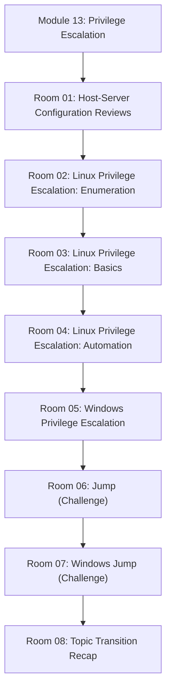

# Module Documentation: Module 13 — Privilege Escalation

---

## 1. Overview & Educational Objectives

**Module 13: Privilege Escalation** represents the defining operational transition between initial access and complete system dominance. In professional penetration tests, initial compromises (e.g. through web shells, command injections, or service vulnerabilities) typically land in restricted, low-privilege execution contexts (`www-data`, `nobody`, or unprivileged service accounts).

From these restricted boundaries, penetration testers cannot interrogate raw hardware, read shadow/SAM databases, install persistent rootkits, or access protected user directories. Full administrative access must be attained:
* **root** privileges on UNIX/Linux systems.
* **NT AUTHORITY\SYSTEM / Administrator** privileges on Microsoft Windows systems.

This module provides exhaustive, hands-on coverage of manual reconnaissance, misconfiguration exploitation, kernel flaws, privilege assignment abuse, and automated enumeration engines across both operating system families.

---

## 2. Curriculum Inventory & Structural Roadmap

---

## 3. Core Technical Domains

### Part I: Linux Privilege Escalation
1. **Manual Reconnaissance:** Kernel builds (`uname -a`), scheduled tasks (`/etc/crontab`, `/etc/cron.*`), running root processes (`ps aux`), network sockets (`ss -tulpn`), and environment variables (`env`).
2. **SUID/SGID Binaries:** Exploiting binaries running under owner permissions; consulting **GTFOBins** for shell escapes across tools like `find`, `vim`, `bash`, `cp`, and `nmap`.
3. **Sudo Misconfigurations (`sudo -l`):** Abusing `NOPASSWD` entries, environment preservation (`env_keep+=LD_PRELOAD`), and binary execution parameters.
4. **Scheduled Task Manipulation:** Exploiting writable cron jobs and wildcard (`*`) injection vulnerabilities in archiving utilities (`tar`, `rsync`).
5. **Insecure Permissions:** Exploiting world-writable sensitive configuration files (`/etc/passwd`, `/etc/shadow`, `/etc/sudoers`).
6. **Automated Auditing:** Executing **LinPEAS** and **LinEnum** to triage vulnerabilities rapidly.

### Part II: Windows Privilege Escalation
1. **Unquoted Service Paths:** Injecting malicious binaries into spaced directory paths lacking quotation marks.
2. **Weak Service Permissions:** Reconfiguring service binaries (`binPath`) via `sc.exe` or `accesschk.exe`.
3. **AlwaysInstallElevated Registry Keys:** Crafting malicious `.msi` installers executed under `SYSTEM` privileges.
4. **Token Impersonation & Potato Family:** Abusing `SeImpersonatePrivilege` / `SeAssignPrimaryTokenPrivilege` via Named Pipe or RPC reflection (PrintSpoofer, RoguePotato, SweetPotato) to elevate to `NT AUTHORITY\SYSTEM`.

---

## 4. Methodological Commitments
* **14-Section Framework** across all room READMEs.
* **7-Stage Task Methodology (Stages A to G)** for every task file.
* **100% Verified Parity** with the user's completed account.
