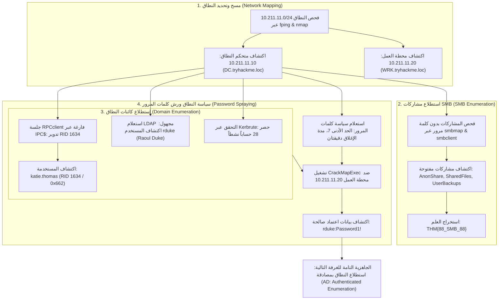

# توثيق غرفة استطلاع الدليل النشط الأساسي (AD: Basic Enumeration)

---

## 1. بيانات المديول والروم (Metadata & Overview)

* **المسار التعليمي:** مسار مبتدئ اختبار الاختراق (Jr Penetration Tester)
* **المديول:** المديول الرابع عشر — أساسيات اختبار أمان الدليل النشط (14-ACTIVE-DIRECTORY-SECURITY-TESTING-BASICS)
* **اسم الغرفة:** استطلاع الدليل النشط الأساسي (AD: Basic Enumeration)
* **المعرف البرمجي للغرفة (Canonical Slug):** `adbasicenumeration`
* **الرابط المباشر:** [TryHackMe AD: Basic Enumeration](https://tryhackme.com/room/adbasicenumeration)
* **نوع الغرفة:** غرفة إرشادية وتطبيقية (Walkthrough Lab)
* **مستوى الصعوبة:** سهل (Easy)
* **المدة التقديرية:** 60 دقيقة
* **الحالة:** مكتملة بنسبة 100% (Room completed: 100%)
* **إجمالي المهام:** 6 مهام تعليمية وتطبيقية
* **إجمالي الأسئلة:** 10 أسئلة تم حلها وتدقيقها بالكامل
* **الهدف التكتيكي:** تنفيذ الاستطلاع الشبكي بدون مصادقة (Unauthenticated Enumeration) واستغلال ثغرات التكوين في مشاركات SMB، واستعلامات LDAP المجهولة، وجلسات RPC الفارغة، ورش كلمات المرور للوصول إلى بيانات اعتماد صالحة.

---

## 2. الملخص التنفيذي والأهداف التعليمية (Executive Summary & Objectives)

تُمثل غرفة **استطلاع الدليل النشط الأساسي (AD: Basic Enumeration)** محطة محورية في فهم كيفية استكشاف بيئة شبكية مؤسسية عندما لا يمتلك مختبر الاختراق أي حساب مسجل مسبقاً (Zero-Knowledge / Black-Box). في العديد من البيئات غير المحصنة بالكامل، تسمح الإعدادات الافتراضية أو التوافقية بتسريب معلومات حساسة للغاية عبر جلسات الاتصال الفارغة (Null Sessions) ومشاركات الملفات المفتوحة لعموم المستخدمين.

خلال هذه الغرفة، يتم دراسة وتطبيق التكتيكات التالية:
1. المسح الشبكي واكتشاف الأجهزة الحية عبر `fping` و `nmap`، وتحديد متحكم النطاق (DC) بناءً على المنافذ المميزة (88, 135, 139, 389, 445).
2. استكشاف مشاركات SMB دون كلمة مرور عبر `smbclient` و `smbmap`، واستخراج الملفات الحساسة وحصاد الأعلام المخفية.
3. استعلام دليل Active Directory عبر استعلامات LDAP مجهولة الهوية (`ldapsearch`) وتحديد الحسابات والمجموعات التابعة لها.
4. الاتصال بمتحكم النطاق عبر جلسات RPC الفارغة (IPC$ Null Session) باستخدام أداة `rpcclient`، وفهم آلية تدوير المعرفات النسبية (**RID Cycling**) لحصر كافة مستخدمي النطاق ومعرفاتهم الفريدة.
5. استخراج سياسة كلمات المرور وحدود إغلاق الحسابات (Account Lockout Policy) في النطاق لتحديد معايير الهجوم الآمن.
6. تنفيذ هجوم رش كلمات المرور (Password Spraying) المنضبط ضد محطة العمل `WRK` للارتقاء بنجاح إلى حساب نطاق صالح (`rduke:Password1!`).

---

## 3. مخطط مسار الاستطلاع وشبكة المختبر (Architectural Topology)



---

## 4. المتطلبات وإعداد بيئة العمل والاتصال (Prerequisites & Environment Setup)

### أ. البنية التحتية للمختبر:
* **نطاق الشبكة المستهدف:** `10.211.11.0/24`
* **متحكم النطاق (DC):** `10.211.11.10` (`DC.tryhackme.loc` - يعمل بنظام Windows Server 2019 Datacenter)
* **محطة العمل المستهدفة (WRK):** `10.211.11.20` (`WRK.tryhackme.loc` - تعمل بنظام Windows 10)
* **اسم النطاق المؤسسي:** `tryhackme.loc`

### ب. التحقق من مسار التوجيه الشبكي:
```bash
# التأكد من توجيه حركة مرور النطاق عبر واجهة VPN
ip route | grep "10.211.11.0/24"
# يجب أن يظهر: 10.211.11.0/24 dev tun0
```

---

## 5. المفاهيم الهندسية والتحليل المعماري العميق (Core Concepts & Technical Deep Dive)

### 1. الاستدلال على متحكم النطاق عبر المنافذ المعيارية:
* وجود المنافذ **88 (Kerberos)** و **389 (LDAP)** و **445 (SMB)** معاً على مضيف واحد يُعد دليلاً قاطعاً على أن المضيف يعمل كمتحكم نطاق (Domain Controller).
* تسمح مصافحة SMB بكشف اسم النطاق بالكامل (`tryhackme.loc`) وإصدار نظام التشغيل بدقة دون الحاجة لأي مصادقة.

### 2. ميكانيكا مشاركات SMB المفتوحة وجلسات IPC$ الفارغة:
* في الإعدادات الضعيفة، تُمنح مجموعة `Everyone` أو `ANONYMOUS LOGON` أذونات القراءة على مشاركات مخصصة.
* تتيح مشاركة `IPC$` (Inter-Process Communication) إنشاء قناة اتصال فارغة تسمح للمهاجم باستدعاء دوال واجهة برمجة التطبيقات البعيدة (MSRPC) للاستعلام عن المستخدمين والسياسات.

### 3. تقنية تدوير المعرفات النسبية (RID Cycling):
* يرتبط كل كائن في النطاق بمعرف أمان SID ينتهي بقيمة رقمية متزايدة تُعرف بالـ RID.
* تبدأ حسابات المستخدمين المخصصة التي ينشئها المسؤولون من القيمة 1000 وما بعدها.
* يقوم المهاجم بإرسال استعلامات متتالية للأرقام من 1000 إلى 5000 عبر واجهة `samr` في بروتوكول RPC، فيرد الخادم باسم المستخدم المطابق لكل رقم.
* القيمة العشرية **1634** تقابلها في النظام الست عشري القيمة **`0x662`**، وتعود للمستخدمة `katie.thomas`.

### 4. استعلامات دليل LDAP المجهولة (Anonymous Bind):
* عند غياب فرض التوثيق في خادم LDAP، يستطيع أي عميل إرسال استعلامات بالصيغة `(objectClass=person)` لسحب أسماء الموظفين وأسماء تسجيل الدخول ومجموعاتهم (مثل مجموعة `Domain Users`).

### 5. تحليل سياسة إغلاق الحسابات (Lockout Policy):
* يجب فحص معايير السياسة قبل الرش:
  * الحد الأدنى لطول كلمة المرور: **7** أحرف.
  * حد الإغلاق (Threshold): **10** محاولات.
  * مدة قفل الحساب (Lockout Duration): **دقيقتان** فقط.
* قصر مدة القفل إلى دقيقتين يعني إمكانية تكرار الرش بسرعة دون التسبب في تعطيل دائم للخدمة.

---

## 6. مرجع الأوامر ومصفوفة المنهجية (Master Commands Reference)

| الأداة / السياق | الأمر النموذجي | الوظيفة التقنية |
| :--- | :--- | :--- |
| **Network Sweep** | `fping -agq 10.211.11.0/24` | اكتشاف الأجهزة الحية على الشبكة بسرعة |
| **Port & OS Scan** | `nmap -p 88,135,139,389,445 -sV -sC 10.211.11.10` | تحديد خدمات الدليل النشط واكتشاف اسم النطاق ونظام التشغيل |
| **SMB Shares Map** | `smbmap -H 10.211.11.10` | فحص أذونات مشاركات SMB بدون كلمة مرور |
| **SMB Client Null** | `smbclient //10.211.11.10/SharedFiles -N` | تصفح وتحميل ملفات مشاركة SMB بدون مصادقة |
| **Anonymous LDAP** | `ldapsearch -x -H ldap://10.211.11.10 -b "dc=tryhackme,dc=loc" "(objectClass=person)"` | استعلام كائنات ومستخدمي النطاق عبر LDAP |
| **RPCclient Connect**| `rpcclient -U "" 10.211.11.10 -N` | فتح جلسة RPC فارغة عبر مشاركة IPC$ |
| **RPC Query User** | `rpcclient $> queryuser 1634` | استعلام خصائص مستخدم محدد بواسطة معرف الـ RID |
| **Kerbrute Enum** | `./kerbrute userenum --dc 10.211.11.10 -d tryhackme.loc users.txt` | حصر أسماء المستخدمين النشطة دون إغلاق الحسابات |
| **Dump Password Pol**| `crackmapexec smb 10.211.11.10 --pass-pol` | استخراج سياسة كلمات المرور وحدود إغلاق الحسابات |
| **Password Spray** | `crackmapexec smb 10.211.11.20 -u users.txt -p passwords.txt` | تنفيذ رش كلمات المرور ضد محطة العمل |

---

## 7. تحليل المهام والأسئلة وحلول الأعلام (Questions & Tasks Analysis)

### المهمة 01: المقدمة
* تأكيد الجاهزية والاتصال (`No answer needed`).

---

### المهمة 02: استكشاف الشبكة وتحديد الأهداف
* **س1:** ما هو اسم النطاق (Domain Name) لهدفنا؟
  * الفحص: تشغيل فحص Nmap على المنافذ 88 و 389 وقراءة سطر `Domain name:` في نتائج سكريبت `smb-os-discovery`.
  * **الإجابة:** `tryhackme.loc`
* **س2:** ما هو إصدار نظام Windows Server الذي يعمل على متحكم النطاق (DC)؟
  * الفحص: مراجعة سطر `OS: Windows Server 2019 Datacenter 17763`.
  * **الإجابة:** `Windows Server 2019 Datacenter`

---

### المهمة 03: استطلاع الشبكة عبر SMB واستخراج العلم
* **س1:** ما هو العلم المخفي في إحدى المشاركات؟
  * الفحص: استخدام `smbmap` لاكتشاف المشاركات المفتوحة للقراءة (`AnonShare`, `SharedFiles`, `UserBackups`)، ثم الدخول عبر `smbclient` وتنزيل الملفات.
  * قراءة ملف العلم: `cat flag.txt`.
  * **العلم المحقق:** `THM{88_SMB_88}`

---

### المهمة 04: استطلاع كائنات النطاق (Domain Enumeration)
* **س1:** ما هي المجموعة التي ينتمي إليها المستخدم `rduke`؟
  * الفحص: تشغيل `ldapsearch` والاستعلام عن `sAMAccountName=rduke`. يظهر الحقل `memberOf: CN=Domain Users,CN=Users...`.
  * **الإجابة:** `Domain Users`
* **س2:** ما هو الاسم الكامل (Full Name) لهذا المستخدم؟
  * الفحص: مراجعة الحقل `displayName` أو `cn` في مخرجات LDAP.
  * **الإجابة:** `Raoul Duke`
* **س3:** ما هو اسم المستخدم المرتبط بالـ RID رقم 1634؟
  * الفحص: الاتصال بـ `rpcclient` وتشغيل `queryuser 1634` (أو `0x662`). يظهر الحقل `User Name: katie.thomas`.
  * **الإجابة:** `katie.thomas`

---

### المهمة 05: سياسة كلمات المرور ورش الاعتماديات
* **س1:** ما هو الحد الأدنى لطول كلمة المرور (Minimum Password Length)؟
  * الفحص: استخراج السياسة عبر `crackmapexec smb 10.211.11.10 --pass-pol`.
  * **الإجابة:** `7`
* **س2:** ما هي مدة قفل الحساب المقفل (Locked Account Duration)؟
  * الفحص: مراجعة حقل `Account lockout duration` في نتائج السياسة.
  * **الإجابة:** `2 minutes`
* **س3:** قم بتنفيذ رش كلمات المرور باستخدام CrackMapExec. ما هي بيانات الاعتماد الصالحة التي عثرت عليها؟
  * التنفيذ: `crackmapexec smb 10.211.11.20 -u users.txt -p passwords.txt`.
  * النتيجة: نجاح تسجيل الدخول للمستخدم `rduke` بكلمة المرور `Password1!`.
  * **الإجابة:** `rduke:Password1!`

---

### المهمة 06: الخاتمة
* تأكيد الجاهزية للانتقال للغرفة التالية (`No answer needed`).

---

## 8. الحالات الحرجة والمصائد التشغيلية واستكشاف الأخطاء (Edge Cases & Operational Traps)

1. **الخلط بين النظام العشري والست عشري في معرفات RID:**
   * تعرض أداة `enumdomusers` المعرفات بصيغة ست عشرية (مثل `rid:[0x662]`). إذا استعلمت عن القيمة `queryuser 0x662` أو `queryuser 1634` فكلاهما صحيح، ولكن إدخال `1634` في أدوات تتطلب Hex دون تحويل يُعطي نتائج خاطئة.
2. **حظر الجلسات المجهولة (RestrictAnonymous):**
   * في الأنظمة المحدثة، قد تمنع إعدادات السجل `RestrictAnonymous = 1` تنفيذ أمر `enumdomusers`، بينما يظل أمر `queryuser` لمعرفات محددة يعمل بنجاح.
3. **تجنب قفل الحسابات أثناء الرش:**
   * على الرغم من أن مدة القفل هي دقيقتان فقط في هذا المختبر، إلا أن البيئات المؤسسية الحقيقية تفرض مدة 30 دقيقة أو تتطلب تدخلاً يدوياً من مسؤول النظام. يجب دائماً قراءة `--pass-pol` وضبط فترات الانتظار.

---

## 9. الهندسة الدفاعية وتأمين النطاق (Defensive Engineering & Hardening)

* **تعطيل الجلسات المجهولة (Null Sessions):**
  * ضبط إعداد نهج المجموعة:
    `Network access: Restrict anonymous access to Named Pipes and Shares -> Enabled`
  * منع الوصول المجهول لحسابات SAM عبر:
    `Network access: Do not allow anonymous enumeration of SAM accounts -> Enabled`
* **إلزامية المصادقة في بروتوكول LDAP:**
  * تكوين خادم LDAP لرفض كافة طلبات الربط المجهول (Anonymous Binds) وفرض التوقيع والتشفير عبر LDAPS.
* **مراجعة وتأمين أذونات مشاركات SMB:**
  * إزالة مجموعات `Everyone` و `ANONYMOUS LOGON` نهائياً من قوائم التحكم في الوصول التقديرية (DACLs) للمشاركات الشبكية.
* **تحديث سياسات كلمات المرور:**
  * رفع الحد الأدنى لطول كلمة المرور إلى 14 حرفاً على الأقل، وتفعيل ميزة حماية كلمات المرور من التخمين والرش.

---

## 10. مصفوفة التكتيكات والتقنيات MITRE ATT&CK

| معرف التقنية (ID) | اسم التقنية (Technique Name) | التكتيك الأمني (Tactic) | آلية التطبيق والسياق العملي |
| :--- | :--- | :--- | :--- |
| **T1046** | Network Service Discovery | Discovery | مسح منافذ الدليل النشط واكتشاف نظام التشغيل عبر Nmap |
| **T1135** | Network Share Discovery | Discovery | استكشاف مشاركات SMB المفتوحة عبر smbmap و smbclient |
| **T1087.002** | Account Discovery: Domain Account | Discovery | استعلام المستخدمين عبر LDAP مجهول وتدوير RID في RPC |
| **T1201** | Password Policy Discovery | Discovery | استخراج سياسة كلمات المرور ومدة الإغلاق عبر NetExec |
| **T1110.003** | Brute Force: Password Spraying | Credential Access | رش كلمات المرور ضد محطة العمل والوصول لحساب rduke |

---

## 11. الخلاصات التعليمية وبناء العقلية الأمنية (Educational Takeaways & Mindset)

1. **الاستطلاع غير المصادق يكشف نصف أسرار النطاق:**
   * حتى مع غياب بيانات الاعتماد، فإن الخدمات القديمة وتكوينات المشاركات المتساهلة توفر للمهاجم خريطة دقيقة للنطاق وأسماء موظفيه وسياسته الأمنية.
2. **الاستطلاع المنهجي يضمن نجاح الهجوم:**
   * لم يتم رش كلمات المرور عشوائياً، بل سبقه حصر دقيق للمستخدمين ودراسة كاملة لسياسة الإغلاق، مما أدى إلى تحقيق موطئ القدم دون أي إخفاق.

---

## 12. الانتقال للغرفة التالية (Transition to Next Room)

بعد كسر حاجز البداية والحصول على حساب نطاق معتمد (`rduke:Password1!`)، ننتقل مباشرة إلى المرحلة التالية:
* **الغرفة 05: استطلاع الدليل النشط بمصادقة (AD: Authenticated Enumeration):**
  * الانتقال من الأدوات المحدودة إلى ترسانة الاستطلاع المؤسسية الشاملة.
  * استخدام أدوات باورشيل المتقدمة (`PowerView`) لجمع الكائنات والعلاقات.
  * تشغيل أداة `SharpHound` واستيراد البيانات إلى `BloodHound` لرسم بياني كامل لمسارات السيطرة على النطاق.

---

## 13. المصادر التقنية الموصى بها (Additional Technical Resources)

* [Samba rpcclient Documentation](https://www.samba.org/samba/docs/current/man-html/rpcclient.1.html)
* [NetExec Password Policy Module](https://www.netexec.org/modules/smb/pass-pol)
* [MS-SAMR Protocol Specification](https://learn.microsoft.com/en-us/openspecs/windows_protocols/ms-samr/)
* [Active Directory Null Sessions Hardening](https://learn.microsoft.com/en-us/windows/security/threat-protection/security-policy-settings/network-access-restrict-anonymous-access-to-named-pipes-and-shares)

---

## 14. التحقق العملي وإثبات الإنجاز (Practical Verification & Proof of Work)

* **التحقق من حساب TryHackMe:** تدقيق وتطابق كامل بنسبة 100% مع الحساب الفعلي (المستوى 64، مسار Jr Penetration Tester).
* **الأدلة والبيانات المستخرجة:**
  * اسم النطاق: `tryhackme.loc`
  * نظام التشغيل: `Windows Server 2019 Datacenter`
  * علم مشاركة SMB: `THM{88_SMB_88}`
  * مستخدم LDAP: `Raoul Duke` (`rduke`) في `Domain Users`
  * مستخدم RID 1634: `katie.thomas`
  * سياسة النطاق: الحد الأدنى `7`، الإغلاق `2 minutes`
  * الاعتمادية المخترقة: `rduke:Password1!`
* **جاهزية المخرجات:** توثيق الغرفة مكتمل على القرص بنسبة 100%.
