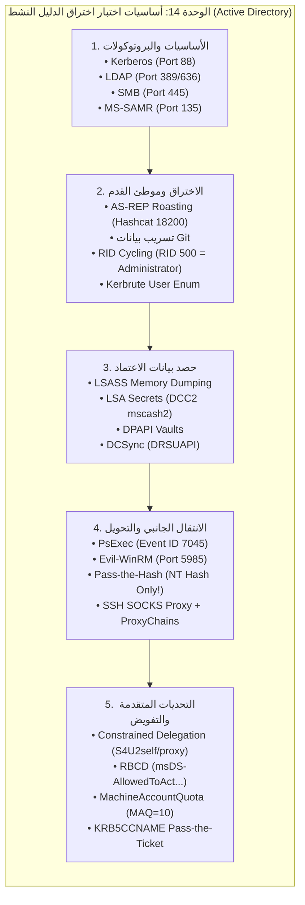

# الدليل التقييمي الشامل: مراجعة ختام وحدة أساسيات أمان الدليل النشط (Topic Transition Recap)
**المسار التعليمي:** Jr Penetration Tester | **الوحدة 14:** أساسيات اختبار اختراق الدليل النشط (Active Directory)

---

## 1. نظرة عامة على المراجعة التقييمية (Recap Overview)

تمثل غرفة **Topic Transition Recap** (المعرف المصدري المعتمد: `6afe01d5f306fc3f65928080`) المحطة الختامية التقييمية للوحدة 14 من مسار Jr Penetration Tester. تقيس هذه المراجعة الاستيعاب المفاهيمي والميداني الشامل لكافة مراحل اختبار اختراق الدليل النشط (Active Directory) التي تمت تغطيتها عبر 9 غرف تدريبية ومختبرات تحدٍ سابقة:
1. **أساسيات وهيكلية الدليل النشط:** بنية الغابات (Forests)، النطاقات (Domains)، الأشجار (Trees)، ووحدات التنظيم (OUs)، وكائنات الدليل.
2. **آليات المصادقة وإدارة الهوية:** بروتوكول Kerberos v5 (تذاكر TGT و TGS وحزم AS-REQ/REP)، ومصادقة NTLM وتحديات Net-NTLMv2.
3. **اختراق النطاق والاستكشاف الأولي (Breaching & Enumeration):** استغلال ثغرات Pre-Auth، وهجمات AS-REP Roasting، واستكشاف المستخدمين عبر Kerbrute وركوب معرّفات RID Cycling، واستخراج كلمات المرور من مستودعات Git.
4. **حصد بيانات الاعتماد وتخزينها:** سحب الذاكرة من LSASS، واستخراج تجزئات SAM و LSA Secrets (تجزئات DCC2/MS-Cache v2)، وخزائن DPAPI، وهجوم استنساخ النطاق DCSync.
5. **الانتقال الجانبي والتحويل الشبكي (Lateral Movement & Pivoting):** تنفيذ الأوامر عن بُعد عبر PsExec و Evil-WinRM، وتمرير التجزئة Pass-the-Hash، وبناء أنفاق SOCKS عبر SSH و ProxyChains.
6. **إساءة استخدام تفويض كيربيروس المتقدم:** استغلال التفويض المقيد (Constrained Delegation) عبر امتدادات S4U2self و S4U2proxy، والتفويض المعتمد على المورد (RBCD) عبر استغلال حصة الأجهزة MachineAccountQuota.

حصلت هذه المراجعة على **48 نقطة من أصل 48 نقطة** بنسبة نجاح **100% من المحاولة الأولى**.

---

## 2. أهداف التعلم والمحاور المختبرة (Learning Objectives)

تركز الأسئلة التقييمية على ستة محاور جوهرية لا غنى عنها لأي مختبر اختراق محترف:
- **المحور 1: التمييز القاطع بين تجزئات NT وتجزئات Net-NTLMv2:** إدراك استحالة تمرير حزم Net-NTLMv2 الملتقطة من الشبكة في هجمات Pass-the-Hash، وحتمية تكسيرها أو ترحيلها (Relaying).
- **المحور 2: حتمية تطهير تاريخ المستودعات البرمجية (Git Secret Hygiene):** استيعاب أن حذف كلمة مرور في Commit جديد لا يحذفها من سجل Git التاريخي غير القابل للتعديل.
- **المحور 3: الدور الوظيفي لبروتوكول LDAP:** تحديد دور LDAP كبروتوكول هرمي مخصص للاستعلام وجرد كائنات النطاق وخصائصها ومجموعاتها.
- **المحور 4: أنماط أداة Hashcat لتكسير تذاكر كيربيروس:** التمييز بين النمط `18200` المخصص لـ AS-REP Roasting والنمط `13100` المخصص لـ Kerberoasting.
- **المحور 5: المعرفات النسبية الفريدة (Well-Known RIDs):** معرفة أن المعرف النسبي `RID 500` مخصص عالمياً لحساب المدير المدمج (`Administrator`).
- **المحور 6: إدارة كاش كيربيروس في بيئات لينكس:** معرفة متغير البيئة `KRB5CCNAME` الذي تعتمد عليه كافة أدوات لينكس لتحديد ملف تذاكر كيربيروس المفعلة لتنفيذ Pass-the-Ticket.

---

## 3. الخريطة المفهومية الشاملة للوحدة 14 (Module Concept Map)

---

## 4. التحليل التقني المعمق للأسئلة والإجابات المعتمدة

### السؤال 1: هجوم Pass-the-Hash وحزم Net-NTLMv2
- **نص السؤال:** *"Pass-the-Hash attacks work with Net-NTLMv2 hashes captured from network traffic."*
- **الإجابة الصحيحة:** **`False`** (خطأ).
- **التحليل التقني:**
  - هجوم Pass-the-Hash (PtH) يعمل **حصراً** مع تجزئة NT المخزنة في الذاكرة (LSASS) أو قاعدة البيانات (SAM/NTDS.dit) لأن بروتوكول مصافحة NTLM يعتمد على تجزئة NT كمفتاح تشفير ثابت للمصافحة.
  - حزم Net-NTLMv2 الملتقطة عبر الشبكة (بواسطة أدوات مثل Responder) هي نتيجة مصافحة ديناميكية مقيدة برقم عشوائي من الخادم (Server Challenge)، ولا يمكن إعادة إرسالها إلى خادم آخر، بل يجب تكسيرها دون اتصال عبر Hashcat نمط `5600` أو ترحيلها في نفس اللحظة عبر هجوم NTLM Relay.

### السؤال 2: تسريب بيانات الاعتماد في مستودعات Git
- **نص السؤال:** *"Deleting a password from a config file in the newest commit fully removes it from the repository."*
- **الإجابة الصحيحة:** **`False`** (خطأ).
- **التحليل التقني:**
  - مستودعات Git تعمل وفق نموذج بيانات غير قابل للتغيير (Immutable Directed Acyclic Graph)؛ أي ملف تم إيداعه في Commit سابق يظل محفوظاً في قاعدة بيانات الكائنات (`.git/objects/`).
  - حذف الملف في Commit لاحق يغير الحالة الحالية فقط، لكن يمكن لأي شخص استرجاع كلمة المرور بمراجعة السجل التاريخي عبر `git log -p`. يتطلب الحل الحقيقي تدوير كلمة المرور فوراً وإعادة كتابة تاريخ المستودع عبر `git-filter-repo`.

### السؤال 3: الدور الوظيفي لبروتوكول LDAP
- **نص السؤال:** *"Which service does LDAP provide in an Active Directory environment?"*
- **الإجابة الصحيحة:** **`Querying directory objects such as users and groups`** (استعلام كائنات الدليل مثل المستخدمين والمجموعات).
- **التحليل التقني:**
  - بروتوكول LDAP (وفقاً للمعيار RFC 4511) هو بروتوكول الاستعلام الدليلي القياسي عبر المنفذين 389 و 636.
  - يوفر LDAP آلية مركزية تتيح للأنظمة والمستخدمين والبرمجيات البحث عن المستخدمين، وفحص المجموعات، وقراءة سمات الكائنات، والاستعلام عن بنية النطاق. أما نقل الملفات فهو وظيفة SMB، وتنفيذ الأوامر وظيفة WinRM و RPC.

### السؤال 4: نمط Hashcat لتكسير تذاكر AS-REP Roasting
- **نص السؤال:** *"Which Hashcat mode is used specifically for cracking AS-REP hashes?"*
- **الإجابة الصحيحة:** **`18200`**.
- **التحليل التقني:**
  - النمط **`18200`** مخصص لتكسير تذاكر كيربيروس المستخرجة من حسابات ألغيت عنها المصادقة المسبقة (`UF_DONT_REQUIRE_PREAUTH`).
  - يقابله النمط **`13100`** المخصص لتكسير تذاكر الخدمة TGS-REP في هجوم Kerberoasting.
  - النمط **`1000`** مخصص لتجزئات NTLM العادية، والنمط **`7500`** مخصص لـ AS-REQ Pre-Auth.

### السؤال 5: المعرف النسبي الشهير RID 500
- **نص السؤال:** *"In a Windows domain, which account is identified by the well-known RID 500?"*
- **الإجابة الصحيحة:** **`Administrator`**.
- **التحليل التقني:**
  - في بنية معرّفات ويندوز الأمنية (SIDs)، يُخصص المعرف النسبي `RID 500` دائماً لحساب المدير المدمج (`Administrator`) على مستوى النطاق أو النظام المحلي، حتى لو تم تغيير اسمه الظاهري.
  - حساب الضيف `Guest` يحمل `RID 501`، وحساب خدمة كيربيروس `krbtgt` يحمل `RID 502`، ومجموعة مديري النطاق `Domain Admins` تحمل `RID 512`.
  - تبدأ حسابات المستخدمين المضافة من `RID 1000` فما فوق.

### السؤال 6: متغير البيئة لكاش تذاكر كيربيروس في لينكس
- **نص السؤال:** *"Which environment variable tells Kerberos-aware Linux tooling which credential cache file to use?"*
- **الإجابة الصحيحة:** **`KRB5CCNAME`**.
- **التحليل التقني:**
  - تعتمد مكتبات كيربيروس في لينكس (مثل MIT Kerberos) وأدوات اختبار الاختراق (مثل حزمة Impacket و Evil-WinRM) على متغير البيئة `KRB5CCNAME` لتحديد المسار المؤدي إلى ملف تذاكر كيربيروس المعتمدة (بصيغة `.ccache`).
  - بتعيين هذا المتغير عبر الأمر: `export KRB5CCNAME=/path/to/ticket.ccache`، يمكن تشغيل أدوات مثل `psexec.py -k -no-pass` وتنفيذ هجوم Pass-the-Ticket دون الحاجة لإدخال أي كلمة مرور.

---

## 5. مصفوفة الإجابات التقييمية الرسمية (Verified Questions Matrix)

| # | نص السؤال التقييمي | نوع السؤال | الإجابة النموذجية المعتمدة | النقاط المحرزة | الحالة |
|:---:|---|:---:|---|:---:|:---:|
| **1** | Pass-the-Hash attacks work with Net-NTLMv2 hashes captured from network traffic. | Boolean | **False** | 8 / 8 | محققة ومؤكدة |
| **2** | Deleting a password from a config file in the newest commit fully removes it from the repository. | Boolean | **False** | 8 / 8 | محققة ومؤكدة |
| **3** | Which service does LDAP provide in an Active Directory environment? | Single-Choice | **Querying directory objects such as users and groups** | 8 / 8 | محققة ومؤكدة |
| **4** | Which Hashcat mode is used specifically for cracking AS-REP hashes? | Single-Choice | **18200** | 8 / 8 | محققة ومؤكدة |
| **5** | In a Windows domain, which account is identified by the well-known RID 500? | Single-Choice | **Administrator** | 8 / 8 | محققة ومؤكدة |
| **6** | Which environment variable tells Kerberos-aware Linux tooling which credential cache file to use? | Single-Choice | **KRB5CCNAME** | 8 / 8 | محققة ومؤكدة |

**المجموع الكلي للدرجات:** **48 / 48 نقطة (100%)**.

---

## 6. استراتيجيات الدفاع والتحصين الشامل لبيئات الدليل النشط

| مجال الحماية | الإجراء الوقائي الموصى به | مرجع الحدث الرقابي (Detection Event) |
|---|---|---|
| **حظر هجمات كيربيروس** | إلغاء علم `UF_DONT_REQUIRE_PREAUTH`، واستخدام كلمات مرور $\ge 25$ حرفاً لحسابات SPN. | Event ID 4768 (Pre-Auth Type = 0) و Event ID 4769. |
| **تعطيل NTLM وحماية الذاكرة** | فرض استخدام كيربيروس، وتفعيل ميزتي `RunAsPPL` و `Credential Guard` لحماية ذاكرة LSASS. | Event ID 4624 (Logon Type 3 NTLM) وسجلات Sysmon 10. |
| **إدارة الحسابات المحلية** | تطبيق نظام **Windows LAPS** بالكامل لمنع استغلال تجزئات المدير المحلي عبر الأجهزة. | تدقيق محاولات المصادقة بالحسابات المحلية عبر الشبكة. |
| **تطهير المستودعات البرمجية** | استخدام أدوات الفحص التلقائي (مثل Gitleaks و TruffleHog) في خطوط CI/CD لمنع إيداع الأسرار. | رصد محاولات إيداع المفاتيح وكلمات المرور في أنظمة التحكم. |
| **تصفير حصة الأجهزة (MAQ)** | ضبط السمة `ms-DS-MachineAccountQuota` على القيمة **`0`** لإبطال هجمات RBCD. | Event ID 4741 (إنشاء حساب كمبيوتر جديد). |
| **تطبيق نموذج الطبقات** | الالتزام الصارم بـ Microsoft Enterprise Access Model واستخدام محطات PAWs لمديري النطاق. | رصد تسجيل دخول حسابات Tier 0 على أجهزة Tier 1 أو Tier 2. |

---

## 7. القواعد الذهبية لمختبر اختراق الدليل النشط (Golden Rules)

> **القاعدة الذهبية الأولى:** تجزئة NT تمرر (Pass-the-Hash)، أما Net-NTLMv2 تكسر أو ترحل (Crack or Relay)؛ لا تخلط أبداً بين طبيعة التجزئتين في العمل الميداني.
>
> **القاعدة الذهبية الثانية:** الذاكرة المؤقتة هي أثمن كنز للمهاجم؛ وجود جلسة مدير نطاق على محطة عمل عادية يعني أن النطاق بالكامل سقط بمجرد الوصول لصلاحيات SYSTEM على تلك المحطة.
>
> **القاعدة الذهبية الثالثة:** إدارة التكوين أهم من ترقيع الثغرات؛ 90% من اختراقات الدليل النشط تتم عبر إساءة استخدام خصائص نظامية مقصودة (مثل Delegation و MAQ و Unconstrained Services و LAPS Absence) وليست بسبب ثغرات برمجية (Zero-Days).
