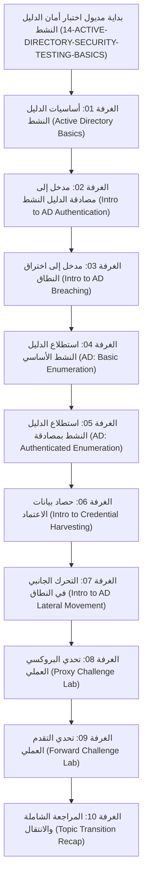

# توثيق المديول الرابع عشر: أساسيات اختبار أمان الدليل النشط (Module 14: Active Directory Security Testing Basics)

---

## 1. نظرة عامة ورؤية المديول التعليمية (Overview & Objectives)

يُمثل **المديول الرابع عشر (Active Directory Security Testing Basics)** النقلة النوعية الكبرى من اختبار أمان الأجهزة الفردية المعزولة إلى اختبار أمان **البنية التحتية للمؤسسات الكبرى (Enterprise Infrastructure)**. في أكثر من 90% من كبرى الشركات العالمية، يُعد **الدليل النشط (Active Directory)** هو العقل المدبر والمستودع المركزي لإدارة الهويات، والمصادقة، والتفويض، والوصول إلى كافة الموارد والأنظمة.

خلال هذا المديول، يتعلم مختبر الاختراق كيف يتحول من مجرد مستخدم يمتلك وصولاً محدوداً إلى شبكة محلية إلى مهاجم يمتلك السيطرة الكاملة على نطاق المؤسسة (Domain Controller / Enterprise Admin).

### المحاور الأساسية التي يغطيها المديول:
1. **معمارية الدليل النشط:** الكيانات الأساسية (Objects, OUs, Domains, Trees, Forests, Global Catalogs, Trust Relationships).
2. **بروتوكولات المصادقة الشبكية:** الفحص الدقيق لحزم ومراحل بروتوكولي **Kerberos** (تذاكر TGT و TGS وحقول PAC) و **NTLM** (مصافحة ثلاثية المراحل ومخاطر تجزئات NetNTLMv2).
3. **اختراق النطاق والوصول الأولي (AD Breaching):** تقنيات حصر أسماء المستخدمين عبر Kerberos (أداة Kerbrute)، ورش كلمات المرور (Password Spraying) مع تفادي سياسات الإغلاق (Account Lockout)، وهجمات الإجبار (Coercion Attacks).
4. **استطلاع النطاق (AD Enumeration):** استطلاع النطاق بدون مصادقة (عبر LDAP و SMB Null Sessions و RPC) ثم الاستطلاع المعمق بمصادقة باستخدام **PowerView** و **BloodHound** لرسم سلاسل الهجوم واكتشاف العلاقات الخفية.
5. **حصاد بيانات الاعتماد (Credential Harvesting):** سحب كلمات المرور والتجزئات من ذاكرة الـ LSASS، وقواعد SAM، وأسرار LSA، وقاعدة النطاق المركزية `NTDS.dit`.
6. **التحرك الجانبي (Lateral Movement):** تقنيات التنقل بين خوادم ومحطات النطاق عبر WinRM و PsExec و WMI، وتطبيق هجمات تمرير التجزئة (Pass-the-Hash) وتمرير التذكرة (Pass-the-Ticket).
7. **التحديات العملية المتقدمة (Live Challenges):** خوض مختبرين واقعيين للمحاكاة الكاملة: مختبر `Proxy` ومختبر `Forward` للارتقاء من حساب خدمة إلى مسؤول النطاق.
8. **المراجعة والتقييم الختامي (Topic Transition Recap):** تثبيت المعارف الدفاعية والهجومية وسجلات التدقيق (Event IDs) وتصليد النطاق.

---

## 2. خريطة غرف المديول العشر (Module 14 Curriculum Map)

---

## 3. المعايير المنهجية والجودة
يلتزم هذا المديول بكافة معايير المشروع:
* تطبيق **إطار الـ 14 قسماً المعياري** على جميع غرف المديول.
* تطبيق **منهجية المراحل السبع (Stages A through G)** على كل ملف مهمة بالتفصيل.
* التطابق والتحقق المباشر بنسبة 100% مع حساب المستخدم الفعلي في TryHackMe.
