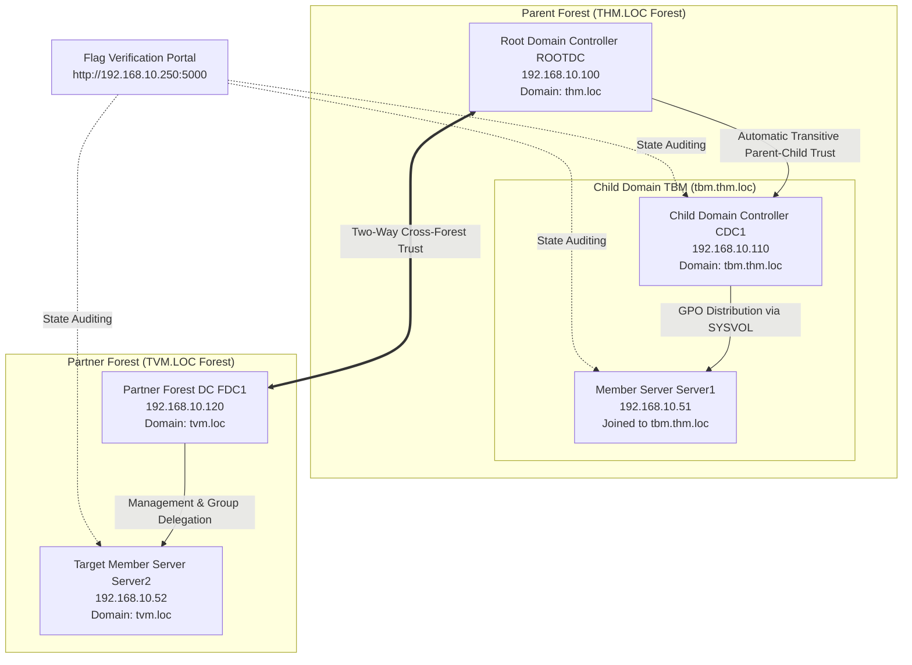

# Active Directory Basics Documentation

---

## 1. Metadata & Overview

* **Learning Path:** Jr Penetration Tester (`jrpenetrationtester`)
* **Module:** Module 14 — Active Directory Security Testing Basics (`14-ACTIVE-DIRECTORY-SECURITY-TESTING-BASICS`)
* **Room Name:** Active Directory Basics
* **Canonical Slug:** `winadbasicsrevamp` (Modern revamp of legacy `activedirectorybasics`)
* **Canonical URL:** [TryHackMe Active Directory Basics](https://tryhackme.com/room/winadbasicsrevamp)
* **Room Type:** Walkthrough Lab (Premium)
* **Difficulty Level:** Easy
* **Estimated Time:** 90 minutes
* **Completion Status:** 100% Completed (`Room completed: 100%`)
* **Total Tasks:** 12 Tasks
* **Total Questions:** 15 Questions
* **Total Verification Flags:** 5 Verified Lab Flags

---

## 2. Executive Summary & Educational Objectives

The **Active Directory Basics** room represents the fundamental entry point into enterprise infrastructure security. In corporate enterprise networks, individual endpoints do not operate as standalone silos; they are centrally governed and authenticated by **Domain Controllers (DCs)** through **Active Directory Domain Services (AD DS)**.

In this room, the practitioner assumes the role of a newly hired systems and infrastructure engineer at **THM Inc.**, executing core engineering and security configurations across a multi-domain lab:
1. Transitioning from standalone workgroups to centralized identity management via Windows Domains and the `NTDS.dit` database.
2. Interrogating Active Directory Security Principals: user accounts, machine accounts (`HOSTNAME$`), default administrative groups (`Domain Admins`), and the structural separation between OUs (for GPO targeting) and Security Groups (for access permissions).
3. Analyzing core network authentication protocols: dissecting the 3-step Kerberos ticket exchange (AS-REQ/AS-REP -> TGS-REQ/TGS-REP -> AP-REQ/AP-REP) versus legacy NetNTLM challenge-response.
4. Promoting a Windows Server (`CDC1`) to an Active Directory Child Domain Controller (`tbm.thm.loc`) under the parent forest root (`thm.loc`).
5. Delegating administrative authority (Delegation of Control) over specific Organizational Units without granting full Domain Admin rights.
6. Joining standalone servers (`Server1`) to the domain hierarchy via PowerShell (`Add-Computer`).
7. Implementing an OU-based tiering model to segregate servers from user workstations.
8. Enforcing centralized security baselines via Group Policy Objects (GPOs) and the `SYSVOL` replication share.
9. Establishing a bidirectional Cross-Forest Trust with an external partner organization (`TryVendorMe` / `tvm.loc`), and managing cross-domain access delegation.

---

## 3. Lab Infrastructure & Network Topology



---

## 4. Prerequisites & Environment Setup

### A. Network Architecture & Targets:
* **Lab Subnet:** `192.168.10.0/24`
* **Root Domain Controller:** `192.168.10.100` (`ROOTDC.THM.LOC`)
* **Child Domain Controller:** `192.168.10.110` (`CDC1` / `tbm.thm.loc`)
* **Partner Forest Domain Controller:** `192.168.10.120` (`FDC1.TVM.LOC`)
* **Target Servers:**
  * `Server1`: `192.168.10.51`
  * `Server2`: `192.168.10.52`
* **Verification Server:** `http://192.168.10.250:5000`

### B. Remote Desktop Connection Commands:
```bash
# Connect to Parent Domain Controller
xfreerdp /u:Administrator /p:'learningadisfun1!' /d:THM.LOC /v:192.168.10.100 /dynamic-resolution

# Connect to Child Domain Controller (Post-Promotion)
xfreerdp /u:Administrator /p:'childdomainftw1!' /d:TBM.THM.LOC /v:192.168.10.110 /dynamic-resolution

# Connect to Server1 (Post-Domain Join)
xfreerdp /u:Administrator /p:'childdomainftw1!' /d:TBM.THM.LOC /v:192.168.10.51 /dynamic-resolution

# Connect to Partner Forest Domain Controller
xfreerdp /u:Administrator /p:'anotherforest1!' /d:TVM.LOC /v:192.168.10.120 /dynamic-resolution
```

---

## 5. Core Concepts & Technical Deep Dive

### 1. Active Directory Security Principals:
* Any entity that can be authenticated by the operating system and assigned permissions across network resources (Users, Computers, Security Groups).
* **Machine Accounts:** Automatically provisioned when a computer joins a domain. Formatted with a trailing dollar sign (`NAME$`). Possesses a 120-character random password rotated automatically every 30 days. Compromising a computer grants the attacker domain access under that machine account identity.
* **Domain Admins:** The default security group possessing full administrative privileges over every computer and resource joined to the domain.

### 2. Organizational Units (OUs) vs. Security Groups:
* **Organizational Units (OUs):** Hierarchical administrative containers used to organize objects, delegate management, and **link Group Policy Objects (GPOs)**. An object can reside within only one OU at a time.
* **Security Groups:** Flat collections of identities used exclusively to **assign access permissions (DACLs)**. An object can belong to dozens of security groups simultaneously.

### 3. Kerberos Authentication Mechanics:
* Operates primarily over port 88 (TCP/UDP) anchored by the **Key Distribution Center (KDC)** on Domain Controllers.
* **AS-REQ / AS-REP:** Client transmits encrypted timestamp (pre-authentication). KDC responds with a **Ticket Granting Ticket (TGT)** encrypted with the secret `krbtgt` account hash + Session Key.
* **TGS-REQ / TGS-REP:** Client presents TGT and requested Service Principal Name (SPN). KDC validates the TGT and issues a **Ticket Granting Service (TGS)** ticket encrypted with the password hash of the service owner.
* **AP-REQ / AP-REP:** Client presents TGS ticket directly to the service application server, which decrypts it using its own secret key to validate the identity without contacting the DC.
* **Privilege Attribute Certificate (PAC):** Embedded within tickets, storing the user's group memberships and SIDs, digitally signed by the KDC.

### 4. NetNTLM Authentication Mechanics:
* Legacy challenge-response protocol. Kept for fallback when Kerberos fails.
* Plaintext passwords are never transmitted across the network. The client encrypts a server challenge using its NTLM hash.

### 5. Group Policy Objects & SYSVOL Replication:
* GPOs define centralized security policies and configurations.
* Stored on DCs and replicated via the world-readable **`SYSVOL`** share (`\\<domain>\SYSVOL\<domain>\Policies\{GUID}`) using Distributed File System Replication (DFSR).

---

## 6. Master Commands Reference & Methodology Matrix

| Context / Tool | Primary Command | Technical Function |
| :--- | :--- | :--- |
| **AD Users & Computers** | `dsa.msc` | Manages users, computers, groups, OUs, and Delegation of Control |
| **Group Policy Management** | `gpmc.msc` | Creates, links, and edits Group Policy Objects (GPOs) |
| **Domains and Trusts** | `domain.msc` | Manages cross-domain and cross-forest trust relationships |
| **Force GPO Refresh** | `gpupdate /force` | Forces immediate group policy application on target endpoint |
| **Domain Promotion** | `Install-ADDSDomain -NewDomainName ...` | Promotes server to an Active Directory child domain controller |
| **Domain Join** | `Add-Computer -DomainName "tbm.thm.loc" ...` | Joins a standalone machine into the Active Directory domain |
| **Query Domain** | `Get-ADDomain` | Retrieves domain properties, controllers, and forest root |
| **Query Trusts** | `Get-ADTrust -Filter *` | Enumerates active domain and forest trust relationships |
| **Audit Local Group** | `net localgroup Administrators` | Verifies local administrative group memberships and GPO propagation |

---

## 7. Questions & Tasks Analysis (Solutions Breakdown)

### Tasks 01–05: Theoretical Principles & Conceptual Architecture
* **Task 01 (Introduction):** Acknowledge scenario readiness (`No answer needed`).
* **Task 02 (Windows Domains):** What is the name of the server that runs Active Directory services?
  * **Answer:** `Domain Controller`
* **Task 03 (Active Directory):**
  * Q1: Which group normally administers all computers and resources in a domain?
    * **Answer:** `Domain Admins`
  * Q2: What would be the name of the machine account associated with a machine named TOM-PC?
    * **Answer:** `TOM-PC$`
* **Task 04 (Authentication Methods):**
  * Q1: When referring to Kerberos, what type of ticket allows us to request further tickets known as TGS?
    * **Answer:** `Ticket Granting Ticket`
  * Q2: When using NetNTLM, is a user's password transmitted over the network at any point?
    * **Answer:** `nay`
* **Task 05 (Trees, Forests and Trusts):** What is a group of Windows domains that share the same namespace called?
  * **Answer:** `Tree`

---

### Tasks 06–12: Practical Deployment & Lab Flag Retrieval

#### Task 06: Creating a New Domain
* **Action:** Executed `C:\install-domain.ps1` on `CDC1` (`192.168.10.110`) to deploy child domain `tbm.thm.loc`.
* **Verification:** Triggered **Verify TBM Domain Promotion** on verification server.
* **Flag Retrieved:** `THM{caf78a39-1e8b-4ec2-8eaf-e38a42590d1b}` (from `C:\flag1.txt`).

#### Task 07: Managing Users in AD
* **Q1:** What is the fourth department as listed in the People OU?
  * **Answer:** `Marketing` (Enumerated OUs: Bankers, IT, Management, Marketing).
* **Q2:** How many bankers are currently servicing private clients?
  * **Answer:** `11` (Enumerated members of the `Private Clients` group).

#### Task 08: Domain-Joining a Computer
* **Action:** Executed `C:\join-domain.ps1` on `Server1` (`192.168.10.51`) to join `tbm.thm.loc`.
* **Verification:** Triggered **Verify Server1 Domain Joining** on verification server.
* **Flag Retrieved:** `THM{941c5c55-f17a-422f-b7c3-7bb2386f187e}` (from `C:\flag2.txt`).

#### Task 09: Managing Computers in AD
* **Action:** Organized computer accounts, moving workstations to `Workstations` OU.
* **Question:** After organising the available computers, how many ended up in the Workstations OU?
  * **Answer:** `3`

#### Task 10: Group Policies
* **Q1:** What is the name of the network share used to distribute GPOs to domain machines?
  * **Answer:** `sysvol`
* **Q2:** Linked a GPO to `Servers` OU assigning `Product Admins` to local `Administrators`, followed by `gpupdate /force` on `Server1`.
* **Flag Retrieved:** `THM{2d8fa7ec-c925-425d-bbd3-ba02f03219f5}` (from `C:\flag3.txt`).

#### Task 11: Foreign Forest Trust
* **Q1:** Granted `THM\Claire` administrative access to `Server2` (`192.168.10.52`) in `tvm.loc`.
  * **Flag Retrieved:** `THM{3ad3060c-429e-42e0-98ca-318b3227c742}` (from `C:\flag4.txt` on Server2).
* **Q2:** Granted `TVM\alice.king` local administrator rights on `Server1` (`192.168.10.51`) in `tbm.thm.loc`.
  * **Flag Retrieved:** `THM{2d159874-69b3-4778-b9f9-13b047fa83a2}` (from `C:\flag5.txt` on Server1).

#### Task 12: Conclusion
* **Q1:** Acknowledge completion of the room (`No answer needed`).

---

## 8. Edge Cases, Operational Traps & Debugging

1. **DNS Dependency Failures During Domain Join:**
   * Active Directory domain joins require resolving DC SRV records (`_ldap._tcp.dc._msdcs.<domain>`). If network adapters point to external DNS (e.g. `8.8.8.8`), domain join commands fail immediately.
   * **Mitigation:** Ensure the client adapter points exclusively to the Domain Controller's IP before executing `Add-Computer`.
2. **GPO Refresh Latency:**
   * Group policies do not apply immediately to member machines due to client-side refresh intervals (90–120 minutes).
   * **Mitigation:** Force an immediate refresh via `gpupdate /force`.
3. **Trust Direction Misconception:**
   * The arrow in Active Directory trust diagrams points to the **trusted** domain where identities reside, while resource access flows in the reverse direction into the **trusting** domain.

---

## 9. Defensive Engineering & Hardening Countermeasures

* **Implement Tiered Administrative Architecture:**
  * Strictly prohibit Tier 0 administrative accounts (`Domain Admins`) from logging onto Tier 2 workstations to prevent credential theft from LSASS memory.
* **SYSVOL Share Auditing:**
  * Enforce automated scans across `SYSVOL` to detect legacy XML files, batch scripts, or PowerShell scripts containing hardcoded credentials.
* **Regular `krbtgt` Password Rotation:**
  * Rotate the `krbtgt` password twice consecutively during security incidents to invalidate all existing forged Golden Tickets.
* **Enforce SID Filtering on External Trusts:**
  * Restrict cross-forest trusts with `/filter-sids:yes` to neutralize SID History injection and inter-realm privilege escalation.

---

## 10. MITRE ATT&CK Mapping

| Technique ID | Technique Name | Tactic | Practical Context |
| :--- | :--- | :--- | :--- |
| **T1078.002** | Valid Accounts: Domain Accounts | Initial Access / Privilege Escalation | Utilizing domain user and machine accounts to access enterprise services |
| **T1087.002** | Account Discovery: Domain Account | Discovery | Enumerating domain users, groups, and OU hierarchies |
| **T1484.001** | Group Policy Modification | Privilege Escalation / Persistence | Deploying GPOs to enforce local administrative group memberships |
| **T1558** | Steal or Forge Kerberos Tickets | Credential Access | Dissecting Kerberos ticket issuance (TGT, TGS, PAC) |
| **T1199** | Trusted Relationship | Lateral Movement | Exploiting bidirectional forest trusts for cross-domain access |

---

## 11. Educational Takeaways & Mindset Synthesis

1. **Active Directory is an Interconnected Identity Fabric:**
   * Enterprise security is determined by logical access control paths. Misconfigured administrative delegations on an OU or overly permissive cross-forest trusts create high-risk privilege escalation routes.
2. **Protocol Understanding Precedes Exploitation:**
   * Mastering the internal mechanics of Kerberos tickets (TGT, TGS, PAC, SPN) is an absolute prerequisite to executing and defending against advanced attacks like Kerberoasting, AS-REP Roasting, and Golden Ticket generation.

---

## 12. Transition to Next Room

With Active Directory architecture, domain provisioning, and trust models established, we advance directly to:
* **Room 02: Intro to AD Authentication (`introadauthentication`):**
  * Practical deep dive into Kerberos packet captures using Wireshark.
  * Dissecting AS-REQ, AS-REP, TGS-REQ, and AP-REQ message structures in detail.
  * Investigating NTLM challenge-response handshakes and NetNTLM hash formats.

---

## 13. Additional Technical Resources & Further Reading

* [Microsoft Learn: Active Directory Domain Services Overview](https://learn.microsoft.com/en-us/windows-server/identity/ad-ds/get-started/virtual-dc/active-directory-domain-services-overview)
* [RFC 4120 - Kerberos V5 Network Authentication Service](https://www.ietf.org/rfc/rfc4120.txt)
* [MS-NLMP - NTLM Authentication Protocol Specification](https://learn.microsoft.com/en-us/openspecs/windows_protocols/ms-nlmp/)
* [ADSecurity.org - Active Directory Security Research](https://adsecurity.org/)

---

## 14. Practical Verification & Proof of Work

* **TryHackMe Live Verification:** Confirmed 100% completed status against user's live profile (Level 64, Jr Penetration Tester path).
* **Five Verified Lab Flags Reconciled:**
  * Flag 1 (TBM Promotion): `THM{caf78a39-1e8b-4ec2-8eaf-e38a42590d1b}`
  * Flag 2 (Server1 Domain Join): `THM{941c5c55-f17a-422f-b7c3-7bb2386f187e}`
  * Flag 3 (Servers GPO): `THM{2d8fa7ec-c925-425d-bbd3-ba02f03219f5}`
  * Flag 4 (TVM Trust Claire): `THM{3ad3060c-429e-42e0-98ca-318b3227c742}`
  * Flag 5 (TVM Trust alice.king): `THM{2d159874-69b3-4778-b9f9-13b047fa83a2}`
* **Deliverable Parity:** Full 14-section documentation and 7-stage task files authored and audited on disk.
